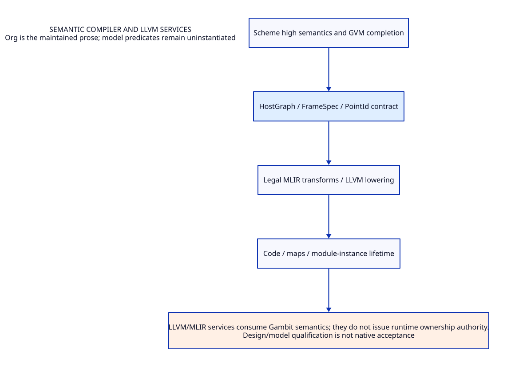

#+TITLE: Semantic compiler and LLVM services
#+SETUPFILE: ../../modeling/org/setup.org
#+CATEGORY: compiler

* RESEARCH Semantic compiler and LLVM services :compiler:
:PROPERTIES:
:ID: cba304e0-c3d2-53d4-b9fe-73f1c585b750
:CUSTOM_ID: compiler-contract
:OWNER: Gambit architecture research
:STATUS: design-only
:EVIDENCE_CLASS: source-and-model-design
:END:

GVM/high semantic export, closure/effect legality, MLIR/LLVM lowering and code/metadata lifetime.

LLVM/MLIR services consume Gambit semantics; they do not issue runtime ownership authority.

** Contract and ownership
:PROPERTIES:
:CUSTOM_ID: ownership
:END:
One Scheme semantic contract; one selected implementation owner for each mechanism. C-facing capability remains mandatory. Imported alternatives are comparisons, not simultaneous deployment decisions.

** Models and views
:PROPERTIES:
:CUSTOM_ID: models
:END:
- [[file:models/sysml/architecture.sysml][SysML architecture and necessary requirements]]
- [[file:diagrams/overview.d2][Maintained D2 view source]]
- 

#+NAME: compiler-sysml-source
#+INCLUDE: "models/sysml/architecture.sysml" src sysml

#+NAME: compiler-d2-source
#+INCLUDE: "diagrams/overview.d2" src d2

** OPEN Evidence and admission gaps
:PROPERTIES:
:ID: 9b5f1b37-c277-5e42-8c3a-6cf546ae14a3
:CUSTOM_ID: gaps
:STATUS: unresolved
:END:
Source reading, model validation, checked proof, native semantic acceptance and measured benefit are distinct. No validation result satisfies the runtime gates automatically.

** Study catalogue
:PROPERTIES:
:CUSTOM_ID: studies
:END:
#+NAME: compiler-studies
| Study | Evidence lineage |
|---+---|
| [[file:studies/evaluation-effects-contract.org][evaluation-effects-contract]] | ~10851b056880~ |
| [[file:studies/gvm-anchor-preservation.org][gvm-anchor-preservation]] | ~88cb7da7a053~ |
| [[file:studies/gvm-native-replacement-matrix.org][gvm-native-replacement-matrix]] | ~408a3b8fd49d~ |
| [[file:studies/gvm-shared-runtime-contract.org][gvm-shared-runtime-contract]] | ~2023db8bd5ba~ |
| [[file:studies/gvm-shared-runtime-evidence.org][gvm-shared-runtime-evidence]] | ~21d7e5fc783b~ |
| [[file:studies/mlir-pass-admission.org][mlir-pass-admission]] | ~9e7ff6aa8351~ |
| [[file:studies/primitive-catalogue.org][primitive-catalogue]] | ~d531a47656bc~ |
| [[file:studies/primitive-ffi-coverage.org][primitive-ffi-coverage]] | ~4eb30117e81f~ |
| [[file:studies/scheme-function-zig-arguments.org][scheme-function-zig-arguments]] | ~91ff2df12813~ |
| [[file:studies/scheme-function-zig-cost-matrix.org][scheme-function-zig-cost-matrix]] | ~f2d4e3904c43~ |
| [[file:studies/scheme-function-zig-design.org][scheme-function-zig-design]] | ~260f7344e6b9~ |
| [[file:studies/scheme-function-zig-evidence.org][scheme-function-zig-evidence]] | ~ef3ccfe4bdb8~ |
| [[file:studies/scheme-to-zig-architecture.org][scheme-to-zig-architecture]] | ~a13196517eea~ |
| [[file:studies/semantic-completion-evidence.org][semantic-completion-evidence]] | ~a32c0f1ae524~ |
| [[file:studies/semantic-completion-operations.org][semantic-completion-operations]] | ~da8dff9e26ab~ |
| [[file:studies/zig-high-level-semantics-design.org][zig-high-level-semantics-design]] | ~061ff4866a7e~ |
| [[file:studies/zig-high-level-semantics-evidence.org][zig-high-level-semantics-evidence]] | ~7d6e7e711374~ |

** Cross-cutting references
- [[file:../../index.org][Development architecture]]
- [[file:../../catalog.org][Complete source-to-Org and diagram migration map]]
- [[file:../../research/validation.org][Validation boundary and retained receipts]]

** Column view for local research obligations
#+BEGIN: columnview :id local :format "%ITEM %STATUS %EVIDENCE_CLASS"
#+END:
