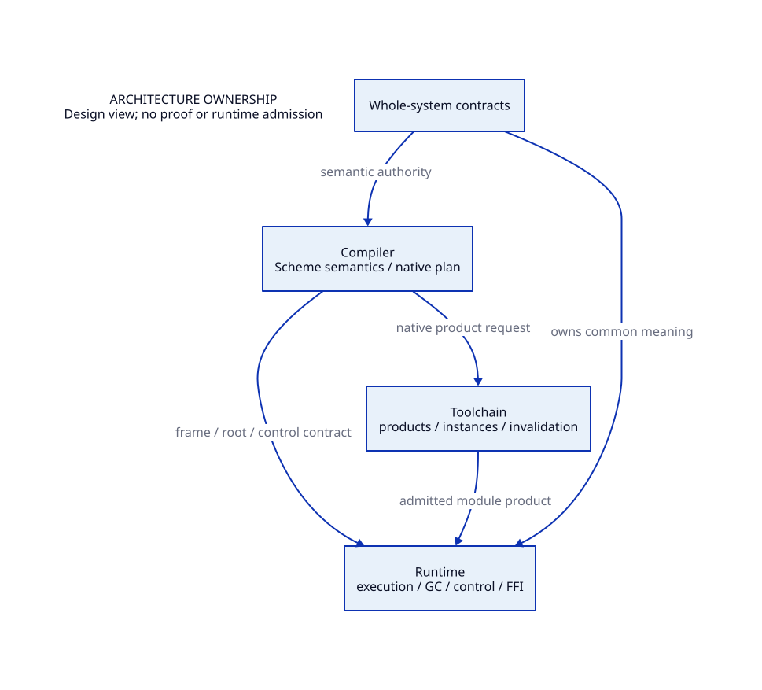

#+TITLE: System Architecture Responsibilities
#+SETUPFILE: ../modeling/org/setup.org
#+CATEGORY: architecture

* RESEARCH Architecture ownership
:PROPERTIES:
:ID: c0b6798a-9b92-5f6d-9e13-d2309182228b
:CUSTOM_ID: architecture-ownership
:OWNER: architecture
:STATUS: design-only
:EVIDENCE_CLASS: design-and-source-correspondence
:END:

The system layer owns semantic interfaces independent of the selected implementation language. It does not absorb tool-specific proofs or upstream language facts.

- [[file:system/index.org][Whole-system foundation and design choices]]
- [[file:runtime/index.org][Runtime composition: execution, GC, control and FFI]]
- [[file:compiler/index.org][Scheme semantic plan, GVM, native and MLIR lowering]]
- [[file:toolchain/index.org][Configuration, native products and invalidation]]
- [[file:models/sysml/organization.sysml][Architecture decomposition model]]
- [[file:diagrams/organization.d2][Architecture view source]]
- 
