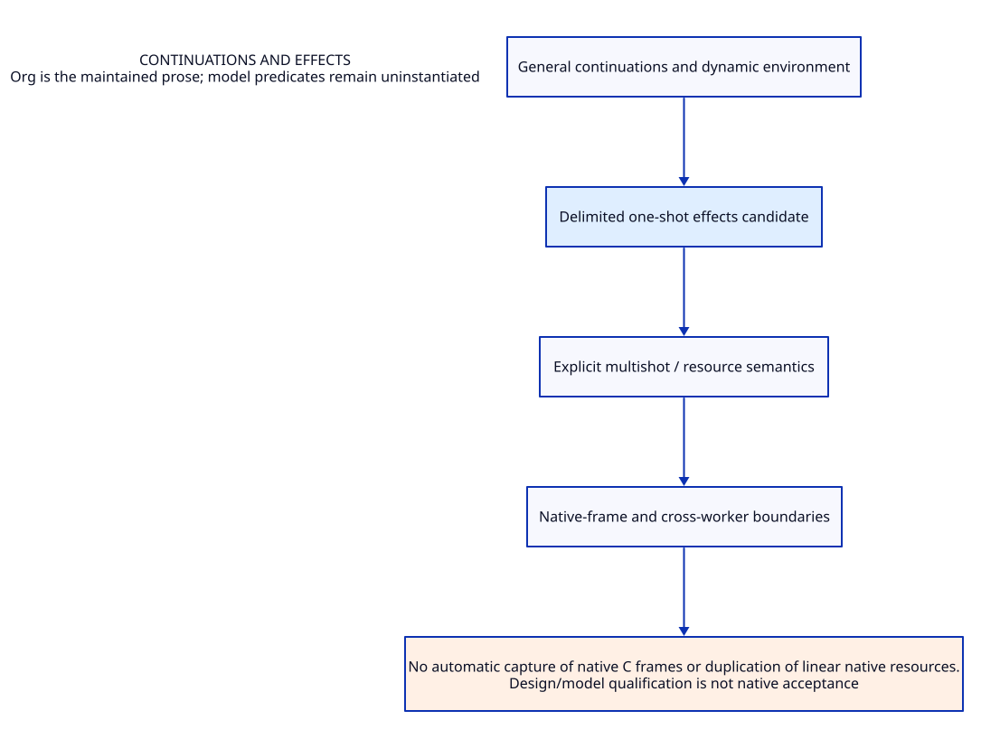

#+TITLE: Continuations and effects
#+SETUPFILE: ../../../modeling/org/setup.org
#+CATEGORY: control

* RESEARCH Continuations and effects :control:
:PROPERTIES:
:ID: 168cda93-0c81-587c-9b23-43a53b2ea72a
:CUSTOM_ID: control-contract
:OWNER: Gambit architecture research
:STATUS: design-only
:EVIDENCE_CLASS: source-and-model-design
:END:

Frames, tail transfer, dynamic environments, general continuations and researched one-shot resumptions.

No automatic capture of native C frames or duplication of linear native resources.

** Contract and ownership
:PROPERTIES:
:CUSTOM_ID: ownership
:END:
One Scheme semantic contract; one selected implementation owner for each mechanism. C-facing capability remains mandatory. Imported alternatives are comparisons, not simultaneous deployment decisions.

** Models and views
:PROPERTIES:
:CUSTOM_ID: models
:END:
- [[file:models/sysml/architecture.sysml][SysML architecture and necessary requirements]]
- [[file:diagrams/overview.d2][Maintained D2 view source]]
- 

#+NAME: control-sysml-source
#+INCLUDE: "models/sysml/architecture.sysml" src sysml

#+NAME: control-d2-source
#+INCLUDE: "diagrams/overview.d2" src d2

** OPEN Evidence and admission gaps
:PROPERTIES:
:ID: 673130de-8c38-5093-9772-fa417ba16485
:CUSTOM_ID: gaps
:STATUS: unresolved
:END:
Source reading, model validation, checked proof, native semantic acceptance and measured benefit are distinct. No validation result satisfies the runtime gates automatically.

** Study catalogue
:PROPERTIES:
:CUSTOM_ID: studies
:END:
#+NAME: control-studies
| Study | Evidence lineage |
|---+---|
| [[file:studies/continuation-minor-scan-proof.org][continuation-minor-scan-proof]] | ~a92ff6b73c75~ |
| [[file:studies/continuation-writer-benefit-matrix.org][continuation-writer-benefit-matrix]] | ~7e35403e24a2~ |
| [[file:studies/continuation-writer-caller-matrix.org][continuation-writer-caller-matrix]] | ~aaac73d3c331~ |
| [[file:studies/continuation-writer-closure-design.org][continuation-writer-closure-design]] | ~0af4599be8f0~ |
| [[file:studies/continuation-writer-evidence.org][continuation-writer-evidence]] | ~c006abdba33b~ |
| [[file:studies/d0-d1-cross-backend-evidence.org][d0-d1-cross-backend-evidence]] | ~6d27c07dcf80~ |
| [[file:studies/d0-d1-cross-backend-protocol.org][d0-d1-cross-backend-protocol]] | ~fc298afb7122~ |
| [[file:studies/d1h-edge-admission.org][d1h-edge-admission]] | ~d4dd58a68388~ |
| [[file:studies/d1h-refactor-evidence.org][d1h-refactor-evidence]] | ~cdd9f3499ae2~ |
| [[file:studies/hostgraph-generation-contract.org][hostgraph-generation-contract]] | ~dff7c6da1084~ |
| [[file:studies/hostgraph-generation-evidence.org][hostgraph-generation-evidence]] | ~30c4d863b169~ |
| [[file:studies/hostgraph-retirement-plan.org][hostgraph-retirement-plan]] | ~6d90232afc1e~ |
| [[file:studies/map-continuation-gc-arguments.org][map-continuation-gc-arguments]] | ~30fa608f4e77~ |
| [[file:studies/map-continuation-gc-benefit-matrix.org][map-continuation-gc-benefit-matrix]] | ~0b215d7c2c00~ |
| [[file:studies/map-continuation-gc-design.org][map-continuation-gc-design]] | ~8d25a47cb28f~ |
| [[file:studies/map-continuation-gc-evidence.org][map-continuation-gc-evidence]] | ~8c23ed008fbe~ |
| [[file:studies/map-continuation-gc-learning.org][map-continuation-gc-learning]] | ~9c540db52ab2~ |
| [[file:studies/map-generated-c-design.org][map-generated-c-design]] | ~d90e529639a4~ |
| [[file:studies/map-generated-c-evidence.org][map-generated-c-evidence]] | ~020043eb05d1~ |
| [[file:studies/map-generated-c-modernization-matrix.org][map-generated-c-modernization-matrix]] | ~55f39c720d91~ |
| [[file:studies/map-generated-c-points.org][map-generated-c-points]] | ~2ede79ca45cc~ |
| [[file:studies/map-generated-c-proof-obligations.org][map-generated-c-proof-obligations]] | ~0e3b95b3cf05~ |
| [[file:studies/map-scheme-zig-arguments.org][map-scheme-zig-arguments]] | ~b2b5795c0677~ |
| [[file:studies/map-scheme-zig-cost-matrix.org][map-scheme-zig-cost-matrix]] | ~8687fc951b98~ |
| [[file:studies/map-scheme-zig-design.org][map-scheme-zig-design]] | ~187032378741~ |
| [[file:studies/map-scheme-zig-evidence.org][map-scheme-zig-evidence]] | ~948306eb70ea~ |
| [[file:studies/return-frame-benefit-matrix.org][return-frame-benefit-matrix]] | ~ea70baf1d49e~ |
| [[file:studies/return-frame-planner-case.org][return-frame-planner-case]] | ~a1aeba7e6f4c~ |
| [[file:studies/return-frame-planner-evidence.org][return-frame-planner-evidence]] | ~8ceb04222085~ |
| [[file:studies/runtime-role-entry-contracts.org][runtime-role-entry-contracts]] | ~7fa9280ebc16~ |

** Cross-cutting references
- [[file:../../../index.org][Development architecture]]
- [[file:../../../catalog.org][Complete source-to-Org and diagram migration map]]
- [[file:../../../research/validation.org][Validation boundary and retained receipts]]

** Column view for local research obligations
#+BEGIN: columnview :id local :format "%ITEM %STATUS %EVIDENCE_CLASS"
#+END:

** Behavioral and proof ownership
- [[file:models/quint/index.org][Quint state/action ownership]]
- [[file:models/lean/index.org][Lean invariant/proof ownership]]
- [[file:../interfaces/index.org][Cross-module semantic interfaces]]

** RESEARCH Component assurance and shared proof dependencies
[[file:component-assurance.org][Owned behavior, formal scopes and source obligations]] /
[[file:../../../modeling/component-assurance.org][composed closure matrix]]. Local checks do not close transitive source,
platform, ownership or progress premises.
