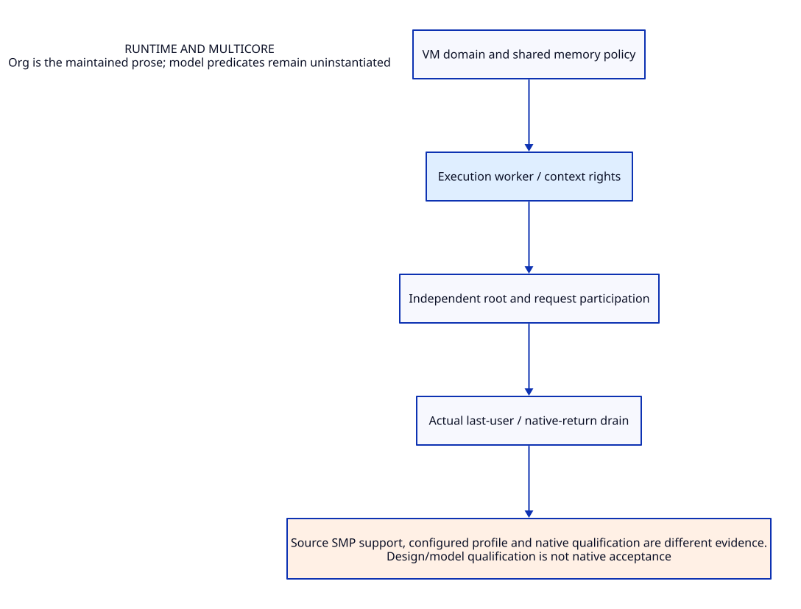

#+TITLE: Runtime and multicore
#+SETUPFILE: ../../../modeling/org/setup.org
#+CATEGORY: runtime

* RESEARCH Runtime and multicore :runtime:
:PROPERTIES:
:ID: 4d7eb57a-ec63-5ba1-90b9-a2aed128bbf8
:CUSTOM_ID: runtime-contract
:OWNER: Gambit architecture research
:STATUS: design-only
:EVIDENCE_CLASS: source-and-model-design
:END:

VM/worker/context/participant separation, memory sharing, ownership, requests and resource last use.

[[file:../interfaces/role-contract-design.org][T0 role contracts]] specify ContextIdentity and ExecutionGrant here, independently of GC participation and collector task grants. The ownership/benefit matrices retain current checkpoint work and expose native acquire/revoke and callback gaps.

Source SMP support, configured profile and native qualification are different evidence.

** Contract and ownership
:PROPERTIES:
:CUSTOM_ID: ownership
:END:
One Scheme semantic contract; one selected implementation owner for each mechanism. C-facing capability remains mandatory. Imported alternatives are comparisons, not simultaneous deployment decisions.

** Models and views
:PROPERTIES:
:CUSTOM_ID: models
:END:
- [[file:models/sysml/architecture.sysml][SysML architecture and necessary requirements]]
- [[file:diagrams/overview.d2][Maintained D2 view source]]
- 

#+NAME: runtime-sysml-source
#+INCLUDE: "models/sysml/architecture.sysml" src sysml

#+NAME: runtime-d2-source
#+INCLUDE: "diagrams/overview.d2" src d2

** OPEN Evidence and admission gaps
:PROPERTIES:
:ID: 236f7f85-5f1b-58e8-bfc3-c0df64a40b5e
:CUSTOM_ID: gaps
:STATUS: unresolved
:END:
Source reading, model validation, checked proof, native semantic acceptance and measured benefit are distinct. No validation result satisfies the runtime gates automatically.

** Study catalogue
:PROPERTIES:
:CUSTOM_ID: studies
:END:
#+NAME: runtime-studies
| Study | Evidence lineage |
|---+---|
| [[file:studies/runtime-modernization-cost-matrix.org][runtime-modernization-cost-matrix]] | ~0a0163b8d7bb~ |
| [[file:studies/runtime-root-participation-contract.org][runtime-root-participation-contract]] | ~7bfedfced162~ |
| [[file:studies/runtime-root-participation-evidence.org][runtime-root-participation-evidence]] | ~6052df72eb90~ |
| [[file:studies/shared-runtime-contract-design.org][shared-runtime-contract-design]] | ~065ef77d1c56~ |
| [[file:studies/shared-runtime-contract-evidence.org][shared-runtime-contract-evidence]] | ~017d009f0c46~ |
| [[file:studies/shared-runtime-proof-argument.org][shared-runtime-proof-argument]] | ~a47ce6f07850~ |
| [[file:studies/shared-runtime-proof-evidence.org][shared-runtime-proof-evidence]] | ~167a83dc691f~ |
| [[file:studies/shared-runtime-root-custody-design.org][shared-runtime-root-custody-design]] | ~708b1dcb6ca1~ |
| [[file:studies/shared-runtime-root-custody-evidence.org][shared-runtime-root-custody-evidence]] | ~f86d8cf2cb7c~ |
| [[file:studies/shared-runtime-root-custody-matrix.org][shared-runtime-root-custody-matrix]] | ~574321186b28~ |
| [[file:studies/shared-runtime-value-matrix.org][shared-runtime-value-matrix]] | ~e5c8d4c16713~ |

** Cross-cutting references
- [[file:../../../index.org][Development architecture]]
- [[file:../../../catalog.org][Complete source-to-Org and diagram migration map]]
- [[file:../../../research/validation.org][Validation boundary and retained receipts]]

** Column view for local research obligations
#+BEGIN: columnview :id local :format "%ITEM %STATUS %EVIDENCE_CLASS"
#+END:

** Behavioral and proof ownership
- [[file:models/quint/index.org][Quint state/action ownership]]
- [[file:models/lean/index.org][Lean invariant/proof ownership]]
- [[file:../interfaces/index.org][Cross-module semantic interfaces]]

** OPEN Membership freeze and resize retirement
[[file:../interfaces/membership-revocation-design.org::#membership-cuts][Membership cuts]] separate member admission, root acknowledgement,
worker withdrawal and target backing release. Execution owns the enroll/freeze
and entry/exit ends; GC owns phase drain. The shared native model owns the contract.

** RESEARCH Resource exit assurance
[[file:resource-exit-assurance.org][Last-user, unknown-outcome and generation-permit contract]] /
[[file:../../../modeling/component-assurance.org][composed closure matrix]]. Actual foreign/device owner and derived-task
completion remain source-refinement obligations.
