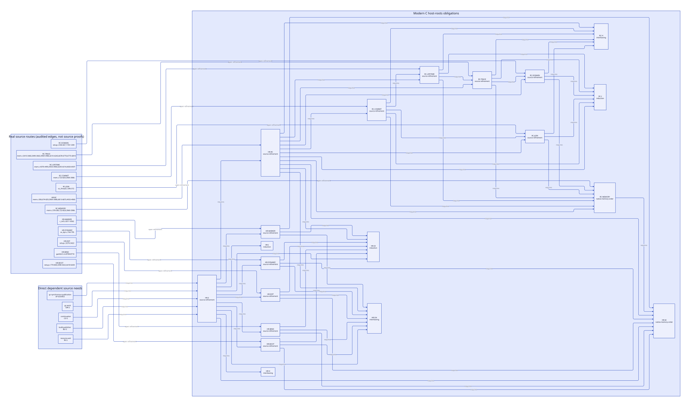

#+TITLE: Modern C Host Roots: Source Routes and Refinement Frontier
#+SETUPFILE: ../../../modeling/org/setup.org
#+CATEGORY: architecture
#+PROPERTY: header-args :eval never :exports code
#+COLUMNS: %28ITEM %18NEED %28STATUS %28CUSTODIAN
#+TODO: RESEARCH OPEN | CONDITIONAL CHECKED

* RESEARCH Decision and authority
:PROPERTIES:
:ID: 6f07674a-7a0b-41f2-907b-481936fb30bf
:CUSTOM_ID: host-roots-refinement
:COMPONENT: host-roots
:MAINLINE: modern-generated-C
:AUTHORITY: GambitHostRootsRefinement
:STATUS: selected-source-census-established-six-source-routes-open
:END:

Host roots are a shared prerequisite of GC work, continuation, resource exit,
synchronous publication and build-result delivery. The modern C redesign must
make root custody and callback activation explicit before splitting execution
contexts from collectors. Changing the implementation language supplies none of
these semantic guarantees.

[[file:models/sysml/host-roots-refinement.sysml][Native SysML]] owns the eight added needs, six source routes and 26 dependency
edges. [[file:../../../modeling/ascent/assurance-planner.ss][ASCENT]] consumes its evaluated fields and derives missing premises;
=sourceRoute= displays the source-to-model relation without granting a pass.
[[file:../../../../models/gambit/host_roots_refinement.qnt][QNT]] exercises explicit target histories. [[file:../../../../models/gambit/lean/HostRootsRefinement.lean][Lean]] proves conditional census,
reload and stack-settlement results. Neither is a C-source simulator.

** Baseline, existing patch and target are different evidence
:PROPERTIES:
:EVIDENCE_CLASS: source-reading-and-target-protocol
:END:
This reading binds vendor sources at the current checkout and the cumulative
fixture =processor-interrupt-collective-wait-cumulative.patch=, SHA256
=8e6d68b028264cc9ae8225008af1ad3f09a6dfebe6d35268296c85e53fd0d23d=.
The fixture is read, not applied or compiled. The earlier successful-retirement
fixture is a historical positive control, not evidence about failed join or
arbitrary callback interleavings. All current input digests and raw checks are
retained in [[file:../../../../evidence/research/host-roots-refinement/checks.json][the scoped receipt]].

#+NAME: host-roots-source-closure
| Need | Vendor behavior / source witness | Existing patch credit | Still required before source closure |
|---+---+---+---|
| HR-RC | [[file:../../../../vendor/gambit/lib/mem.c::306][Per-PSTATE rc_head]], register 723–756, mark 3969–3986; mark_rc inside P0 block 6813–6873 | Moves mark_rc outside P0 block, patch 3443–3460; successful join transfers RC/still lists before cleanup, 3160–3234 and 4490–4501 | Every live list has a scanner after membership changes; failed/unknown join retains scan debt; list mutation and scanning excluded |
| HR-MARKER | [[file:../../../../vendor/gambit/lib/c_intf.c::6511][Marker allocation]] precedes proc use; TODO explicitly identifies movement; saved[0] is a fixed scratch slot | SAVE1 before make_vector and RESTORE1 after, 2010–2029; allocation-throw helper clears slot, 714–768 | Exclusive slot extent, scanner coverage, reload and every exceptional release; nested scratch writers cannot overwrite an outer root |
| HR-BOOT | [[file:../../../../vendor/gambit/lib/setup.c::807][Worker startup]] copies data_scmobj before execute_sync_op_loop, then calls run; module startup also calls run at 6425 | Patch explicitly excludes ordinary run markers from SFUN leases, 749; worker run remains | Prove actual thunk stable or root it before the preceding collective; a later marker lease cannot repair an already stale value |
| HR-EXIT | [[file:../../../../vendor/gambit/lib/setup.c::3276][call]] rethrows unmatched marker/error; matched return restores fp and R0; run kills marker only on normal call return | Three generated SFUN wrapper forms gain catcher, kill and frame_leave, 524–548; allocation failure refunds admission | Direct run, conversion-error reentry and unmatched propagation settle the exact activation once; no lexical cleanup assumption |
| HR-BIND | [[file:../../../../vendor/gambit/include/gambit.h.in::8708][Real/effective PSTATE binding]] and [[file:../../../../vendor/gambit/lib/os_thread.c::697][thread initialization]] are separate from catcher/fp/R0 | Frame counts and VM admission gate are present | Same-owner/no-switch profile must prove binding unchanged; switching profile needs a separate saved binding protocol; foreign jumps outside profile rejected |
| HR-DYNAMIC | [[file:../../../../vendor/gambit/lib/os_dyn.c::744][c_closure_self]] has a TLS TODO; proc=#f resolves RC data after allocating marker | Saving #f protects no closure identity; per-processor scanning helps the RC data location only | Exact trampoline ABI, nested/thread-safe self identity, RC borrow and deletion drain; no arm64 admission from a source template |

* RESEARCH Actual callers and protected intervals
** RC is a native allocation with one managed data field
[[file:../../../../vendor/gambit/lib/mem.c::674][setup_rc / cleanup_rc]] initialize/free the circular list. =cleanup_rc= frees all
blocks, independently of their refcount. =register_rc= attaches to the selected
processor; =set_data_rc= stores one Scheme object; =mark_rc= relocates this slot.
It does not discover Scheme pointers hidden in arbitrary payload bytes.

#+NAME: host-roots-caller-inventory
| Caller family | Actual call chain | Custody consequence |
|---+---+---|
| Dynamic C closure | os_dyn.c:749–791 make_c_closure -> alloc_rc(current PSTATE) -> set_data_rc(proc) -> trampoline converter -> marker(#f) -> data_rc(c_closure_self) | Registry scanner must cover this processor and RC lifetime; identity must survive before the late lookup |
| Native strings/bytes | c_intf.c:3233,3276,3315,3350,3381,3412,3456,3579; os_files.c:1189; os_io.c:4144,7124 | Usually data=#f, native bytes are not a recursively scanned root; allocation/list/release ownership still applies |
| Tcl command callback | [[file:../../../../vendor/gambit/examples/tcltk/tcltk.scm::125][scheme_call_cmd]] -> data_rc(ClientData) -> static tcltk_call; scheme_delete_cmd -> release_scmobj + release_rc, 183–195 | Still-vector indirection with a positive still reference is a distinct root route; in-flight callback versus deletion needs an independent borrow/drain contract |
| Static generated callback | gambit.h.in:10043–10059 BEGIN_SFUN variants -> marker -> conversions/call -> optional conversion-error callback -> END_SFUN | Three wrapper shapes share activation bookkeeping but keep conversion semantics; permanent entry labels can have an absence-of-movable-input proof |
| Worker / main entry | setup.c:781,807–840 and 6425 -> run:3398–3422 -> marker -> call | Must be audited separately; generated wrapper lease is not a proof for run |

The selected Scheme resize wrappers pass =##startup-processor!= at
[[file:../../../../vendor/gambit/lib/_thread.scm::3157][3157–3159]] and 6892–6894 through =##current-vm-resize=
([[file:../../../../vendor/gambit/lib/_kernel.scm::2353][2353–2360]]). This narrows the real startup caller set. It does not, by itself,
prove the representation/lifetime of every C caller's =scheme-object= thunk.
The required outcome is either a stable-label certificate for the admitted
caller or a root covering the earlier collective; do not report a demonstrated
native use-after-move from the target counterexample alone.

** Marker interval is wider than the still object's lifetime
=make_vector(ps,...)= uses still allocation; =alloc_scmobj_still= at
[[file:../../../../vendor/gambit/lib/mem.c::1563][1563–1650]] may collect and may fail. Still refcount initially protects the
marker after creation; it does not protect a movable procedure used to fill it.
=mark_saved= at 6526–6538 scans each processor's saved slots.
[[file:../../../../vendor/gambit/include/gambit.h.in::8059][SAVE1 / RESTORE1]] write/read/clear saved[0]; they neither reserve a nested slot nor
restore a previous occupant. The patch closes the selected ordinary input
window only under a no-clobber and scan-membership premise.

*** OPEN Two admitted implementations of the target root lease
:PROPERTIES:
:NEED: HR-MARKER
:CUSTODIAN: callback-activation
:END:
1. Generated short scratch extent: use saved[0] only after proving no existing
   borrower, no overlapping saved writer and all controlled throw paths. This
   can avoid a new allocation; a bare depth counter is not that proof.
2. Explicit activation root chain: stable, scanner-enumerated slot records with
   owner/VM/generation and a LIFO activation token. Reentry creates a distinct
   record; every failure restores the previous chain head. No address of an
   expired C automatic variable can remain registered.

These are target alternatives, not two mandatory implementations. Modern C
generation should choose from proven profile facts. Unknown nesting requires
the complete lease route or rejection, rather than silently reusing scratch.

** Nested exits and binding identity
The return handler at [[file:../../../../vendor/gambit/lib/_kernel.scm::1019][1019–1071]] checks processor identity and invalidated marker,
then throws UNWIND_C_STACK. =call= accepts only the matching destination marker;
otherwise it propagates outward. A target activation record therefore carries:

#+NAME: host-activation-spec
#+BEGIN_EXAMPLE
HostActivationSpec {
  identity: (VM, context, processor, hostThread, generation, activationId);
  parentActivation; previousRealPstate; previousEffectiveBinding;
  rootedInputSlots; reservedScratchToken; initializedMarker;
  admissionCountOwned; catcherProfile; exitState;
}
#+END_EXAMPLE

The record is a design contract, not implemented C. Keep all changed cleanup
state reachable through a stable ledger for admitted setjmp/longjmp profiles;
do not rely on changed nonvolatile automatic locals after longjmp. Prepare
cleanup before exposing the catcher boundary. Allocation failure owns no valid
marker; initialize-success owns exactly one marker. Matched return, Scheme
exception and unmatched propagation invalidate/release only this activation's
marker and admission lease, restore its admitted binding state, then deliver or
rethrow the original outcome. Child settlement preserves the parent marker.

Restoring catcher/fp/R0 and decrementing a count do not restore a changed
PSTATE binding. In the same-owner/no-switch profile, establish equality at
entry and prohibit changes over the complete extent; a needless TLS write is
not required. A switching profile must restore both real and effective binding
with an explicit VM/context relation. The bounded vendor search found binding
macro definitions at 8713/8717, not uses that would establish this protocol.
Thread initialization/affinity setup is not a nested binding restoration API.
Unmanaged longjmp, OS thread cancellation, cross-thread continuation return
and foreign ABI unwind remain outside admission unless separately modeled.

* RESEARCH Synchronization and source-step obligations
#+NAME: host-roots-refinement-steps
| Source event / target action | Required simulation and stutter premise | Failure / unknown custodian |
|---+---+---|
| register_rc / scanNonzero | Every live managed data slot has exactly one logical owner; every such owner is enumerated, not just processor zero | Registering owner retains unaccepted roots |
| shrink / retireUnknown | Live allocation retained AND included in a stopped-root snapshot or explicit retained-donor adapter | Donor plus lifecycle coordinator retain scan debt; pending_join_count alone is not coverage |
| successful join + transfer / transferCommitted | Donor stopped, all remote borrowers drained, receiver scan admission live, splice exclusion and no uncovered interval; model atomicity is a theorem obligation | Before commit donor; after accepted commit receiver; unknown commit must be resolved by identity |
| SAVE1 / reserve | Slot is scanner-visible, current value protected before first GC-capable event, exclusive token spans nested/throw paths | Current activation retains input and token |
| make_vector / allocateMoving | GC preserves logical identity and updates the registered location; still-header initialization and error return separately mapped | Failed allocation releases only acquired resources |
| RESTORE1 / reload | Reload from the relocated slot before use, then clear/release; no raw alias survives the move | Root custodian retains until reload or abandoning use |
| call / enter | Roots and marker complete, same admitted binding, exact parent activation and lease count | Callee activation owns its root/marker obligations |
| matched return / settleTop | Top identity matches, marker invalidated, lease released once, previous binding proven/restored | Parent remains live |
| unmatched throw / repeated settleTop | Unwind each abandoned activation once before original outcome crosses boundary; no suppressed error or wrong marker | Each abandoned activation until acknowledged cleanup |

** OPEN C memory-order obligation HR-M
For same-owner mutation, execution ownership must exclude scanner access until
the final root store is published. Freeze final slot set/value stores before a
release handoff; scanner acquires the handoff before reading/writing them.
Owner cannot mutate during scanner ownership. GC completion releases relocated
values; resumed owner acquires and reloads before managed access. This is a
proposed happens-before chain, not a claim that current barrier macros prove it.

RC list insertion/removal/transfer needs mutual exclusion with the actual scan
population or a proved collective exclusion window. The patch's MISC_MEM_LOCK
around splice is not alone a proof for a scanner that does not take that lock.
Saved-slot storage has the same access-order obligation. Logical ownership,
native thread liveness, VM membership and processor scan membership are four
different predicates. Full native atomic expansion, conditional profiles,
failure paths and unknown join require a C-memory refinement before HR-M closes.

** Lean and QNT purpose, rather than file association
#+NAME: host-roots-proof-obligations
| Need / formal statement | What is checked | What is still assumed |
|---+---+---|
| HR-DH | 14 deterministic histories: P1 scan, donor retention, receiver commit, relocation/reload, fixed-slot clobber, late root, allocation throw, nested return/rethrow, wrong marker, count/binding separation | Chosen target actions; source reachability, arbitrary schedules and progress are not checked |
| HR-DI / liveRcCoverage | Parametric union of active and retained root domains covers live slots when retained owners are scanned | Concrete live-slot census and retained scan adapter |
| HR-DI / protectedReload | Equality composes updated root location with reloaded local | Real GC identity preservation, rooted location update and reload before use |
| HR-DI / reservationSurvives | Makes the exclusive-extent equality premise explicit | Does not prove scratch noninterference; this premise remains HR-MARKER work |
| HR-DI / enterPreserves, settlePreserves, nestedSettlement | Count/list balance and restoration for the abstract activation stack | C activation-token matching, marker lifetime, catcher/exit profile and binding simulation |
| HR-DI / retainedDoesNotImplyScanned, balancedIsNotBinding, lateRootCannotRepair | Independent logical counterexamples | Do not establish a reachable native execution |
| Six HR source routes | Initial relation; each C event refines an action or stutters without changing logical custody; observations and terminal exits reflect safety | All remain OPEN; coexistence of QNT and Lean is not a refinement theorem |

The QNT allocation-throw history covers root-slot release, not the separate
admission-count acquisition/refund in the existing patch. =settleTop= models
controlled propagation, not arbitrary foreign unwinding. Marker sets model
logical validity, not the concrete still header/refcount. Epoch changes model
location movement, not object allocation/GC algorithms. Lean uses head-first
lists while QNT appends at the tail: a reversal relation and identity mapping
are required in their refinement; no automatic QNT-to-Lean equivalence is claimed.

* RESEARCH Learning from OCaml and the C constraints
[[file:../../../../vendor/ocaml/runtime/caml/memory.h::439][Local-root chain restoration]] supplies an explicit extent protocol.
[[file:../../../../vendor/ocaml/runtime/callback.c::387][Named-value registration]] roots its inputs and recomputes String_val after a
lock acquisition that may move the object. The lesson for Gambit is to identify
every GC-capable wait/allocation and reload location-derived aliases, not to
copy an OCaml macro into a different collector and continuation architecture.

[[https://anil.recoil.org/papers/2020-icfp-retropar.pdf][Retrofitting Parallelism onto OCaml]] (§§1.2–1.4, 5.4) treats foreign access
and stack scanning as collector design constraints. This supports the need for
an explicit Gambit boundary; it supplies no Gambit speedup prediction.
[[https://www.open-std.org/jtc1/sc22/wg14/www/docs/n1570.pdf][WG14 N1570]] (§5.1.2.4, §7.13.2.1, §7.17.3) supplies the data-race,
longjmp and memory-order constraints. The proposed ledger and handoff are our
conditional design deductions. They still need source simulation and profile
qualification. No benchmark or compatibility percentage is transferred.

* RESEARCH Benefit, added work and retirement matrix
#+NAME: host-roots-benefit-matrix
| Mechanism | Source-grounded quantity / benefit | Necessary added work | Retirement condition / falsifier |
|---+---+---+---|
| Correct per-processor census | For P active processors, covers P-1 additional RC heads versus vendor P0-only scan; required managed-slot work is O(sum R_p) | Enumeration of P heads plus retained donor domains; each live root still scanned | Existing patch already contributes active coverage; no new speedup claim; failed donor omission falsifies completeness |
| Activation root contract | 3 SFUN macro shapes plus direct run can share one semantic entry/exit specification | Root lease, marker state, owner and failure ledger; conversions remain | Retire duplicated bookkeeping after all four route classes refine contract; removing marker validity semantics is disallowed |
| Scratch fast profile | Existing SAVE/RESTORE performs save, reload and clear without a new heap allocation | Prove exclusive allocating extent and throw cleanup | If arbitrary reentry can clobber saved[0], use explicit chain or reject this profile |
| Explicit root chain | Nested depth D with K slots needs O(D+K) live metadata; admission/exit O(1) plus K-root enumeration/reload | Stable record storage, linkage publication, relocation and cleanup | Cannot claim fewer required roots; overhead is justified only by enabled correct reentry/worker decoupling |
| Retired RC/still transfer | Splices rather than individually rebuilding RC records; still tail walk remains O(S_donor) in current patch | Stop/join/drain proof and receiver acceptance; failed join retains resources and scan debt | Teardown path retires only when every transferred class and borrower is covered; retaining memory without scanning is a counterexample |
| Binding profile specialization | Same-owner/no-switch can prove zero binding-switch writes | Identity checks or static guarantees; switching profile requires snapshot/restore | Count zero cannot substitute for binding equality |
| Independent GC workers | Contract can separate execution identity from scanner identity across five dependent components | Root publication, acquire/reload and complete retained-domain adapter | Enabled architecture, not measured throughput; missing HR-M or source route blocks adoption |
| Modern C versus Zig | All six safety obligations and required root/GC work are common; zero demonstrated language-specific reduction here | Zig would still need moving-GC root API, unwind strategy, runtime ABI and source proofs | Current evidence favors completing modern C contract first; no positive Zig net benefit follows from defer or no-GC allocation |

No runtime path is retired in this research. The quantitative claims count
covered domains, route classes and asymptotic work; they do not estimate elapsed
time, staffing or invented performance percentages. An explicit root contract
is the modernization substrate. Language choice remains downstream of it.

* OPEN Closure and adoption frontier
Six source routes and the concrete HR-M obligation remain unresolved. HR-DH and
HR-DI are local checked slices only. Historical HR-H/HR-I results are retained
under unchanged formal-source bytes, not rerun or broadened. ASCENT must show
that scan-only or save-only evidence cannot close HR-S, and that any missing
source route blocks its five downstream consumers even when synthetic local
passes are supplied elsewhere. Synthetic controls cannot issue runtime authority.

[[file:retained-rc-scan.org][The retained-domain continuation of this study]] decomposes HR-RC into five
source needs and RC-MEMORY plus RC-H/RC-I. It adds active-collector proxy scanning,
full retained still phase/capacity coverage and an epoch-pin/layout-writer
commit contract. Its model checks do not close the six parent source routes.

[[file:../../../modeling/component-assurance.org][The composed matrix]],  and the scoped receipt track
that boundary. This research changes no C implementation, applies no patch and
runs no native executable or performance workload.
