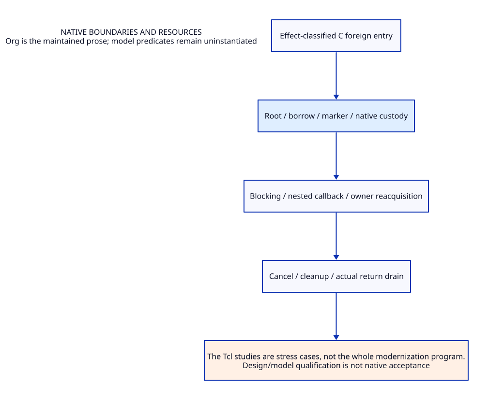

#+TITLE: Native boundaries and resources
#+SETUPFILE: ../../../modeling/org/setup.org
#+CATEGORY: ffi

* RESEARCH Native boundaries and resources :ffi:
:PROPERTIES:
:ID: cbb4d920-3675-5929-96a7-8b0d8ab598a5
:CUSTOM_ID: ffi-contract
:OWNER: Gambit architecture research
:STATUS: design-only
:EVIDENCE_CLASS: source-and-model-design
:END:

Borrowed/retained values, owner attachment, blocking/reentry, callbacks, cancellation and shutdown drain.

The Tcl studies are stress cases, not the whole modernization program.

[[file:host-roots-refinement.org][Modern C host-root source refinement]] is the current shared blocker study:
per-processor RC census, pre-marker roots and nested exit/binding custody.
Its native SysML routes drive ASCENT needs, QNT histories and Lean premises.
[[file:retained-rc-scan.org][Retained RC domains and transfer commit]] follows failed/unknown joins through
ordinary GC, including still tracing, capacity and physical cleanup obligations.

** Contract and ownership
:PROPERTIES:
:CUSTOM_ID: ownership
:END:
One Scheme semantic contract; one selected implementation owner for each mechanism. C-facing capability remains mandatory. Imported alternatives are comparisons, not simultaneous deployment decisions.

** Models and views
:PROPERTIES:
:CUSTOM_ID: models
:END:
- [[file:models/sysml/architecture.sysml][SysML architecture and necessary requirements]]
- [[file:diagrams/overview.d2][Maintained D2 view source]]
- 

#+NAME: ffi-sysml-source
#+INCLUDE: "models/sysml/architecture.sysml" src sysml

#+NAME: ffi-d2-source
#+INCLUDE: "diagrams/overview.d2" src d2

** OPEN Evidence and admission gaps
:PROPERTIES:
:ID: 77cc97d0-8ef5-5773-badb-08e8ce49ec06
:CUSTOM_ID: gaps
:STATUS: unresolved
:END:
Source reading, model validation, checked proof, native semantic acceptance and measured benefit are distinct. No validation result satisfies the runtime gates automatically.

** Study catalogue
:PROPERTIES:
:CUSTOM_ID: studies
:END:
#+NAME: ffi-studies
| Study | Evidence lineage |
|---+---|
| [[file:studies/device-release-support-matrix.org][device-release-support-matrix]] | ~0ceb5df79233~ |
| [[file:studies/device-release-sync-cost-matrix.org][device-release-sync-cost-matrix]] | ~6a229cc198c6~ |
| [[file:studies/device-release-sync-evidence.org][device-release-sync-evidence]] | ~479f68c1a106~ |
| [[file:studies/device-release-sync-proof.org][device-release-sync-proof]] | ~6740093aee3f~ |
| [[file:studies/device-release-wait-contract.org][device-release-wait-contract]] | ~bf37b2512fc0~ |
| [[file:studies/device-release-wait-cost-matrix.org][device-release-wait-cost-matrix]] | ~6117a1271028~ |
| [[file:studies/device-release-wait-evidence.org][device-release-wait-evidence]] | ~7fbd28a0edb2~ |
| [[file:studies/foreign-plan-contract.org][foreign-plan-contract]] | ~e264767ce773~ |
| [[file:studies/foreign-plan-engineering-comparison.org][foreign-plan-engineering-comparison]] | ~5882e4852454~ |
| [[file:studies/foreign-plan-evidence.org][foreign-plan-evidence]] | ~04b1866d129e~ |
| [[file:studies/foreign-release-worker-contract.org][foreign-release-worker-contract]] | ~f481a6170fe1~ |
| [[file:studies/foreign-release-worker-evidence.org][foreign-release-worker-evidence]] | ~8d90a6cfbda1~ |
| [[file:studies/native-callback-arguments.org][native-callback-arguments]] | ~c581424ab78c~ |
| [[file:studies/native-callback-benefit-matrix.org][native-callback-benefit-matrix]] | ~c1b5f3c5eb58~ |
| [[file:studies/native-callback-continuation-design.org][native-callback-continuation-design]] | ~04af04fe075e~ |
| [[file:studies/native-callback-custody-contract.org][native-callback-custody-contract]] | ~aa90f70a7947~ |
| [[file:studies/native-callback-evidence.org][native-callback-evidence]] | ~3599c37d7144~ |
| [[file:studies/owned-callback-participating-wait-contract.org][owned-callback-participating-wait-contract]] | ~910607ef0ea6~ |
| [[file:studies/owned-callback-wait-evidence.org][owned-callback-wait-evidence]] | ~5f0618948c6c~ |
| [[file:studies/owned-callback-wait-matrix.org][owned-callback-wait-matrix]] | ~a2d18bdb80f7~ |
| [[file:studies/rc-marker-caller-evidence.org][rc-marker-caller-evidence]] | ~d18507e71cae~ |
| [[file:studies/rc-marker-maintenance-matrix.org][rc-marker-maintenance-matrix]] | ~93029402d62f~ |
| [[file:studies/rc-marker-minimal-contract.org][rc-marker-minimal-contract]] | ~d3f54137fc91~ |
| [[file:studies/rc-payload-custody-cost-matrix.org][rc-payload-custody-cost-matrix]] | ~416d4a8867ad~ |
| [[file:studies/rc-payload-custody-design.org][rc-payload-custody-design]] | ~1860b273b30b~ |
| [[file:studies/rc-payload-custody-evidence.org][rc-payload-custody-evidence]] | ~cad0cead7d75~ |
| [[file:studies/root-transfer-receipt-cost-matrix.org][root-transfer-receipt-cost-matrix]] | ~aad613cb68c5~ |
| [[file:studies/root-transfer-receipt-design.org][root-transfer-receipt-design]] | ~82fc409ff4b0~ |
| [[file:studies/root-transfer-receipt-evidence.org][root-transfer-receipt-evidence]] | ~8a327fd1a423~ |
| [[file:studies/target-root-adapter-cost-matrix.org][target-root-adapter-cost-matrix]] | ~b4a38e3add29~ |
| [[file:studies/target-root-adapter-design.org][target-root-adapter-design]] | ~ca4979aae20c~ |
| [[file:studies/target-root-adapter-evidence.org][target-root-adapter-evidence]] | ~1f3cfd564f2a~ |
| [[file:studies/tcl-cancel-propagation-arguments.org][tcl-cancel-propagation-arguments]] | ~4eee002c7b5a~ |
| [[file:studies/tcl-cancel-propagation-benefit-matrix.org][tcl-cancel-propagation-benefit-matrix]] | ~ecf008de361b~ |
| [[file:studies/tcl-cancel-propagation-design.org][tcl-cancel-propagation-design]] | ~c776733d7a34~ |
| [[file:studies/tcl-cancel-propagation-evidence.org][tcl-cancel-propagation-evidence]] | ~cd82b1202957~ |
| [[file:studies/tcl-cancel-writer-arguments.org][tcl-cancel-writer-arguments]] | ~c909a696146f~ |
| [[file:studies/tcl-cancel-writer-benefit-matrix.org][tcl-cancel-writer-benefit-matrix]] | ~7b9ffa5ce391~ |
| [[file:studies/tcl-cancel-writer-design.org][tcl-cancel-writer-design]] | ~094480524d74~ |
| [[file:studies/tcl-cancel-writer-evidence.org][tcl-cancel-writer-evidence]] | ~ddd389edae30~ |
| [[file:studies/tcl-command-custody-arguments.org][tcl-command-custody-arguments]] | ~428c6338f978~ |
| [[file:studies/tcl-command-custody-benefit-matrix.org][tcl-command-custody-benefit-matrix]] | ~2f3a8f2bd687~ |
| [[file:studies/tcl-command-custody-design.org][tcl-command-custody-design]] | ~bb3f72aeba4c~ |
| [[file:studies/tcl-command-custody-evidence.org][tcl-command-custody-evidence]] | ~91bf9c62a9ca~ |
| [[file:studies/tcl-control-boundary-arguments.org][tcl-control-boundary-arguments]] | ~0dc4f96affca~ |
| [[file:studies/tcl-control-boundary-benefit-matrix.org][tcl-control-boundary-benefit-matrix]] | ~35b50aa1448d~ |
| [[file:studies/tcl-control-boundary-design.org][tcl-control-boundary-design]] | ~257679ca249e~ |
| [[file:studies/tcl-control-boundary-evidence.org][tcl-control-boundary-evidence]] | ~8cfb97d414a6~ |
| [[file:studies/tcl-coro-invariants-arguments.org][tcl-coro-invariants-arguments]] | ~28e797db983b~ |
| [[file:studies/tcl-coro-invariants-benefit-matrix.org][tcl-coro-invariants-benefit-matrix]] | ~d52487bc430a~ |
| [[file:studies/tcl-coro-invariants-design.org][tcl-coro-invariants-design]] | ~8edc8c19e71b~ |
| [[file:studies/tcl-coro-invariants-evidence.org][tcl-coro-invariants-evidence]] | ~d381b6628f17~ |
| [[file:studies/tcl-entry-cancel-arguments.org][tcl-entry-cancel-arguments]] | ~215703224130~ |
| [[file:studies/tcl-entry-cancel-benefit-matrix.org][tcl-entry-cancel-benefit-matrix]] | ~e99e0e0c791e~ |
| [[file:studies/tcl-entry-cancel-design.org][tcl-entry-cancel-design]] | ~43b333d96f3d~ |
| [[file:studies/tcl-entry-cancel-evidence.org][tcl-entry-cancel-evidence]] | ~b092794a1bf9~ |
| [[file:studies/tcl-interpreter-reuse-arguments.org][tcl-interpreter-reuse-arguments]] | ~5f7cac67f4b9~ |
| [[file:studies/tcl-interpreter-reuse-benefit-matrix.org][tcl-interpreter-reuse-benefit-matrix]] | ~f04522c05e16~ |
| [[file:studies/tcl-interpreter-reuse-design.org][tcl-interpreter-reuse-design]] | ~dfff190f919e~ |
| [[file:studies/tcl-interpreter-reuse-evidence.org][tcl-interpreter-reuse-evidence]] | ~a7b8d303a7e4~ |
| [[file:studies/tcl-mixed-cancel-arguments.org][tcl-mixed-cancel-arguments]] | ~2e962c511300~ |
| [[file:studies/tcl-mixed-cancel-benefit-matrix.org][tcl-mixed-cancel-benefit-matrix]] | ~ecd0ab6d8d69~ |
| [[file:studies/tcl-mixed-cancel-design.org][tcl-mixed-cancel-design]] | ~66df26b2a368~ |
| [[file:studies/tcl-mixed-cancel-evidence.org][tcl-mixed-cancel-evidence]] | ~1e9154bc6fc0~ |
| [[file:studies/tcl-next-evaluation-arguments.org][tcl-next-evaluation-arguments]] | ~f4def82c1a94~ |
| [[file:studies/tcl-next-evaluation-benefit-matrix.org][tcl-next-evaluation-benefit-matrix]] | ~67ec4022e930~ |
| [[file:studies/tcl-next-evaluation-design.org][tcl-next-evaluation-design]] | ~aec507b2d58b~ |
| [[file:studies/tcl-next-evaluation-evidence.org][tcl-next-evaluation-evidence]] | ~79c2d6a33f96~ |
| [[file:studies/tcl-private-coro-arguments.org][tcl-private-coro-arguments]] | ~5d8f7187e72d~ |
| [[file:studies/tcl-private-coro-benefit-matrix.org][tcl-private-coro-benefit-matrix]] | ~162b249e24a1~ |
| [[file:studies/tcl-private-coro-design.org][tcl-private-coro-design]] | ~ec9c54ad49ea~ |
| [[file:studies/tcl-private-coro-evidence.org][tcl-private-coro-evidence]] | ~938743d3bc4f~ |
| [[file:studies/tcl-reuse-service-arguments.org][tcl-reuse-service-arguments]] | ~41717c54a928~ |
| [[file:studies/tcl-reuse-service-benefit-matrix.org][tcl-reuse-service-benefit-matrix]] | ~632593bd7fac~ |
| [[file:studies/tcl-reuse-service-design.org][tcl-reuse-service-design]] | ~f86dd2cf058c~ |
| [[file:studies/tcl-reuse-service-evidence.org][tcl-reuse-service-evidence]] | ~4504ddeaa250~ |
| [[file:studies/tcl-targeted-cancel-arguments.org][tcl-targeted-cancel-arguments]] | ~a36fc043b5ca~ |
| [[file:studies/tcl-targeted-cancel-benefit-matrix.org][tcl-targeted-cancel-benefit-matrix]] | ~9d5d047256b7~ |
| [[file:studies/tcl-targeted-cancel-design.org][tcl-targeted-cancel-design]] | ~551a744f9245~ |
| [[file:studies/tcl-targeted-cancel-evidence.org][tcl-targeted-cancel-evidence]] | ~9a90b7bb7861~ |
| [[file:studies/tcl-trace-cancel-arguments.org][tcl-trace-cancel-arguments]] | ~590deeb9b1b3~ |
| [[file:studies/tcl-trace-cancel-benefit-matrix.org][tcl-trace-cancel-benefit-matrix]] | ~a6cbc19ed378~ |
| [[file:studies/tcl-trace-cancel-design.org][tcl-trace-cancel-design]] | ~f98e79ab5cfe~ |
| [[file:studies/tcl-trace-cancel-evidence.org][tcl-trace-cancel-evidence]] | ~c806b95746ac~ |
| [[file:studies/tcl-trace-reachability-arguments.org][tcl-trace-reachability-arguments]] | ~ade1ffb0d9da~ |
| [[file:studies/tcl-trace-reachability-benefit-matrix.org][tcl-trace-reachability-benefit-matrix]] | ~08dadb6712b0~ |
| [[file:studies/tcl-trace-reachability-design.org][tcl-trace-reachability-design]] | ~3696bae76ef0~ |
| [[file:studies/tcl-trace-reachability-evidence.org][tcl-trace-reachability-evidence]] | ~8ff4a3183c7e~ |

** Cross-cutting references
- [[file:../../../index.org][Development architecture]]
- [[file:../../../catalog.org][Complete source-to-Org and diagram migration map]]
- [[file:../../../research/validation.org][Validation boundary and retained receipts]]

** Column view for local research obligations
#+BEGIN: columnview :id local :format "%ITEM %STATUS %EVIDENCE_CLASS"
#+END:

** Behavioral and proof ownership
- [[file:models/quint/index.org][Quint state/action ownership]]
- [[file:models/lean/index.org][Lean invariant/proof ownership]]
- [[file:../interfaces/index.org][Cross-module semantic interfaces]]

** RESEARCH Component assurance and shared proof dependencies
[[file:component-assurance.org][Owned behavior, formal scopes and source obligations]] /
[[file:../../../modeling/component-assurance.org][composed closure matrix]]. Local checks do not close transitive source,
platform, ownership or progress premises.

** RESEARCH Final-value freeze and generational roots
[[file:rc-freeze-publication.org][Native writer census, storage/raw borrows and root publication]]
connects retained domains to the generational modern-C candidate. Callback
storage lifetime need not end before a GC; raw values must park and reload.

* RESEARCH Whole-round resume and deferred cleanup :modern_c:gc:ffi:
:PROPERTIES:
:CUSTOM_ID: resume-seal-cleanup
:AUTHORITY: GambitResumeSealCleanup
:STATUS: conditional-source-order-open
:END:
[[file:../gc/resume-seal-cleanup-design.org][The resume/cleanup study]] binds whole-round seal issuance to closed strong/weak
work, qualified cleanup handback, covered roots, known capacity, prepared
success/error context, committed result and current binding/writer/gate state.
GC sweep currently calls release_fn synchronously then frees its wrapper.
Explicit foreign-release!, conversion rollback and teardown retain distinct
semantics. Device cleanup may wait using PSTATE scratch; a standalone executor
needs explicit WaitContext. device_release may free storage even on error, so
error/effect/disposition must be distinct. A queued owner callback cannot run
before active permit, and cleanup must not wait for it. Unknown handoff or
GC-critical state refuses resume; independently isolated native outcome debt
may retain backing while GC resumes. No automatic callback/owner-death repair.
Native SysML:19 needs,38 edges,7 source routes,11 caller families,9 cost rows.
QNT31 histories/100 bounded sampled traces and Lean25 conditional declarations
qualify RS-H/RS-I only. Fifteen source and two native-memory-order needs remain
open; zero components qualify. Five ASCENT transport/scope/digest cases retain
a clearly synthetic positive control. No measured speedup or peak decrease.
No runtime implementation, native test, benchmark or path retirement.
