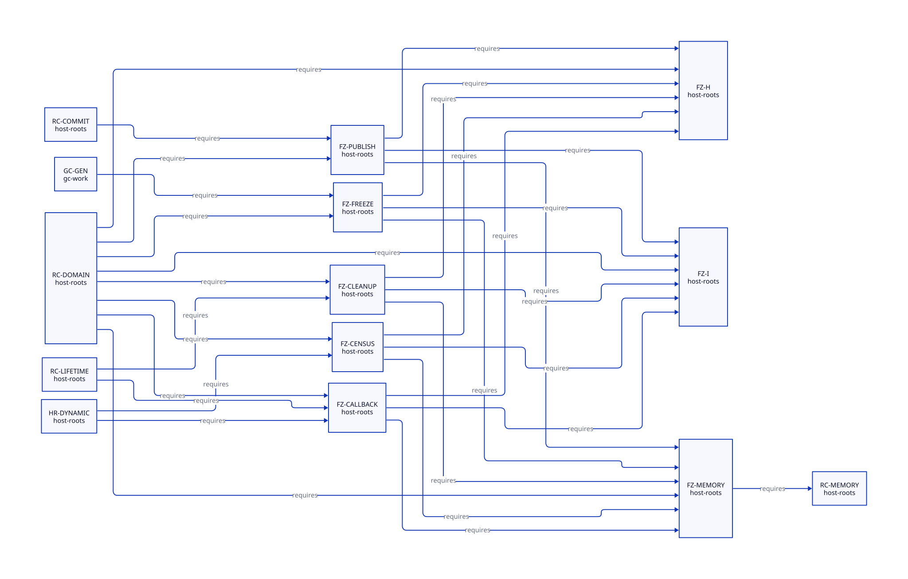

#+TITLE: Native RC writers, freeze receipts and generational root publication
#+SETUPFILE: ../../../modeling/org/setup.org
#+CATEGORY: ffi
#+PROPERTY: header-args :eval never :exports code
#+OPTIONS: toc:3 num:t

* RESEARCH Modern C target and source boundary :ffi:gc:modern_c:
:PROPERTIES:
:CUSTOM_ID: rc-freeze-publication
:STATUS: local-kernels-checked-source-and-memory-open
:OWNER: Native root and resource interfaces
:AUTHORITY: models/sysml/rc-freeze-publication.sysml
:EVIDENCE_CLASS: bounded-source-census-and-conditional-model
:END:

This extends [[file:retained-rc-scan.org][retained-domain scanning]] with real native readers/writers and
separate storage versus managed-value borrows. Modern C owns the implementation
candidate; Zig supplies no automatic GC, root, cancellation or destructor policy.
The [[file:../gc/modern-c-generational-design.org][generational GC design]] consumes these contracts: a minor collection must
see native roots and every old-to-young write, not just generated Scheme stores.

* Source census, actual callers and external closure
:PROPERTIES:
:CUSTOM_ID: census
:END:

The retained raw census matches eight RC operations, header and list identifiers
in vendor Gambit C/header/template/Scheme sources: 116 lexical occurrences in
nine files. It includes definitions, comments and function-table entries.
This is not 116 callers, a proof of external-C closure, or a runtime observation.
Higher-level conversion/release wrappers and generated macros below extend the
call analysis beyond that regex. Public header aliases and arbitrary external
C writes cannot be proven absent by searching this checkout.

#+NAME: rc-native-writer-borrower-census
| Family | Real source anchors | Writes / borrows / ownership | Required change or qualification |
|---+---+---+---|
| Primitive and scanner | [[file:../../../../vendor/gambit/lib/mem.c::674][mem.c:674-829,3969-3986]]; header:11309-11315,11413 | Allocate/register/unlink/refcount/data store; scanner caches next and relocates data | RootWrite and structural mutation authorities; pin protects header/list layout; collector writes distinct from mutator writes |
| Conversion callers | [[file:../../../../vendor/gambit/lib/c_intf.c::1633][c_intf.c:1633-1809,2887-2940,3233-3613]] | Function/string/list retain/release; list payload traversal; partial construction cleanup | Native storage borrow even for data=#f. refcount==1 is not concurrency exclusion. Dynamic procedure conversion also borrows managed root data. |
| Generated exits and native allocation | [[file:../../../../vendor/gambit/include/gambit.h.in::9838][header:9838-9894,10476-10522]] | Plain-C allocation/delete macros and generated function/string/list conversion cleanup | Cover generated normal and exceptional/nonlocal exits. Existing optional C++ branch is inventory, not the selected architecture. |
| Dynamic function pointers | [[file:../../../../vendor/gambit/lib/os_dyn.c::744][os_dyn.c:744-795,1045-1053]]; c_intf.c:6511-6562 | RC closure payload stored/read; raw callable trampoline; marker allocation; release | Stable invocation lease, protected callee before allocation, slot reload; global c_closure_self has no universal thread-identity proof |
| Tcl command and result | [[file:../../../../vendor/gambit/examples/tcltk/tcltk.scm::125][tcltk.scm:90-97,125-195,217-227,288-342]] | Callback reads RC data; delete releases still Scheme value then RC; returned C string later released by Tcl | Nonblocking logical delete and in-flight lease; creation failure after setup must settle exactly; no assumption command-struct lifetime protects ClientData |
| Foreign object release | [[file:../../../../vendor/gambit/lib/c_intf.c::1683][c_intf.c:1683-1710,5287-5381]]; [[file:../../../../vendor/gambit/lib/mem.c::4387][mem.c:4387-4455]]; _kernel.scm:3884-3894 | Clear foreign fields before callback; GC ignores error and frees wrapper; manual release reports error; conversion failure calls release_fn directly | New custody acceptance endpoint needed before clear/free. Cannot return deferred from existing callback and assume GC keeps wrapper. Preserve manual result/exception semantics. |
| Native payloads/platforms | [[file:../../../../vendor/gambit/lib/os_io.c::3948][os_io.c:3948-3971,4199-4558,7099-7143]]; os_files.c:1189; Xlib.scm:68-104,332,381,739 | TLS strings/SSL context, event pointer, Xlib RC storage and failure cleanup | Separate native list mutation from Scheme roots; external cleanup effects/owner and platform branches remain conditional |
| External API escape | [[file:../../../../vendor/gambit/lib/setup.c::5900][setup.c:5900-5922]]; header:13232-13255,14575-14598 | Exported RC operations/function tables and public header layout | Freeze only for mediated profile with complete writer inventory. Unknown aliases/writers retain backing and reject collection/reentry admission. |

Tcl creation returns a still vector with explicit still ownership in this
binding; do not reclassify it as an unprotected movable object. Conversely, that
fact does not prove ClientData lifetime or the creation-failure cleanup endpoint.
Historical Tcl internals are in [[file:studies/tcl-command-custody-evidence.org][the imported source ledger]]. Fresh pinned-source
fetch was unavailable in this study; current linked-library semantics and a
nonlocal exit across Tcl frames remain unresolved.

* Freeze receipt and publication protocol
:PROPERTIES:
:CUSTOM_ID: protocol
:END:

1. Prepare root slots, native header/backing ownership, scan membership and any
   native-only release task capacity before GC pin admission. Prepare failure
   leaves the creator/donor responsible; no partially installed domain receipt.
2. Close new mutator ingress, including callback entry and root/list writers.
   Finish already admitted writes and park raw Scheme-value borrows. Storage
   leases may survive: a callback waiting for GC need not finish first.
3. Issue a receipt only for exact VM/domain/generation/layoutRevision/rootEpoch
   and writer-inventory identity, with final registered slot values, zero active
   mutator writers, parked raw borrows and no unknown escape. Failed/unknown join
   is not evidence of any of these predicates.
4. Final slot stores precede a release publication/freeze acknowledgement;
   scanner admission acquires it. Enroll the domain before executor removal and
   before the epoch scan cut seals. The active collector owns its work context.
   The root-domain set is not the worker/barrier-participant set.
5. Epoch pins exclude RC header unlink/free, domain backing release and layout
   transfer. Collector relocation can update registered slots while mutator
   ingress remains closed. It does not reacquire the blocked mutator permit.
6. Resume requires acquire/reload of updated rooted values before raw access.
   Reentry, writer reopening, identity/layout reuse or changed inventory revokes
   the receipt. Transfer outcome unknown retains resolution and lifetime debt.

C memory order must relate these source events: =final slot writes -> release
ack -> acquire scan cut -> collector slot rewrite -> release completion ->
acquire rooted reload=. A short admission mutex can serialize structural
pin/writer gates; no join, allocating callback or GC runs while holding it.
Mutually excluded plain slot accesses need not all become atomic. Concurrent
card writers need an atomic or disjoint per-context scheme; volatile and an
unrelated queue fence do not establish the required happens-before chain.
This is a target obligation, not a proof of existing macros or Darwin behavior.

** Callback, deletion and foreign cleanup cycles
:PROPERTIES:
:CUSTOM_ID: wait-cycles
:END:
#+NAME: rc-freeze-wait-counterexamples
| Reachable source pattern / target hazard | Unsound wait | Target responsibility |
|---+---+---|
| Tcl/native callback applies Scheme and allocates | GC waits for storage lease; callback waits for GC | Park raw values and keep storage rooted/pinned. Freeze excludes raw use, not all native lifetime leases. |
| Delete invoked during own/nested callback | Delete waits for callback count including itself | Mark closing, refuse new callbacks, return; last exact callback token enables physical delete. Thread/VM affinity remains explicit. |
| mem.c GC invokes release_foreign while roots/layout pinned | GC waits for deferred destructor; destructor waits for same pin/owner | Accept pre-reserved native-only custody before clear/free, finish epoch without awaiting physical destructor, drain later. |
| Cleanup queue fills while epoch pin held | GC waits for queue slot; consumer cannot run before pin drops | Reserve before pin, or reject/retry preparation outside epoch. No allocating queue growth or lost task. |
| Deferred payload holds a new Scheme reference after strong/weak cut | New task appears native-only but creates an untraced root | Inventory/root it before cut and rescan under a separately proved protocol, or reject native-only route. |

Current release_foreign clears its fields before calling release_fn; GC then
frees unreachable wrappers even if the callback returns an error. Therefore the
new coordinator must intervene before those destructive endpoints. Manual
foreign-release! and conversion-error release are result-bearing operations;
deferred acceptance cannot silently replace their synchronous result contract.
Shutdown must drain callbacks, exact accepted release tasks, descendants and
backing users after epoch pins drop. An accepted task still owns its resource
if delivery fails or acknowledgement is unknown. It does not keep the very pin
needed for its destructor to make progress.

* Conditional formal evidence and remaining obligations
:PROPERTIES:
:CUSTOM_ID: proofs
:END:

The new QNT kernel has two callback identities and separate raw/storage state,
writer closure, initialization/publication, generation-bound receipt, pin and
pre-reserved native-only cleanup. Thirteen named histories include positive
park/relocate/reload, nested-delete drain and final-writer ordering, plus ten
explicit omission controls. The wait flags encode forbidden dependencies; they
are not a discovery of the full native wait graph or a liveness model.

Seven named Lean statements prove conditional receipt requirements, storage/raw
separation, publication and collector authority, plus strict-rank finite wait-path
acyclicity. The last theorem applies only if every actual wait edge has a valid
rank. These simple receipt lemmas do not prove final writer census, generation
uniqueness, source ordering or fairness. New finite histories and bounded positive
sampling are distinct from source simulation and native acceptance.

#+NAME: freeze-closure-matrix
| Need | Local result | Remaining gate |
|---+---+---|
| FZ-H / FZ-I | Named target histories and checked conditional lemmas | Native reachability, unbounded protocol preservation and complete wait graph |
| FZ-CENSUS | Eight source families and seven native census routes recorded | Full external/generated alias and writer closure; reject unknown profile |
| FZ-FREEZE / FZ-PUBLISH | Target receipt and publication-order contracts | Real final-value handoff, ingress gate, all domain enrollments and slot update relation |
| FZ-CALLBACK | Actual dynamic/Tcl entry-delete-create endpoints | Stable native invocation identity, nested/nonlocal cleanup and external failure semantics |
| FZ-CLEANUP | Actual manual/GC/conversion-error callers distinguished | Accepted task payload/capacity, thread affinity, shutdown/descendant drain |
| FZ-MEMORY | C ordering and no-wait-under-pin obligations stated | Concrete synchronization, lock order and native platform qualification |

RC-DOMAIN requires all eight FZ needs. RC-LIFETIME additionally requires callback
and cleanup; RC-COMMIT requires publication; HR-DYNAMIC requires callback/census.
The generational candidate requires the freeze contract through native SysML.
These are executable ASCENT prerequisites, not just hyperlinks. No source need
is passed by a census entry or a model file's existence.

* Benefit and incremental support matrix
:PROPERTIES:
:CUSTOM_ID: costs
:END:
#+NAME: rc-freeze-costs
| Support | Modern C responsibility | Zig responsibility if selected later | Removable work / added overhead |
|---+---+---+---|
| RootRegistry / freeze | Typed generated slots, owner/epoch/layout identity, admit/park/reload, stable membership | Same semantics and tests; allocator cleanup cannot discover Scheme roots | Removes coupling root survival to executor/barrier participation; O(domains + roots) census/scan and retained backing remain |
| BarrierLog | Bounded source-slot/card recording and overflow fallback; generated store coverage | Same barrier/overflow/ordering proof | Enables skipping clean mature interiors; O(pointer stores) checks plus dirty scan and metadata |
| Callback lease | Native lifetime separate from raw borrow; exact nested/error exit and VM restore | Same foreign ABI/nonlocal-exit contracts | Avoids self-wait and pin cycles; per-entry tokens/slot reloads and rejected raw escapes added |
| ReleaseCoordinator | Pre-reserved accepted native-only task, owner dispatch, once-only resolution and shutdown | Same real target-user/task policy; lexical defer helps only lexical exits | Removes arbitrary destructor execution from unqualified GC worker; queue, custody retention and late physical release added |
| Generated layout/store consumers | Scheme emits semantic descriptors; C validates/lowers them | Backend substitution may replace emitter details only after independent benefit | Unchecked macro/layout duplication can retire after all consumers migrate; no old runtime path retired now |

Net benefit requires avoided mature traversal/copy and unsafe coupling to exceed
barrier, roots, promotion, coordination, retention and major-cycle costs over
identical work. See [[file:../gc/modern-c-generational-design.org::#benefit-matrix][the generational work equation and falsifiers]]. No person-day estimate,
assumed percentage, native timing result or automatic Zig advantage is claimed.

#+NAME: rc-freeze-authority
#+INCLUDE: "models/sysml/rc-freeze-publication.sysml" src sysml

[[file:diagrams/rc-freeze-publication.d2][Native-derived dependency view]] /
 /
[[file:../../../../evidence/research/rc-freeze-publication/checks.json][exact source-bound checks and inherited receipts]]. Runtime implementation,
native execution, performance testing and retirement all remain outside this study.
