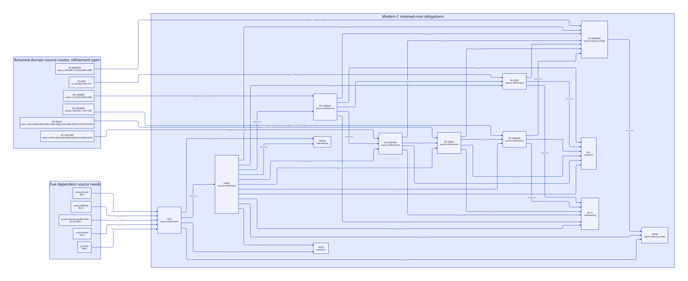

#+TITLE: Modern C Retained RC Domains, GC Epochs and Transfer Commit
#+SETUPFILE: ../../../modeling/org/setup.org
#+CATEGORY: architecture
#+PROPERTY: header-args :eval never :exports code
#+COLUMNS: %30ITEM %18NEED %28STATUS %28CUSTODIAN
#+TODO: RESEARCH OPEN | CONDITIONAL CHECKED

* RESEARCH Architectural decision
:PROPERTIES:
:ID: 8e858f30-9dc6-40aa-baf0-96939053b69b
:CUSTOM_ID: retained-rc-scan
:COMPONENT: host-roots
:MAINLINE: modern-generated-C
:AUTHORITY: GambitRetainedRcScan
:STATUS: target-contract-and-kernel-checked-concrete-source-open
:END:

A root domain must outlive executor membership. A failed/unknown join retains
allocation custody; it does not establish scan membership or stopped writers.
The proposed modern C runtime keeps qualified retained domains in the next GC
epoch census, scans them through active collectors, and serializes layout
commit with epoch pins. It never puts an exited thread back in the GC barrier.

[[file:models/sysml/retained-rc-scan.sysml][Native SysML]] owns domain identity, freeze, epoch, commit, capacity and
quarantine contracts, eight added needs and 28 added prerequisite edges under
HR-RC. [[file:../../../../models/gambit/retained_rc_scan.qnt][QNT]] contains the target lifecycle and omission controls. [[file:../../../../models/gambit/lean/RetainedRcScan.lean][Lean]] proves
the reader/exclusive-writer kernel step and trace preservation; full GC phase
closure is an explicit premise, not a proved native property. [[file:../../../modeling/ascent/assurance-planner.ss][ASCENT]] computes
which source and memory premises still block HR-RC and its consumers.

** Baseline and cumulative patch
The vendor and the cumulative fixture remain unmodified. The patch SHA256 is
=8e6d68b028264cc9ae8225008af1ad3f09a6dfebe6d35268296c85e53fd0d23d=.
This study reads both, applies neither, and does not treat a source branch as
a reproduced native failure. [[file:../../../../evidence/research/retained-rc-scan/checks.json][The scoped receipt]] binds current source/model/DSL
bytes, native SysML evaluation, formal checks and retained failures.

* RESEARCH Actual producer, consumer and recovery chain
#+NAME: retained-rc-source-census
| Event / real caller | Source evidence | Consequence |
|---+---+---|
| Shrink request | [[file:../../../../vendor/gambit/lib/_thread.scm::3157][##cvmr]] passes ##startup-processor! through [[file:../../../../vendor/gambit/lib/_kernel.scm::2353][##current-vm-resize]] to current_vm_resize; patch 4687–4733 wraps admitted resize and reopens SFUN admission | Result publication/reopening is not retained-domain GC enrollment |
| Membership removal | setup.c:546–667 barrier_sync_op uses processor_count; patch 4475–4483 sets join_pending and pending_join_count before OP_SET_PROCESSOR_COUNT | Publish retained-domain custody before count decreases; the scalar pending count contains no root inventory |
| Donor exit | Patch 4424–4448 removes processor deque entry, cleans interrupts/OS state, leaves memory to its slot and calls thread_exit | Exit request is not a joined-thread receipt; remote RC writers may still exist |
| Join result | [[file:../../../../vendor/gambit/lib/os_thread.c::546][thread_join]] uses pthread_join on POSIX; patch 4489–4501 transfers/cleans memory only on NO_ERR | Success supports thread termination; failed/unknown result keeps donor data and scan debt |
| Retry producer | recover_retired_processors, patch 4350–4381, enumerates join_pending slots up to MAX_PROCESSORS | Existing retry is invoked by cleanup_owned_vmstate at 5084–5095, not by ordinary GC |
| Next explicit GC | [[file:../../../../vendor/gambit/lib/_kernel.scm::2032][##gc-without-exceptions / ##gc]] -> [[file:../../../../vendor/gambit/lib/setup.c::1182][garbage_collect]] -> on_all_processors -> OP_GARBAGE_COLLECT -> garbage_collect_pstate | No pending-donor scan adapter appears in this entry or the patched OP handler at 4547–4548 |
| Allocation-triggered GC | mem.c:1647 still allocation and _kernel.scm:69,280,1974 limit slow paths -> garbage_collect | A restriction on future resize alone cannot protect ordinary allocation/GC |
| Root consumer | [[file:../../../../vendor/gambit/lib/mem.c::3969][mark_rc]] follows current PSTATE rc_head and updates each data slot; patch 3443–3460 moves it outside P0-only block | Fixes active P1 coverage, not domains excluded from the participating cohort |
| Successful transfer | Patch 3160–3234 transfer_mem_pstate: MISC_MEM_LOCK, still splice/counters, RC splice, donor head reset | Credited existing mechanism; reader exclusion, physical borrower drain and ownership publication are caller premises |
| Physical cleanup | mem.c:4933–4960 and patch 3223–3234 free still/RC and destroy queue facilities | Requires receiver acceptance, empty donor lists and complete last-user drain, not merely join status |

The bounded =pending_join_count= occurrence census in the cumulative patch
shows resize guards, initialization, successful join accounting and teardown
guards. It does not add a retained-domain iteration to ordinary GC. Following
the error branch and then an explicit GC is a source-level continuation
obligation; this research does not claim that a failed pthread_join was induced
on the host or that every Scheme caller ignores a resize error.

** Join outcome is not a root-state classifier
The [[https://developer.apple.com/library/archive/documentation/System/Conceptual/ManPages_iPhoneOS/man3/pthread_join.3.html][Apple archived pthread_join manual]] specifies zero for success, an error
number otherwise, and prohibits simultaneous joins of the same target. It is
API evidence, not qualification of the installed binary or every Darwin release.
The two Open Group page fetches returned HTTP 403; that missing access is retained.

The vendor wrapper discards the raw nonzero pthread result and calls
=err_code_from_errno=. [[file:../../../../vendor/gambit/lib/os_base.c::1050][os_base.c:1050–1076]] maps errno=0 to UNKNOWN_ERR,
not success; this is *not* a demonstrated false-success path. However, ambient
errno can lose the actual pthread error class. A modern typed JoinObservation
must preserve raw return, native handle/generation and unique join owner.
Failed lookup or an unknown transport outcome cannot issue a termination,
root-freeze or cleanup receipt. Retrying after an already consumed successful
join also needs outcome reconciliation, not another blind pthread_join.

* RESEARCH Root-domain and collector separation
#+NAME: retained-domain-spec
#+BEGIN_EXAMPLE
RetainedRootDomain {
  VM; domainId; generation; layoutRevision;
  rcHead; stillHead; liveStillWords; deferredStillWords;
  freezeReceipt; backingLeases; outstandingNativeBorrowers;
  phaseCoverage; epochPins; layoutWriter; transferRecord;
}
GcDomainSnapshot {
  gcEpoch; activeCollectorCohort;
  entries: (domainId, generation, layoutRevision, rootSpan, stillSpan,
            assignedCollector, backingLease, freezeReceipt);
}
TransferRecord { TransferId; source; destination; layoutRevision;
                 state: Prepared | Committed | Aborted; receipt; }
#+END_EXAMPLE

These are proposed contract data, not runtime implementation. A domain identity
is not a PSTATE array index. Generation prevents slot reuse/ABA; layoutRevision
changes on transfer. A retained root domain is counted once in root enumeration
and never added to =processor_count= or =scan_workers_count=.

*** OPEN Freeze before executor removal: RC-DOMAIN / RC-JOIN
Publish a retained-domain record and final root writes before removing the
executor. Obtain a complete writer/borrower freeze receipt independently of
join. The census includes =register_rc=, =release_rc=, =addref_rc=, =set_data_rc=
and native borrows across callbacks/deletion; these use plain fields at
mem.c:723–829. Thread exit alone does not stop another native holder.

If all admitted writers are frozen, an unknown join can coexist with proxy
scanning while the lifecycle owner retains the OS-thread resource. Without
freeze/backing evidence, close allocating and reentrant ingress and do not
start unsafe collection. Merely returning an overflow Boolean and allowing
Scheme to continue allocating is insufficient. Recovery or controlled teardown
must resolve the missing evidence; availability loss and retained memory remain
visible. Unknown raw C writers cannot be silently admitted.

This selected domain covers RC and still roots. Live saved slots, activations,
captured stack origins or native aliases require their own root coverage or an
absence certificate. SFUN count zero cannot supply the full absence census;
the other host-root/continuation obligations remain open.

*** OPEN Proxy scan uses active work context: RC-TRACE
[[file:../../../../vendor/gambit/lib/mem.c::3490][mark_array]] loads allocation cursors from its PSTATE, may allocate copy space,
forward objects and publish chunks. [[file:../../../../vendor/gambit/lib/mem.c::3410][setup_stack_heap_vmstate]] initializes queues,
copy spaces and worker counts only for processors below =processor_count=.
Stealing/termination at 6678–6770 also use that active population. Calling the
old =mark_rc= with the retired donor's PSTATE can publish work to a queue outside
this population; it is not a sufficient adapter.

The modern C contract separates =scanRcDomain(activeCollector, rootDomain)=:
enumerate donor-owned native data cells but mark them using the assigned live
collector's copying/work context. Every writable native RC data cell has one
scan assignment per epoch. Forwarding CAS on a Scheme object does not make two
unsynchronized writes to the same native RC slot legal. Logical aliases in
different slots are a separate case.

Retained still objects must enter the same epoch lifecycle:

#+NAME: retained-still-phases
| Phase / source | Required retained-domain adapter |
|---+---|
| Setup, mem.c:4210–4233 and 6775–6810 | Reset still marks and enqueue positive-refcount objects, using live collector work queues |
| Strong RC tracing, mem.c:3630–3654 / 3969–3986 | Traverse RC targets with the current still mark state; scanning only RC data cannot repair stale still marks |
| Descendant work / weak phase | Charge all generated copying, still and weak work to the active epoch; termination includes it |
| Cleanup, mem.c:4370–4426 and 6920–6937 | Apply the correct retained-domain still list, write back live/deferred accounting, preserve foreign destructor ownership |
| Capacity, mem.c:6255–6314 | Include retained still words exactly once; collector copies count under the active collector, not stale donor allocation cursors |

The current =free_unmarked_still_objs= can call =release_foreign=. A proxy on an
arbitrary worker is not a thread-affine destructor authorization. Deferred
release/owner delivery and shutdown drain remain resource-exit dependencies.
Keeping the domain pin alone protects storage; it does not settle these effects.
Cleanup must not synchronously wait for a root-writer lease whose admission
requires release of the same GC epoch pin. Such a destructor needs a separately
rooted, accepted deferred-custody handoff with a proved drain protocol, or that
profile remains inadmissible. The target cleanupAccount action does not prove
this handoff. RC-LIFETIME retains this obligation rather than declaring a
circular cleanup wait safe.

* RESEARCH Transfer commit versus scanning
** Epoch pin and exclusive layout authority: RC-COMMIT / RC-MEMORY
Use a short registry synchronization boundary to admit epoch readers or a layout
writer. Freeze a unique domain/layout snapshot at GC admission. Pin RC headers,
still headers and relevant backing until strong/descendant/weak/cleanup users
finish; returning from the RC traversal is too early to release the epoch pin.
All worker uses share the epoch's ownership; its release requires phase closure.

Transfer admission requires successful raw join, root-writer freeze, borrower
drain and zero epoch pins. It admits an exclusive layout writer, preventing a
new epoch snapshot. Do not hold the registry mutex while joining, waiting for
pins, scanning, running destructors or reaching a collective barrier. Drain
waits release the mutex and recheck identity/guards after wakeup. The lock order
and progress proof remain RC-MEMORY obligations.

During the exclusively owned interval, update all still links and counters,
all RC links, donor-empty state, receiver ownership and layout revision. No
reader observes partial links. The abstract linearization point is publication
of the completed TransferRecord plus new layout under the same exclusion.
Commit must not allocate or invoke callbacks/throw. A process crash or broken
pointer write is not covered by an in-memory receipt protocol.

The current splice's MISC_MEM_LOCK serializes its critical section but =mark_rc=
does not take that lock. Neither an active-cohort barrier nor a plain pending
count proves an out-of-cohort caller shares scan exclusion. Before in-place
code can refine the atomic model, prove an enclosing collector exclusion window
or introduce the explicit epoch-pin/layout-writer protocol. No additional mutex
around the old splice is claimed to be a complete fix.

** Unknown result and reclamation custody: RC-LIFETIME
#+NAME: retained-transfer-outcomes
| Observation | Physical root owner | Coordinator responsibility / permitted action |
|---+---+---|
| Preparation rejected or aborted before links change | Donor remains enrolled | Keep all roots/backing; retry only after guards and same identity are checked |
| Commit completed, acknowledgement lost | Receiver owns roots; donor lists are empty | Query immutable TransferId/revision; do not infer rollback or splice again |
| Outcome unresolved | Authoritative transfer record determines owner; observer does not know it | Retain resolution and backing debt; deny cleanup/slot reuse |
| Receiver receipt resolved and all borrowers/epoch pins drained | Receiver remains scan owner | Cleanup empty donor structures; destroy donor scan facilities only after last user |

Layout commit and delivery acknowledgement are different events. A caller
timeout cannot reverse ownership. No receipt may be issued between partial RC
link writes and receiver publication. Release/acquire publication orders final
root stores, snapshot acquisition, relocation writes and resumed reloads; native
macro/lock expansion must still prove the concrete C happens-before relation.

* RESEARCH Models, refinement obligations and counterexamples
#+NAME: retained-rc-proof-matrix
| Obligation | Concrete-to-model relation / checked slice | Still open |
|---+---+---|
| RC-H | 15 histories: retained scan twice across GC epochs, quarantine, commit/abort/lost ack and omission controls; 100 positive-step samples, 50 steps, seed 17 | Bounded target execution only; no exhaustive, liveness or native failure evidence |
| RC-I | 11 named Lean statements; reader/writer kernel stepPreserves and tracePreserves; parametric enrollment and snapshot stability | Does not prove the entire QNT GC lifecycle or any C transition relation |
| RC-JOIN | Raw POSIX result -> joinSuccess/Failed/Unknown; unique lifecycle owner and freeze separate | Error transport correction and real stop/borrower receipts |
| RC-DOMAIN | Membership removal preserves enrolled domain before retire; beginGC freezes every admitted retained domain | Actual registry publication, complete writer census and quarantine entry |
| RC-TRACE | prepareStill -> scanRoots -> drainTrace -> weakComplete; active context owns copy/queue work | Real RC/still adapters, disjoint assignment, copying and weak producer closure |
| RC-COMMIT | prepareTransfer/commitTransfer/abortPrepared/resolveCommitted; revision stays fixed while pinned | Every native link/counter write hidden by the exclusion window; acknowledgement identity |
| RC-LIFETIME | cleanupAccount/finishGC/cleanupDonor; no native header/backing destruction before final use | Foreign release effects, complete backing census, exact physical capacity accounting |
| RC-MEMORY | Pin/exclusive admission and ordered publication | C locks/atomics, alias exclusion, no blocking cycle, native progress and all admitted profiles |

The Lean kernel models one GC epoch reader pin, not a refcount increment per
worker. Its abstract release action has no GC phase guard; =fullPhaseClosure=
states the additional obligation explicitly. The C/QNT adapter must release
only after complete phase closure. Safe kernel traces alone cannot justify an
early release after =mark_rc=.
The kernel's =alive= concerns the published root backing; it is not the donor
PSTATE header. After an accepted transfer, the former can remain live while
the latter becomes reclaimable.

QNT models one selected retained domain and a live proxy collector. Its revision
counter detects a changed pinned layout; full domain-generation/handle-reuse
refinement still needs a larger identity relation. It does not model arbitrary
RC payload bytes, partial source pointer writes, reentrant foreign destructors,
all GC root classes or arbitrary native readers. =freezeWriters= is a target
acknowledgement premise, not an assumption supplied by a failed join. Unsafe
fault actions are excluded from =step= and used only by named counterexamples.
No sampled invariant is promoted to universal correctness.

ASCENT retains all 48 needs and 94 dependencies, including the existing
host-root routes. Six detail omissions, parent-only and trace-only controls
must block HR-RC, HR-S and all five downstream consumers even when other
obligations have synthetic passes. Exact scope/digest mismatch must reject
RC-I/RC-H. SourceRoute rows are traceability, not source-proof receipts.

* RESEARCH Benefit and added overhead
:PROPERTIES:
:CUSTOM_ID: retained-rc-benefits
:END:
#+NAME: retained-rc-benefit-matrix
| Decision | Conditional benefit | Necessary added work / quantitative bound | Falsifier / retirement gate |
|---+---+---+---|
| Separate root domains from worker cohort | Preserve RC/still roots after executor removal without keeping a dead worker in barriers | Enumerate A active + T retained domains: O(A+T); required root visits O(sum R_d + sum S_d) plus descendants | Missing domain, unfrozen native writer or invalid backing blocks GC admission |
| Active collector proxy | Reuse existing copying/forwarding/chunk algorithms; no collector queue required per retired executor | Assign every domain to a live collector; account each RC slot/still setup once per epoch | Work sent to a retired PSTATE queue falsifies closure |
| Writer/borrower freeze | Stop root mutation before a domain leaves executor membership | B outstanding native borrows/writers must settle or be excluded; registry enumeration does not bound that wait | A blocked borrower can prevent progress; no finite freeze-latency bound is established |
| One epoch pin per snapshot | Share lifetime protection across slot enumeration and all descendant consumers | O(A+T) snapshot metadata and domain pin operations per GC; no new atomic required per RC slot solely for this mechanism | Early unpin before weak/cleanup users complete blocks adoption |
| Exclusive layout commit | Avoid scanning the same native slot concurrently; preserve O(1) RC chain splice | Retain current O(S_donor) still-tail walk unless a separately maintained tail removes it; writer waits for epoch drain | Existing splice mutex alone is insufficient; wait/GC/join under registry lock can break progress |
| Transfer identity / outcome reconciliation | Avoid duplicate splices and premature donor cleanup after lost acknowledgement | O(U) unresolved transfer records, with identity lookup; no constant-time hash claim or bounded U assumed | Replaying splice or repeated consumed join is rejected |
| Complete retained still accounting | Correct GC capacity/cleanup decisions; avoid omitted retained bytes | Charge retained live/deferred words once; physical native retention B_retained = sum retained backing bytes | Charging stale donor copying cursors double-counts active copies; omission can undercount capacity |
| Freeze-missing quarantine | Refuse unsound collection while preserving evidence and custody | Lost allocation/reentry availability; memory and OS-resource retention can be unbounded without recovery | No claimed healthy steady-state throughput in this mode |
| Shared modern C contract | Reuse source proof obligations across GC, control, resource exit, publication and build-result delivery | Registry, writer/borrow API, phase adapter, receipts and memory-order proof remain necessary | Zero C paths retired and zero Zig-specific net reduction established by this study |

For T=0 the retained-domain loop visits no extra domains; epoch coordination
can still have fixed overhead and is not proven free. A snapshot reused within
one GC must not skip rescanning the same retained roots in the next moving-GC
epoch. Required live-root work cannot be eliminated. No elapsed-time speedup,
pause bound, staffing estimate or percentage is asserted.
The O(A+T) enumeration bound is not a bound on stop/drain latency: B native
borrowers, pin holders and deferred cleanup can delay admission independently.

* OPEN Adoption and next source proof
- [X] Trace failed/unknown join retention and ordinary GC consumers separately.
- [X] Specify domain/copying-context separation and full still/capacity obligations.
- [X] Check target histories, bounded positive-step invariant samples and Lean kernel.
- [X] Connect typed SysML needs to actual ASCENT controls and native-derived D2.
- [ ] Prove native freeze/enrollment and complete RC writer/borrower census.
- [ ] Refine every list/counter/receipt source write and resolve unknown outcomes.
- [ ] Refine retained still tracing, foreign release, capacity and physical backing.
- [ ] Close C memory order, progress and the full GC/continuation/root composition.

 and [[file:../../../modeling/component-assurance.org][the composed closure matrix]] track this work.
No runtime implementation, patch application, native test or performance run
is performed. Modern C is the required architecture owner; Zig would inherit
these same GC/root/ownership obligations.
