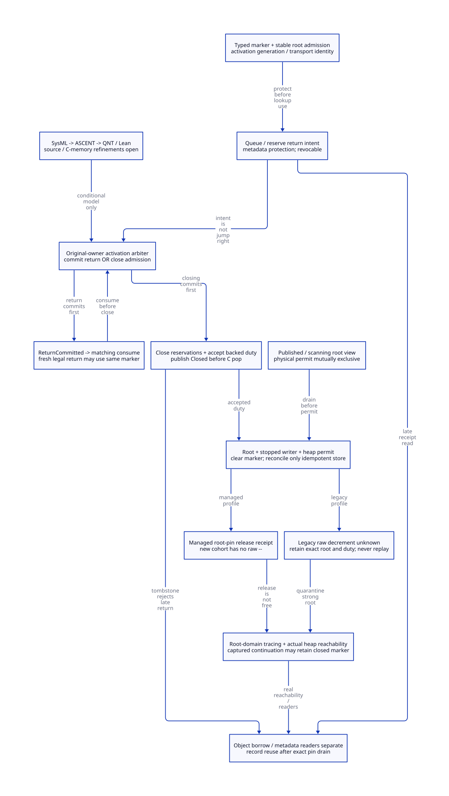

#+TITLE: Activation Return Claims, Marker Clearing and Pin Retirement
#+OPTIONS: toc:3 num:nil
#+PROPERTY: header-args :eval never :exports code
#+STARTUP: overview

* Decision and maintained authority
:PROPERTIES:
:ID: gambit-activation-marker-retirement
:CUSTOM_ID: activation-marker-retirement-decision
:STATUS: SOURCE-AND-C-MEMORY-REFINEMENT-OPEN
:AUTHORITY: models/sysml/activation-marker-retirement.sysml
:END:

Modern generated C remains the mainline. Scheme retains continuation semantics,
conversion policy and generation of native entry/root descriptions. Modern C owns
activation arbitration, exact root/pin duties, phase-scoped physical writes and
metadata reclamation. This study designs replacement responsibilities; it does
not implement the runtime or qualify native behavior.

[[file:models/sysml/activation-marker-retirement.sysml][SysML]] is the semantic source for needs, dependencies, source routes, caller
inventory, costs and diagram topology. Native sysml evaluation feeds the actual
[[file:../../../modeling/ascent/activation-marker-retirement.rules.scm][ASCENT DSL]] and [[file:../../../modeling/ascent/activation-marker-retirement.request.scm][bound request]], linking [[file:../../../../models/gambit/activation_marker_retirement.qnt][QNT]] and [[file:../../../../models/gambit/lean/ActivationMarkerRetirement.lean][Lean]] to exact scopes.
[[file:activation-marker-retirement-matrix.org][Closure/benefit matrix]], [[file:diagrams/activation-marker-retirement.d2][D2]] and  are generated views. The
[[file:../../../../evidence/research/activation-marker-retirement/checks.json][receipt]] preserves source identities and open obligations. [[file:owner-exit-guard-design.org][Owner-exit guard]] duties
are imported as open prerequisites, not inherited implementation proofs.

The selected managed marker cohort uses a canonical root-pin ledger and explicit
root-domain tracing. A qualified legacy adapter retains the original numeric
still refcount behavior. Unknown legacy decrement outcomes remain quarantined;
changing -- into an atomic decrement alone does not solve operation identity.

#+begin_quote
A queued return is not a right to jump. Logical Closed is not a physical marker
write. A pin-release receipt is not evidence that a Scheme object is unreachable.
#+end_quote

* Source findings that determine the architecture
:PROPERTIES:
:CUSTOM_ID: activation-marker-retirement-source
:END:

#+NAME: marker-source-cuts
| Source | Actual behavior | Consequence |
|---+---+---|
| c_intf.c 6509-6545; mem.c 1487-1500 | marker is a 1/2-element still vector with initial refcount one | New managed pin ownership must replace this initial legacy pin rather than accidentally add a second debit |
| c_intf.c 6551-6564 | kill writes marker[0]=false then calls still_obj_refcount_dec | Three responsibilities are currently coupled: activation death, heap mutation and native pin release |
| mem.c 1441-1484,1730-1739 | still inc/dec/read are ordinary field operations; release_scmobj can decrement still objects | No operation receipt; raw reader/writer inventory and actual C synchronization must be reconstructed |
| _kernel.scm 1020-1072 | wrong-processor routing precedes invalid-marker test; then W_ALL and native throw | New claim validation must preserve hook/error ordering and actual rooted destination |
| setup.c 3276-3390 | only matching ___call consumes return frame and restores R0 | Closed publication must not destroy an already committed live target |
| gambit.h.in 10043-10059 | conversion-error loops invoke ___call again with the same marker | One return ever per activation is not an equivalent replacement |
| mem.c 4210-4251,6780-6810 | setup seeds nonzero-refcount still objects; zero gets mark=-1 | Counter-zero managed marker requires an actual strong root scan adapter |
| mem.c 3625-3651 | ordinary root marking can enqueue an unmarked still object, using CAS in SMP | Reuse the still marking primitive; completeness/phase integration remains a new proof duty |
| mem.c 4387-4427,6917-6935 | sweep frees still objects left unmarked | Neither receipt nor logical close authorizes eager free |
| mem.c 4432-4451,684-703,4932-4935 | teardown frees still/RC chains unconditionally | Native pin or metadata reader alone does not survive domain teardown |

The full caller matrix also includes generator emission, processor migration,
actual host/function-valued callbacks and Tcl callbacks. These are source consumers,
not executed native race witnesses. External macro/private API users remain an
admission boundary; source inventory here does not cover arbitrary third-party C.

* Identities and return ownership
:PROPERTIES:
:CUSTOM_ID: activation-marker-retirement-identities
:END:

#+NAME: activation-identities
| Identity or lease | Meaning | Does not grant |
|---+---+---|
| ActivationKey=(identity,generation) | A particular original C activation and rooted marker/code binding | Permission to jump from a different OS thread |
| TransportId | One delivery attempt/receipt for a selected native transport | Identity of a Scheme continuation or one-shot restriction on it |
| Reserved return intent | Revocable reservation validated against current activation | An irreversible right to pop/return or a reason to wait for requester ACK |
| ReturnCommitted | Owner has committed one actual matching return | Permission for a concurrent closer to destroy that target |
| Marker object borrow | Protected heap/root handle and authorized marker access | C activation validity or metadata reuse permission |
| Metadata read pin | Control/receipt storage lifetime only | Marker body access or a C jump right |
| Canonical result/right | Independently rooted result/native ownership from prior study | Permission to return into a closed C activation |

Native queues contain keys and transport identities, not unprotected C stack
addresses or raw movable SCMOBJ payloads. Registry lookup and reader pin acquisition
are one protected operation; load-then-increment after reclamation is too late.
The baseline uses bounded native gates. A hazard-pointer replacement would require
publish/revalidate and its own source/memory proof, not only a new pointer field.

Preserve fresh legal Scheme invocations while an activation remains live. The
SFUN error-handler loop is a concrete reason not to use activation generation or
continuation identity as a once-ever delivery key. A retry queries its existing
TransportId receipt; a genuinely new semantic invocation uses a distinct transport
identity. The model has two such deliveries within one activation generation.

* Close versus return commit
:PROPERTIES:
:CUSTOM_ID: activation-marker-retirement-arbitration
:END:

#+NAME: activation-control-states
#+begin_example
Open -- owner commits return --> Returning -- matching consume --> Open
Open -- close admissions --> Closing -- backed duty accepted --> Closed --> C pop
Returning -- close request --> Returning (request is not accepted close)
Closing/Closed -- queued/reserved request --> Revoked/Closed receipt
#+end_example

Return commit and close-admission use the same authoritative native control word
or bounded gate. State and active-return identity are projections of one decision,
not separately published ownership flags. This is the abstract linearization;
actual C atomic/lock refinement and target ABI are still open.

** The two race cases

1. Close wins: change Open to Closing, revoke all uncommitted reservations and
   reject future return commits for this generation. Do not wait for the external
   holder to notice cancellation. Their metadata records can remain readable.
2. Return wins: change Open to Returning with the exact transport/destination;
   normal close cannot publish Closed or pop this activation until the original
   owner consumes that return in matching ___call. A close request is recorded,
   not implemented by waiting for a foreign holder or making that holder jump.

Returning to Open after matching consumption does not resurrect a closed frame:
logical closure has not happened yet. Subsequent conversion handling can legally
invoke Scheme again using that same live marker. Once Closing begins, the state
cannot become Open. Generation wrap/reuse requires all old readers/messages and
lookup rules to be safe; finite integers in a model are not a machine wrap proof.

A lost commit/close response does not change the authoritative control. Query the\nexact activation/transport identity: Returning must still be consumed by its\noriginal owner; Closed still owns its accepted cleanup duty. Do not replay a jump,\nassume reservation cancellation removed a committed effect, or refund backing. If\ncontrol/owner/stop state itself cannot be read or established, retain custody and\nrefuse C-pop/reuse permission; arbitrary owner death is not repaired here.\n\nOnly original-owner, current-lineage code commits or consumes a return. Existing
wrong-processor hook order remains; a migrated Scheme thread still cannot longjmp
across OS threads or to a dead C stack. ___call's destination/rooted GVM coordinate
must survive inner guards; internal trampoline trips are not activation closes.
Scheme dynamic-wind selection remains Scheme-owned.

* Closing publication and physical-duty handoff
:PROPERTIES:
:CUSTOM_ID: activation-marker-retirement-handoff
:END:

Before publishing Closed, the original guard holds backed stable records, closes
bounded managed writers, transfers any stopped initialization duty, and installs
an accepted physical marker-retirement task with its root/code backing. Closed
and acceptance are canonical outcomes; queue notification can be delayed/lost.

The guard then pops only its own escaped native activation. It performs no marker
heap write under a frozen root view and never rolls back a committed result.
Result roots/ReleaseRight remain in their separate admitted service or wrapper
record. The formal model assumes that independent result backing exists; it does
not prove all actual result-slot layouts outlive activation metadata.

Uncommitted reservations have no physical C-stack pin after revocation. Metadata
observers may delay record reuse, but must not delay C pop or root-view closure.
An owner-committed return is different: consuming it is necessary before closure,
not an optional notification acknowledgement. No scheduling/fairness or fixed
wall-clock bound is established for an original owner suspended by the OS.

* Physical clear and GC view exclusion
:PROPERTIES:
:CUSTOM_ID: activation-marker-retirement-clear
:END:

#+NAME: marker-clear-guard
#+begin_example
Closed + exact root/code backing + accepted physical duty
  + known stopped previous writer + no marker object borrower
  + no published-but-unclaimed view + no active scanner/view reader
  + current heap/root write permit
    -> write marker procedure field to false
    -> record known-clear outcome
    -> release managed pin or execute a separately admitted legacy debit
#+end_example

Closing also rejects new external marker-object borrows; already admitted borrows\nretain their roots until explicit drain. Metadata-only readers can still query\nClosed receipts. Ordinary GC tracing and a rooted captured continuation are not\nconverted into external C body-borrow rights.\n\nDo not acquire the exclusive write permit and then wait for an external borrower.
Admission to the write slice itself requires borrower drain. The slice allocates
no Scheme object, calls no Scheme/native destructor, and waits for no owner callback
or GC collective. Unknown active writer/phase/layout remains a critical blocker;
a timeout or thread-name observation is not a stopped-writer receipt.

A published but not yet claimed root view already prevents physical mutation.
Testing active scanner count==0 alone misses a late worker claim. The model has
separate Published, Scanning, Traced and Idle states. A more concurrent algorithm
could retain immutable snapshots/epoch pins while permitting writes, but needs
an additional proof; the selected baseline serializes this window.

Immutability concerns descriptor locations/topology. Collector-authorized root
values may move and must be reloaded. A C data race is not repaired by a seqlock
retry or volatile. The permit must cover actual ordinary vector/refcount accesses
and every existing reader/writer in the selected cohort, not only this service.
Future generational/SATB deletion-barrier obligations must be included by that
collector profile; a false store is not automatically a universal barrier-free
operation. No such collector-specific source proof is supplied here.

** Unknown clear versus unknown decrement

Writing the same field to false is idempotent. After a qualified stop, exact
identity/shape/root validation and a fresh permit, the service can reconcile or
repeat that field assignment. This says nothing about safe retry while an old
writer is still running, a freed object, a torn unqualified representation, or
arbitrary native effects.

Numeric -- is not idempotent. If its execution is uncertain, do not infer success
from a missing notification, an error code or today's count, and do not repeat it.
The distinction is represented in separate managed and legacy formal profiles.

* Managed root-pin ledger and qualified legacy bridge
:PROPERTIES:
:CUSTOM_ID: activation-marker-retirement-pin
:END:

The mainline managed cohort replaces the implicit initial legacy refcount pin:

1. A typed marker allocator prepares a valid body/layout and canonical ActivationKey
   plus a strong root-domain entry before shared still admission. The managed
   raw counter is initially zero, not the legacy allocator's one.
2. Root-domain tracing feeds the marker into existing still-object marking.
   mem.c's still mark/CAS path can enqueue it even though its numeric counter is
   zero. Descriptor completeness, all-processor coverage and phase ordering must
   be proved before enabling this allocation path.
3. An identity-bearing PinRelease operation commits Held to Released once after
   known physical clear. That canonical control is the outcome; an ACK loss is
   recovered by query. No unrelated numeric -- is hidden behind that receipt.
4. Service/reader/epoch obligations keep exact strong coverage until root retirement
   is safe. Roles share one backing/handle; do not account them as copied objects.
   Captured Scheme continuations can independently keep the closed marker live.

This is a real C allocator/kernel/root-consumer refactoring. Retaining initial
counter one and adding a second root pin is not this design. Nor can the new
cohort remain exposed to unchecked still_obj_refcount_dec/release_scmobj or opaque
marker reads. Those accesses must reject the new cohort or use its checked service.
Other still objects and legacy public C interfaces keep their existing profile
until separately migrated. No global refcount removal is proposed.

** Stable classification after metadata retirement

The live managed marker must preserve a nonambiguous managed discriminator and
ActivationKey even after its activation record is gone. A registry miss for an
identified managed marker is Closed; an ordinary legacy vector is not silently
classified as dead. A side index alone loses this distinction after deletion.
The typed marker/FrameSpec contract therefore needs an in-object or equivalently
lifetime-stable classification/key and a GC layout describing all managed fields.
Do not assume today's 1/2-word vector ABI or marker size remains unchanged. Exact
encoding/32-bit width, source adapters and code generation remain open gates.
If a future collector moves markers, stable key/handle relocation also needs proof;
current still-object address stability is not general moving-object identity.

** Legacy debit ambiguity

The legacy bridge keeps initial counter one and the existing single decrement
only under a qualified nonthrowing/phase-exclusive envelope. A known completion
can retire that obligation. An unknown debit preserves its root and exact task;
there is no generic recovery from count alone.

#+NAME: legacy-outcome-indistinguishability
| History from initial count 1 | Current count | Own debit executed? | Visible completion |
|---+---+---+---|
| Own debit not executed | 1 | No | Unknown |
| Own debit executed; another client adds a pin | 1 | Yes | Unknown |

The observation (count=1, completion=Unknown) cannot distinguish them. Extra
complete writer journals, frozen contributions or an operation-specific receipt
could strengthen admission, but are not present in these raw exports. The Lean
counterexample proves ambiguity for this deliberately restricted observation;
it is not an impossibility theorem for every richer runtime design.

If the writer is known stopped, layout/counter access is race-free and a separate
strong quarantine root is already included, GC can trace the marker despite an
unknown debit. Actual count zero/one is not interpreted as a release receipt.
The quarantine may persist indefinitely; root/pin credits cannot be refunded.
If the writer may still mutate or header/list/root publication is unknown, this
is not an isolated outcome debt and no GC-progress permission follows.

* Scanner, borrower and metadata-reader lifetimes
:PROPERTIES:
:CUSTOM_ID: activation-marker-retirement-lifetime
:END:

#+NAME: marker-lifetime-matrix
| Participant | What remains protected | What blocks it from reclaim/write | Release endpoint |
|---+---+---+---|
| Original active return | Exact C activation, destination and owner binding | Closing cannot overtake ReturnCommitted | Matching original-owner ___call consumption |
| Revoked/queued intent | Key/receipt metadata; no direct C pointer | No right to block C pop | Read terminal receipt or fail closed on missing identity |
| GC published/claimed view | Root descriptors/cells and selected marker backing | No physical write/root unregister for selected baseline | Trace completion plus all eligible view-claim/read duties drained |
| Marker object borrower | GC-safe object handle and code/layout | Must drain before physical clear and root retirement | Explicit borrow end under original/delegated context |
| Metadata reader | Activation/receipt record only | Delays that record's reuse, not marker collection by itself | Reader pin released before metadata free |
| Captured Scheme continuation | Ordinary heap reference to closed marker | May keep object live after service pin release | Actual heap reachability and GC sweep |
| Unknown legacy debit | Strong quarantine root and exact physical obligation | No retry, refund or root drop | Richer qualified outcome evidence; otherwise retained |
| Committed result | Independent canonical root/native right | Marker retirement cannot discard it | Its existing result/borrow/ReleaseRight protocol |

When marker cleanup is known, no object borrower/view remains, and the C frame is
popped, the service may unregister its strong root. Actual collection still follows
collector reachability/sweep; do not call free because the pin receipt says done.
Metadata may remain for readers after marker collection, provided it exposes no
unprotected object pointer. Its final generation reuse also needs delayed-message,
lookup and key-wrap rules. These are source/lifetime obligations, not solved by an
integer generation field alone.

Teardown is separate: free_still_objs and cleanup_rc are unconditional in current
source. Drain or physically transfer the entire domain before teardown can destroy
still/RC/code storage. Neither a metadata pin nor a positive current refcount is
an existing teardown-survival guarantee.

* C synchronization and nonblocking responsibility
:PROPERTIES:
:CUSTOM_ID: activation-marker-retirement-order
:END:

#+NAME: marker-publication-order
| Event | Required ordering and lifetime relation |
|---+---|
| Lookup plus metadata pin | Protected registry lookup acquires lifetime before dereference; actual record removal uses same scheme |
| Commit versus close | Same control/gate serializes phase and return identity; no split ready/owner fields |
| Closed plus accepted duty | Root/init/code backing and durable in-process task state precede release publication; consumer acquires |
| Physical permit | Publishes exclusion against both new view formation and existing published/claimed readers; never waits for external borrower while held |
| Managed pin release | One canonical identity/state commit; unknown notification queries it; no opaque decrement gap |
| Root/record retirement | Drain matching object/view/metadata classes before respective backing reuse; captured heap roots remain ordinary GC roots |

Durable here means stable in-process ownership across native frame exit, not a
persistent journal that survives process termination. Process crash, arbitrary
signal corruption or an unknown allocator/layout is outside the recovery claim.
Original-owner arbitration and a bounded mutation slice do not establish lock-free
or wait-free progress for the entire VM. They remove specific reverse waits under
admitted premises; future native acceptance must check actual code and scheduling.

* Models, counterexamples and remaining refinement
:PROPERTIES:
:CUSTOM_ID: activation-marker-retirement-models
:END:

QNT models one activation generation, two transport identities, a managed pin-ledger
profile and a legacy-debit profile, and one active root view at a time. Each profile
is sampled separately. It checks fresh same-marker delivery, close/commit order,
reservation revocation, pending view versus write permit, idempotent clear recovery,
legacy unknown retention, borrower/observer separation and late lookup after record
retirement. Captured continuation reachability and independently rooted committed
result are abstract premises, not full Scheme/GC simulations.

Counterexample controls reject closing an owner-committed return, jumping after
Closed, C pop before closure, permit during published-but-unclaimed view, physical
write during scan, duplicate pin release, repeated unknown legacy decrement, early
root refund/free, repeated delivery and discarded committed result. The deliberate
badStep run must violate safety; none is reported as an executed native failure.

Lean proves abstract close/commit exclusion, supported pin release/query Step/Trace
conservation, physical write/reclamation gate rejection, fresh transport separation,
and legacy observational ambiguity. Idempotence of false is a value-level law;
its use depends on the independently stated root/stop/permit premises. The proofs
are not all-action QNT induction, exhaustive state exploration, C11 refinement,
GC-worker qualification or arbitrary continuation/FFI equivalence.

#+NAME: marker-refinement-obligations
| Obligation | Remaining source proof |
|---+---|
| AR-CLAIM | Every real return/migration/error-loop path uses exact owner/activation and distinct delivery identity without banning legal Scheme invocations |
| AR-CLOSE | Guard revocation/backed task acceptance precedes pop; committed targets and initialization/results survive every exit |
| AR-CLEAR | Full marker reader/writer inventory, actual stopped writer and phase permit; idempotent field recovery only inside that envelope |
| AR-PIN | Typed allocation, initial raw count zero, strong root enumeration and removal/rejection of all raw counter/opaque paths for managed cohort |
| AR-SCAN | Published/unclaimed/claimed duties fully covered; explicit roots enter actual scan queues before weak/finish/sweep; teardown transfer |
| AR-RECLAIM | Stable managed classification/key, lookup pins, object versus metadata drain, captured markers and generation/message reuse |
| AR-ORDER | C data-race freedom, visibility, counter/profile atomicity and actual native ABI/stop/lifetime mapping |

ASCENT joins exact method/artifact/digest/scope and dependencies. The two checked
formal slices do not close imported source/native-order prerequisites or qualify
a component. Synthetic all-scoped receipts test routing only.

* Benefits, physical peak and migration
:PROPERTIES:
:CUSTOM_ID: activation-marker-retirement-benefits
:END:

The generated matrix counts logical operations. Each return delivery has one
owner commit; each activation exit has one close-admission decision. Revocable
reservations need no external-holder ACK before C pop. A committed return still
requires actual owner consumption, whose scheduling time is not bounded here.

For a qualified managed marker, the old single raw decrement is replaced by one
identity-bearing pin release; it is not simply added alongside it. Extra root
tracing/registry/generation/receipt work remains. Physical clear may be repeated
only for an unknown idempotent field store; no raw debit is repeated after unknown.
This is a correctness/recovery capability, not a measured instruction reduction.

#+NAME: activation-marker-peak
#+begin_example
Peak = max_t [ H(t) + P(t) + N(t) + Q(t) ]
H: physical managed heap, including uniquely retained procedure/continuation graphs
P: actual root/activation/transport/receipt pool backing not already in H
N: unique native backing retained by admitted dependencies
Q: quarantine backing not already counted in H, P or N
Logical close, C pop, pin receipt or metadata ACK produces no automatic refund.
#+end_example

A small marker may retain a large procedure graph; bounded record slots alone do
not bound retained heap bytes. Use real heap/native budgets and reject further
admission when backed capacity is exhausted. Deferred clearing and legacy unknown
quarantine can increase peak. No whole-round peak reduction or speedup is proved.

Migration order is typed marker/key and root-domain contract, owner return/close
arbitration, all kernel/raw-access consumer gates, phase write service, managed
ledger release and separately qualified legacy bridge, then reader/teardown
retirement. Enable the managed cohort only after those source gates close. Old
ungated marker validity, direct kill/debit and initial-one ownership can retire
for that cohort; generic still refcount APIs and existing CFUN/library cleanup
cannot retire wholesale. This study retires zero production paths and performs
no runtime implementation or native test.

* Learning references
:PROPERTIES:
:CUSTOM_ID: activation-marker-retirement-learning
:END:

- [[https://cs.brown.edu/people/mph/HerlihyW90/p463-herlihy.pdf][Herlihy and Wing, Linearizability (1990)]] motivates explicit competing
  return/close linearization points. It does not prove this C control publication.
- [[https://www.eecg.utoronto.ca/~amza/ece1747h/papers/hazard_pointers.pdf][Michael, Hazard Pointers (2004)]] motivates separating logical removal from
  safe reuse and requiring protected/validated reader acquisition. Its progress
  and performance results do not transfer to this lock/gate-based design.
- [[https://www.open-std.org/jtc1/sc22/wg14/www/docs/n1570.pdf][WG14 N1570]], 5.1.2.4 and 7.13: actual ordinary-field races and original
  thread/activation restrictions remain C-level obligations; committee-draft text
  is not target/compiler acceptance.
- [[https://ocaml.org/manual/5.3/intfc.html][OCaml C interface]], roots and custom-block restrictions: learn explicit
  root lifetime and restricted callback/cleanup authority, while retaining Gambit's
  marker/full-continuation and still-object contracts rather than copying its ABI.
