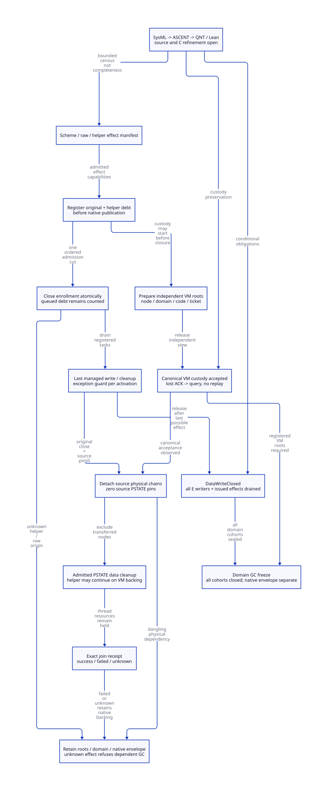

#+TITLE: Modern C Data-Write Closure and VM Custody Before PSTATE Cleanup
#+AUTHOR: Gambit runtime research
#+LANGUAGE: en
#+OPTIONS: toc:3 num:nil
#+TODO: OPEN | CONDITIONALLY-CHECKED
#+PROPERTY: header-args :eval never
#+STARTUP: overview

* Decision and evidence boundary
:PROPERTIES:
:CUSTOM_ID: data-write-closure-custody-decision
:STATUS: SOURCE-AND-C-MEMORY-REFINEMENT-OPEN
:MAINLINE: MODERN-GENERATED-C
:END:

This is a runtime ownership refactoring study for Gambit. Scheme owns procedure,
continuation, conversion and unwind semantics; its generator emits typed effect and
exit descriptors consumed by a modern C runtime service. Language replacement is
not the mechanism that makes writes stop or roots survive processor removal.

The present source contains no =DataWriteClosed= issuer. A successful Scheme call,
a marker invalidation, a processor-count update and a native join are different
observations. None, alone, closes every possible data writer or transfers the
physical resources destroyed by PSTATE cleanup.

Selected design: close each admitted writer cohort after its last possible effect;
prepare and accept independent VM custody before destructive PSTATE cleanup; retain
native thread/TLS/code resources on failed or unknown join. Separately established
cooperative data closure can authorize data GC without a successful native join.
Unknown data effects still block the affected domain's freeze. No recovery or
progress claim under arbitrary native thread death is made.

The semantic authority is [[file:models/sysml/data-write-closure-custody.sysml][the SysML model]].
Its native projection drives [[file:data-write-closure-custody-matrix.org][caller, closure and benefit matrices]],
[[file:diagrams/data-write-closure-custody.d2][D2]] and .
The actual [[file:../../../modeling/ascent/data-write-closure-custody.rules.scm][ASCENT DSL]] binds artifact,
digest, method, check and exact scope, rather than treating a file reference as proof.
The [[file:../../../../evidence/research/data-write-closure-custody/checks.json][scoped receipt]] records the remaining gaps.
The prior [[file:marker-interrupted-publication-design.org][interrupted-publication study]] remains unchanged.

* Source observations and the coverage frontier
:PROPERTIES:
:CUSTOM_ID: data-write-closure-custody-source
:END:

** Generator, conversion and nonlocal exits

The =c-make-function= generator wraps parameter and result conversions around three
SFUN result families. =c-function= emits =SFUN_CALL=; error macros can invoke Scheme
again. =END_SFUN= subsequently invalidates the marker, decrements its still
refcount and propagates errors. An issuer immediately after =SFUN_CALL= is too
early. Even result conversion can execute necessary cleanup or fail.

=build-c-lambda= also accepts user C text. Its generated =___return= macro reaches
a local label, but arbitrary C =return=, =longjmp=, external callbacks or retained
aliases are not thereby routed through a universal finally. =___AT_END= is selected
text on a generated path; it is not evidence that every exceptional edge executes
it. The bounded source family and exact anchors are native caller rows
=generator-all-three-sfun= and =generator-cfun-and-raw=.

=___call= catches trampoline trips, restores only its matching C-return frame and
rethrows a nonmatching unwind. =___run= has a normal marker-kill statement inside
TRY, which is not the same as proving that every throw executes it. The new guard
must be off-stack, keyed by activation identity, and participate in the actual
unwind dispatcher. A nested activation cannot discharge its parent's duties.
No change to Scheme dynamic-wind or continuation semantics follows merely from
installing a C cleanup guard.

=___propagate_error= (=setup.c:839-865=) can call =___THROW=; under setjmp that
writes =longjmp_err= and uses the PSTATE catcher, while TRY exit restores the
catcher pointer. These are not automatically harmless postludes. A normal guard
may close a narrowly specified marker-data scope after its final marker effect,
but source PSTATE pins must cover propagation/catcher restoration. A broader
activation-data seal must wait until those effects complete or their duty transfers
to an admitted unwind guard. No issuer is justified solely by inserting a call
between marker kill and error propagation.

The same generator's =2590-2670= emits release wrappers for aggregate conversions
or accepts an explicit release identifier. Those generated helpers belong in the
transitive effect manifest too; the three SFUN outer macros alone are insufficient.

** Named raw writes and cleanup-produced work

The selected-source census retains exact matching lines for marker APIs,
allocation, refcounts, RC payloads, thread joins and cleanup. It is a lexical census
of named routes, not alias analysis or proof of all loaded native effects.

- Marker creation writes procedure and processor slots after vector allocation;
  its source explicitly notes missing input protection across GC. Marker kill
  writes slot zero and then decrements the still count.
- Generic still allocation publishes next/head before count, length, header and
  caller body initialization. Allocator return therefore cannot certify the
  caller's entire initialization transaction.
- RC registration links a PSTATE sentinel; payload writes, addref, release, unlink
  and free are separate effects. A VM pointer to that sentinel retains a PSTATE
  dependency. A relocated root view must cover nonzero processors too; the old
  P0 =mark_rc= branch is not such a proof.
- Setup, mark and sweep are independent domain writers. A construction seal does
  not close future GC-phase work forever. The coordinator must count later
  phase-authorized cohorts before granting another actor domain access.
- =free_still_objs= invokes =release_foreign= before freeing each backing.
  =release_foreign= clears native release/pointer fields and invokes an arbitrary
  release function. Calling this after a supposed whole-domain seal creates
  new effects unless its work was preclassified and transferred.
- =cleanup_interrupts_pstate= calls =release_procedural_interrupt= while holding
  =procedural_interrupts_mut=. The release helper invokes the externally supplied
  =execute_fn(intr, false)=. =raise_procedural_interrupt_pstate= takes the same
  target mutex. A reentrant enqueue from that callback is a conditional lock-cycle
  counterexample, not a demonstrated current execution. Transfer queued duties
  under lock, invoke admitted callback work outside the lock, or reject that
  effect profile. The queue lock alone does not close future external enqueues.

Both generated =_kernel.c= and Scheme =_kernel.scm= inspect legacy vector slots;
regeneration/admission must cover both. GSTATE exports marker, RC, cleanup, thread
and procedural-interrupt interfaces. External native users can retain capabilities
not visible to a local call-site search. A controlled cohort requires a loaded
module/effect manifest and native callback unregister/drain evidence; unmanifested
raw aliases remain outside that cohort. The proposed recovery helper has no current
source implementation; its effect census is a design obligation, not a discovered
existing worker.

** Actual cleanup and join ordering

The native caller matrix covers all named =___cleanup_pstate= calls found in the
selected source: shrink, growth rollback and global shutdown, plus the exported
GSTATE entry. Shrink calls cleanup on the departing processor before =thread_exit=;
P0 joins later and ignores the returned status. Global shutdown also calls cleanup
after resize. Memory cleanup unconditionally frees still and RC chains; OS cleanup
can close the select-abort resource. VM cleanup destroys scan/allocation facilities.

The POSIX join wrapper branches on =pthread_join= but translates a nonzero result
through errno, rather than preserving that returned error number. This loses exact
failure information; it is not a claim that a failed join becomes success. The new
receipt preserves the raw return, request and target incarnation. At most one
native join authority may act on the target. Once success is known, its evidence
cannot be downgraded by a later unknown response or a reused thread identifier.

These observations expose requirements for the proposed recoverable cohort. They
do not establish a native bug in Gambit's existing cooperative collection profile.

* Conditional closure and handoff protocol
:PROPERTIES:
:CUSTOM_ID: data-write-closure-custody-protocol
:END:

** Identities and distinct receipts

#+NAME: closure-receipt-shapes
#+begin_example
WriterKey = (VM incarnation, Domain incarnation, Operation, Cohort generation,
             Native activation incarnation, Writer lineage)
WriterEffectSpec = (producer module/code identity, last-effect endpoint,
                    direct writes, transitive calls, descendants, exception exits)
DataWriteClosed = (WriterKey scope, sealed enrollment revision,
                   closed members, issued-effects-zero evidence, manifest identity)
VmCustodyAccepted = (operation, accepted decision, root-view receipt,
                     physical-domain receipt, code/ticket dependencies)
PstateCleanupPermit = (incarnation, VM acceptance observed, original data closed,
                       transferred-node exclusion, source pins zero)
NativeStopReceipt = (join request, exact target incarnation, raw return,
                     native reader/termination evidence)
#+end_example

These are design data shapes, not implemented C structs. A per-activation seal does
not imply a whole-domain seal; a domain freeze requires every contributing cohort.
The root view, physical domain and code leases are dependencies, not duplicate
ownership authorities.

** Register, close admission, drain and certify

1. Before publishing a callback address, queue item or helper capability, register
   the descendant under the canonical operation. Registration precedes parent
   discharge. Queue publication alone cannot act as the registration.
2. Order enrollment closure against registration in one synchronization domain.
   Registration wins: the member is owed even if not yet enqueued or dequeued.
   Closure wins: the attempted new capability is rejected before any effect.
3. Existing members may finish after enrollment closes. An unstarted helper may
   be canceled only with a no-effect proof. Cancellation request is not completion.
4. Each writer finishes its last admitted effect, hands off result/roots and closes
   reentry for that identity. Closure publication follows actual effects, not an
   optimistic ACK. A native postlude may still hold separately tracked PSTATE pins.
5. Certify only after the sealed member set is complete, all members closed, all
   issued effects settled and no raw capability escapes the manifest. Any new
   service/helper cohort must register before the domain-wide freeze cut; it may
   not reopen an already consumed certificate.

The close gate is not a universal revocation of already-issued C stores. An epoch
increment, logical owner death or timeout cannot turn an in-flight store into zero
pending effects. Async cancellation, unknown final writes and unrecoverable lock
ownership require rejection/quarantine, not an invented closure witness.

** VM acceptance precedes cleanup, not necessarily helper completion

Prepare VM backing before the source can disappear: stable operation decision,
relocation-safe root cells, a canonical still/RC domain, code and dependency leases,
and allocation/ticket custody. Preparation can overlap existing writer execution.
It cannot let the collector scan an unstable view: mutation, root replacement and
scan eligibility still use the inherited frozen-view protocol.

Acceptance is one canonical publish after the independent-backing and root-view
audit. Missing ACK is resolved by protected query. Before acceptance is observed,
the source retains its obligation. After canonical acceptance, VM service owns the
recoverable duty even if the caller never receives the answer. The interval may
contain two records of responsibility, but only one physical ownership authority;
neither may refund or free on an uncertain response.

The audit must reject PSTATE list sentinel references, stack root cells, current
closure global/TLS dependence, old scanner registration, source OS wait handles and
locks scheduled for destruction. VM ownership as a name is insufficient. Transferred
nodes must physically leave every destructive source cleanup walk. Retain one
backing; do not copy a heap object merely to rename its custodian.

With original managed writes closed, source pins zero, VM-independent helper
backing and canonical acceptance, PSTATE *data* cleanup may proceed while a VM
helper is still active. That helper still blocks its domain's data freeze until
its own closure. Thread descriptor, TLS, native stack and readers follow a later
native-envelope retirement proof. Do not treat this permit as permission to free
all processor storage.

** Cleanup is a producer and VM shutdown is a later barrier

Preflight classifies finalizers and interrupt callbacks before destructive walks.
Admitted deferred tasks transfer roots, native resources and code before dequeue;
unknown enqueue/acceptance retains custody. Unclassified synchronous callbacks
cannot execute under an already-issued domain seal. They need a counted cleanup
cohort with usable backing and bounded reserve, or the permit must be refused.

VM shutdown first closes external producers, then drains/retains these service
cohorts and root views, and only then destroys shared scan/allocation/OS facilities.
No coordinator waits for native join or owner callback while holding a lock or GC
barrier the target needs. If target effects cannot be closed, keep the affected
resources charged and refuse the dependent operation. Isolation sufficient to let
unrelated domains run is another obligation; it is not assumed by this model.

** Failure responsibility

#+NAME: custody-outcome-rules
| Observation | Source responsibility | VM responsibility | Allowed consequence |
|------------+-----------------------+-------------------+---------------------|
| Prepare failed, no accepted outcome | Retain original roots/domain/tickets | Retain any prepared reservation until disposition known | No destructive source cleanup |
| Acceptance result unknown | Keep duty and protected query right | If canonical accepted, retain full recoverable duty | Query canonical state; no replay/refund |
| Accepted, original write/pin unknown | Keep unsafe source resources alive | Keep roots/domain/code and outstanding effect debt | Refuse source cleanup and dependent freeze |
| Accepted and original closed, VM helper open | Source pins must be zero for data cleanup | Helper/member and result custody retained | Data cleanup possible; no domain freeze |
| Join failed or unknown, data closure unproved | Native envelope retained | Roots/domain/effect debt retained | No inferred termination or data seal |
| Join failed or unknown, independent cooperative closure proved | Native envelope retained | GC-visible roots retained | Data GC may proceed under all other phase gates |
| Join successful | Match exact incarnation; no second native join | Helper/result/root dependencies still separately owed | Retire native envelope only after readers drain |

Unknown native calls are not retried merely because they lack a response. Resolving
a prior join request means learning its canonical outcome, not issuing another
= pthread_join = against an identifier whose lifetime is uncertain.

* Memory-order and refinement obligations
:PROPERTIES:
:CUSTOM_ID: data-write-closure-custody-refinement
:END:

=DW-ORDER= requires compatible atomic access types and lifetime protection for
membership, closure and acceptance cells. Registration and admission-close must
serialize. Producer release follows the last data effect; the certifier's acquire
observes all closed writers and their effects. Acceptance release follows stable
root/domain publication; cleanup acquire observes that exact acceptance. Target
scan registration and source unlink require shared exclusion against scans/sweep,
with no period in which neither custodian covers the object.

A fence does not prove termination, eliminate raw aliases, make a partially
initialized header scan-safe or repair an abandoned mutex. Current emulated CAS
uses a hashed mutex; no universal lock-free or owner-death property is inherited.

The QNT abstraction treats these operations atomically. Lean proves selected
contract implications and a custody transition system. Both require a separate
simulation from actual generated/raw C effects. SysML requirement definitions are
validated structure, not instantiated proof of every requirement.

** Model scope, counterexamples and retained correction

[[file:../../../../models/gambit/data_write_closure_custody.qnt][QNT]] models one operation/cohort, an original writer and one helper. Issuance
and physical application are separate; registered-but-unstarted work is counted.
Admission, closure, VM acceptance, PSTATE pins and join outcomes are independent.
Join actions represent receipt observations for one request/target, not repeated\nnative join calls. It does not model arbitrary member counts, nested stack values, the whole collector,
C weak memory, process crashes or native liveness.

[[file:../../../../models/gambit/lean/DataWriteClosureCustody.lean][Lean]] proves conditional closure requirements and child debt, custody Step/Trace
preservation, monotonic join knowledge, no-join envelope retention and data-freeze
independence from join. It is not a proof of every QNT action or C-source refinement.

The initial sampled model exposed a known-success -> unknown downgrade after
native-envelope retirement. Its trace is retained in the evidence directory; the
admitted transitions now preserve known success and an explicit unsafe history
retains the old behavior as a counterexample. This is a model-design correction,
not a native failure. Additional negative histories cover missing helpers, pending
stores, open enrollment, raw escape, fake VM pointer handoff, postlude pins and
premature release after failed/unknown join.

** Evidence routing and closure

SysML declares nine local needs and imports six predecessor obligations without
changing their scope. ASCENT computes required methods, exact qualified slices,
transitive unmet dependencies, cycles and component readiness. Five actual
repository queries exercise current, missing-history, wrong-scope, stale-digest and
synthetic all-scoped control cases. Only local =DW-H= and =DW-I= can receive scoped
formal evidence. Source/native-order imports stay open; synthetic completion is a
planner control, never native admission.

The generated matrix is the closure report. No runtime path has retired, no native
test ran, and no measured speedup or peak reduction is asserted.

* Benefits, costs and migration decisions
:PROPERTIES:
:CUSTOM_ID: data-write-closure-custody-economics
:END:

For E admitted writers, O live operations and D live domains, the design adds
O(E+O+D) operation/domain support records, plus independently counted native
thread envelopes and protected readers; a closure census is O(E) unless a separately proved
incremental counter replaces it. Dynamic/external origins prevent a finite global
bound from the present source. Registration is once per admitted capability;
effect count, byte size and latency depend on the qualified implementation.

One canonical acceptance eliminates replay as the response-recovery mechanism.
Query performs zero native allocations/frees or scalar credit refunds on the
selected protocol. These are conditional work properties, not percentage speedups.
Native side-record sizeof/alignment and allocator usable size remain unqualified.

The inherited marker layout adds 24 bytes per live SMP marker in aligned-wrapper
request arithmetic. This is separate from writer/custody/service pools. Whole-round
physical peak remains max over time of H+P+N+Q, counting each backing once, including
retained roots/code/native envelopes. A VM handoff does not refund physical memory.
Failed joins and unknown readers may retain Q indefinitely. There is no proved
peak reduction and no claimed bounded leak-free progress under arbitrary failure.

Migration is dependency-driven: first enumerate/admit effects and regenerate all
endpoint variants; then establish root/physical-domain publication and canonical
VM acceptance; then route shrink/rollback/shutdown/exported cleanup through one
permit; finally qualify exact join/native-envelope retirement and the C memory
refinement. Raw managed marker/list/RC/cleanup paths retire only after all dependent
needs close. Legacy uncontrolled C remains explicitly outside the new cohort until
its own migration. This avoids a second language layer without proving it removes
any necessary support.

* Primary mechanism evidence and limits
:PROPERTIES:
:CUSTOM_ID: data-write-closure-custody-papers
:END:

- [[https://cs.brown.edu/people/mph/HerlihyW90/p463-herlihy.pdf][Herlihy and Wing, Linearizability (1990)]] motivates distinguishing the
  canonical operation outcome from its response. The selected acceptance cell
  still needs a concrete C refinement; the paper supplies no native-stop proof.
- [[https://www.eecg.utoronto.ca/~amza/ece1747h/papers/hazard_pointers.pdf][Michael, Hazard Pointers (2004)]] explains why logical removal cannot imply
  safe physical reuse in the presence of old borrowers. We borrow that lifetime
  distinction, not its algorithm, lock-free guarantee or performance measurements.
- [[https://developer.apple.com/library/archive/documentation/System/Conceptual/ManPages_iPhoneOS/man3/pthread_join.3.html][Apple's archived pthread_join manual]] states successful return observes target
  termination, returns errors directly, and simultaneous joins on one target are
  undefined. It does not establish survival of resources already freed by target
  cleanup, stop of descendant helpers, or a match to this host's installed binary.

All three primary sources were opened during this study. Their mechanism evidence
is separate from the exact local source digest and from unperformed native tests.
