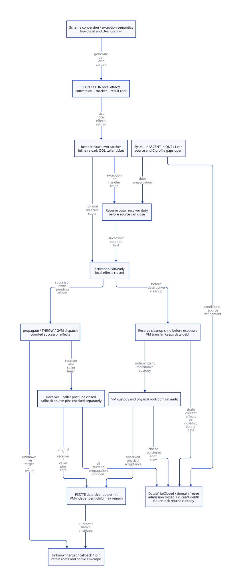

#+TITLE: Modern C FFI Exit, Catcher Restoration and Data-Write Closure
#+AUTHOR: Gambit runtime research
#+LANGUAGE: en
#+OPTIONS: toc:3 num:nil
#+TODO: OPEN | CONDITIONALLY-CHECKED
#+PROPERTY: header-args :eval never
#+STARTUP: overview

* Decision and authority
:PROPERTIES:
:CUSTOM_ID: ffi-exit-catcher-closure-decision
:STATUS: SOURCE-AND-C-PROFILE-REFINEMENT-OPEN
:MAINLINE: MODERN-GENERATED-C
:END:

Generate an explicit exit plan from Scheme and execute it through a typed modern C
exit service. Keep Scheme exception, dynamic-wind, tail-call and continuation
semantics in Gambit. Three observations remain distinct: local activation effects
finished, source PSTATE borrowers drained, and current-domain data writers closed.
There is no complete DataWriteClosed issuer in the present source.

A propagation receiver must acquire duty before the original activation drops it.
An OOL CFUN caller keeps its own register/status borrow after callee exit. Cleanup
callbacks create new duties before invocation; moving their resources to VM
custody does not by itself discharge their data effects. An unstarted future-epoch
task can remain across this GC only under a separately proved nonexecution gate.

[[file:models/sysml/ffi-exit-catcher-closure.sysml][SysML]] is the semantic authority for needs, dependencies, source routes, costs
and diagram topology. Native SysML evaluation projects the [[file:ffi-exit-catcher-closure-matrix.org][matrices]] and
[[file:diagrams/ffi-exit-catcher-closure.d2][D2 source]] / . The actual [[file:../../../modeling/ascent/ffi-exit-catcher-closure.rules.scm][ASCENT DSL]] joins scope,
artifact, digest, method and check. The [[file:../../../../evidence/research/ffi-exit-catcher-closure/checks.json][receipt]] retains exact identities and open
refinement obligations. Imported [[file:data-write-closure-custody-design.org][predecessor contracts]] are not newly proved.

* Real generated exit paths
:PROPERTIES:
:CUSTOM_ID: ffi-exit-catcher-closure-source
:END:

** SFUN: call completion precedes conversion, retirement and propagation

=c-convert-representation= recursively places BEGIN/END conversion macros around
its body; =c-make-function= emits void, SCMOBJ and typed SFUN variants. Relevant
END conversion macros release temporary still SCMOBJ values. Those releases can
follow the call, and a nonlocal exit may bypass their lexical location.

=SFUN_ERROR= can invoke the Scheme conversion-error handler again. After its loop,
result conversion/assignment and =END_SFUN= still have effects. Marker kill clears
slot zero and decrements its still refcount. =propagate_error= then executes on
both success and nonzero paths; only the latter calls =throw_error=.

A source-level acquisition record must distinguish conversions that succeeded
from conversions never reached. It must not manufacture cleanup from changed or
uninitialized automatic variables after a jump. Marker construction's existing
input-root TODO is still open. A new guard does not solve that root obligation.

SFUN has no universal local TRY installed by its BEGIN macro. A managed generated
exit needs a qualified outer guard encompassing admitted conversion/body exits;
adding a cleanup call solely after =SFUN_CALL= or marker kill is insufficient.

** CFUN: actual ordering and distinct handler routes

The source computes =cleanup?= from parameter types. This is not a proof that a raw
body with =cleanup?= false cannot throw, reenter or retain a pointer.

For the cleanup variant the source order is:

#+NAME: cfun-current-body-order
#+begin_example
BEGIN_CFUN context
  argument-conversion acquisition scopes
    W_ALL_INL
    BEGIN_TRY
      native/user body
      result conversion/publication
      AT_END
    END_TRY                 // restores predecessor catcher
    R_ALL_INL               // inline only; empty in OOL callee
  END argument conversions  // function/string/RC releases still occur
CFUN_CONV_ERROR             // ordinary error: inline jump or OOL return
propagate_error             // reached for NO_ERR or UNWIND_C_STACK here
END_CFUN                    // inline reload / OOL success temp1 publication
OOL caller: R_ALL; read temp1; dispatch handler if needed; eventual JUMPRET
#+end_example

An earlier throw skips user =AT_END=. Moving it after catch would newly execute
user effects; it is not an automatically equivalent cleanup fix. Guaranteed
runtime-service cleanup must be separate from optional user text. The generated
=___return= macro uses a local goto; arbitrary native return/longjmp remains a
separate admission problem.

Ordinary =CFUN_CONV_ERROR= excludes NO_ERR and UNWIND_C_STACK, writes error temps
and exits *before* the subsequent =propagate_error=. The UNWIND route can reach
that propagation call. A single generic error edge would lose this distinction.

=targ-scan-c-procedure= selects inline/OOL emission; the source defaults inline to
false and explicitly says OOL avoids setjmp interfering with C TCO. An OOL callee
has no =R_ALL_INL= restoration. Its caller reloads registers and reads status after
return. Therefore local callee closure can precede caller reload, while a distinct
caller ticket must remain. Inline CFUN requires its applicable local restoration
before local exit. Preserve this deliberate placement instead of introducing
setjmp into every GVM host.

** Catcher restore, throw and the real receiver

Under the setjmp profile, TRY saves the predecessor, installs a stack jbuf,
reads =longjmp_err= on jump and restores the predecessor at END_TRY. THROW first
writes =longjmp_err= and then jumps via =ps->catcher=. Restoration is itself a
PSTATE write; the target is native stack state, not transferable worker context.

=___call= restores its local catcher on leaving TRY. Trampoline-only trips can
loop without ending the original activation. A matching UNWIND marker performs
fp/R0 restoration and returns; a nonmatching marker or error rethrows to the outer
catcher. =___run= has marker kill inside the normal TRY body, so a thrown call can
skip it. The new service must cover acquired cleanup duties on those real edges
without changing Scheme return rights or replaying a native jump.

** Cleanup helpers and new producers

CFUN END conversions invoke release_function, release_string and release_string_list;
these reach RC decrement/unlink/free, and list release can release child strings.
Sweep/free_still invokes release_foreign, which clears native fields and calls the
release function. =cleanup_interrupts_pstate= calls external =execute_fn(intr,false)=
under the queue mutex; normal service calls execute_fn outside that mutex. Reentry
that needs the cleanup-held mutex is a conditional lock-cycle counterexample.
Neither current queue emptiness nor original activation exit closes external
interrupt producers.

The generated matrix supplies exact source anchors for all sixteen caller families.
A bounded lexical census covers named macros/helpers and exported APIs, not all
possible aliases in user C or loaded native libraries. Unmanifested raw escape
cannot receive a controlled-cohort certificate.

* Concrete exit-service contracts and insertion cuts
:PROPERTIES:
:CUSTOM_ID: ffi-exit-catcher-closure-contracts
:END:

#+NAME: exit-plan-shapes
#+begin_example
ExitPlan = (activation identity, backend/profile, acquired conversions,
            marker disposition, rooted result, own catcher predecessor,
            applicable register restore, normal/error/unwind route,
            propagation receiver, caller postlude, cleanup children)
ActivationExitReady = (own final effects settled, acquired duties disposed/transferred,
                       marker retired once, own catcher restored,
                       applicable local register restore complete, result rooted,
                       every outward duty already registered)
PstateBorrowClosed = (exact incarnation, all source borrowers zero,
                      no installed/dead catcher, no pending temp/fp/R0/reload access)
DataWriteClosed = (domain/cohort/epoch, sealed admission, current effects zero,
                   source borrowers drained, registered VM root view,
                   any retained future tasks blocked by qualified execution gate)
#+end_example

These are design contracts, not implemented C types. The local-ready observation
is deliberately not named DataWriteClosed.

** Normal and exceptional issuing points

#+NAME: issuing-point-cuts
| Path | Existing source cut | Required modern C issuer or handoff |
|------+---------------------+------------------------------------|
| SFUN normal | After all END conversions, result handoff, marker retirement and admitted final native context access | Generated normal exit service publishes ActivationExitReady; release source pin only after its final context dependency |
| SFUN nonmatching throw | ___call rethrows before lexical END cleanup | Off-stack acquired-duty guard receives escape; reserve outer target/root/code/PSTATE ticket before original closes |
| ___run caught escape | END_TRY restores catcher after skipped normal kill | Guard resolves acquired marker duty and rooted result/error; then local-ready; no blind second kill |
| Inline CFUN ordinary error | R_ALL_INL and argument cleanup precede handler jump | Reserve handler receiver before jump; no reliance on later END_CFUN being reached |
| OOL CFUN ordinary error | cproc returns error before END_CFUN success assignment | Callee-ready may publish; caller pin persists through R_ALL, temp1 read and dispatch |
| CFUN UNWIND | Selected cleanup and catcher restore precede propagate_error | Reserve propagation ticket before source close; original qualified thread alone performs jump |
| Domain seal | No current source issuer | Coordinator acquire observes all current effect closures, source borrowers zero, admission cut and VM root-view receipts |

A guard's own metadata publication is not permission to use old PSTATE fields
again. Continuing propagation belongs to an already registered successor ticket.
After it arrives at the outer catcher, that receiver still owes its own restore,
error/result delivery and possible outward handoff. Never infer total pins zero
from one local guard finishing. Full recursive catcher-chain refinement is open.

** No zero-borrow gap and no cross-thread continuation replay

Register successor responsibility before releasing the source. The protected record
contains receiver identity, live same-thread catcher, error/result roots and code
leases. For an original-to-receiver transfer, modeled borrow count is conserved.
Physical THROW remains on its qualified native thread. An independent collector or
helper may inspect custody and settle an admitted non-jump task; it may not longjmp
into an owner's native frame. Failed/unknown join retains native backing under the
imported lifetime contract.

The implementation must distinguish builtin, library and dynamically imported
setjmp profiles. Off-stack journals are control storage; they do not make jmp_buf
portable, make a dead frame live, or authorize another thread to use it.

** Callback debt, current closure and future-epoch work

Reserve a cleanup child before clearing the only resource fields, publishing the
callback address or dropping parent duty. Required resources include native payload,
GC-visible roots, code and origin/owner/thread capabilities. A callback that can
write current GC data or reenter an active current context remains current work.
An unknown callback outcome retains its duty; it is not completion.

VM-independent transfer can make source pins zero while a child still owes data
work. Source data cleanup may then proceed under the inherited physical-domain
permit, but it does not authorize the current-domain seal by itself.

For a callback that must wait until GC completion, requiring its execution before
that same completion creates a cycle. The selected alternative is a *future-epoch
execution gate*: the child is not started, has no issued current write or usable
current-context capability, cannot be invoked by an unregistered native producer,
and has VM-independent rooted custody. Admission to the current epoch is closed;
its next execution must obtain a fresh epoch/context authority. Then the current
seal can exclude that child's future effects while retaining its task/resource debt.
This is not a refund or an old terminal seal reopening.

The bounded QNT model represents that gate as an atomic admitted transition and
has no next-epoch resume action. Proving native callback unregister, queued-event
exclusion and next-epoch reacquisition is an explicit source obligation. If a child
has started, has an unknown invocation, lacks physical independence or can bypass
the gate, deferral is inadmissible and the dependent operation remains blocked.

** C memory order and physical cleanup

Receiver/callback admission publication precedes source release; coordinator acquire
observes closures and debts. Count-zero checks and final admission closure must
share an exclusion/atomic protocol so a late callback cannot appear behind a seal.
Canonical VM acceptance and root-domain registration precede any source unlink or
PSTATE cleanup. Still/RC walkers, scanner and sweep must agree on that physical cut.
No fence supplies unknown cleanup outcome, a native target lifetime or raw-alias
completeness. Exact C atomic/layout/backend refinement remains open.

* C-language and compiler constraints
:PROPERTIES:
:CUSTOM_ID: ffi-exit-catcher-closure-c-profile
:END:

[[https://www.open-std.org/jtc1/sc22/wg14/www/docs/n1570.pdf][WG14 N1570, 7.13.1.1 and 7.13.2.1]] restricts standard setjmp call contexts;
longjmp needs a live environment in the same thread; changed nonvolatile automatic
locals in the containing function become indeterminate. Keep recovery state in
protected storage and emit a permitted standard call form.

The header's library fallback feeds setjmp into an assignment in BEGIN_TRY.
That form cannot be used as an ISO-C-only qualification argument. Actual selected
builtin/import profile and compiler extensions must be identified separately;
this source observation is not a demonstrated Darwin runtime failure.

[[https://gcc.gnu.org/onlinedocs/gcc/Nonlocal-Gotos.html][GCC's builtin documentation]] distinguishes its builtins from library functions,
limits builtin longjmp's second argument to one, and prohibits invoking it in the
same function that initialized its buffer. A new exit stub cannot assume it may
inline or relocate the jump arbitrarily. No compiler/target behavior was tested.

[[https://cs.brown.edu/people/mph/HerlihyW90/p463-herlihy.pdf][Herlihy and Wing's linearizability formulation]] motivates separate accepted duty,
physical effect and observed response. Concrete C cells and source simulation are
still required; no native exactly-once side effect follows from the model alone.

* Formal scope and evidence chain
:PROPERTIES:
:CUSTOM_ID: ffi-exit-catcher-closure-formal
:END:

[[file:../../../../models/gambit/ffi_exit_catcher_closure.qnt][QNT]] has SFUN and OOL-CFUN simulation initializers, named inline-CFUN histories,
one original activation, a propagation receiver, an OOL caller and a cleanup child.
It separates issued/applied local effects, local close, caller reload, source pins,
current child execution and unstarted future-gated custody. Arbitrary recursive
nesting, weak memory, native instruction interruption, foreign API implementations
and the complete collector are outside this bounded model.

[[file:../../../../models/gambit/lean/FfiExitCatcherClosure.lean][Lean]] proves local gate implications and an independent debt Step/Trace account.
Receiver transfer conserves borrow count; callback registration adds a debt;
independent transfer does not discharge it. A DeferredSeal theorem permits retained
future debt only with the assumed execution gate. This is not a simulation of every
QNT action or actual native source.

A source-driven model correction retained the earlier generic reload ordering:
OOL callee exit must precede caller reload, while inline local restore precedes
local exit. The corrected model retains a caller pin and a counterexample for its
premature removal. The earlier named-test log is retained as earlier model evidence,
not relabeled as verification of the refined profile. Additional histories expose
premature marker/catcher closure, unregistered propagation/callbacks, wrong catcher
identity, active-child deferral and future task retention across the current seal.

SysML routes nine local needs and six imported open premises through actual ASCENT
queries. Five cases check current evidence, missing history, wrong scope, stale
digest and synthetic all-scoped control. Only EX-H and EX-I qualify locally; the
synthetic ready result is a planner control, never native admission. Requirement
definitions are native-tool validated structure, not proved requirement instances.

* Net benefit, peak memory and retirement
:PROPERTIES:
:CUSTOM_ID: ffi-exit-catcher-closure-economics
:END:

The matrix quantifies protocol work rather than invented speedups: one disposition
per acquired duty, zero native jump/free/allocation replay from observation query,
and zero-borrow-gap avoidance through registered transfer. It does not prove that
current production code already avoids or experiences any particular failure.

For A live activations, J receiver/caller tickets and K cleanup debts, exit support
records scale as O(A+J+K), plus reader/thread envelopes and transitive retained
root/code graphs. The inherited candidate marker layout adds 24 bytes per live SMP
marker in aligned-wrapper request arithmetic; new atomic records have unqualified
sizeof/alignment. One physical object remains one backing through custody changes.
Peak is max over time of H+P+N+Q, counting each backing once. Future gating avoids
requiring callback execution before GC completion, but retains task/resource memory;
unknown outcomes can retain Q indefinitely. No peak reduction is proved.

Retirement order is dependency-driven: generate complete typed acquisition/exit
plans; qualify catcher/backend profiles; implement source-to-receiver and caller
borrow contracts; integrate callback admission, root/domain custody and future
execution gates; finally route all destructive cleanup through permits. Only then
can managed legacy END/error/kill/cleanup scatter retire. There are zero retired
production paths today. No Zig-specific support saving or performance result is
needed to justify investigating these modern C architectural separations.
