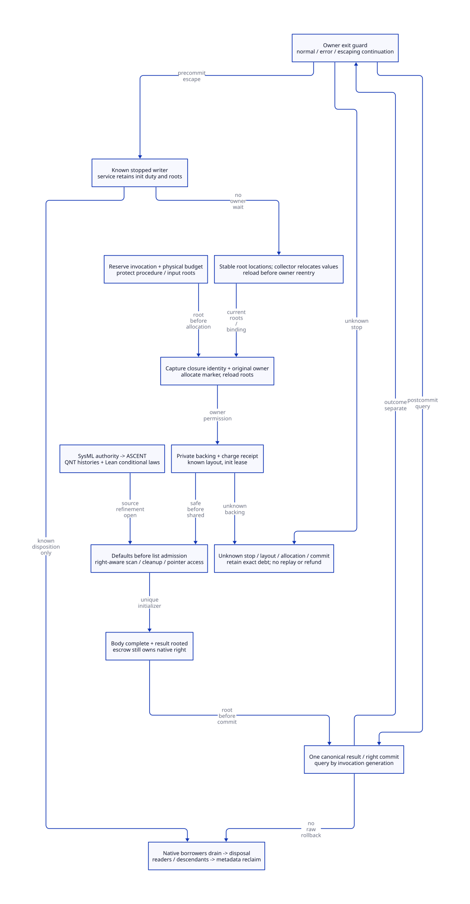

#+TITLE: Safe FOREIGN Shells, Pre-Marker Roots and Nested Unwind
#+OPTIONS: toc:3 num:nil
#+PROPERTY: header-args :eval never :exports code
#+STARTUP: overview

* Decision and evidence boundary
:PROPERTIES:
:ID: gambit-foreign-shell-unwind
:CUSTOM_ID: foreign-shell-unwind-decision
:STATUS: CONDITIONAL-DESIGN
:AUTHORITY: models/sysml/foreign-shell-unwind.sysml
:END:

Modern generated C is the mandatory implementation direction. Scheme retains
language semantics, conversion policy, continuation destinations and generation
of root/exit descriptors. The proposed C services own physical shell admission,
root registration, initialization custody, canonical result publication and
owner-local exit settlement. This is a runtime refactoring contract, not a build
profile or a second runtime in Zig. No production path is changed or retired.

The maintained authority is [[file:models/sysml/foreign-shell-unwind.sysml][SysML]]. Native sysml evaluation supplies
needs, dependencies, source routes, callers, costs and diagram topology to the
[[file:../../../modeling/ascent/foreign-shell-unwind.rules.scm][ASCENT DSL]] and its [[file:../../../modeling/ascent/foreign-shell-unwind.request.scm][source-bound request]].
[[file:foreign-shell-unwind-matrix.org][Generated closure/cost matrix]], [[file:diagrams/foreign-shell-unwind.d2][D2]] and  are projections, not a
parallel semantic registry. [[file:../../../../models/gambit/foreign_shell_unwind.qnt][QNT]] checks finite histories; [[file:../../../../models/gambit/lean/ForeignShellUnwind.lean][Lean]] checks conditional
laws. [[file:../../../../evidence/research/foreign-shell-unwind/checks.json][Receipt]] records exact inputs, failures and assurance scope.

#+begin_quote
A scanner-safe shell, permission to return into a C activation, and permission to
dispose its native payload are three different capabilities. None implies the
other two. An exception notification is not a stopped-writer receipt.
#+end_quote

* Real source cuts
:PROPERTIES:
:CUSTOM_ID: foreign-shell-unwind-source
:END:

The complete caller matrix is generated from SysML. The decisive observations
below distinguish source facts from proposed changes.

1. [[file:../../../../vendor/gambit/lib/mem.c::1487][alloc_scmobj]] requires the caller to fill the body before the next allocation.
   Its still path can call GC at 1647, then obtain native backing at 1657, undo
   accounting on known allocation failure at 1665, and link storage at 1682-1683
   before writing refcount, length and header. This is an existing phase-order
   discipline. It is not independently collectible safe-shell publication.
2. [[file:../../../../vendor/gambit/lib/c_intf.c::5156][POINTER_to_SCMOBJ]] has the native pointer before wrapper allocation, stores
   tags/release function/pointer, and finally assigns the caller's output.
   [[file:../../../../vendor/gambit/include/gambit.h.in::6030][FOREIGN_SIZE is three words]]. That excludes header, alignment and allocator
   overhead. The fourth output assignment is not a canonical ownership commit.
3. [[file:../../../../vendor/gambit/lib/mem.c::4023][scan]] skips FOREIGN payload. This does not prove dynamic tag values or
   opaque managed dependencies are rooted. Sweep and teardown still call
   [[file:../../../../vendor/gambit/lib/c_intf.c::1683][release_foreign]], which clears fields before arbitrary native cleanup.
   A half-filled shell must not reach that release or raw-pointer conversion.
4. [[file:../../../../vendor/gambit/lib/c_intf.c::6509][make_sfun_stack_marker]] allocates a vector before copying proc_or_false;
   its TODO explicitly acknowledges possible collection. [[file:../../../../vendor/gambit/lib/mem.c::1778][make_vector]] itself
   forbids a movable init value and requires other reachability/refcount for a
   still init value. Replacing false with the procedure does not fix the gap.
5. [[file:../../../../vendor/gambit/lib/os_dyn.c::744][c_closure_self]] is process-global with a thread-local TODO. A C closure
   trampoline stores its identity there before entering its converter. Reading
   it after a collecting/reentrant call needs an identity-capture protocol.
   The source fact alone is not a reproduced concurrent or nested failure.
6. [[file:../../../../vendor/gambit/lib/setup.c::3379][___call]] catches a trampoline exit, then rethrows wrong errors or a different
   destination marker before its normal frame restoration. [[file:../../../../vendor/gambit/lib/setup.c::3404][___run]] kills its
   marker after ___call returns inside TRY. A throw can skip that statement.
7. [[file:../../../../vendor/gambit/gsc/_ptree2.scm::2931][The Scheme generator]] emits SFUN entry, conversions, calls, error handling
   and END. [[file:../../../../vendor/gambit/include/gambit.h.in::10043][SFUN macros]] kill the marker on their lexical END; conversion-error
   handling can reenter Scheme via temp1..4. [[file:../../../../vendor/gambit/include/gambit.h.in::9981][C TRY]] restores catcher state,
   not every skipped function's resource ledger. C BEGIN_CLEANUP is lexical;
   the C++ destructor branch is not the selected modern C architecture.
8. [[file:../../../../vendor/gambit/examples/tcltk/tcltk.scm::124][The actual Tcl callback]] loads an RC-held vector and returns a native string;
   Tcl_SetResult takes a release_string callback. Command deletion releases the
   vector/RC. These are distinct lifetimes; this example does not establish
   permission to longjmp through arbitrary Tcl activations.

* Allocation, publication and initialization authority
:PROPERTIES:
:CUSTOM_ID: foreign-shell-unwind-shell
:END:

#+NAME: shell-transition-contract
| Cut | Preconditions | Authoritative event | Retained responsibility on failure |
|---+---+---+---|
| Reserve | Original owner admitted, stable root/init/result record and budget available | Register invocation generation and physical reservation | Source retains payload and reservation; fail before native production if unavailable |
| Acquire private storage | Input roots already protected, collecting allocator allowed outside locks | Known allocation/charge receipt identifies exact backing | Unknown address/charge stays allocator debt; no fabricated free or refund |
| Prepare shell | Private backing, unique InitLease, known descriptor layout | Complete metadata plus tags=false, release_fn=null, ptr=null | Private backing is outside collector list; service may retain known stopped duty |
| Admit shell | Valid metadata/defaults, rooted init record, guarded release/read paths | Release publication under still-domain admission protocol | Prepublication source owns; postpublication canonical domain owns membership; query uncertain response |
| Fill payload | Exclusive initialization writer and valid current roots | Monotone progress record; no allocating/callback operations in bounded write slice | Known stopped writer can hand duty to service; unknown writer cannot be duplicated |
| Root result | Complete body, current root-write authority | Registered result handle visible to this round or separately qualified rescan | Escrow still owns native ReleaseRight |
| Commit | Body, root, generation and sole right all verified | Publish one immutable canonical WrapperCommitted record | Before event: escrow; after event: wrapper; unknown response retains record and queries it |

Admission is not a multi-store lock-free miracle. Baseline design uses a bounded
still-domain gate to serialize list membership with root registration, epoch
closure and descriptor phase initialization. No allocation, foreign call, callback
or nonlocal transfer occurs while holding it. Storage is acquired before the
critical slice. If the epoch closes meanwhile, retain private backing and retry
admission after the proper round protocol; do not wait inside the gate for GC.
Native sysml requirements constrain the design; they are not executed C proofs.

The present still mark slot is phase scratch: setup_still_objs_to_scan assigns it
before scan/sweep. A redesigned allocator must either admit before that cut or
explicitly initialize the current phase's mark state under exclusive ownership.
Blindly setting mark=0 or reusing old mark state is not a proof. Unchanged legacy
GC readers cannot overlap a new independent publication protocol by assumption.

Safe defaults are typed values, not a byte-zeroing assertion about C function
pointers. A default shell is internal: user pointer/tag conversion remains gated
until commit. Preserve its dependency roots separately because current FOREIGN
scan is opaque. Protect arbitrary tags before wrapper allocation; after commit,
require permanent tags or retain a stable root handle for their full use period.
No claim is made that today's tag producers meet either admission rule globally.

The initializer may write raw final fields before commit only while canonical
release/pointer guards exclude unauthorized readers. All GC, explicit release,
constructor rollback and teardown origins must consult the same ReleaseRight.
Refcount=1 is useful under current collection ordering but does not authorize
survival through unconditional teardown. The proposed safe-shell path cannot be
enabled while the old direct finalizer/borrow path still handles that cohort.

* Pre-marker root and closure identity protocol
:PROPERTIES:
:CUSTOM_ID: foreign-shell-unwind-marker
:END:

#+NAME: pre-marker-order
#+begin_example
admit original owner + reserve stable invocation/root cells (no managed allocation)
  -> capture explicit closure token and acquire RC/code/library invocation lease
  -> register procedure/arguments/tags + all live ancestor/error/result cells
  -> allocate marker (may collect; lock is not held)
  -> acquire/reload relocated procedure, publish marker root and original processor
  -> perform argument conversion / ___call using this invocation's descriptors
#+end_example

For proc_or_false=false, capture the actual RC closure token before the first
collecting/reentrant operation, then use its protected data cell. A source-owned
lease must already make that capture legal; loading a freed global and later
incrementing a refcount is too late. TLS is an insufficient complete solution:
same-thread nested entry can replace a TLS slot before a delayed reread. Prefer
an explicit per-invocation token carried by a qualified trampoline/entry adapter.
The C calling convention, generated trampoline support and code lifetime remain
source-refinement gates, not an established ABI-preserving implementation.

Marker allocation failure creates no valid return destination. Retain/release
procedure roots and the pre-reserved record through the failure guard; do not
kill an uninitialized marker. RC registration/scanning on every nonzero processor
and cleanup_rc transfer/drain remain prerequisites imported from earlier studies.
Do not assume that a C local SCMOBJ or an RC addref is enough.

* Nested exits and the owner guard
:PROPERTIES:
:CUSTOM_ID: foreign-shell-unwind-exit
:END:

#+NAME: exit-obligation-matrix
| Actual exit class | Required settlement | Result/native custody | Marker rule |
|---+---+---+---|
| Matching ordinary Scheme return | Complete conversion and guarded delivery | Known canonical result only | Invalidate this invocation after owner return sequence |
| Conversion error, handler returns normally | Keep invocation/error roots through nested handler calls | Parent result is not child's scratch slot | Preserve parent; independently settle each child |
| Allocation failure before marker ready | Close partial entry/root/record admission | No marker result; preexisting native payload remains escrow-owned | No kill of uninitialized marker |
| Nonmatching marker / outer continuation | Settle escaped descendants from inner to outer, restore catcher, propagate exact destination | Transfer stopped initialization duty; canonical commit remains unchanged | Invalidate escaped markers; keep live destination marker |
| Postcommit exception or lost response | Query canonical state; separately decide delivery/error policy | Wrapper owns; no constructor rollback or repeated native effect | Dead/escaped marker cannot be revived by a rooted result |
| Unknown stop or foreign-library unwind legality | Retain exact roots, backing, duty and right; refuse this exit/reentry admission | No inference of release or refund from scalar error | No jump to another OS thread or dead C activation |

The new guard catches supported exits at an original-owner boundary outside the
allocating/converting/calling slice. It publishes a typed exit tag and separately
rooted Scheme exception or continuation destination. It closes managed writers,
settles child records, transfers stopped initialization duties, invalidates only
escaped markers, restores the previous catcher and propagates the original tag.
A =ContinuationEscape= is not silently reclassified as an exception or C error.
An original matching destination remains usable only while its real activation
and processor binding are valid. Scheme dynamic-wind behavior remains owned by
Scheme; no claim is made that a resource guard alone preserves it.

The recovery record lives outside automatic locals modified after setjmp. Its
stable handle is initialized before setjmp and is not overwritten before the
catcher resumes. N1570 7.13.2.1 restricts changed nonvolatile automatic values and
forbids longjmp into terminated functions or across threads. The current header
may choose compiler builtins; their target-specific contract is a separate gate.
Adding volatile to a few locals neither roots them nor supplies inter-thread
synchronization. We do not propose C++ exceptions or destructors.

Settlement is bounded and no-callback: defer actual native cleanup to an admitted
service when required, with dependencies retained. Never enter arbitrary release
functions under the owner/registry lock or while a collector waits for that same
owner. Unknown stop remains unresolved; an exception request alone cannot make a
concurrent/native writer stop. A heap-safe shell can unblock a qualified scan,
but cannot make an unsafe suspended foreign activation resumable.

The Tcl adapter needs a separately specified result/error policy and string
ownership transfer before delivery. A release_string token becomes Tcl-owned
only at a known successful library handoff. An unknown handoff must retain/query
that exact token. Arbitrary continuation escape across Tcl frames is rejected
until its library contract is proved. Returning a fabricated TCL_OK is not an
acceptable replacement for Scheme exception semantics.

* Canonical commit, unknown response and reclamation
:PROPERTIES:
:CUSTOM_ID: foreign-shell-unwind-commit
:END:

The linearization point is the single successful publication of
=WrapperCommitted(invocation,generation,RootHandle,ReleaseRight,completion)= into
an authoritative control record. List linkage, last field write, *obj assignment,
queue insertion and notification are not that point. A bounded lock or a proven
release/CAS control publication can implement the abstract event; no machine-level
atomicity has been established here. Consumers acquire that control before any
body/right reads; old direct pointer reads must be replaced for this cohort.

Before commit, the initializer holds InitLease and escrow holds ReleaseRight.
After commit, InitLease closes and the wrapper projects the same ReleaseRight.
There is no second native allocation or independent ownership bit. A side record
must survive still-body release, GC relocation rules, observer pinning and code
unload; a stale address alone is not stable invocation identity.

Unknown response differs from an unknown canonical record. If an authoritative
query returns Pending, the service may continue only from known progress with a
known stopped writer and a fresh lease. Committed forbids rollback or a second
wrapper. If record access, generation, stop, physical disposition or roots are
unknown, retain custody and refuse takeover. No timeout creates an ownership
answer. Native disposal requires actual borrower drain and known disposition;
metadata/root/ticket reuse requires every relevant reader/descendant/code lease
to drain. Result ACK does not itself free storage.

* Formal refinement, counterexamples and closure
:PROPERTIES:
:CUSTOM_ID: foreign-shell-unwind-proof
:END:

The SysML model defines ForeignShell, Invocation, SafeAdmission, MarkerRootFirst
and CommitRootFirst and routes seven new source/order obligations to exact
callers. Five previous obligations are imported as still-open premises. The
ASCENT relation joins method, artifact, digest, exact scope and dependency;
file existence cannot qualify a component. Its all-scoped case is synthetic
wiring evidence only and never grants native admission.

QNT represents private/defaulted/admitted/complete shell states, distinct
initialization authority, two invocation slots, pre-marker relocation, canonical
commit and exceptional settlement. Named histories include allocation failure,
pre/postcommit exception, child escape preserving the parent marker, repeated
query, borrower/reader drain, and unsafe alternatives. Counterexample controls
cover linked-before-defaults, unprotected marker, unrooted/double commit, skipped
child guard, GC with an active writer, early refund, release while borrowed and
legacy finalizer coexistence. The negative badStep deliberately violates safe;
it is not a detected native failure. The simulation is seeded sampling, not an
exhaustive state-space proof or termination argument.

Lean proves canonical-state preservation for the explicitly defined
commit/query/escape Step and Trace, plus publication, root-before-commit,
generation, exit and parent/child slot lemmas. No claim extends that induction to
all QNT actions, physical malloc/list accounting, actual setjmp behavior, native
effects, arbitrary callback depth or a C11 source simulation. Passing model
slices leaves source and native-memory obligations open in the closure matrix.

#+NAME: refinement-remaining
| Need family | Required forward/reflection obligation |
|---+---|
| Allocation | Actual aligned allocation, charge rollback and list publication refine private/default/admitted transitions; no omitted write/scan/free path |
| Roots | Every actual allocating/reentrant point has complete descriptor coverage; relocation updates the cells subsequently read |
| Marker | Closure identity captured before invalidation, exact activation/processor preserved, failed entry has no marker to invalidate |
| Unwind | Every generated normal/error/nonlocal edge executes or delegates one guard without changing Scheme continuation/dynamic-wind semantics |
| Commit | One C authoritative event implements both result readiness and ReleaseRight ownership; unknown response cannot enable replay |
| Reclaim | Actual sweep/explicit/rollback/teardown/borrow paths share that right; native effects and physical disposition are separately established |
| Memory order | Data-race freedom, acquire/release control visibility, list/root phase exclusion, lock order and reclamation before generation reuse |

* Benefit and physical peak accounting
:PROPERTIES:
:CUSTOM_ID: foreign-shell-unwind-benefit
:END:

The generated matrix counts logical work and states falsifiers. Three safe
FOREIGN payload defaults do not mean three instructions or a three-word total
object. At callback depth d, at least d procedure roots and d invocation records
are needed, plus actual live ancestor/result/error/argument/tag roots. If records
come from preallocated pools, charge the physical pool capacity once; do not add
live logical record bytes a second time.

#+NAME: shell-peak-law
#+begin_example
Peak = max_t [ H(t) + P(t) + N(t) + Q(t) ]
H = physical managed heap backing excluding separately counted pools
P = actual shell/root/init/commit/exit pool backing not already in H
N = live native backing counted once across escrow and wrapper
Q = retained unknown/quarantine backing not already in H, P or N
Positive latency gain requires removed waits/repeated work
  > added root scans + gate/guard + publication/query + reclamation work.
#+end_example

A canonical commit moves authority, not physical storage, and earns no refund.
Safe defaults, overlapping roots, late outcomes and delayed disposal can increase
peak. With fixed admission and native-size budgets, quarantine is bounded by retained\nreservations and can exhaust admission; without those bounds no finite retained\nbacking bound follows. No whole-round peak reduction, speedup, pass elimination or incremental Zig
net benefit is proved. The architectural benefit is enabling independently
scannable admitted shells and explicit recoverable custody without weakening
Scheme semantics; actual work saved remains conditional on a real workload and
all source/ordering obligations.

The current allocation formula can be made more concrete without a native test.
mem.c 515-535 and 1570-1571 give STILL_BODY=6 and words=6+WORDS(bytes).
A FOREIGN payload therefore requests 9 words before alignment support. In
alloc_mem_aligned_aux 577-590, when word and pointer are both 8 bytes, the
FOREIGN alignment parameters are multiplier=1, modulus=0 and extra=15 bytes:
the call to ALLOC_MEM_HEAP requests 87 bytes. A marker vector requests 71 bytes
for one element or 79 for two. These are conditional source-derived request
sizes, not allocator usable sizes, RSS, new-service metadata sizes or savings.
Replacing a shell need not duplicate these allocations; the extra root/control
pool backing is still a separate physical budget to be designed.

* Migration and retirement gates
:PROPERTIES:
:CUSTOM_ID: foreign-shell-unwind-migration
:END:

1. Scheme generates complete Root/Exit/Frame descriptors and invocation origin
   metadata; modern C supplies one shared canonical root/init/result/guard service.
2. Qualify actual RC/root ownership and collector membership/phase exclusion;
   reserve records before entry. No independent worker admission precedes this.
3. Replace still publication for the new typed FOREIGN cohort; gate all pointer,
   release, sweep, rollback and teardown consumers before exposing safe shells.
4. Replace process-global closure identity and pre-marker root gap with explicit
   captured tokens, protected roots and source-qualified ABI adapters.
5. Replace generated SFUN/___run exit sequences with guarded normal/error/escape
   settlement while retaining trampoline, marker and Scheme continuation meaning.
6. Retire cohort-specific old paths only after caller completeness, failure
   semantics, C-memory refinement and later authorized native acceptance. This
   study retires zero routes and performs no runtime or native test.

* Learning sources and limits
:PROPERTIES:
:CUSTOM_ID: foreign-shell-unwind-learning
:END:

- [[https://ocaml.org/manual/5.3/intfc.html][OCaml C interface]], sections 5, 5.3 and 7.2: protect live values before
  allocation; separate pending actions from allocation; typed callback results
  permit cleanup before propagation. We learn the separation of concerns, not
  OCaml's stack/effect/GC ABI. Its allocation action policy is not presumed true
  for current Gambit or imposed without a separate language/effect audit.
- [[https://cs.brown.edu/people/mph/HerlihyW90/p463-herlihy.pdf][Herlihy and Wing, Linearizability (1990)]]: motivates one observable abstract
  commit between invocation and response. It does not prove this C design.
- [[https://www.open-std.org/jtc1/sc22/wg14/www/docs/n1570.pdf][WG14 N1570]], 5.1.2.4 and 7.13: C concurrency and nonlocal-jump constraints.
  This is a committee draft, not evidence of actual compiler-builtin or Darwin
  ABI conformance. See receipt for selected-source identities and open gates.
