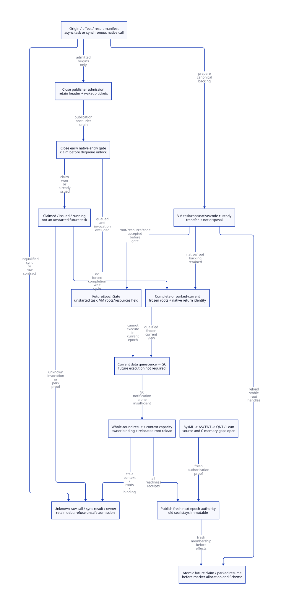

#+TITLE: Modern C Future-Epoch Execution Gate and Fresh Reentry Authority
#+AUTHOR: Gambit runtime research
#+LANGUAGE: en
#+OPTIONS: toc:3 num:nil
#+TODO: OPEN | CONDITIONALLY-CHECKED
#+PROPERTY: header-args :eval never
#+STARTUP: overview

* Decision and authority
:PROPERTIES:
:CUSTOM_ID: future-epoch-reentry-gate-decision
:STATUS: SOURCE-AND-NATIVE-ORDER-REFINEMENT-OPEN
:MAINLINE: MODERN-GENERATED-C
:END:

There is no complete future-epoch execution-gate issuer in the present source.
The selected refactoring is a VM-owned AdmissionDomain shared by generated native
entry, owned queue publication/dequeue, participating wait and context reentry.
Scheme owns effect, result, continuation and exit semantics; typed modern C services
own atomic admission, custody, root-view publication and native/context lifetime.

Distinguish an unstarted retained asynchronous task, a claim whose native invocation
may already be issued, and an existing native invocation parked for its own GC.
Only the first can receive FutureEpochGate. A running callback cannot become an
unstarted task by changing its epoch number. A parked callback resumes the same
native activation under new write authority, without invoking the callback again.

[[file:models/sysml/future-epoch-reentry-gate.sysml][SysML]] is the authority for obligations, dependency edges, source routes, costs
and diagram topology. Native evaluation projects [[file:future-epoch-reentry-gate-matrix.org][the matrices]] and
[[file:diagrams/future-epoch-reentry-gate.d2][D2 source]] / . Actual [[file:../../../modeling/ascent/future-epoch-reentry-gate.rules.scm][ASCENT DSL]] binds exact artifact,
digest, scope and method. The [[file:../../../../evidence/research/future-epoch-reentry-gate/checks.json][receipt]] separates scoped model checks from source
and native-order gaps. Imported [[file:ffi-exit-catcher-closure-design.org][exit/catcher/callback contracts]] stay open.

* Source chain and excluded shortcuts
:PROPERTIES:
:CUSTOM_ID: future-epoch-reentry-gate-source
:END:

** Publication continues after the queue mutex is released

=raise_procedural_interrupt_pstate= writes =h->next= before locking, appends the
header under the target queue mutex, unlocks, then calls =raise_interrupt_pstate=.
The latter can update interrupt flags, trip the stack limit and abort device select.
A publisher's source-PSTATE duty therefore ends after the wakeup postlude, not at
queue insertion. Closing only the queue head leaves later target accesses possible.

The new publication ticket must be reserved before the first admitted effect and
name the exact target incarnation and backing. Producer admission closure and
outstanding-publication reconciliation precede source resource cleanup and gate
certification. A pre-cut accepted publication can finish into the owned VM queue;
it cannot silently append to an already destroyed PSTATE queue.

** Dequeued means claimed, not completed

=service_procedural_interrupts_pstate= removes the head and updates the tail while
holding the mutex, then unlocks and invokes =execute_fn(intr,true)=. Thus the visible
queue may be empty while a native callback is about to start or already running.
The present route does not publish the new claim/active-call registry required by
this design. Claim registration must happen under the same ordered cut as dequeue,
before unlocking. Error and nonlocal exits retain the claim until their actual exit
and root responsibilities are settled.

=cleanup_interrupts_pstate= instead invokes =execute_fn(intr,false)= under the queue
mutex. False is an operation supplied to arbitrary external code, not a universal
no-effect cancellation token. Moving a queued execution task must preserve the
intended true/false operation and result handling; calling false and later true
could dispose the payload before its future use. Reentrant release work must not
wait for this GC or the held queue mutex.

** A late gate in ___call is insufficient

The native closure trampoline writes =c_closure_self= before entering the generated
converter; source records its thread-local TODO. SFUN BEGIN fetches PSTATE and
allocates a marker before calling Scheme. Marker construction also has an input
root-protection TODO. Tcl's =scheme_call_cmd= reads =data_rc(client_data)= before
calling the Scheme wrapper. Therefore a gate solely in =___call= is too late.

The managed profile needs a stable typed native entry thunk before these relevant
effects, protected code/control lookup and root handles independent of source
PSTATE. Every public/raw entry and cached native function pointer must either use
that ingress or have origin-specific unregister/drain evidence. A pointer swap,
generation bump, empty owned queue or disabled interrupt flag cannot revoke an
already-issued native invocation. The complete loaded-origin manifest is unresolved.

** Synchronous Tcl commands cannot be converted into deferred tasks implicitly

The real Tcl example calls =tcltk_call= synchronously, immediately installs its
returned C string in Tcl and returns TCL_OK. The command arguments borrow argv
storage from the active Tcl call. Returning invented pending/success while the
Scheme computation is delayed changes both result and lifetime semantics.

This origin requires gating upstream initiation, a qualified participating wait
inside the same native invocation, or refusal of future-task admission. Deep-copying
argv alone does not repair its synchronous result contract. The command deletion
callback and later Tcl result-free callback release different resources; neither,
by itself, proves all copied/native callback aliases have drained. No undocumented
Tcl deletion/unregister guarantee is assumed in this study.

** GC notification precedes context preparation

The current GC performs strong, weak and cleanup phases separated by barriers,
resizes capacity and guarantees heap fudge. P0 then raises INTR_GC before its call
to =prepare_mem_pstate=. That function writes fp/hp and stack/heap limits and
refreshes interrupt detection limits. The normal cooperative protocol supplies
additional sequencing; this observation is not a demonstrated current native race.
It does show that the notification alone is not an independent-worker reentry seal.

Root handling must also change: =mark_rc= is in the P0 branch while continuation,
register, saved and processor roots are scanned per PSTATE. Transferring a nonzero
processor's task to VM custody requires an actual all-domain root adapter. TLS
binding and processor integer alone do not identify a prepared next-epoch context.

* Gate issuance protocol
:PROPERTIES:
:CUSTOM_ID: future-epoch-reentry-gate-issuance
:END:

#+NAME: future-gate-records
#+begin_example
AdmissionDomain = (VM incarnation, domain incarnation, epoch, origin manifest,
                   producer admission, publication debt, queue/claim/entry state)
PublicationReceipt = (accepted request, target incarnation, header/link/wakeup duty)
ClaimReceipt = (task identity, claim attempt, expected epoch, invocation issue state)
FutureEpochGate = (unstarted async task, closed current ingress,
                   publisher and claim exclusion, no issued native invocation,
                   VM root/resource/code custody, input/order/result profile)
ParkedCurrentReceipt = (same native activation, safe point, frozen root view,
                        revoked current write permit, live owner/catcher/code)
ReentryAuthority = (new epoch, whole-round result, prepared context/capacity,
                    exact owner/VM binding, reloaded root handles, new membership)
#+end_example

These are design shapes, not implemented structs or current source-issued receipts.

** Ordered close, claim and transfer

1. Reserve bounded metadata/root/native/code custody before accepting work. Close
   producer admission and early current-epoch entry in an order shared with all
   producers and claims. Existing publishers remain counted through their postlude.
2. A dequeue publishes its claim before releasing the queue lock. If close wins,
   no new current claim starts. If claim wins, that duty stays visible even when
   the queue becomes empty or the caller loses the claim response.
3. Queued unstarted work can move to the owned future queue after publication
   postludes settle. Preserve task identity, operation, input ownership, enqueue
   order and result causality. A canceled claim must preserve its accepted position
   unless a separately admitted contract allows reordering.
4. An unissued owned claim can be canceled/retargeted only under the same atomic
   arbitration that authorizes native issue/start. Once invocation is issued or
   unknown, cancellation request, timeout or counter update is no exclusion proof.
5. Sign FutureEpochGate only after origin/adapter coverage, canonical custody,
   current publication/claim exclusion and no-issued-invocation evidence are known.
   Protected query resolves a lost response; it performs no callback replay.

The exact source cuts are the publisher entry and post-wakeup exit, the
mutex-protected dequeue, generated/native ingress before first context/root effect,
and the coordinator's final census. No existing one of those statements is a full
issuer. Introducing the service requires changing these paths together.

** Claimed, issued and running work

#+NAME: callback-classification
| State at close | Admissible action | Duty retained |
|----------------+-------------------+---------------|
| Queued, async result contract | Move under exclusion to VM future queue | Inputs, root handles, resources, code, accepted order and result identity |
| Claimed, proven unissued | Cancel versus native issue under one arbitration, then retain as future | Canonical claim/result record until old claimant cannot issue |
| Native invocation issued or unknown | Do not certify unstarted; drain or track actual entry/exit | Invocation/control/code/native context and roots |
| Running and able to complete without waiting on this GC | Complete through exit protocol | Exit, result and caller-postlude duties |
| Running and needs this GC | Qualified participating park, not completion wait | Same native invocation, frozen roots and live return/catcher identity |
| Synchronous result required | Preserve same-call protocol or gate upstream | Native caller/argument/result lifetime |
| Unknown origin, root view or native target | Refuse affected admission/transfer | Canonical service/source retains unresolved debt |

** Participating park avoids the completion wait cycle

The unsafe dependency cycle is GC waits for callback completion, callback waits for
that GC, and/or callback holds a lock required by GC. Requiring completion cannot
resolve that cycle. At an admitted safe point the existing callback instead
publishes a frozen root/continuation view, relinquishes current managed write
authority and retains its native activation. GC waits for that handshake, not the
callback's final result. Root writes, native borrows, nested callbacks and locks
must be covered by the inherited exit/root contracts.

A parked callback remains current native work, not a new task. No worker longjmps
to its owner frame. If its frozen view or lock/borrow closure is unknown, the
handshake is unavailable and the dependent operation stays unresolved. No liveness
under arbitrary thread death, foreign nonparticipation or abandoned locks is claimed.

* Fresh next-epoch reentry
:PROPERTIES:
:CUSTOM_ID: future-epoch-reentry-gate-reentry
:END:

#+NAME: next-epoch-order
#+begin_example
current epoch closed and current writers quiescent
 -> strong/weak/cleanup and known shared capacity outcome complete
 -> prepare selected execution context, allocation limits and binding
 -> reload relocated values from stable VM root handles
 -> release-publish next epoch authority
 -> acquire-claim membership for exact expected epoch and context incarnation
 -> marker allocation, conversions and Scheme entry
#+end_example

Claim and next phase closure must share an admission protocol. No check-then-enter
window may authorize writes after membership closes. Failed owner binding,
capacity, reload or claim keeps the task under VM custody. An epoch change does not
make an old context or raw SCMOBJ valid. Revalidate exact VM/native activation
identity, not only a processor number that can be reused during resize.

The two routes differ: future work acquires a new invocation claim and executes
once; parked work resumes the *same* native invocation with fresh write membership.
The old epoch's terminal seal remains immutable even while the next epoch writes.
A stale queued native request cannot simply borrow the newest permission.

A root handle is stable lookup authority; values loaded before GC must not be
reused after relocation. Binding must precede context-dependent marker allocation.
All-domain root registration and the physical still/RC domain handoff precede any
source PSTATE cleanup. Current cleanup and join paths do not supply these new
permissions; failed/unknown join retains native envelope separately.

* Custody, capacity and failure boundaries
:PROPERTIES:
:CUSTOM_ID: future-epoch-reentry-gate-custody
:END:

Transfer one backing with explicit ownership authority. Keep roots, payload,
continuation/native stack as applicable, code and result lifetime under VM custody.
Borrowed argv/native buffers need actual retention evidence or an admitted snapshot;
a shallow pointer copy is not a payload lease. A future task is still charged even
though it contributes no current write. Native cleanup outcome unknown cannot be
resolved by rerunning a destructor or discarding the task record.

Future-queue budget must be reserved before destructive detachment or a closing
phase in which allocating could recursively request GC. Exhaustion needs an
origin-compatible reject/backpressure rule before acceptance, or continued source
custody. A void native enqueue API does not provide a new failure result by magic.
No new blocking wait is allowed under queue/publication/GC locks.

For source cleanup, VM custody must include physical node/root/code backing and
all source borrowers must be zero or transferred under the imported protocol.
A parked native activation still needs its PSTATE/context/catcher dependencies;
a VM-owned label cannot authorize their destruction. Unknown results keep the
canonical task and native envelope alive; physical lifetime is separate from
current data quiescence.

* C memory order and adapter refinement
:PROPERTIES:
:CUSTOM_ID: future-epoch-reentry-gate-refinement
:END:

Publication, queue claim, cancel, native issue and close need compatible atomic or
mutex access and exact incarnation protection. Release certificates follow final
current effects; coordinator acquire observes the complete census and frozen views.
Next epoch release follows context/root preparation, acquire claimant joins that
same epoch before effects. Code/control lookup must remain valid for a callback
that arrives after logical close. No mixed plain/atomic accesses or lock-free
backend assumption is inherited from the old header's synchronization helpers.

[[https://cs.brown.edu/people/mph/HerlihyW90/p463-herlihy.pdf][Herlihy and Wing (1990)]] supplies the distinction between a canonical operation
and an observed response; actual claim/close/issue refinement remains necessary.
[[https://www.eecg.utoronto.ca/~amza/ece1747h/papers/hazard_pointers.pdf][Michael (2004)]] explains why logical removal cannot authorize physical reuse while
old references remain. This study borrows that lifetime distinction, not its
algorithm, progress guarantees or measured performance. Neither paper establishes
Gambit's root completeness, library unregister behavior or this host's native ABI.

* Formal scope and closure
:PROPERTIES:
:CUSTOM_ID: future-epoch-reentry-gate-formal
:END:

[[file:../../../../models/gambit/future_epoch_reentry_gate.qnt][QNT]] models one owned asynchronous task, one publication ticket, claim/native
issue/running/parked/future/completed states and epochs zero and one. Queued and
running initialization profiles exercise finite simulations. Named histories cover
publication postludes, unknown claim observations, claim/close order, participating
park, future claim, relocated root reload and old-seal immutability. Negative
controls retain queue-empty/claim-inflight, issued cancellation, running-to-future,
parked-to-unstarted, synchronous deferral, missing context/binding, stale roots and
replayed native invocation errors.

The model's park and gate transitions assume complete frozen-view and native-origin
adapters. It does not prove arbitrary nested foreign callbacks, multi-producer FIFO
order, unbounded tasks/epochs, full GC simulation, native instruction interruption,
C weak memory or liveness. Earlier model checks are not evidence of those properties.

[[file:../../../../models/gambit/lean/FutureEpochReentryGate.lean][Lean]] proves selected conditional gate/defer prerequisites and fresh authorization
conditions plus task custody Step/Trace preservation. Parked resume does not add an
invocation. It is not a proof of every QNT action or C-source simulation. Future task
lifetime remains explicit. SysML requirement definitions are validated structure,
not discharged requirement instances.

SysML routes nine local needs and six imported open premises to actual ASCENT
queries. Current, missing-history, wrong-scope, stale-digest and synthetic all-scoped
cases test the exact evidence boundary. Only FG-H and FG-I qualify locally. The
synthetic ready control is not source/native qualification. Source and C-memory
frontiers remain in the generated closure matrix.

* Benefits, costs and retirement
:PROPERTIES:
:CUSTOM_ID: future-epoch-reentry-gate-economics
:END:

Conditional savings are concrete: GC need not execute an unstarted future task;
parked resume adds zero new native invocations; a claim/result query adds zero
callback executions; moving task custody requires no duplicate heap object backing.
These are protocol properties, not measured speedups or proof that every existing
callback can use the new path.

Gate metadata grows with publisher tickets, claimed/parked leases and retained
future tasks, plus readers and root/code/native dependency graphs. Inherited marker
request arithmetic adds 24 bytes per SMP marker in the selected candidate layout;
new atomic metadata sizeof/alignment remains unqualified. Physical peak is
max_t(H+P+N+Q), with each backing counted once: managed heap H, protocol pools P,
native backing N and separately retained/quarantined backing Q. Future execution
can reduce required current work while extending resource lifetime. Unbounded
arrivals or unknown native readers can retain Q indefinitely; no peak reduction is
proved. Root references already counted in H are not charged twice.

Retire managed raw enqueue/dequeue/direct entry and notification-as-authorization
only after complete origin manifests, publisher postludes, native issue/cancel
arbitration, parked root views, fresh reentry and C-order gaps close. All destructive
cleanup callers must use the same custody permits. Legacy uncontrolled C remains
outside qualification. There are zero production paths retired, no native tests
and no performance measurements in this study.
