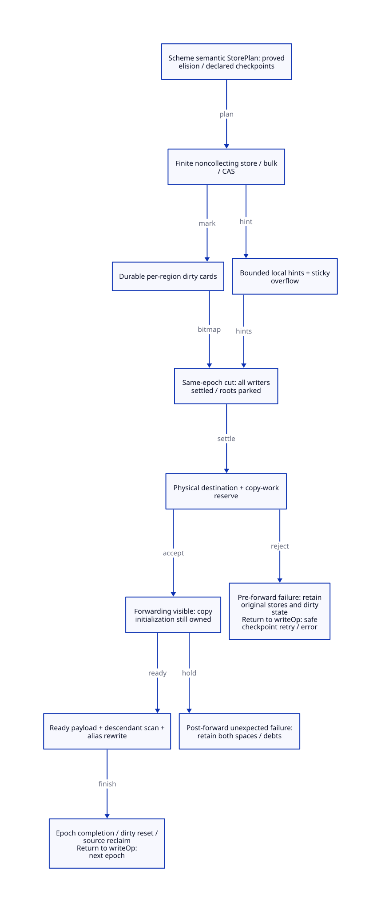

#+TITLE: Generational barriers, remembered sources and promotion custody
#+SETUPFILE: ../../../modeling/org/setup.org
#+CATEGORY: gc
#+PROPERTY: header-args :eval never :exports code
#+OPTIONS: toc:3 num:t

* RESEARCH Amplify Gambit's semantics through modern C :modern_c:gc:control:ffi:
:PROPERTIES:
:CUSTOM_ID: generational-barrier
:OWNER: GC and generated-store architecture
:AUTHORITY: models/sysml/generational-barrier.sysml
:STATUS: target-kernel-checked-source-and-memory-open
:EVIDENCE_CLASS: current-source-and-conditional-model
:END:

The objective is capability amplification: use Scheme semantic knowledge to
remove provably unnecessary barriers and repeated mature-frame work, make
multi-shot continuation sharing useful across minor collections, and expose a
predictable C interface for multicore embedding. Semantic preservation is a
necessary foundation, not the whole benefit case. Modern generated C is the
selected direction. Neither Zig nor another implementation language supplies
these proofs or removes the required GC work automatically.

This design refines [[file:modern-c-generational-design.org][the generational runtime blueprint]]. Native SysML owns the
policy, writer families, benefits, exact subjects and dependencies; Org owns the
argument. The [[file:generational-barrier-matrix.org][derived writer and capability matrices]] and  are projections.
All QNT/Lean sources remain at the root under models/. No runtime C or Scheme
implementation, configure/build, native test or performance experiment is added.

* Evidence and the real writer population
:PROPERTIES:
:CUSTOM_ID: evidence
:END:

The source-bound receipt records current hashes of the selected vendor source
and existing cumulative patch. The [[file:../control/studies/continuation-writer-caller-matrix.org][historical 24-family caller study]] is navigation
and provenance, not a refreshed whole-program proof. Ten native-owned families
in the derived matrix identify concrete producer-to-store chains reviewed here.
These are neither ten total call sites nor a coverage percentage.

#+NAME: barrier-source-ledger
| ID | Current selected source | Grounded consequence |
|---+---+---|
| BW-FRAME | [[file:../../../../vendor/gambit/lib/_kernel.scm::3439][_kernel.scm:3439-3558]]; [[file:../../../../vendor/gambit/lib/_io.scm::11706][_io.scm:11706-11727,13729-13798]] | Frame reader dispatch calls implode-frame, which allocates then calls frame-set! repeatedly. continuation-set! has heap and stack branches; they need different store/root authorities. |
| BW-SHELL | [[file:../../../../vendor/gambit/lib/_kernel.scm::3154][_kernel.scm:3154-3162,3595-3727]]; header:5908-5931; C target:4263-4273 | Frame/denv setters and cursor updates mutate shared shells. Shallow copying retains frame/denv aliases; old age is not immutability. |
| BW-DENV | [[file:../../../../vendor/gambit/lib/_thread.scm::340][_thread.scm:340-565]]; [[file:../../../../vendor/gambit/lib/_thread#.scm::735][_thread#.scm:735-886]]; _gambit#.scm:638-643 | SMP dynamic-ref writes caches on cache2/cache3/miss; dynamic-set! also writes binding cdr/default descriptor. SMP env-insert! is reader-commented at 526; persistent env-insert constructs new nodes. |
| BW-PROFILE | _thread.scm:9-44,5351-5368,5654-5874; _thread#.scm:2990-3039 | Non-SMP branch has its own active destructive insertion. Do not count declarations or commented SMP text as executed writers. No configured native branch is exercised here. |
| BW-CONTROL | [[file:../../../../vendor/gambit/lib/_kernel.scm::1354][_kernel.scm:1354-1378,1115-1346]]; header:6314-6330,6377-6387,6654-6665,6716-6736 | Dynamic bind install/restore, scheduler save/restore, graft/return write thread/shell/denv/cache state and transfer active roots. An active thread object can still be mature. |
| BW-DECODE | [[file:../../../../vendor/gambit/lib/_io.scm::11756][_io.scm:11756-11824,12726-12845,12883-12908]] | Closure/list/vector fixups can run after construction. General cyclic/forward frame repair is not established; do not invent a delayed frame-fixup endpoint. |
| BW-FFI | [[file:../../../../vendor/gambit/lib/mem.c::703][mem.c:703-829,3969-3986]]; os_dyn.c:744-795; Tcl binding:125-195,288-342; c_intf.c:6511-6562; setup.c:3275-3422 | RC data is an explicit native root slot; scanner relocation also writes it. SFUN/run marker allocation and CFUN conversion/reentry require protected handles. Prior patch repairs are credited, not relabeled generational support. |
| BW-COPY | [[file:../../../../vendor/gambit/lib/mem.c::3490][mem.c:3490-3665,3667-3966,4210-4245]] | Forwarding can be published and source references redirected before payload copying finishes. A published address is not payload readiness; the winning initializer and later scan work need custody. |
| BW-RESERVE | [[file:../../../../vendor/gambit/lib/mem.c::3326][mem.c:3326-3390,6316-6468]] | Existing section sharing, overflow reserve and recoverable/fatal overflow paths are real assets. They do not establish a separate mature-promotion reserve or permission to resume after a failed partial copy. |
| BW-STORE | [[file:../../../../vendor/gambit/include/gambit.h.in::5482][header:5328-5329,5482-5485,6764-6771]]; _t-c-2.scm:3356-3365 | Direct pair/vector/global/CAS stores and disabled SSB reservation must become generated semantic stores; switching on an old hook is insufficient. |

Public headers, raw aliases, arbitrary embedded C and dynamically selected
external callbacks prevent global closure by textual search. Admission requires
an effect/borrow footprint and exact root/region ownership, or rejects the
profile. Scanning known cards cannot recover unknown native roots, stale raw
pointers or missing foreign-thread participation.

** Primary mechanisms learned, and limits
#+NAME: barrier-primary-evidence
| Reference | Mechanism learned / reflection for Gambit |
|---+---|
| [[https://mailman.iro.umontreal.ca/pipermail/gambit-list/2019-November/009234.html][Feeley, 2019: generational GC and C/FFI]] | Remembering inverse references can alter assignment safepoints. Our explicit design alternative forbids collection in barrier primitives; the historical warning is motivation, not a theorem that every barrier must collect. |
| [[https://anil.recoil.org/papers/2020-icfp-retropar.pdf][Retrofitting Parallelism onto OCaml, sections 4.3-4.4]] | Select the C-interface/coordination tradeoff deliberately; an STW young phase can coexist with modern parallel execution. No OCaml performance number or fiber semantics is imported. |
| [[file:../../../../vendor/ocaml/runtime/memory.c::183][Local OCaml memory.c:183-236,295-320]]; [[file:../../../../vendor/ocaml/runtime/minor_gc.c::1095][minor_gc.c:1095-1137]] | Separate young remembering from major deletion protection. Initialization promises no GC; table threshold requests a later minor, while growth can allocate native memory and fail fatally. Our bounded-card path has a different resource contract. |
| [[https://simonmar.github.io/bib/papers/parallel-gc.pdf][Marlow et al., sections 2.1 and 4]] | Remembered objects versus source fields and parallel forwarding are genuine alternatives. An object/card descriptor avoids unqualified raw interior-pointer lifetime; Gambit frames need exact layout-aware ranges. |
| [[https://xavierleroy.org/publi/concurrent-gc.pdf][Doligez/Leroy, 1993, sections 2-3]] | Compile-time mutability and identity assumptions support particular promotion choices. Scheme's shared mutable frames and eq? prevent importing those assumptions wholesale. |
| [[https://www.open-std.org/jtc1/sc22/wg14/www/docs/n1570.pdf][C committee draft N1570, 5.1.2.4 and 7.17]] | Matching release/acquire and race-free accesses supply ordering; an atomic dirty bit alone does not order unrelated native raw accesses. This is a cited draft, not a claim of current standards or host conformance. |

The local OCaml memory.c notes mixed-language memory-model limits explicitly.
We do not copy its volatile accesses/fences as a portable C11 proof. Either
exclusive access or an explicit compatible atomic lowering must cover conflicting
Scheme/generated-C/native accesses; ordinary C data races remain outside the
admitted profile. The precise mixed-language memory model stays WB-MEMORY open.

* Selected remembered-set architecture
:PROPERTIES:
:CUSTOM_ID: cards-and-hints
:END:

Native SysML defines StoreTicket/StoreAdmissionLaw, RememberedCut/CutAndResetLaw
and CopyReservation/PromotionCustodyLaw. These include current versus proof epoch,
heap-field versus root-slot authority, pending-writer exclusion, descriptor pins,
residual reset coverage, physical reserve and initialization/scan owners. They
are target schema requirements, not satisfied native runtime instances. The
formal refinement table below assigns their source and mathematical obligations.

Use preallocated per-region dirty-card metadata as authoritative coverage, plus
bounded per-execution-context dirty-card hints as an enumeration accelerator.
This resolves the earlier card-versus-log alternative: logs can be lost only
under an acknowledged fallback, while complete card coverage remains mandatory.
Card allocation/layout is prepared with region publication, outside the barrier.

A source key is =(VM, regionId, regionGeneration, cardIndex)=. Root slots have
separate RootRegistry identities. A card can contain multiple objects or part
of a large frame: the descriptor must locate valid object starts, subtypes and
FrameSpec pointer ranges, not treat arbitrary words as Scheme values. Heap-frame
link/RA structural writes require validated control-layout transitions; a dirty
bit alone does not legalize arbitrary ##frame-set! indices.

#+NAME: barrier-store-protocol
| Step | Obligation | Failure / stop boundary |
|---+---+---|
| Prepare operands | Complete Scheme evaluation/conversion; root and reload owner/value; validate slot/range/encoding and source class | May allocate only at declared points before entering the noncollecting primitive |
| Admit finite write | Obtain current context/VM writer permit; reject closed ingress or unknown raw alias | No callback, allocation, nonlocal jump or GC poll inside this primitive |
| Record coverage | Atomically premark every needed card; append optional bounded hint, or make overflow sticky before an unhinted store | Failed CAS/aborted pre-store operation can leave a harmless false-positive card |
| Commit field/CAS | Preserve language field/atomic semantics; successful pointer update already has coverage | A failed CAS needs no undo of conservative card marking |
| Settle write | Commit or abort the exact admitted operation; release final-value acknowledgement only outside the primitive | A stop arriving between premark and store waits for settlement; it cannot snapshot a promised but incomplete field update |

For an already dirty card, deduplicating hints is optional; correctness cannot
depend on every writer winning an enqueue race. Owner exit/migration transfers
log endpoints and epoch identity, or publishes fallback under the lifecycle
protocol. Failed/unknown join is not evidence that its last writer stopped.
All actual root domains remain registered separately from collector workers.

RootWrite into RC data does not card-mark a native header and pretend it is a
managed object. It uses root membership/freeze, and the collector scans actual
slots. FFI writes into a managed old object require a validated region/range
barrier. Whole-known-heap scanning can relax remembered precision; it does not
repair missing root membership or nonparticipating native writers.

** Log overflow, scan cut and reset
:PROPERTIES:
:CUSTOM_ID: snapshot
:END:

Overflow is sticky for a particular epoch. With complete hint endpoints and no
overflow, scan the union of hinted cards, deduplicated. With any overflow, walk
allocated card metadata and scan dirty cards. This is O(C) metadata inspection,
not necessarily an O(M) mature payload scan. A missing/invalid card layout may
require a separately admitted full-known-region fallback, or reject the cut.
Never overwrite unconsumed hints, clear a dirty card while mutators can write,
or interpret an empty hint buffer as an empty remembered set.

Seal requires every admitted mutator/root/log publisher to settle, plus acquired
same-epoch acknowledgements. Pin card descriptors, source extents and root
layout until every selected source is updated. Reset only after complete young
evacuation/rewrite and before the next mutator epoch. If any old-to-young edge
survives, rearm its card; direct promotion is not proof of zero residual edges
until every actual referent/source rewrite closes. Weak/will processing remains
a separate semantic obligation.

Reset must also publish the *next enumeration*: residual dirty cards need next-
epoch seed hints, or a sticky next-epoch overflow flag if those seeds do not fit.
A retained dirty bit with empty hints and overflow=false is not sufficient.
Normal reset visits selected dirty cards only; clearing the entire card array
each normal minor would reintroduce O(C) work. The QNT kernel checks orphaned
dirty cards and an explicit hint-discard fallback; its direct-promotion finish
has no residual edges. The Lean seed lemma covers the conditional next-epoch
policy, while the real residual producer and finite capacity remain open.

C ordering is: =premark + field store + log endpoint/overflow -> release writer
ack -> coordinator acquire -> snapshot and collector updates -> release epoch
completion -> acquire rooted reload=. Card bits can use atomic OR; a relaxed
card operation is only a candidate when the matching acknowledgement chain
orders all accesses. Concurrent Scheme field publication needs its own access
model. Collector ready publication and chunk ownership require an additional
release/acquire chain before a worker reads copied payload.

Noncollecting and bounded storage use do not establish a worst-case execution
time. The target's C atomic may use a library lock, and contended RMW operations
need progress assumptions. A hard pause bound requires a qualified primitive
and maximum write-chunk bound; no such native timing/lock-freedom result is
claimed. Sparse hints avoid a central append lock, but atomic card false sharing
can still limit multicore scaling.

* Promotion reserve and irreversible publication
:PROPERTIES:
:CUSTOM_ID: promotion
:END:

Before any forwarding/source rewrite, a PromotionReserveReceipt must bind VM,
collection epoch, destination regions/generations, physical committed capacity,
work metadata, exclusive allocation rights and an upper bound. Virtual address
reservation, likely survivor estimates or a shared free-byte counter do not
establish this receipt.

A conservative bound is the sum of aligned mature sizes for *all allocated young
objects*, plus GC-created captured-frame expansion, allocation/header changes,
worker slack/CAS-loser claims and bounded copy/scan descriptors. Every term must
come from actual layouts and worker grants. A dedicated evacuation-region policy
can avoid guessing fragmented mature free-list capacity, at the cost of peak
reservation and later mature-space integration. Reuse current sections and
overflow accounting only after those changed meanings are refined.

Keep context resume/nursery reserve separate from worker copy/tail reserve.
Charge disjoint intervals once; reclaiming a worker tail for a context requires
an explicit ownership/layout handoff. Include every target context in the sealed
membership set, including resize outcomes, rather than counting only collector
workers. Space for protected allocation-failure delivery is also a separate
reserve: preflight failure does not mean an allocation-starved context can just
resume normal allocation. These capacity terms are not proved by the kernel's
one-object credit equation.

#+NAME: promotion-failure-custody
| Cut / outcome | Custodian and legal action | Forbidden conclusion |
|---+---+---|
| Preflight rejected, no forwarding anywhere | Coordinator retains young source, roots and dirty state; run an admitted reclamation/retry or deliver allocation failure at a protected declared checkpoint | A committed Scheme store is not rolled back; the barrier itself did not collect |
| Private destination acquired, no forwarding for that object | Return only unused local reservation/descriptor credits; source remains authoritative | Local refund does not prove the whole epoch has no other published forwarding |
| Forwarding visible, payload incomplete | Winning copy subframe retains exact progress, reserved destination and Tail/scan debt; redirects may point to pending destination | Published address is not payload readiness; do not return to MarkCurrent and drop initialization |
| CAS loser / aliases | Resolve canonical destination; refund only private unpublished claims; update every root/source alias under pin | Finding the same object through one root does not rewrite another omitted slot |
| Unexpected resource breach after any publication | Retain both spaces, descriptors, root pins and unfinished owners in quarantine; no normal resume/reclaim receipt | No whole-epoch rollback, ordinary Scheme error delivery or availability guarantee is established |
| Copy ready and all descendants/sources complete | Finish phase, release pins, reset/rearm cards, deliver capacity outcome and resume with rooted reload | Ready payload alone does not discharge scanning, weak/cleanup or context-restoration debts |

Existing forwarding-before-copy is not declared a bug by itself. Collector
consumers must distinguish address resolution from payload readiness. A new
independent worker architecture must make that distinction explicit instead of
assuming the mutator PSTATE will finish every suspended copy immediately.
Physical no-fail reservation and unexpected-failure handling remain source
obligations: this design does not prove recovery from arbitrary OS/process faults.

* Semantic leverage and proof-directed elimination
:PROPERTIES:
:CUSTOM_ID: amplification
:END:

A proposed Scheme StorePlan carries point/module identity, value/slot encoding, source
class, write range, possible allocation/reentry and ownership evidence. Modern C
lowers it mechanically. Known young source or provably nonyoung/immediate value
can remove the *generational* barrier. Root registration, owner permits and
concurrent-major barriers do not disappear with that proof.

The current C target already threads safety/side-effect information through
[[file:../../../../vendor/gambit/gsc/_t-c-2.scm::2998][targ-apply-simp and targ-setup-inlinable-proc (2998-3006,3316-3347)]], and gives shell
setters an SSB-space argument at 4263-4273. Reuse this semantic classification
surface, but extend it with actual source-age/escape/region and safepoint facts;
those old flags do not already prove generational elision.

An elision permit binds PointId, rooted source identity, region generation and
GC epoch. Evaluating operands can allocate before entry: reload first, then
prove/revalidate the actual source/value class. GC, promotion, callback reentry
or a checkpoint expires a historical young-source fact unless the producer
proves it still applies. A proof across a no-safepoint interval can specialize
several stores; an arbitrary prior allocation cannot. The current Lean lemma
assumes the present predicate and does not prove this producer analysis.

Private mature initialization needs coverage at publication and a trace-valid
InitSpec at any intervening GC; interrupt masking and a constructor name are not
proofs. Decoder fixups after publication use ordinary stores. Bulk writes must
have a finite write bound; long bulk operations need declared chunk checkpoints
and trace-valid partial initialization rather than an unbounded no-poll section.
Proper tail calls also require a poll/latency policy for allocation-free loops.

This enables several concrete forms of amplification: mature continuation frame
sharing can outlive many minor epochs without repeated full traversal; denv and
higher-order code can use proved store specialization; native extensions get
predictable safepoints for multicore calls; one semantic contract can feed modern
C and a future LLVM/MLIR consumer. These are conditional design opportunities,
not a claim that a modern-C emitter or language switch alone optimizes Scheme.
The derived matrix records what work each mechanism can remove and its falsifier.

* QNT, Lean and source refinement
:PROPERTIES:
:CUSTOM_ID: proofs
:END:

WB-H binds one finite kernel: three old slots, two cards, one native root, a
capacity-one hint set, one admitted writer and one two-word promoted object.
The 26 named histories include real source-family projections and explicit
omission controls. Positive sampling checks the declared target actions only;
it does not establish native reachability, full worker populations or liveness.
Hints are modeled as a small deduplicated set, not a production log algorithm.
A phantom representative copy may be performed even with no modeled live edge;
this kernel is not an allocator work-count/performance model.

WB-I binds fourteen named conditional statements. Store and log invariants compose
into source-slot selection over arbitrary slot/card types. The promotion lemmas
separate no-unfinished-copy finish, no post-forward whole-epoch abort, credit
conservation and required slot rewrite. No-collect lemmas concern target
transformations, not the real C call graph. The complete QNT transition invariant
and source simulation have not been proved in Lean.

#+NAME: barrier-refinement-matrix
| Need | Required concrete relation / step | Remaining proof boundary |
|---+---+---|
| WB-WRITERS | Every real write -> RootWrite, validated old-card store, private InitSpec, collector/control transition or refused profile | Every actual alias, callback, branch and structural frame editor; logical reads can write |
| WB-LOG | Premark -> commit/abort; hint append/overflow -> complete card coverage | Atomic bitmap and actual object-start/range layouts; bounded nonallocating helper call graph |
| WB-SNAPSHOT | Permit close -> settled operation -> same-epoch acquired endpoints and root cut | All real participants, region generations/reset, FFI park/reload and migration/unknown outcomes |
| WB-PROMOTE | Preflight -> physical reserve -> forward pending -> init ready -> scan/alias rewrite -> finish | Exact bound, multiple object/CAS winners, partial Tail/chunk state, weak/major and context recovery |
| WB-MEMORY | Source atomics/locks -> target atomic steps/stutters; field and ready publication -> legal consumer observations | C/mixed-language data-race freedom, target ABI/order and progress; no native qualification |

GC-GEN depends on all seven WB needs. WB-WRITERS depends on CO-S/FZ-CENSUS;
WB-SNAPSHOT depends on WB-LOG, FZ-FREEZE and RC-DOMAIN; WB-PROMOTE also depends
on GW-S. Thus a passed finite history or file association cannot close the
source composition. ASCENT must expose each omitted prerequisite transitively.

#+NAME: barrier-native-contract
#+INCLUDE: "models/sysml/generational-barrier.sysml" src sysml

* Work, space and retirement accounting
:PROPERTIES:
:CUSTOM_ID: costs
:END:

Let W be executed pointer-store opportunities, E those with valid generational
elision, P active writing contexts, L hint capacity, C allocated card entries,
H hint entries, D selected dirty cards and S(D) their pointer slots/valid frame
ranges. Normal enumeration costs O(H + S(D)); overflow costs O(C + S(D)).
Metadata is O(C + P*L), plus region/object-start/frame descriptors and reserve.
Duplicate hints and card false sharing can increase H/S(D); no percentage gain
is inferred from source occurrence counts. Barrier work is charged for W-E,
while card coverage, exact roots and major-cycle work remain mandatory.

Charge object-start lookup and GC-map decoding in S(D) as well. A dirty card in
a large captured frame does not imply local scan cost if the scanner must walk
from the frame/region start each time. To obtain the local-work benefit, the
Scheme generator must supply indexed FrameSpec pointer ranges/mask positions
and the region descriptor must locate starts without a whole-region walk.
Those descriptors may be prepared/reused with native module/layout artifacts;
their generation, space and lifetime costs remain charged. This is a source
and benefit obligation, not something the small QNT map proves.

A positive net benefit requires avoided mature traversal/copy plus proved
elisions to exceed remaining barriers, atomic contention, hint/fallback scanning,
promotion/coordination, complete major collection and reserve/retention costs over
identical Scheme allocation/mutation/control work. Peak physical memory and
maximum no-poll duration need separate bounds. Preflight failure can reduce
availability; quarantine is preservation of safety/custody, not successful recovery.

A sufficient positive-work family is an unchanged, inactive, mature captured-
frame graph of baseline scan/copy cost M, retained through k young collection
opportunities. Assume the candidate performs one necessary major bounded by M,
no extra major is forced by capacity, and all extra work is charged as overhead
A. Its bound M+A is strictly below k*M when A < (k-1)*M. The Lean lemma
amplificationWorkPositive checks that arithmetic. Root/activation costs must
actually remain bounded independently of M; no full card-array reset or hidden
bitmap walk may be canceled from A. These are explicit workload/resource/cost
premises, not measured parameters or a proof that current applications satisfy
them. Heavy mutation, activation, hint overflow or promotion pressure can defeat
the inequality. This identifies real work that the redesign can amplify rather
than assigning an invented speedup percentage.

Retire direct unchecked managed-store lowering, implicit SSB decisions, root/list
mutation without ownership and PSTATE-bound copy continuation only after their
specific consumers migrate. Mature interiors can be skipped only after writer
and descriptor closure. Keep complete major collection and explicit fallback;
there is one selected semantic owner rather than two handwritten GC semantics.
No runtime path is retired in this study. See the [[file:../../../../evidence/research/generational-barrier/checks.json][source-bound receipt]] and
[[file:../../../modeling/component-assurance.org][composed closure matrix]] for exact checks and the remaining frontier.
