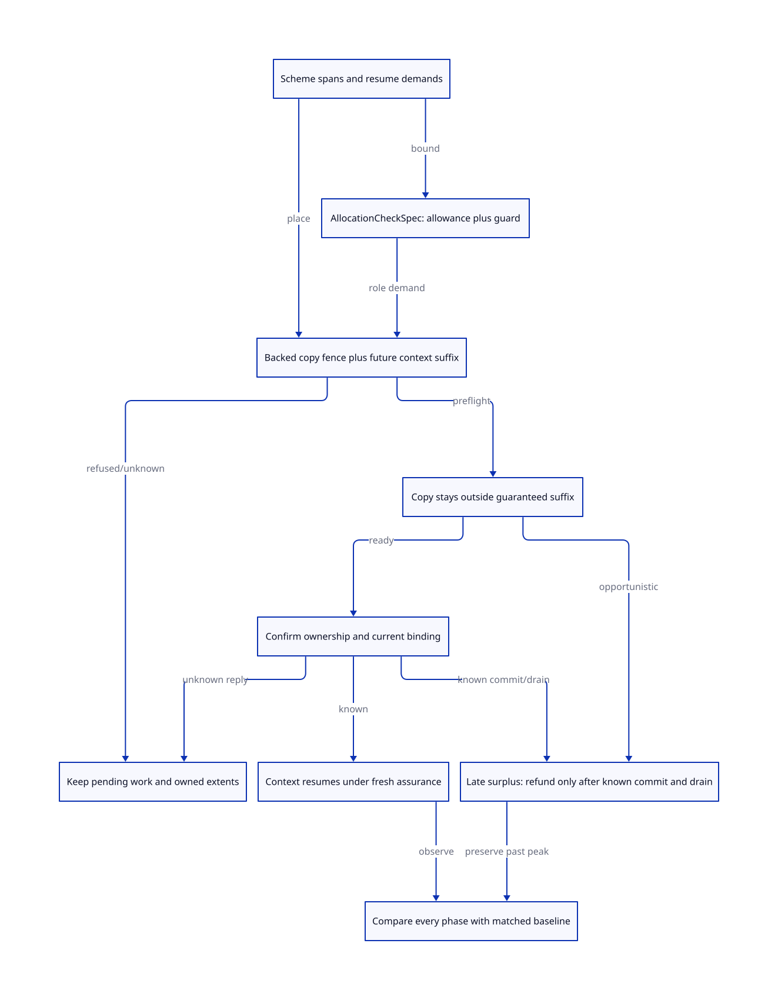

#+TITLE: Guaranteed context tails in promotion placement, allocation checks and round peak accounting
#+SETUPFILE: ../../../modeling/org/setup.org
#+CATEGORY: gc
#+PROPERTY: header-args :eval never :exports code
#+OPTIONS: toc:3 num:t

* RESEARCH Modern C: make guaranteed reuse a pre-forward placement obligation :modern_c:gc:smp:control:
:PROPERTIES:
:CUSTOM_ID: guaranteed-tail-placement
:AUTHORITY: models/sysml/guaranteed-tail-placement.sysml
:STATUS: target-kernel-checked-source-refinement-open
:EVIDENCE_CLASS: source-and-conditional-formal-research
:END:

[[file:promotion-interval-handoff-design.org][The interval/reader study]] separates preflight-guaranteed reuse Qg from late
refund Qo. This refinement specifies how Qg becomes part of the actual promotion
placement and the first context allocation assurance. It also closes a tempting
inference error: even a lower copying-phase peak need not lower the whole-round
peak if a later restoration, failure or acquisition phase dominates.

Modern generated C is mandatory. Scheme owns ordered allocation/control semantics,
FrameSpec/PointId and root maps; the native runtime owns actual backing, interval
rights and current bindings. Native SysML owns three receipt schemas/laws, seven
source families, six needs, prerequisites and cost/view rows. [[file:guaranteed-tail-placement-matrix.org][The matrices]] and
 are native-evaluated projections. [[file:../../../../models/gambit/guaranteed_tail_placement.qnt][QNT]] and [[file:../../../../models/gambit/lean/GuaranteedTailPlacement.lean][Lean]] remain root-level target
models. No runtime/generator implementation, native test, benchmark or build
profile change is made. No requirement is claimed satisfied by today's runtime.

* Source evidence: neither a free cursor nor a constant is a certificate
:PROPERTIES:
:CUSTOM_ID: source
:END:

#+NAME: guaranteed-tail-source-facts
| Source | Current behavior | Architectural consequence |
|---+---+---|
| gsc/_t-c-1.scm:108-119 | Portable target representation assumptions; targ-msection-fudge=4096 | Compiler bookkeeping allowance, not a universal actual span bound or current runtime section geometry. |
| gsc/_t-c-2.scm:345-413 | Reserve debt plus floating-cache size can emit a check; emitted heap argument includes compiler fudge; debt counters reset afterward | Count the realized ordered events after the check. Reset debt does not undo a later operand allocation or create a new native interval. |
| header:8544-8560 | CHECK_HEAP(n,m) tests hp>heap_limit; m is unused in these macro bodies | hp==limit remains the fast path. A future context guard must cover the next bounded writes/formed addresses, not presume an up-front hp+m test. |
| gsc/_t-c-2.scm:2480-2486,2607-2635,2820-2866 | Fixed allocation and vector reserves precede materialization; dirty floating values may box during lowering | Derive W/P from actual schedule, boxing versions and representation; a constructor's nominal payload size is insufficient. |
| mem.c:3241-3410,3490-3811 | Copying can add chunk links/end markers, frame representation and alignment; allocation cursor alone is not all writes | Future context suffix begins after a bound on every copy write and formed pointer, not after predicted survivors or a momentary cursor. |
| mem.c:4525-4562 and six calls at 4717,7080,7215,7358,7402,7500 | Same PSTATE restores hp/fp/limits with approximate free space, stack/heap split and MSECTION_FUDGE | Existing reuse is credited. Detached context recovery needs exact role grants at every setup/GC/stack-growth/undo/heap-limit endpoint. |
| _kernel.scm:303-334,1964-2022 | Heap-limit saves an internal frame/registers, calls heap_limit and possibly GC, reloads, and may raise/retry | First-resume assurance includes root/control restoration, slow successor and exception continuation; an old physical address or code PointId alone is insufficient. |
| _kernel.scm:506-596,900-971; mem.h:76-78 | Rest/keyword processing can finish list construction and an argument vector before GC, because the stack must become scannable | Preserve separate pre-GC completion and failure-delivery obligations. A heap tail accepted for ordinary nursery allocation does not discharge them. |

In the reviewed no-handle layout, runtime MSECTION_FUDGE is 8194 words
(mem.h:65-67), while compiler targ-msection-fudge is 4096. These are different
contracts; the difference alone proves neither a defect nor reclaimable excess.
The source-derived actual frame bound, portable emitter reservation and dynamic
constructor limit cannot be collapsed into one constant. The historical
[[file:studies/allocation-check-bound-design.org][AllocationCheckSpec study]] is preserved navigation/provenance. The specific
current anchors above are refreshed; its complete historical caller census and
old Zig comparison are not reissued as current source proof.

* One plan, disjoint current and future roles
:PROPERTIES:
:CUSTOM_ID: plan
:END:

A guaranteed tail is a reservation for a *future role*, not currently writable
space for both worker and context. Extend the existing placement receipt with:

#+NAME: guaranteed-plan-records
| Record | Identity and data | Issuance / use condition |
|---+---+---|
| PlanSnapshot | VM, epoch, immutable effective context/root-domain set, worker roles, target resize disposition, code/profile/layout hashes | Snapshot remains valid until all destructive work and promised recoveries settle; arrivals/resize changes need explicit re-admission. |
| CopyEnvelope | Per backing object, source/destination identity, payload claims, maximum copy write and address frontiers, links/alignment/scan/task metadata and completion rights | Real allocated backing plus proved placement/packing. Payload sum alone cannot authorize it. |
| FutureResumeDemand | Context/activation generation, first resume PointId, exact code/layout identity, role and required interval, initial cursor, logical allowance and guard | Receiver accepts before forwarding without entering managed code. Root homes, reload and next-GC layout must be valid. |
| GuaranteedTail | Backing extent/generation, copy fence, [futureStart,futureEnd), matching demand ID, future owner, nonoverlapping claims and transfer operation | All copy writes and formed addresses stay <=copyFence<=futureStart. Worker cannot consume the suffix on a slow/failure path. |
| DemandDischarge | Injective mapping of one actual separate-backing demand to accepted future interval | Credit once. An interval cannot discharge two contexts, heap and stack simultaneously, or both an ordinary and independent failure promise. |
| ActivationReceipt | Existing ownership commit/read-back, complete prefix grammar, root readiness, current epoch/PointId and first-span assurance | Only then may the context allocate. Pending or unknown commit preserves frozen authority and permits no speculative refund/reentry. |

At preflight, place all copy objects and their worst-case overhead *around* the
future interval. Unused space discovered only after copying is Qo, even if it is
contiguous with Qg. If a packing algorithm can relocate the promised suffix or
use it for a large object, the promise is not guaranteed. If enlarging destination
backing is necessary to create Qg, charge that enlargement against the credit.
The layout must describe copied prefix, gaps, guards and later context objects;
a guard/gap is not an object or a payload range to scan.

A conservative bound such as Y+S can consume most of the arena; in that case
Qg can legitimately be zero even when expected survivors are small. A tighter
proof may inspect complete distinct target layouts or exploit static semantic
facts, but an unproved survivor forecast cannot manufacture guaranteed slack.
A plan includes actual region alignment/contiguity and native backing; it does
not qualify resident-page, OS-OOM or RSS behavior.

** Role vector and the reservation timeline

Keep independent demands for ordinary heap allowance, downward stack growth,
GC-entry completion, emergency/failure delivery, roots and native metadata.
Share an interval across alternatives only after proving mutual exclusion and
lifetime/exit equivalence; the selected conservative design keeps these roles
separate. In particular, the compiler's no-interrupt declaration does not make a
rest helper's residual allocations disappear or prove them noncollecting.

Known accepted Qg replaces a matching fresh acquisition *before that acquisition
would coexist with collection backing*. Acquiring both, then returning one at
resume, is a valid late physical refund but has already paid the earlier peak.
Receiver acceptance requires bounded native preparation; its allocation/index/
root costs are themselves in the acquisition-phase ledger. Preflight does not
call arbitrary Scheme or unknown FFI code while holding a placement lock.

* AllocationCheckSpec and the first resumed span
:PROPERTIES:
:CUSTOM_ID: checks
:END:

For a single granted [u,v) heap interval, let h be the actual entry cursor,
L the logical trigger and Bwrite/Baddress the exclusive write and formed-address
high-water bounds relative to h until the next new assurance/effect boundary.
Require lower-bound/provenance/alignment validity as well as:

#+BEGIN_SRC text :eval never
h <= L
B = max(Bwrite, Baddress)
L + B <= v
ordinary allowance = L-u
physical demand >= ordinary allowance + B
#+END_SRC

The guard B is physically occupied reservation, not extra ordinary allowance.
If h==L passes today's comparison, the next realized span can still consume B.
Crossing a software grant while inside the same native allocation is an ownership
violation here, not automatically C pointer-arithmetic undefined behavior; crossing
the underlying native object's bounds is a separate C concern.

Scheme emits ordered summaries (delta,W,P,minima), with actual helper closure:
=W(A;B)=max(W(A),delta(A)+W(B))= and likewise P; net deltas compose by addition.
Bounds include headers, payload, alignment, temporary pointer probes, floating
materialization and final markers, not just net hp advance. Dynamic branches
need guarded alternatives or a conservative join; positive unbounded cycles
need another check/proved bound or are refused. No universal finite B for all
Scheme/native code is established by this study.

For an admitted 64-bit no-handle fixed vector with n elements and d actual
post-check allocated F64 box events and no other effects, the selected write/
advance upper case is n+1+2d words. Repeated dirty versions count as separate
events; pointer high-water and lower offsets still need their own analysis.
NAN-boxing, self-tagging, 32-bit alignment and dynamic helpers are different
profiles, not silent uses of that equation.

The slow successor is explicit: save/materialize roots and the internal frame,
request a new grant or collection, and reload cursor/owner/value from the actual
returned binding. The old PointId certificate expires on epoch/layout/profile
change, reentry or effects that invalidate its premises. A new certificate uses
remaining work, not the original requested amount minus an assumed refund.
An exception handler can return and retry in _kernel.scm:1987-1999; its return
must revalidate the grant and root state as well. Unknown helper/native writes
or unbounded lowering reject issuance, even if the region has nominal free bytes.

** GC completion and context restore are different endpoints

Rest/keyword handlers create complete root carriers before collection; their
remaining list/vector demand belongs to the currently owned source-side grant
or a separately accepted native/root-safe completion design. They cannot use an
uncommitted future context suffix. Stack frames saved by the heap-limit handler
and restored rest arguments use stack authority, not a heap allowance receipt.
Normal overflow reserve in mem.h:76-78 is intended to support such completion;
resize can adjust it. Do not subtract this reserve merely because a normal
context heap grant exists.

All six prepare_mem_pstate callers must consume current exact grants. The
post-GC guarantee-fudge branch at mem.c:7041-7043 can call next_heap_msection;
that acquisition must already be in the plan or be excluded by a proved restore
grant, rather than silently destroying the claimed peak reduction. The
modern-C target removes approximate free counters as allocation *authority*
only after every direct and generated consumer adopts these receipt bounds.
Approximate counters can remain policy/statistics hints.

* Failure, refusal and unknown results
#+NAME: guaranteed-failure-custody
| Boundary | Required custody | What cannot be credited |
|---+---+---|
| Cannot place copy envelope plus role/guard-correct future demand | Original source/root/card plan and exact partial backing allocations remain owned; no global forwarding | Predicted survivor slack, a different role or two fragmented holes counted as one extent |
| Receiver acceptance fails before forwarding | Original plan retains backing and separately accepted completion/failure capacity; release only known unpublished/unborrowed acquisitions | A missing grant counted as fulfilled, or metadata preparation omitted from the acquisition peak |
| Copy cannot honor its sealed fence after forwarding | Canonical initialization/scan/alias debts and both source/destination storage remain; quarantine normal resume/reclaim | Stealing Qg or restoring the source header/cursor; freeing a visible claim to make a counter fit |
| Ownership committed, acknowledgement lost | Existing exact transfer record remains authoritative; sender frozen, receiver awaits valid read-back | Second allocation/commit, timeout refund, entering Scheme on an unknown binding |
| Pending GC/overflow/exception successor | Materialized roots and exact remaining-work owner retain completion and failure role grants | Treating scalar compiler debt reset as completed allocation or allowing a retry on stale hp/fp |
| Late known refund | Release only the actual displaced fresh backing after ownership/reader/deallocator checks; keep historical peak | Retroactively calling the refund Qg or erasing an earlier higher occupancy |
| Unknown acquisition or native reader exit | Bounded operation/held-partial ledger retains actual responsibility; no unbounded new attempts | Native zero-result/idle/timeout treated as a clean successful release |

Existing allocators/adjust_msections are synchronous. Unknown delivery is a target
service/exit protocol state, not a claim that today's malloc routinely returns
unknown results. Refusal, source retention and quarantine are safety dispositions;
this study supplies no arbitrary-thread-failure recovery or progress guarantee.

* Whole-round peak: a phase inequality, not a tail-byte total
:PROPERTIES:
:CUSTOM_ID: peak
:END:

Use the same effective context set, allocation/root history, native profile and
work accounting for each comparison. Keep two baselines distinct: (1) today's
same-PSTATE architecture, which already reuses tails; (2) a separated worker/
context design that would allocate a matching fresh resume interval. Qg may
avoid work/storage in (2); it is not automatically an improvement over (1).

Let j range over *all* acquisition, copying, ownership-commit, normal restore,
slow/completion/exception, reader-retention and failure-reconciliation phases.
For a matched separated baseline with actual phase occupancies b_j, define
Pbase=max_j b_j. If a candidate phase is bounded by b_j-q_j+o_j, q_j must name
actual physical backing omitted/released in that phase, and o_j includes extra
arena rounding, metadata, old generations/readers and held partial results.
To claim strict whole-round saving delta>0 require every actual candidate phase
to satisfy c_j<=Pbase-delta. Lower copying occupancy alone is insufficient.
A baseline *upper estimate* is not a measured/established lower bound on actual
baseline peak; mathematical comparisons must state which exact model they use.

#+NAME: guaranteed-peak-classes
| Reuse class | Copy/acquisition credit | Later credit | Whole-round conclusion |
|---+---+---+---|
| Preflight-backed Qg replaces an unacquired fresh interval, no compensating arena growth | Up to Qg once, after all physical/role/guard and acceptance premises | Same interval remains in Destination; no second subtraction | Can reduce peak only if all other candidate phases also remain below Pbase; added costs must not consume the credit |
| Qg created by growing destination by Qg | The added arena cancels avoided fresh storage before metadata | Possible later ownership benefit | No intrinsic peak saving; extra metadata can make it worse |
| Surplus found only after actual copying, Qo | Zero retrospective credit | Actual fresh backing may be released after known commit/drain | Reduces later occupancy; cannot lower an already recorded maximum |
| Reuse improves copy phase but restore/root/index/exception overlap reaches Pbase | Valid local credit | Other overlap remains charged | No strict whole-round reduction |
| Guard, stack or failure reserve advertised as ordinary free tail | No admitted credit | Only a separately proved role transition permits reuse | Refuse or retain original capacity; cannot claim benefit |

Native SysML's PeakEvidence/PeakLaw requires complete phase coverage, matched
baseline and every-phase inequality before a strict gain claim. The QNT kernel
records an irreversible history floor for peak; its deliberate bad history
rewrite is rejected. Its small constant words are finite counterexamples, not
native samples or extrapolated byte/percentage benefits. Lean supplies arbitrary
Nat phase inequalities and containment conditions, not an actual runtime phase
coverage or spatial/provenance proof.

The mature-continuation work condition A<(k-1)*M still requires complete matched
costs. A must now include placement, ordered-bound generation/validation, exact
resume checks, partial-result reconciliation and metadata/root retention. No
person-day or automatic Zig gain substitutes for those obligations.

* Models, proof routes and migration
:PROPERTIES:
:CUSTOM_ID: proofs
:END:

GT-H binds 17 named QNT histories plus 100 bounded positive samples, maximum 80
steps, seed 17. One region/context has a copy fence, future suffix, guard, unknown
commit, abstract GC rebind and phase-peak monitor. It covers positive Qg and late
refund, a later overlap defeating Qg, insufficient guard, unbacked/double credit,
copy-fence invasion, stale/unknown entry, pre-forward private release and
post-forward custody. The abstract rebind assumes a newly valid grant; it is not
a proved second real GC. Neither exhaustive coverage, liveness, C memory model
nor whole collector correctness is claimed.

GT-I binds twelve named conditional statements: spanContained,
copyAndFutureDisjoint, restoreAllowance, sequentialBound, vectorBoxBoundMonotone,
noDoubleReserve, guardCannotBeCountedAsAllowance, lateRefundKeepsRecordedPeak,
threePhasePeakBelow, dominantUnchangedNoStrictGain, creditNeedsNetGain and
largerDestinationCancelsCredit. Offset/order predicates and phase occupancies
are premises. No whole QNT step induction, all-code bound analysis or source
simulation is proved.

GT-PLAN/GT-CHECK/GT-RESTORE/GT-PEAK remain source-refinement obligations. SysML
gates IH-EXTENTS on placement, IH-TAIL on check/restore, and PR-BOUND on peak
accounting. Prerequisites include actual GW-S work, WB writers, CO-S control,
HR-BIND restored VM binding and IH-MEMORY/IH-READERS. Actual ASCENT facts and
matching scope/digest receipts qualify only GT-H/GT-I. A synthetic GT-RESTORE
pass must still be blocked if HR-BIND is missing.

#+INCLUDE: "guaranteed-tail-placement-matrix.org" :minlevel 2

Migration order: Scheme emits ordered checks and role-specific resume demands;
place future intervals with all copy/metadata envelopes before forwarding; make
runtime allocators stop at the sealed fence; adapt all six restore endpoints and
kernel completion/exception branches; activate via known ownership/current root
binding; compare full phase traces against separately named baselines. Retire
implicit PSTATE/approximate-counter authority and unqualified check constants
only after all their consumers close. No runtime path is retired here.

* Primary evidence and reflection
#+NAME: guaranteed-primary-evidence
| Primary reference | Mechanism learned and scope limit |
|---+---|
| [[https://simonmar.github.io/bib/papers/parallel-gc.pdf][Marlow et al., Parallel Generational-Copying GC, sections 3.4-3.5]] | Separate scan/allocation frontiers and pending work even when they share a block. Gambit's future context region additionally needs a pre-forward write/address fence and role-specific restore demand; neither follows just from a free allocation pointer. No benchmark transfers. |
| [[https://anil.recoil.org/papers/2020-icfp-retropar.pdf][Sivaramakrishnan et al., Retrofitting Parallelism onto OCaml, section 4.4]] | Mutator synchronization and canonical promotion require explicit ordering/readiness. Gambit's portable generated C, multi-shot frames and pre-GC rest completion require their own admission/space proofs, not copied one-shot fiber or performance assumptions. |
| [[file:../../../../vendor/gambit/gsc/_t-c-2.scm::345][Gambit allocation/check lowering]]; [[file:../../../../vendor/gambit/lib/_kernel.scm::1964][kernel slow/exception endpoints]]; [[file:../../../../vendor/gambit/lib/mem.c::4525][native restore]] | These current producer/consumer paths determine the modern-C replacement boundary. Constants, source audits and conditional models are not installed-profile, RSS or native performance receipts. |
