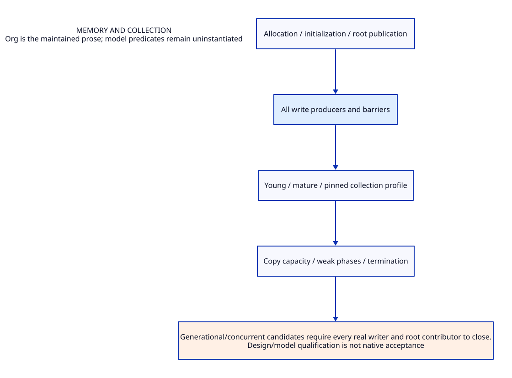

#+TITLE: Memory and collection
#+SETUPFILE: ../../../modeling/org/setup.org
#+CATEGORY: gc

* RESEARCH Memory and collection :gc:
:PROPERTIES:
:ID: 2bb541c9-d612-5fd8-9447-9a623dc52ce3
:CUSTOM_ID: gc-contract
:OWNER: Gambit architecture research
:STATUS: design-only
:EVIDENCE_CLASS: source-and-model-design
:END:

Allocation, initialization, roots, barriers, promotion, copying capacity, weak/finalizer and worker contracts.

[[file:../interfaces/role-contract-design.org][T0 role contracts]] specify CollectorWorkContext here and shared EpochParticipant/RoleHandoff under interfaces. Existing parallel collection and chunk stealing are retained baseline; a separate worker grant authorizes neither Scheme execution nor arbitrary foreign cleanup.

Generational/concurrent candidates require every real writer and root contributor to close.

** Contract and ownership
:PROPERTIES:
:CUSTOM_ID: ownership
:END:
One Scheme semantic contract; one selected implementation owner for each mechanism. C-facing capability remains mandatory. Imported alternatives are comparisons, not simultaneous deployment decisions.

** Models and views
:PROPERTIES:
:CUSTOM_ID: models
:END:
- [[file:models/sysml/architecture.sysml][SysML architecture and necessary requirements]]
- [[file:diagrams/overview.d2][Maintained D2 view source]]
- 

#+NAME: gc-sysml-source
#+INCLUDE: "models/sysml/architecture.sysml" src sysml

#+NAME: gc-d2-source
#+INCLUDE: "diagrams/overview.d2" src d2

** OPEN Evidence and admission gaps
:PROPERTIES:
:ID: 6f58a8c3-fe52-52dc-8837-5226dcdfa012
:CUSTOM_ID: gaps
:STATUS: unresolved
:END:
Source reading, model validation, checked proof, native semantic acceptance and measured benefit are distinct. No validation result satisfies the runtime gates automatically.

** Study catalogue
:PROPERTIES:
:CUSTOM_ID: studies
:END:
#+NAME: gc-studies
| Study | Evidence lineage |
|---+---|
| [[file:studies/allocation-check-bound-cost-matrix.org][allocation-check-bound-cost-matrix]] | ~05283cb2e1b5~ |
| [[file:studies/allocation-check-bound-design.org][allocation-check-bound-design]] | ~bfddf265c290~ |
| [[file:studies/allocation-check-bound-evidence.org][allocation-check-bound-evidence]] | ~41a10cd3b859~ |
| [[file:studies/allocation-reserve-helper-contract.org][allocation-reserve-helper-contract]] | ~9cc2293b3b66~ |
| [[file:studies/collector-work-context-cost-matrix.org][collector-work-context-cost-matrix]] | ~c1900ac821df~ |
| [[file:studies/collector-work-context-design.org][collector-work-context-design]] | ~70d4edbdb42e~ |
| [[file:studies/collector-work-context-evidence.org][collector-work-context-evidence]] | ~4bc9f1220545~ |
| [[file:studies/completion-admission-evidence.org][completion-admission-evidence]] | ~3477476ee21c~ |
| [[file:studies/gc-capacity-result-cost-matrix.org][gc-capacity-result-cost-matrix]] | ~95d1c837fb84~ |
| [[file:studies/gc-capacity-result-design.org][gc-capacity-result-design]] | ~b38a3cd4d4c0~ |
| [[file:studies/gc-capacity-result-evidence.org][gc-capacity-result-evidence]] | ~6f6752b85c09~ |
| [[file:studies/gc-current-mechanism-audit.org][gc-current-mechanism-audit]] | ~d9189d910e5d~ |
| [[file:studies/gc-native-runtime-arguments.org][gc-native-runtime-arguments]] | ~3596ba6c8d39~ |
| [[file:studies/gc-native-runtime-cost-matrix.org][gc-native-runtime-cost-matrix]] | ~7dc2f9d10ab5~ |
| [[file:studies/gc-native-runtime-design.org][gc-native-runtime-design]] | ~3f7a82d4a3e8~ |
| [[file:studies/gc-native-runtime-evidence.org][gc-native-runtime-evidence]] | ~981c5bc7293a~ |
| [[file:studies/init-spec-segment-layout-cost-matrix.org][init-spec-segment-layout-cost-matrix]] | ~e19305802594~ |
| [[file:studies/init-spec-segment-layout-design.org][init-spec-segment-layout-design]] | ~533656323551~ |
| [[file:studies/init-spec-segment-layout-evidence.org][init-spec-segment-layout-evidence]] | ~984ca2c20249~ |
| [[file:studies/still-construction-tail-cost-matrix.org][still-construction-tail-cost-matrix]] | ~6090512450af~ |
| [[file:studies/still-construction-tail-design.org][still-construction-tail-design]] | ~84df34994425~ |
| [[file:studies/still-construction-tail-evidence.org][still-construction-tail-evidence]] | ~54f7336e2ee3~ |

** Cross-cutting references
- [[file:../../../index.org][Development architecture]]
- [[file:../../../catalog.org][Complete source-to-Org and diagram migration map]]
- [[file:../../../research/validation.org][Validation boundary and retained receipts]]

** Column view for local research obligations
#+BEGIN: columnview :id local :format "%ITEM %STATUS %EVIDENCE_CLASS"
#+END:

** Behavioral and proof ownership
- [[file:models/quint/index.org][Quint state/action ownership]]
- [[file:models/lean/index.org][Lean invariant/proof ownership]]
- [[file:../interfaces/index.org][Cross-module semantic interfaces]]

** OPEN Phase revocation and worker drain
[[file:../interfaces/membership-revocation-design.org::#membership-late][Late delivery and custody]] preserve accepted drain rights after new-acquisition
closure. One worker can transfer complete work before exit; effective phase
revocation additionally requires all producers, publishers, readers and transfers.

** RESEARCH Component assurance and shared proof dependencies
[[file:component-assurance.org][Owned behavior, formal scopes and source obligations]] /
[[file:../../../modeling/component-assurance.org][composed closure matrix]]. Local checks do not close transitive source,
platform, ownership or progress premises.

** RESEARCH Generational modernization in generated modern C
[[file:modern-c-generational-design.org][Candidate allocation, barriers, continuation/FFI roots and major/minor composition]]
revisits the collector itself. Native SysML owns GEN-H/I and GC-GEN dependencies;
local kernels do not close runtime or memory-order admission.

** RESEARCH Generational write barriers and capability amplification
[[file:generational-barrier-design.org][Durable cards, bounded hints, writer cuts and promotion custody]] refines the
modern-C collector. [[file:generational-barrier-matrix.org][Native-derived writer and benefit matrices]] distinguish
semantic elision and reusable mature continuations from preservation alone.

* Promotion bounds and residual handoff
[[file:promotion-residual-design.org][The source-grounded capacity/epoch study]] derives frame and nursery bounds,
separates worker and context reserves, and specifies staged dirty-card handoff.
[[file:promotion-residual-matrix.org][Native-derived matrices]] quantify removable work and simultaneous peak space.
PR-H/PR-I are target formal slices; PR-BOUND/RESIDUAL/FFI/MEMORY remain open.

* Physical extents, tail ownership and old-reader drain
[[file:promotion-interval-handoff-design.org][The interval/retirement study]] traces backing allocation and partial results,
six restoration callers, local/queued/dequeued scans, resize and shutdown.
[[file:promotion-interval-handoff-matrix.org][Native-derived matrices]] separate guaranteed preflight reuse from late refunds:
late reuse does not automatically reduce an earlier physical peak.

* Guaranteed tails, allocation guards and whole-round peak
[[file:guaranteed-tail-placement-design.org][The guaranteed-placement study]] integrates future context intervals with copy
write/address fences, actual generated allocation checks and six restore callers.
[[file:guaranteed-tail-placement-matrix.org][Its native-derived matrix]] distinguishes matched fresh-reserve substitution,
late refunds and phase overlaps that eliminate whole-round peak benefit.

* Rest construction, framed GC and resumed execution
[[file:rest-gc-resume-envelope-design.org][The real structure chain]] separates crossing guard, noncollecting completion,
first heap0/stack2 interval, later frame8 growth and actual physical release.
[[file:rest-gc-resume-envelope-matrix.org][The native-derived matrix]] reports conditional work and whole-round peak bounds.

* Structure slow POLL, recursive frames and still allocation
[[file:structure-poll-still-envelope-design.org][The next real source segment]] covers internal return, interrupt effects,
recursive stack/heap frames, section assignment and independent still backing.
[[file:structure-poll-still-envelope-matrix.org][The native matrix]] separates conditional bounds, existing reuse and real Qg credit.

* Still initialization and cooperative participation
[[file:still-init-safepoint-design.org][The initialization/request/root study]] separates request posting, body completion,
result-root publication and frozen participation. It traces real interrupt and
GC consumers, nested callback cleanup and unknown storage custody.
[[file:still-init-safepoint-matrix.org][The native-derived matrix]] states removable work, added root metadata and
whole-round peak conditions; no mandatory still allocation is eliminated.

* Partial initializer and undelivered result recovery
[[file:still-init-recovery-design.org][The progress/owner/result study]] traces actual pointer constructors, atomic string
partial errors, directory I/O and generated FFI output/release scopes.
[[file:still-init-recovery-matrix.org][The native matrix]] separates one-pass work, input snapshots, root overlap and
unknown/dedup retention; unsafe retry is not a legitimate performance baseline.
