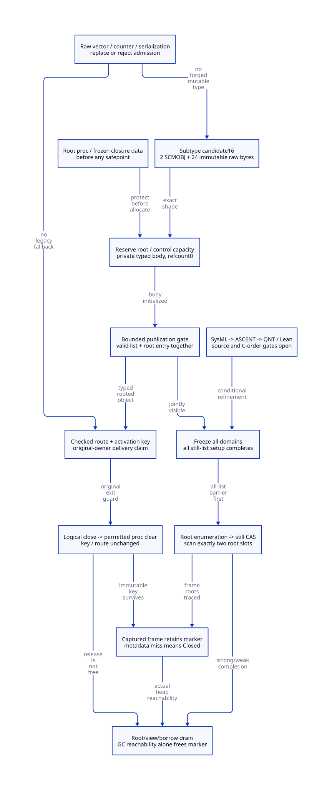

#+TITLE: Controlled Marker Layout, Activation Identity and Zero-Count Root Scanning
#+OPTIONS: toc:3 num:t
#+PROPERTY: header-args :eval never
#+TODO: OPEN | MODEL-CHECKED SOURCE-CLOSED

* Decision and authority
:PROPERTIES:
:ID: gambit-managed-marker-layout
:CUSTOM_ID: managed-marker-layout-decision
:STATUS: CONDITIONAL-DESIGN-SOURCE-REFINEMENT-OPEN
:AUTHORITY: models/sysml/managed-marker-layout.sysml
:END:

Modern generated C remains the mandatory runtime direction. Introduce a dedicated
internal marker representation, a constructor/root admission gate and checked
consumers. This removes the old conflation of a vector slot, a C activation right
and a numeric external pin. Zig adds no demonstrated reduction in these necessary
contracts. This study designs no runtime implementation and executes no native
Gambit program.

[[file:models/sysml/managed-marker-layout.sysml][SysML]] owns obligations, dependency edges, caller and cost rows, topology and
layout arithmetic. Native sysml projections drive [[file:managed-marker-layout-matrix.org][the closure/benefit matrix]] and
[[file:diagrams/managed-marker-layout.d2][D2]] / . The actual [[file:../../../modeling/ascent/managed-marker-layout.rules.scm][ASCENT DSL]] and [[file:../../../modeling/ascent/managed-marker-layout.request.scm][bound request]] join
artifact, digest, method, required check and exact scope before recognizing a
[[file:../../../../models/gambit/managed_marker_layout.qnt][QNT]] or [[file:../../../../models/gambit/lean/ManagedMarkerLayout.lean][Lean]] slice. [[file:../../../../evidence/research/managed-marker-layout/checks.json][The receipt]] records remaining source/C-memory gates.
[[file:activation-marker-retirement-design.org][Activation retirement]] remains an open imported contract, not a passed source proof.

#+BEGIN_QUOTE
A zero numeric still count is safe only when an independent, complete root domain
feeds the actual collector queue in the right phase. A stable key identifies a
record; it never creates a live native activation or authorizes a nonlocal jump.
#+END_QUOTE

* Current source and representation choice
:PROPERTIES:
:CUSTOM_ID: managed-marker-layout-source
:END:

=lib/c_intf.c:6509–6545= allocates a one/two-element vector, then installs the
procedure and optional processor id. Its TODO explicitly identifies the unrooted
procedure across allocation. =6551–6564= invalidates slot zero and decrements the
still count. =lib/mem.c:1487–1500,1560–1709= documents caller initialization,
possible GC and initial count one; the list is linked before the caller fills its
body. That allocator cannot become the controlled constructor merely by changing
its initial count.

=include/gambit.h.in:2875–2950= uses five subtype bits, leaving numeric 16 and 17
unnamed in these local definitions. =lib/_gambit#.scm:31–72= and the corresponding
=lib/sys.scm= definitions agree, but =macro-subtype-bvector?= tests =16 < subtype=.
=lib/_system.scm:1170–1220= uses this classification to read byte payload for
hashing. Candidate 17 is therefore a poor local choice. Candidate 16 avoids that
specific predicate, but is only a proposed allocation of type space, not a global
ABI certification. Every subtype dispatcher, supported target and bootstrapped
module needs admission. No header or Scheme subtype table is changed here.

The two tempting reused representations are rejected for this design:

- Ordinary vector: =mem.c:4169–4177= defaults to scanning every body word. A raw
  integer limb can resemble a managed pointer; scanning it is invalid.
- FOREIGN: =mem.c:4023–4038= skips the entire payload. Hiding the procedure in it
  loses the managed edge unless another complete descriptor is added. Its release
  semantics and public pointer conversions add unrelated obligations.

* Exact proposed layout
:PROPERTIES:
:CUSTOM_ID: managed-marker-layout-layout
:LAYOUT_ROLE: INTERNAL-CONTROLLED-MARKER
:END:

#+NAME: marker-body-layout
| Body offset | Type and role | Mutation | GC interpretation |
|-------------+---------------+----------+-------------------|
| 0 | SCMOBJ procedure or false | Initialization; later permitted clear | Strong updateable managed slot |
| W | SCMOBJ processor-route fixnum | Immutable after admission | Examine as SCMOBJ; immediate has no heap edge |
| 2W | 8 bytes VM incarnation | Immutable | Raw; never scan |
| 2W+8 | 8 bytes activation slot | Immutable | Raw; never scan |
| 2W+16 | 8 bytes slot generation | Immutable | Raw; never scan |

=W= is Scheme word bytes, restricted here to 4 or 8. Header byte length is exactly
=2W+24=, and representation is always STILL with the ordinary subtyped tag.
The still prefix remains six words in =mem.c:515–535=. Existing handle-enabled
prefix storage does not add another copy of the body. The dedicated scan case
checks exact type/length and calls the existing marking operation on slots zero
and one, including relocation write-back. It never interprets key bytes as SCMOBJ.
Malformed layout is a violated admitted premise requiring rejection/fail-stop,
not a recoverable object to scan by guessing.

Do not overlay an arbitrarily packed C struct on the payload. Generate byte offsets
and accessors from the same descriptor. The fixed key representation uses three
little-endian unsigned 64-bit encodings. Decode through unsigned bytes/memcpy and
bounded shifts, never unaligned uint64 pointer casts, signed shifts or fixnum
truncation. Fixed byte order is an internal encoding choice, not permission to
serialize a live activation. Native scalar struct padding is excluded from these
body size calculations. Exact byte codec/C aliasing refinement remains ML-LAYOUT.
Lean proves injectivity of the equivalent bounded three-limb arithmetic encoding;
it does not yet prove the C byte-loop refinement.

Both single-processor and SMP controlled markers use this one layout. The extra
route slot makes the single-processor body larger than today's one-element vector.
SysML evaluates both word sizes and the current aligned wrapper arithmetic:

#+NAME: marker-size-interpretation
| Configuration | Body | Six-word prefix + body | Current wrapper request | Current SMP request | Delta |
|---------------+------+------------------------+-------------------------+---------------------+-------|
| W=8, pointer bytes=8 | 40 B | 88 B | 103 B | 79 B | +24 B |
| W=4, pointer bytes=4 | 32 B | 56 B | 67 B | 43 B | +24 B |

These are source-derived requested bytes, not malloc usable size or RSS. The
wrapper adds 15/11 bytes from =alloc_mem_aligned_aux:540–598= for the selected
alignment/modulus. The single-processor legacy request is 71/39 bytes, so its
increase is 32/28 bytes. A different allocator/profile must rederive these bounds.

* Stable identity and classification
:PROPERTIES:
:CUSTOM_ID: managed-marker-layout-identity
:END:

=ActivationKey=(VmIncarnation,ActivationSlot,SlotGeneration)= is immutable for the
physical object's entire lifetime, including after logical close, metadata removal
and procedure clear. Components are issued nonzero, bounded to 64 bits; VM
incarnations are unique for the process lifetime, slot reuse increments generation
without modular wrap. Exhaustion refuses admission. Restarted-process messages are
outside the in-process authority domain and must be rejected at the transport
boundary. Random bits alone do not prove uniqueness. A process-persistent or remote
identity service is not provided by this design.

Object address and processor fixnum are not identity. A lookup verifies all three
components while protecting the metadata record before dereference; a live-object
borrow/root is obtained before reading its header/key. An incoming stale raw
pointer cannot be made safe by reading its type first. Native requests carry a
validated key/receipt, not a pointer for speculative dereference.

The classifier has separate outcomes: controlled with valid shape/key; recognized
legacy vector from a qualified legacy origin; malformed/unsupported. Once
controlled, an absent or nonmatching record is Closed. It must never fall back to
legacy vector semantics. Removing metadata does not erase the object's type/key.
An arbitrary same-sized vector is not sufficient legacy provenance. Key possession
is also insufficient to manufacture a controlled object or native return right.

The original C activation, original OS thread, native catcher lineage and processor
generation are authoritative in the control record. Preserve the existing
wrong-processor hook before the closed-return exception. =_kernel.scm:1020–1072=
and =_thread.scm:3127–3151= route Scheme execution, not a C stack between threads.
After the owner claim commits, =setup.c:3276–3390= still consumes only the matching
return frame. Keep its exact rooted marker object coordinate; do not replace object
equality with key equality and accept cloned markers. Per-delivery TransportId is
separate: the SFUN error loop may legally call =___call= again with the same marker.

* Rooted construction and zero-count publication
:PROPERTIES:
:CUSTOM_ID: managed-marker-layout-admission
:END:

** Input capture before any allocation

The explicit procedure argument enters an off-stack root cell before reservation
or allocation can invoke GC. A dynamic callback captures the actual closure data
and code lease first, then roots the procedure. =os_dyn.c:744–790,1045–1058= exposes
=c_closure_self= as global with a thread-local TODO; rereading it after a safepoint
is not a closure snapshot. =mem.c:702–825= RC data/list ownership is a distinct
native structure; neither its refcount nor its current P0-only tracing establishes
complete cross-processor closure coverage. Unqualified foreign-thread entry or
alias mutation refuses the controlled profile.

** Private preparation and canonical commit

1. Pre-reserve the control/root slot and native backing budget. Any possible GC
   still sees the procedure input root. Allocation failure leaves the caller's
   inputs and reservation duty intact until a known rollback.
2. Construct private still storage with valid header, length, link placeholder,
   mark=-1, refcount=0, false-or-procedure slot, route and immutable key. No generic
   public =alloc_scmobj= call may create this subtype and return a caller-fill shell.
3. Under one bounded admission gate, link initialized storage into the correct
   still domain and publish its root enumeration entry/control. GC cannot freeze
   a snapshot between these two physical writes. Release the gate/commit state
   before returning the marker or dropping the input root.
4. A lost response does not redo allocation or refund capacity. The canonical
   control/root service retains custody and permits an identity query. If the
   native write stop or structural validity is unknown, refuse GC handoff.

The gate is a design linearization boundary, not a claim of one machine instruction.
It permits no Scheme execution, allocation, callback or nonlocal escape. Owner
failure inside it requires a proven stop/completion protocol; arbitrary thread
termination is not made recoverable by a status enum. Private initialized storage
must remain in a discoverable construction escrow through such uncertainty.

A temporary initial refcount-one workaround is outside the selected controlled
profile. It reintroduces the ambiguous raw decrement that this cohort removes.
Generic still allocation and old C APIs remain legacy until their separate callers
are migrated; no global refcount removal is proposed.

* Actual GC scan integration and conditional argument
:PROPERTIES:
:CUSTOM_ID: managed-marker-layout-scan
:END:

=mem.c:4210–4251= resets count-zero still marks to -1. =3625–3651= explicitly roots
a still object by CAS-ing that mark into a scan chain; the numeric count is not
consulted there. =4020–4180= then dispatches body scanning. =7003–7031= already
places a BARRIER between per-processor setup, strong marking, weak marking and
cleanup. This useful mechanism is retained; its roots and worker assignment are
redesigned.

Required ordering is:

#+BEGIN_EXAMPLE
freeze complete root/domain membership
  -> initialize marks for ALL physical still lists
  -> global setup completion
  -> enumerate every registered root, including processor-one/constructor/quarantine
  -> still mark CAS / accounted scan task
  -> exact typed-body scan + transitive queue closure
  -> weak-phase closure -> sweep
#+END_EXAMPLE

A P0 scanner may mark a P1-owned still object only after P1's setup is complete;
its successful CAS owns the resulting queue/task until scan completion. Source
sweep remains on physical list ownership. Independent collector workers must carry
an explicit list/domain/queue mapping, not borrow PSTATE identity. Failed/unknown
claim leaves a rooted, counted task; no finish seal while that responsibility is
unsettled. This imports existing task/view contracts rather than asserting their
source implementation now.

Published-but-unclaimed views protect cells as much as active scanners do. Root
unregistration and physical procedure clear exclude both. A descriptor must expose
updateable SCMOBJ cells; copying a root value and discarding relocation updates is
insufficient. After service-root release, a captured continuation's frame liveness
map must continue to reach the marker through =mark_captured_continuation= and
=mark_frame=; a later scan of the cleared marker sees false plus the immediate route,
while its immutable key remains unscanned.

#+NAME: conditional-scan-proof
#+BEGIN_QUOTE
Assume complete frozen root coverage, initialized shape, all-list setup-before-mark,
no concurrent root/marker writers, and collector task closure. The service root
marks the zero-count marker; the dedicated scanner visits its two managed cells;
the existing transitive marking loop discovers the procedure graph. Thus zero
numeric count alone cannot make that rooted marker or procedure unreachable to
this collection. This is conditional reachability, not a proof of the whole C GC.
#+END_QUOTE

* Raw-access migration, semantic limits and retirement
:PROPERTIES:
:CUSTOM_ID: managed-marker-layout-access
:END:

#+NAME: raw-marker-migration
| Current access family | Selected modern C action | Admission/retirement gate |
|-----------------------+--------------------------+---------------------------|
| make_vector plus raw stores in c_intf | Typed rooted constructor | All input origins and allocation failure paths covered |
| kernel conversion handler temp3[0] | Checked rooted procedure accessor | Error-handler rooting and same-marker retries preserved |
| kernel unwind slot1/slot0 reads | Checked route, then key/owner claim | Hook/error ordering and exact native destination preserved |
| kill slot0=false; still -- | Logical guard close, permitted proc clear, one root-pin release | View/borrow/old-writer drain and accepted physical duty |
| raw still inc/dec/read; release_scmobj | Reject controlled subtype or explicit handle service | Valid object lifetime before classification; no zero-count decrement |
| generic alloc_scmobj and inline typed shell | Refuse controlled subtype outside constructor | No forged body or partially initialized publication |
| default GC scan / FOREIGN skip | Dedicated exact descriptor | Shared generated subtype/size/scan agreement |
| raw subtype-set!, unchecked vector body or native pointer | Deny capability/module admission or migrate caller | Unsafe native C remains trusted; no enforcement by language magic |
| continuation/frame serialize and reconstruct | Explicitly reject live-native-marker serialization | No decoded copy acquires live activation; detached inert format requires separate semantics |
| diagnostic writer/hash/copy | Opaque marker handling, identity-aware policy | Never print/rebuild a key as a return capability or scan arbitrary bytes |
| module GSTATE make/kill function pointers | Feature/layout-digest admission and coordinated regeneration | Old compiled kernel/SFUN modules cannot silently consume new body |
| teardown/free | Drain root domains and physical duties first | Captured marker/borrowers/code/result rights accounted independently |

The checked-in =_kernel.c:10845,11745–11759= contains the same raw generated accesses
as =_kernel.scm=. Updating only Scheme source or only c_intf would leave a real old
consumer. Bootstrapped kernels and external generated modules must be regenerated
or rejected by explicit capability/layout admission. A new function pointer ABI
cannot be smuggled through the old GSTATE slots. Legacy cohort coexistence needs
origin-specific adapters; it is not permission to reinterpret either object shape.

=lib/_system.scm:3570–3615= serializes live continuation/frame slots, so a marker
can reach a serializer without a public marker API. The generic unsupported-object
branch already exists near =3750–3788=, but controlled-marker rejection must be
explicitly specified and covered through binary, textual and custom transform
paths. An application may deliberately substitute detached data; that substitution
changes the result and cannot reconstitute a live C activation. Opaque diagnostic
printing can remain available. Full text/custom-writer consumer census remains an
open gate; no claim that every historical serializer is already safe.

* Counterexamples and formal scope
:PROPERTIES:
:CUSTOM_ID: managed-marker-layout-models
:END:

QNT checks 27 named histories: 16 admitted examples and 11 unsafe alternatives
that violate the stated invariant. The latter are retained as counterexamples,
not included in the admitted transition set: unrooted publication, raw-key whole
scan, FOREIGN no-edge scan, setup reset after marking, managed-miss legacy fallback,
key reuse, raw debit, forged deserialize, clear during published view, unknown
commit root drop, and freeing a captured marker. A separate expected-failing run
checks that unsafe whole-body scanning is detected by the actual invariant.
The 100 samples of up to 100 transitions with literal seed 17 are non-exhaustive.
Processor one is an abstract owner label, not an executed SMP processor test.

Lean has 18 conditional declarations. Bounded key encoding is injective; roots zero
and one are disjoint from raw key slots; the admission/query/unknown-response Step
relation and traces preserve root custody; late setup is a genuine scan invariant
counterexample; absent/closed/wrong-owner records reject return. Body arithmetic is
also checked. Full C byte codec, all QNT actions, native weak memory, moving GC,
frame/root-map completeness and arbitrary continuation execution are not proved.

ASCENT derives method selection and unmet prerequisites from actual SysML facts.
Five repository Evidence cases cover current evidence, missing QNT history,
wrong Lean scope, stale digest and a clearly synthetic all-scoped positive control.
Only ML-H and ML-I qualify as current model slices. Ten source obligations and two
C-memory obligations, including imported premises, remain unresolved. No runtime
component is admitted and no production path has retired.

* Benefit, peak memory and architecture consequences
:PROPERTIES:
:CUSTOM_ID: managed-marker-layout-benefits
:END:

At the same live marker set, this layout adds exactly 24 bytes per SMP marker before
allocator-bin effects. It does not reduce the two cell visits of the old SMP vector.
The gain is precise, shared, auditable ownership and removal of the managed raw-pin
protocol, with explicit constructor/GC/return/teardown contracts. Additional root
enumeration is O(R) and lookup/activation arbitration has real cost. Closed-marker
procedure clearing can remove one retaining edge only after permission; other
captured roots may keep the same graph alive.

Let M(t) count physical live controlled markers, including closed captured ones.
Relative marker backing is 24*M(t), not 24 times active native calls alone. Root and
control pools, quarantined construction, retained procedure/code/native resources
must additionally enter =Peak=max_t(H+P+N+Q)= once per backing. Record removal, root
release and ACK do not refund a still allocation before actual sweep. No reduction
in whole-round peak or wall-clock time is established.

The positive net condition is saved fault/retry/retention/wait work exceeding typed
allocation, root traversal, lookup, view-drain and admission overhead, while all
semantic gates hold. Modern C can implement this directly using Scheme-generated
descriptors and ordinary disciplined C services. Zig would need the same roots,
C ABI, canonical identity and memory-order support; zero incremental savings have
been demonstrated here. LLVM can later consume the same semantic layout/root
contract, but its type system does not itself supply the runtime's heap type maps.

* Primary research and limits
:PROPERTIES:
:CUSTOM_ID: managed-marker-layout-references
:END:

- [[https://www.eecg.utoronto.ca/~amza/ece1747h/papers/hazard_pointers.pdf][Michael, Hazard Pointers (2004)] motivates protecting a looked-up record before
  use and separating logical removal from reclamation. This study does not inherit
  its lock-free progress or performance results; the selected gate is conditional.
- [[https://www.open-std.org/jtc1/sc22/wg14/www/docs/n1570.pdf][WG14 N1570]], sections 5.1.2.4, 6.5 and 7.13, grounds race freedom, byte access
  and the original live-thread activation restriction for nonlocal jumps. It is a
  committee draft, not a Darwin/Clang/GCC acceptance receipt.
- [[https://llvm.org/docs/GarbageCollection.html][LLVM garbage collection documentation]] assigns heap type maps and runtime
  coordination to the frontend/runtime; root descriptions must be explicit. This
  supports the descriptor boundary, not a claim that LLVM supplies Gambit's GC.
- The Feeley DLS task-migration paper was located, but its author-hosted PDF returned
  access denial during this study. No paper-specific theorem or performance result
  is inferred from the search excerpt. The marker design above rests on the actual
  checked-out Gambit consumers and the accessible primary materials.

#+BEGIN_REVIEW
Next blocking evidence is source refinement of the typed allocator/scan adapter,
the exhaustive supported-target subtype/serialization census, root freeze with
cross-processor task ownership, and the actual C ordering/ABI contract. These are
architecture research obligations; this receipt grants no native implementation
or performance qualification.
#+END_REVIEW
