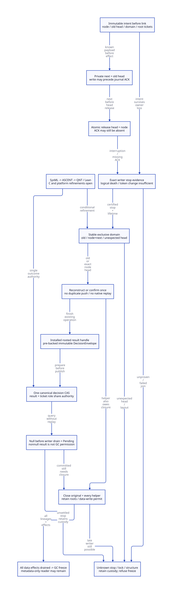

#+TITLE: Interrupted LinkStill and Commit: Progress, Stop Evidence and GC Custody
#+OPTIONS: toc:3 num:t
#+PROPERTY: header-args :eval never
#+TODO: OPEN | MODEL-CHECKED SOURCE-CLOSED

* Decision and authority
:PROPERTIES:
:ID: gambit-marker-interrupted-publication
:CUSTOM_ID: marker-interrupted-publication-decision
:AUTHORITY: models/sysml/marker-interrupted-publication.sysml
:STATUS: SOURCE-AND-C-MEMORY-REFINEMENT-OPEN
:END:

Modern generated C remains the selected architecture. Split LinkStill into next
and head effects and their trailing journal acknowledgements. Split Commit into
preparing an immutable decision envelope, publishing its pointer and acknowledging
it. A stopped helper reconciles *physical effects* against immutable intent; it
never interprets a missing ACK as permission to repeat a push or scalar debit.

[[file:models/sysml/marker-interrupted-publication.sysml][SysML]] owns needs, dependency/import scopes, caller/cost rows and diagram
structure. Native sysml projections drive [[file:marker-interrupted-publication-matrix.org][the closure/benefit matrix]], [[file:diagrams/marker-interrupted-publication.d2][D2]] and .
The actual [[file:../../../modeling/ascent/marker-interrupted-publication.rules.scm][ASCENT DSL]] and [[file:../../../modeling/ascent/marker-interrupted-publication.request.scm][request]] bind artifact/digest/method/check/scope to
[[file:../../../../models/gambit/marker_interrupted_publication.qnt][QNT]] and [[file:../../../../models/gambit/lean/MarkerInterruptedPublication.lean][Lean]]. [[file:../../../../evidence/research/marker-interrupted-publication/checks.json][The receipt]] preserves current source identity, open obligations
and scope controls. [[file:marker-joint-publication-design.org][Joint publication]] remains an imported open source contract.
No runtime implementation, native Gambit test or performance measurement is made.

#+BEGIN_QUOTE
A journal can lag a completed store. A token change cannot recall an already-issued
store. A committed result does not prove that its original writer or helper can no
longer mutate collector-visible state.
#+END_QUOTE

* Actual source: no existing recovery journal to reuse
:PROPERTIES:
:CUSTOM_ID: marker-interrupted-publication-source
:END:

=mem.c:1677–1693= currently stores =base[STILL_LINK]=old head=, publishes
=still_objs=base=, then initializes count/length/header. The body is caller-filled.
There is no per-operation intent, staged ACK or canonical decision in that path.
=still_objs= and the scan queue are per-PSTATE fields at =276–306=; the allocation
lock at =376–384= protects capacity. Existing cooperative GC participation explains
why plain stores alone are not proof of a current runtime race. New independent
workers need a different explicit visibility and lifetime protocol.

=setup_still_objs_to_scan:4210–4251= and =free_unmarked_still_objs:4387–4427= directly
walk and, during sweep, relink the current still chain. Changing only the allocator
would leave real readers/writers bypassing the new protocol. The existing still
mark CAS at =3625–3651= is useful prior machinery, but header synchronization
macros at =gambit.h.in:11004–11084= select builtin/emulated/sequential backends;
they do not certify the atomic object ABI or stalled-owner progress of a new cell.

The first new admission boundary is therefore a =ControlledStillDomain= with a
native atomic head and qualified iterators. Legacy raw PSTATE heads remain in the
legacy cohort. Do not cast an existing plain head to atomic and mix accesses.
Setup/sweep/capacity walkers must explicitly include controlled and legacy domains
and reconcile pending native allocation tickets. This is a C-layer refactoring,
not a wrapper added around the old two stores.

* Intent, journal and authority records
:PROPERTIES:
:CUSTOM_ID: marker-interrupted-publication-records
:END:

#+NAME: interrupted-publication-records
| Record | Contents | Publication/lifetime rule |
|--------+----------+---------------------------|
| LinkIntent | Operation and activation key; VM/domain incarnation; node; expected old head; immutable body/layout proof; root/allocation ticket handles | Complete before first effect; release-published; held through every writer/helper |
| ProgressJournal | Next/head/commit ACK, writer lineage, operation stage | ACK follows matching effect; absence is not negative evidence |
| StopCertificate | Exact operation/writer/native incarnation/domain lease; closure origin; covered helper set; no-future-effect evidence | Cannot be issued from timeouts, token changes or ignored joins |
| DecisionEnvelope | Same operation/domain identity; stable result-root handle; allocation ticket and immutable committed disposition | Fully prepared in reserved backing before one pointer publication |
| CanonicalDecision | Atomic pointer: initially no committed envelope, then exact immutable envelope | Result and ticket role use the same authority |
| ReaderProtection | Root/object borrow distinct from metadata-only record pin | Protect lookup before dereference; record reuse waits its actual readers |

These are in-process volatile protocol records. No filesystem journal, power-fail
recovery or persistent-memory durability is claimed. Root handles are relocation-
safe cells, not untracked movable SCMOBJ copies inside a native envelope. Shape,
ticket and generation validation happen while backing and domain identity remain
pinned. Invalid raw pointers cannot be classified by dereferencing a presumed tag.

The journal is advisory progress evidence. The immutable intent and canonical
atomic cells decide reconciliation. Publish =NextAck= only after next is ready,
=HeadAck= only after head publication, and =CommitAck= only after the decision CAS.
A death between effect and ACK is expected. A log that leads the physical effect
is an invalid producer, not a recoverable success receipt.

* LinkStill internal cuts and reconstruction
:PROPERTIES:
:CUSTOM_ID: marker-interrupted-publication-link
:END:

Assume a valid initialized node, protected old head, complete immutable intent,
exclusive stable domain lease, and certified termination of the previous effect
writer. GC has not frozen or swept that domain and no other admitted allocator
can change its head. The allocation ticket must prove N is fresh and absent from the well-formed old chain; node-versus-head inequality alone is not full list acyclicity. Then execute:

#+NAME: link-inner-order
#+BEGIN_EXAMPLE
publish LinkIntent(node=N, expectedHead=H, domain=G)
  -> write private N.next=H
  -> optional trailing NextAck
  -> atomic release publication domain.head=N
  -> optional trailing HeadAck
#+END_EXAMPLE

The new head must be a real atomic object with acquire readers. Next is private
before head publication and immutable afterwards until an exclusive sweep phase.
This permits ordinary next storage only under the admitted no-racing-writer and
next-before-release ordering. Its prefix/body assumptions come from the existing
layout authority; atomic head/decision side records have separately qualified
size/alignment. No universal lock-free pointer primitive is assumed.

#+NAME: link-reconciliation
| Stable observation after stop | Allowed action | Forbidden inference |
|-------------------------------+----------------+---------------------|
| head=H, node still private to intent | Reconstruct N.next=H from intent, then publish N | Do not need to read/interpret an interrupted private next value |
| head=N and N.next=H, valid node | Confirm link; advance journal without insertion | Missing HeadAck does not mean head store failed |
| head=N but next/layout unexpected | Retain duty; refuse freeze | Never overwrite a published next by guessing |
| head neither H nor N | Retain duty; refuse freeze | Do not search a later chain to invent ownership or silently unlink |
| old writer/helper may still store | Keep permit and input/result roots | No takeover from token/generation change alone |

If a private next write was interrupted, a known stopped writer and head=H allow
reconstruction without interpreting a potentially invalid pointer representation.
If head=N, acquire visibility must establish that its preceding next write was
complete; an unexpected next is rejected. Actual arbitrary-machine interruption,
signal/cancellation behavior and compiler ordering remain IP-ORDER obligations.

Re-running =push= with =oldHead=current head= when head already equals N creates
=N.next=N=. This is a retained counterexample. The admitted helper uses the
original H and the classification above; it never takes a fresh head as substitute
intent. All stop/lifetime/shape premises remain necessary even though the allowed
assignment can be idempotent.

* What constitutes a stop certificate
:PROPERTIES:
:CUSTOM_ID: marker-interrupted-publication-stop
:END:

#+NAME: stop-evidence-admission
| Evidence | Can support no-future-write evidence? | Additional conditions |
|----------+---------------------------------------+-----------------------|
| Normal guarded operation endpoint | Conditionally | No further store origin/reentry; prior effects complete; exact operation/lineage and domain |
| Cooperative handoff/park | Conditionally | Original writer publishes closure after its last possible effect and cannot reenter the closed generation |
| Exact successful native join/termination | Conditionally | Exact native incarnation, final effects drained, all helper origins covered, backing/locks still usable |
| Scheme continuation escape or logical activation close | Insufficient alone | Does not stop another helper or arbitrary foreign writer |
| Generation increment / revoked token | Insufficient alone | An issued store can pass the earlier check and execute later |
| Failed, ignored or unknown join; timeout; thread-id match | Insufficient | No proof that the exact writer has terminated |
| Thread stopped but node/root/lock already destroyed | Insufficient for takeover | Stop does not reconstruct memory or make a dead lock usable |

A certificate covers the complete effect-writer lineage, including helpers.
Stopping writer zero then allowing helper one to mutate creates another closure
obligation. Metadata-only readers are separate: they can keep a record alive
without blocking GC, provided they cannot borrow the object or perform head/root
writes through that permission.

The managed native profile must prohibit unqualified asynchronous signal escapes,
asynchronous cancellation and raw foreign writes in these bounded sections, or
provide separate platform proof. No claim is made that the present runtime already
establishes this profile. A normal C release fence alone is not a thread-stop
primitive. A generation check immediately before a raw store still has a race if
closure can occur between that check and the store.

** Real Darwin/POSIX paths and the cleanup problem

=os_thread.c:546–575= branches on =pthread_join= success but converts a failure
through =err_code_from_errno= instead of preserving the original pthread return.
=os_base.c:1052–1077= reads errno and maps zero to UNKNOWN_ERR. This is not evidence
that a failed join returns success, but it loses the exact returned error for a
future stop receipt. Retain the original call result and exact target identity.

=setup.c:870–984= calls =___cleanup_pstate= and then =___thread_exit= on a shrinking
processor; P0 later calls =___thread_join= and ignores the result. Memory cleanup
at =setup.c:4569–4579= reaches =mem.c:4432–4451,4928–4964=, which frees still/RC and
can destroy synchronization. Consequently, join success alone cannot qualify
recovery of an operation still backed by that destroyed PSTATE. No native failure
is inferred from this source order; it rejects that order as evidence for the new
recoverable cohort.

Move canonical construction/domain/root/code duties to a VM-owned service before
PSTATE cleanup. Record effect-writer closure separately from native activation
closure and physical thread termination. The existing child =___run= return at
=setup.c:763–801= can continue serving sync operations, so it is not a native stop.

Do not call blocking join while holding the publication/GC locks or waiting for an
owner that itself awaits this GC barrier. Refusing Frozen is a safety state; the
coordinator may obtain evidence outside that reverse wait cycle. Liveness under an
arbitrary unknown managed writer or nonrecoverable owner-held lock is unproved.

* Commit internal cuts: one result and one ticket authority
:PROPERTIES:
:CUSTOM_ID: marker-interrupted-publication-decision
:END:

#+NAME: decision-inner-order
#+BEGIN_EXAMPLE
body valid + head linked + root installed
  -> fill reserved DecisionEnvelope(rootHandle, ticket, exact identity)
  -> publish immutable envelope readiness
  -> atomic decision CAS: Uncommitted -> that envelope
  -> trailing CommitAck / derived summary refresh
#+END_EXAMPLE

Prepare no new native allocation or Scheme work inside Commit. A partly filled
unpublished envelope is not interpreted; after prior writer stop, reconstruct it
from rooted canonical inputs in reserved backing. It cannot be reused while its
original writer might still fill it.

The one decision pointer is authority for both the committed result and the
allocation ticket's Reserved/Live role. It does not independently increment
=occupied_words_still= or decrement another reservation counter as a second
commit. Capacity admission already holds the physical charge throughout. Scalar
counters become reconciled summaries; freeze/resize must account for one ticket
once, including pending/quarantine categories. =requested_words_still= remains a
temporary resize estimate, not this ticket's outcome.

#+NAME: decision-observations
| Protected observation | Meaning and permitted recovery |
|-----------------------+--------------------------------|
| Valid committed envelope, CommitAck missing | Outcome committed; query/copy receipt; no allocation, free or scalar replay |
| No envelope, previous writer fully stopped, valid rooted intent | Commit not yet published; qualified helper can finish existing CAS |
| No envelope, writer may still execute CAS | Pending snapshot; cannot declare final failure or refund |
| Envelope committed, original/helper data writers not closed | Result may be known, but permit and GC freeze still remain unsettled |
| Record/backing/domain identity unknown or invalid | No speculative pointer read; retain custody/refuse admission |

A result query never authorizes returning into a dead native C activation.
=___call=, SFUN error loops, continuation/processor routing and outer guards remain
under their imported semantics. =gambit.h.in:9981–10007= uses setjmp/longjmp in the
selected C path: progress/result storage must survive outside abandoned stack
locals. This study does not turn C lexical cleanup into universal finally behavior.

* GC, late stores and reclamation
:PROPERTIES:
:CUSTOM_ID: marker-interrupted-publication-freeze
:END:

The permit remains held until the original and every admitted helper have closed
their possible data effects, root/list/decision state is reconciled, and service
custody is known. Then withdrawal release-publishes closure to the frozen-view
coordinator. Data-write closure cannot be inferred from commit success.

A retained counterexample has writer zero issue a head store, die logically, then
have its generation revoked. An unqualified helper commits and drops the permit.
The old issued store executes after that drop. Rechecking the token in the helper
never intercepts that already-issued effect. Qualified stop/drain would exclude
this schedule; the model deliberately allows the raw delayed effect in the unsafe
control.

No operation/domain/envelope identity is reused while old borrowers can still
access its storage or issue a delayed effect. This is the ABA/lifetime obligation,
not solved by adding an integer generation beside a reused raw pointer. Protected
metadata lookup precedes use. Control-only reader pins may survive GC, but prevent
control-record reclamation. Stable decision/root service backing remains separate
from that mutable record and the dead original native activation.

Unknown final head/CAS outcome with confirmed stop and intact backing is often
reconcilable by the canonical cells. Unknown actual stop, invalid header/intent,
unexpected head, missing root, unrecoverable lock or destroyed domain remains
GC-critical: retain roots/tickets/permit and refuse Frozen. Isolated native malloc/
free outcome debt is governed by the previous design; it is not repaired by this
link/decision journal.

* Model scope, proofs and counterexamples
:PROPERTIES:
:CUSTOM_ID: marker-interrupted-publication-models
:END:

QNT has 32 named histories: 19 admitted cases and 13 unsafe controls. It models one
operation in physical domain one, original/helper actors, separately issued and
applied next/head/decision effects, trailing ACKs, canonical decision, generation,
stop closure, metadata pins and GC freeze. The ordinary and helper-entry profiles
each sample 100 traces of up to 100 transitions with literal seed 17. Initializer
steps add states to displayed trace lengths. This is not exhaustive or native SMP
execution.

The model's join-success transition is an external stop premise. It can discard
an unapplied pending effect; other histories apply the effect before termination.
It never derives actual successful join, signal/cancellation correctness, kernel
store completion or code lifetime from a status flag. Pointer effects are abstract
atomic transitions. Private next interruption is represented by an invalid-value
placeholder; no real invalid pointer is dereferenced or machine instruction run.

Lean checks 23 conditional declarations. Reconciliation establishes the exact
link, is idempotent and avoids self-link; identical absent ACKs cannot decode two
different head outcomes. Changing generation leaves pending effects unchanged.
Pending effects, wrong identity, omitted helper, failed join without cooperation,
missing root/shape and unrecoverable lock reject their corresponding gates.
Two null-decision snapshots with different pending effects are indistinguishable if only the published flag is observed; this restricted-observation result is not an impossibility claim for richer stop evidence. Decision/query Step/Trace preservation and derived-ticket conservation use the
single authority. A committed decision with pending effects cannot pass CanFreeze.
No full QNT-to-C or machine memory-model simulation is proved.

#+NAME: interruption-refinement-obligations
| Concrete event | QNT slice | Lean slice | Source/platform gap |
|----------------+-----------+------------+---------------------|
| Immutable intent release | publishIntent | Reconciliation premises | Every field/root/ticket initialized and lifetime held |
| next write, possibly interrupted | issueNext/applyStore/interruptNext | settleEstablishesLink | C representation and stopped private reconstruction |
| head store before ACK | issueHead/applyStore/acknowledgeHead | ackAloneCannotDecode / idempotence | Real atomic head; exclusive domain; every reader migrated |
| Logical death/token revoke | logicalDeath/revokeGeneration | generationDoesNotDrain | No unmodeled late writer or raw legacy origin |
| Native/cooperative stop | joinedStop/cooperativeStop | StopValid and takeover rejection | Real exact receipts, helper closure, lock/storage survival |
| Immutable envelope and CAS | prepareDecision/issueCommit/applyStore | commitPreserves / tracePreserves | C CAS, stable root handle and unified ticket interpretation |
| Commit response lost | loseResponse/query | Decision query identity | Protected lookup, original native return contract |
| Drop permit/freeze | releasePermit/freeze | commitAloneDoesNotDrain | All effect origins, memory ordering and imported full GC view |

ASCENT imports six open needs without changing their scope. Five actual repository
Evidence cases cover current slices, missing QNT, wrong Lean scope, stale artifact
digest and a synthetic all-scoped positive control. Only IP-H and IP-I qualify.
Eleven source and two C-memory needs remain open. Native sysml parse/expression
validation is not proof of instantiated runtime requirements. Zero production
paths are retired and zero complete runtime components are admitted.

* Benefits, memory and retirement
:PROPERTIES:
:CUSTOM_ID: marker-interrupted-publication-benefits
:END:

The protocol can remove duplicate list insertion, replayed scalar commit and
reallocation on a lost response. One operation has one winning decision CAS;
queries have zero native allocation/free/jump effects. Atomic attempts and query
count are not bounded to one. Reconciliation itself allocates nothing under its
permit. These are protocol bounds, not measured time savings.

Additional support is explicit: one immutable link intent and decision envelope,
root/ticket handles, bounded writer-lineage records, stop receipts, protected
queries and collector/domain adapters. The two-actor model does not establish an
unbounded helper failure-recovery theorem. A real profile must reserve lineage/
record slots or refuse further admission without dropping existing responsibility.

Retain the inherited marker layout body =2W+24= and its +24-byte SMP delta only
within the stated layout assumptions. Atomic heads/decisions are native side
records whose size, alignment, backing and fallback behavior remain unqualified;
do not assume their C sizeof equals one pointer on every target. The physical
peak remains =max_t(H+P+N+Q)= with unique backing counted once. Delayed roots/code,
stop debt and record-reader pins can raise or prolong peak; no reduction is proved.

Conditional retirement targets are controlled-cohort raw head publication,
caller-local progress, independently replayable result/credit commit and ungated
raw marker consumers. Legacy allocation is separately admitted; generic still
refcounts are not globally removed. Source-wide iterator, scalar-summary,
resize/cleanup and generated-kernel migration must precede retirement.

Modern C can express these contracts directly and preserve Scheme/C portability
through generated descriptors and qualified platform adapters. Zig would need the
same actual roots, stop evidence, atomics, lifetime and GC integration; no extra
necessary-support saving has been demonstrated here. Positive net value requires
removed duplication, waits, faults and retention to exceed journal/atomic/lease/
root/stop costs under the semantic gates. No person-day or invented speedup estimate
is used.

* Primary evidence and limits
:PROPERTIES:
:CUSTOM_ID: marker-interrupted-publication-references
:END:

- [[https://cs.brown.edu/people/mph/HerlihyW90/p463-herlihy.pdf][Herlihy and Wing (1990)]] supports distinguishing an operation's linearized
  outcome from its response. It does not prove the C pointer cells or recovery.
- [[https://www.eecg.utoronto.ca/~amza/ece1747h/papers/hazard_pointers.pdf][Michael (2004)]] motivates lookup protection and separating logical removal
  from reclamation. No lock-free progress or performance guarantee is transplanted.
- [[https://developer.apple.com/library/archive/documentation/System/Conceptual/ManPages_iPhoneOS/man3/pthread_join.3.html][Apple archived pthread_join manual]] states successful join observes target
  termination. Exact target identity, managed-storage survival and complete writer
  coverage remain this architecture's responsibility; the archived manual is not
  an installed-macOS binary/version qualification.
- [[https://github.com/apple-oss-distributions/libpthread/blob/main/src/pthread.c][Apple public libpthread source]] shows distinct exit-gate, joiner wake and
  thread-storage cleanup responsibilities. This is an inspected moving public
  source reference, not a digest-matched source for the host's installed library.
- The current Open Group join pages were inaccessible and the WG14 N1570 URL
  timed out. Those failures are retained; no unsupported platform proof is filled
  from them. Accessible Apple evidence and actual Gambit call sites remain bounded.

#+BEGIN_REVIEW
The remaining hard boundary is a real source-level DataWriteClosed issuer covering
every generated/raw/helper origin and a qualified atomic/stop backend. Logs and
models alone cannot make an already-issued raw effect disappear or recover memory
freed by the old PSTATE cleanup order.
#+END_REVIEW
