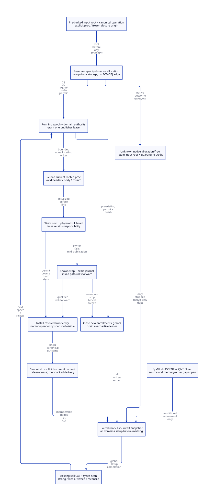

#+TITLE: Marker Allocation, Root Registration and Joint Still Publication
#+OPTIONS: toc:3 num:t
#+PROPERTY: header-args :eval never
#+TODO: OPEN | MODEL-CHECKED SOURCE-CLOSED

* Decision and authoritative research boundary
:PROPERTIES:
:ID: gambit-marker-joint-publication
:CUSTOM_ID: marker-joint-publication-decision
:AUTHORITY: models/sysml/marker-joint-publication.sysml
:STATUS: SOURCE-AND-C-MEMORY-REFINEMENT-OPEN
:END:

Modern generated C remains the selected runtime architecture. Refine the previous
atomic-visibility abstraction into four physical publication fragments, bracketed
by a VM epoch publisher lease and exclusive physical-domain link authority. GC
closes new grants, drains existing publishers, then freezes paired root/list/credit
membership. A response is not the commit event. A missing response does not release
a writer permit or authorize another allocation.

[[file:models/sysml/marker-joint-publication.sysml][SysML]] owns model needs, imports, dependencies, caller/cost rows, topology and
references to the existing layout arithmetic. Its native projections drive the
[[file:marker-joint-publication-matrix.org][closure/benefit matrix]], [[file:diagrams/marker-joint-publication.d2][D2]] and . Actual [[file:../../../modeling/ascent/marker-joint-publication.rules.scm][ASCENT rules]] and [[file:../../../modeling/ascent/marker-joint-publication.request.scm][bound request]]
select and check exact [[file:../../../../models/gambit/marker_joint_publication.qnt][QNT]] / [[file:../../../../models/gambit/lean/MarkerJointPublication.lean][Lean]] scopes. [[file:../../../../evidence/research/marker-joint-publication/checks.json][The receipt]] binds source, model and observation
identities. [[file:managed-marker-layout-design.org][Controlled marker layout]] remains an imported open source contract.
No runtime code, native Gambit test or performance measurement is part of this study.

#+BEGIN_QUOTE
The selected guarantee is joint visibility to qualified observers, not a magical
atomic write of two pointers. Physical list linking and root installation are
separate writes. The publisher's lease prevents a collector snapshot between them.
#+END_QUOTE

* What the checked-out runtime actually does
:PROPERTIES:
:CUSTOM_ID: marker-joint-publication-source
:END:

=lib/mem.c:276–306= makes =still_objs=, its scan queue, deferred words and =rc_head=
PSTATE fields. =ALLOC_MEM_LOCK= at 376–384 protects capacity bookkeeping, not the
still chain or a root registry. =alloc_scmobj_still:1560–1709= has these real branches:

#+NAME: existing-allocation-branches
| Branch | Capacity action | Physical allocation | List/body sequence |
|--------+-----------------+---------------------+--------------------|
| Deferred small request | Fold into PSTATE deferred words only after native success | aligned heap allocation | Link first; count=1/length/header; caller fills body |
| Sufficient VM capacity | Charge deferred+request under allocation lock; reset deferred after unlock | aligned heap allocation | Same caller-fill contract |
| Insufficient capacity | Unlock; synchronous GC with requested words | aligned heap allocation after GC | Same caller-fill contract |
| Native failure after slow reservation | Subtract request under allocation lock | NULL error | No still node returned |

=make_vector:1778–1821= initializes the caller-filled body. =c_intf.c:6509–6545=
then copies the procedure or =data_rc(c_closure_self())= into that vector; the
source explicitly warns that the procedure may already have moved. Generic
=alloc_scmobj= promises count one and initialization before the next allocation.
It is not a private, zero-count, independently scanned constructor.

=setup.c:479–488,542–708,1012–1200= combines synchronous GC requests, raises the VM
sync interrupt and executes GC on participating processors. =mem.c:7003–7031=
has barriers between setup, strong marking, weak marking and cleanup. These facts
explain the current cooperative context; they do not prove a native race exists
merely because list writes are plain stores. The proposed independent workers
remove that implicit coupling, so equivalent publication exclusion must become an
explicit contract.

=setup.c:763–801= starts a child processor through =___run= and, after it returns,
continues servicing synchronous operations. Processor exit from Scheme is not
proof that its original native writer stopped. =mem.c:4928–4964= destroys memory
synchronization and invokes P0 cleanup with an explicit other-processors TODO.
A new registry cannot silently survive that unconditional teardown.

* Objects, domains and the canonical operation
:PROPERTIES:
:CUSTOM_ID: marker-joint-publication-records
:END:

#+NAME: publication-record-contract
| Record | Required contents | Lifetime authority |
|--------+-------------------+--------------------|
| EntryRoot | Updateable procedure cell, actual closure/code borrow, native owner lineage | Root-domain entry admitted before any allocation |
| ConstructionOp | Stable operation identity, activation key, stage, result slot, exact allocator profile, tickets, progress/stop evidence | Canonical service; caller stack is not backing |
| RawStorage | Native pointer or unresolved outcome; no managed private edge before permit | Operation disposition ledger |
| DomainLease | VM/domain incarnation, publisher identity, epoch, exclusive link authority | Exact active-operation set, not a guessed scalar |
| RootEntry | Reserved updateable marker cell plus publication state | Same operation/epoch commit boundary |
| FrozenView | Physical domain membership, committed roots, construction roots, capacities, per-domain setup completion | GC task/view service until scan/sweep reconciliation |

The activation key and physical-domain identity are separate. A processor index
can be a route hint but cannot authorize writes after resize/reuse. Pin the domain
incarnation through every permit and GC view; resize must drain or explicitly
transfer its responsibilities. The abstract model fixes two domains and does not
prove the resize algorithm.

ConstructionOp slots, EntryRoot cells and result slots are pre-backed. Publishing
an EntryRoot itself must use root-domain enrollment admission; it cannot allocate
the root it needs while holding an unregistered movable argument. If enrollment
is closed or capacity unavailable, keep upstream qualified rooted custody or reject
the native entry. An arbitrary raw SCMOBJ supplied by an unaudited foreign thread
is not a recoverable input.

* Preparation can overlap GC; managed body writes cannot
:PROPERTIES:
:CUSTOM_ID: marker-joint-publication-preparation
:END:

Before a publisher permit exists:

1. Enroll the input procedure root while epoch enrollment permits it. Capture the
   actual dynamic callback's RC data/code lease before allocation. =os_dyn.c=
   exposes global =c_closure_self= with a thread-local TODO; rereading it later is
   not a snapshot. =mark_rc= is PSTATE-local and called only in P0's branch.
2. Reserve canonical control/root/native credits. If capacity needs GC, request
   it here with no publication permit, domain lock or allocation lock held.
3. Allocate native storage outside the permit. The storage is not yet an exposed
   SCMOBJ or still-list member. It may have raw scaffolding and false fields, but
   no private, untracked copy of a movable procedure pointer.
4. If GC runs, it updates the enrolled input cell. Keep raw storage native-only;
   later body fill reloads the then-current rooted procedure under its permit.

This sharpens the previous description of a private initialized body: copying a
movable procedure into private storage before a possible GC is insufficient unless
that storage is also a complete updateable root domain. The selected path avoids
that extra private object scan by postponing the managed write until the permit.

A native allocator may block. For independent GC to proceed, the context must
already have a frozen complete root view and qualified native participation state;
this is a source admission requirement, not supplied by malloc or by the current
cooperative rendezvous. A still-active/unknown managed writer cannot be relabeled
native-only debt merely because its caller is slow.

* Grant and four publication fragments
:PROPERTIES:
:CUSTOM_ID: marker-joint-publication-fragments
:END:

Grant atomically checks Running epoch, current domain incarnation and a free
physical-domain link authority, then installs the operation in the VM active set.
A concrete common control lock plus nonblocking domain-authority check is one
permitted implementation refinement. Do not hold one authority while blocking for
another. Distinct domains may hold permits concurrently; writers to the same chain
serialize. No native storage allocation, Scheme execution, callback, GC request,
condition wait or foreign exception propagation occurs inside the permit.

#+NAME: publication-fragments
| Fragment | Writes and postcondition | Custodian before permit release |
|----------+--------------------------+---------------------------------|
| FillBody | Reload input; exact typed header/length/mark=-1/count=0; procedure, route and immutable key complete | Operation plus input root |
| LinkStill | Write node.next, then physical-domain head | Operation lease covers half-published node |
| InstallRoot | Write reserved root cell and prepared registry entry | Same operation; no independent observer may snapshot it |
| Commit | Publish canonical committed result and reserved-to-live capacity transfer | Service owns marker/root/result even if reply is lost |
| ReleasePermit | Release domain authority and active lease after all prior writes | Canonical strong marker root replaces temporary input role |

The four fragments refer to abstract units of work, not four instructions or
machine atomics. Actual C stores within each fragment require a progress/stop
journal sufficient to identify the next safe operation. QNT treats each fragment
atomically and does not prove interruption between arbitrary stores. Header/list
validity uncertainty therefore remains a hard source gate.

Canonical commit occurs after body, list and root installation. All qualified
observers, including diagnostic/list/accounting walkers, must honor the active
permit or committed-view boundary. If an observer reads the physical head without
that protection, a commit bit alone cannot save it.

The committed result remains strongly rooted across permit withdrawal and a later
GC before the native caller receives it. Delivery to a caller-owned root is a
separate accepted handoff. If its activation closed, retain/reconcile the result
through the service; do not jump to the old C frame. This imports the original
activation/continuation guard contract and does not change Scheme error handling.

* GC closing, freeze and setup arbitration
:PROPERTIES:
:CUSTOM_ID: marker-joint-publication-freeze
:END:

#+NAME: epoch-publication-order
#+BEGIN_EXAMPLE
Running: enroll roots / grant per-domain publishers
  -> Closing: close new enrollment and grants
  -> drain exact publisher and root-writer responsibilities
  -> Frozen: paired domain/list/root/credit snapshot
  -> setup ALL physical still lists
  -> enumerate roots -> still CAS -> typed/transitive scan
  -> weak/cleanup/sweep -> reconcile live and pending credit
  -> next Running epoch; waiting constructors reload updated inputs
#+END_EXAMPLE

A publisher granted before Closing can finish its bounded fragments after Closing.
A raw private constructor without a permit can wait through the round with its
input cell covered. Closing does not wait for every such constructor or requester
ACK. It does wait for actual managed writers and root enrollment/relocation writers
to stop and settle. Native allocation failure/private rollback may settle its native disposition during a round, but root-cell withdrawal waits for the frozen view to drain; the model defers its combined known-failure/rollback action while Frozen. The root-writer protocol is an imported source premise; the
QNT profile starts each root through an atomic enrollment action.

The final active-set test and transition to Frozen use the same admission control
as grant. Releasing a permit then permitting another grant before freeze is not a
valid zero observation: Closing must already reject that new grant. A scalar zero
is evidence only under that closed membership and lifetime protocol.

=setup_still_objs_to_scan= resets zero-count mark fields. Every physical list's
setup must finish before *any* cross-domain root CAS. A P0 worker can then enqueue a
P1-owned object through existing =mark_array=; the queue/task holder owes its scan,
while physical list ownership determines sweep. This avoids a late setup erasing
a successful mark. The barrier is global setup completion, not just completion of
the scanner's own list.

C ordering obligations are explicit: initialized body/link/root/result stores
happen before lease-release publication; freeze acquires/drains those releases
and revalidates closed membership; setup completion happens before marking.
Unprotected ordinary root reads/writes still constitute a separate race problem.
A release fence alone does not register a missing root or stop a writer. Do not
hold the admission lock while waiting for publishers needing it to complete.

* Failure and unknown outcome custody
:PROPERTIES:
:CUSTOM_ID: marker-joint-publication-recovery
:END:

#+NAME: publication-failure-disposition
| Cut and evidence | Root/native/credit custodian | GC and retry rule |
|------------------+-----------------------------+-------------------|
| Entry/root reservation rejected | Upstream qualified root owner; no new native allocation | Reject/retry entry only while upstream custody remains valid |
| Known malloc NULL before permit | Operation releases reservation once; no allocated object | No published marker to scan; ordinary error path |
| Known raw private pointer; known rollback free | Operation retains input until rollback completion | Return credit once; no list mutation |
| Native malloc/free outcome unknown, native writer known stopped, no managed private edge | Canonical quarantine retains input root, operation and charge | GC may trace input and continue; no second alloc/free or refund |
| Permit acquired, before list link | Exact active operation plus input root | Selected helper may roll forward after stop/shape confirmation; never silently drop permit |
| List linked, root not installed | Lease, private journal and input root | No freeze; selected recovery rolls forward, never guessed free/unlink |
| Root installed, canonical commit incomplete | Same operation/root/lease, reservation still charged | No public result and no early lease withdrawal |
| Canonical commit succeeded, response lost | Service root/result and live credit | Query the same operation; no native allocation replay |
| Actual writer stop or partial header/link validity unknown | Exact active operation plus all root/credit duties | Refuse freeze/handoff; timeout is not a stop certificate |
| Native owner activation closed after commit | Root/result service plus accepted physical cleanup duty | Metadata query is safe only with protection; no native return capability |

For a known stopped writer with valid fragment journal, the selected recovery
finishes the existing operation. It does not rerun an uncertain native allocation
or reconstruct lost identity from count. A real stop protocol, helpers' authority,
inner-store interruption recovery and counter/link integrity remain JP-RECOVER and
JP-ORDER. Arbitrary OS-thread death with a held nonrecoverable lock is not handled
by asserting that a helper exists.

The QNT model deliberately retains an unknown-stop permit: Closing cannot advance
to Frozen. That is a correct safety refusal with no liveness guarantee. Avoiding
all GC blockage under arbitrary unknown managed writers has not been proved.

* Capacity, native backends and peak memory
:PROPERTIES:
:CUSTOM_ID: marker-joint-publication-accounting
:END:

For each canonical operation, reserved credit transfers to exactly one of live,
known-returned or quarantine disposition. The native call and result are distinct
from capacity admission. Lost ACK changes neither allocation count nor ownership.

=free_unmarked_still_objs:4387–4427= rebuilds the still chain and per-PSTATE live
words; =determine_occupied_words:6256–6296= sums them across processors. Private
unlinked native storage is absent from that recount. Its charge must survive in a
separate pending ledger, rather than vanish or be counted as a live list node.
=resize_heap:6302–6475= temporarily treats requested words as live; the GC sync op
combines request sizes. Such a temporary capacity estimate is not a per-operation
physical allocation receipt. Reconcile reservation inclusion at the epoch cut so
it is neither charged again nor accidentally refunded when the estimate resets.

Reuse [[file:models/sysml/managed-marker-layout.sysml][the existing SysML layout authority]]: body =2W+24=, prefix+body =8W+24=.
At the same live known-marker set, SMP marker backing increases by 24 bytes each.
The aligned wrapper requests 103 bytes at W=8 or 67 at W=4 under the previous
pointer/alignment assumptions. These numbers do not include registry/journal pools,
allocator usable-size effects or transitive retained procedure/code graphs.

An important backend qualification is now explicit: =os_base.c:445–507= routes
heap allocation to the code allocator under =SUPPORT_LOWLEVEL_EXEC=. Its mmap path
at =335–407= adds two size words, and the matching release discards munmap's return.
Therefore the aligned-wrapper request is not a universal OS allocation bound or
release-success receipt. Bind the effective backend before estimating page/RSS
costs or admitting release completion. No native backend is executed here.

Define disjoint backing categories at each time:

#+BEGIN_EXAMPLE
Peak = max_t(Hpublished(t) + Pprivate(t) + Ncontrol(t) + Qunknown(t))
#+END_EXAMPLE

Move one backing between categories; never add a second object because service
custody changed. Unknown result debts have their own admission budget: the number
of active publisher leases does not bound all old private/quarantine operations.
Input root retention may keep a large graph alive even with a small marker slot
count. No whole-round peak reduction, allocator page count or speedup follows.

* Formal model, source reflection and negative controls
:PROPERTIES:
:CUSTOM_ID: marker-joint-publication-models
:END:

QNT has 32 named cases: 17 admitted histories and 15 retained unsafe controls.
Two operation identities run either on the same processor-one domain or on split
domains. It tracks input roots, physical heads/next links, per-domain exclusion,
fragment stages, permits, canonical entries, credit disposition, setup completion,
root revisions and lost replies. Two GC epochs expose the stale-procedure and
setup-reset risks. Each profile has 100 samples of up to 100 transitions with
literal seed 17, not an exhaustive state-space proof.

Negative controls cover premature freeze, grant after Closing, permit waiting for
GC, stale root reload, late setup, dropped partial-link permit, free of linked
storage, unknown refund/root drop, replayed allocation, early marking, exposure
before commit, concurrent same-domain writers, native calls under permit and withdrawal of an input root already included in a frozen view.
The separate intentionally failing run must detect premature freeze.

Lean checks a one-transaction projection: each guarded publication fragment,
closing, freeze and query preserves the stated invariant; Step/Trace induction
preserves it across the projected protocol. A Frozen state has paired list/root/
commit membership. Unknown writer stop rejects writes; Closing rejects grants;
credit transfers conserve total, unknown debt keeps its root and charge, and a published input-root view rejects withdrawal.
It does not prove all two-operation QNT transitions, actual C stores, root-map
completeness, fairness, native allocator recovery or arbitrary thread failure.

#+NAME: source-to-model-refinement
| Source/design event | QNT cut | Lean obligation | Still open |
|---------------------+---------+-----------------+------------|
| Rooted input enrollment | begin | Admission premise | All real roots, callback origin and relocation protocol |
| Native allocate/result | nativeSuccess/Failure/Unknown | Credit/debt projection | Native backend, stop, result storage and matched free |
| Epoch+domain grant | grant | grantPreserves | C lock/lease linearization and domain-generation lifetime |
| Header/body completion | fillBody | fillPreserves | Codec/layout, inner writes, fresh root load |
| next/head installation | link | linkPreserves | Two physical stores, exclusivity and exact recovery journal |
| Root registry installation | installRoot | installPreserves | Updateable cell visibility and every observer |
| Canonical result/credit | commit | commitPreserves | Multi-field C commit and result custody |
| Permit withdrawal | releasePermit | releasePreserves | Happens-before, no premature input drop |
| Closed enrollment + GC view | requestFreeze/freeze | close/freeze/trace preservation | Every enrollment/writer, resize and teardown |
| Global setup + marking | setupDomain/mark/finishStrong | Conditional freeze membership | Queue/task closure and actual complete collector |

Native sysml validates the selected models and evaluates fields; requirement
instances are not thereby proved. ASCENT checks artifact/digest/method/check/scope
conjunctively, imports six *open* needs unchanged, and preserves five Evidence
controls. Only JP-H and JP-I are current qualified slices. Eleven source-refinement
and two C-memory needs remain open; zero complete runtime components are admitted.

* Retirement, net value and research evidence
:PROPERTIES:
:CUSTOM_ID: marker-joint-publication-benefits
:END:

Conditional retirement targets are the controlled cohort's caller-fill/count-one
marker constructor, unrooted procedure copy and raw kill/debit coupling; implicit
PSTATE/processor participation must be replaced by explicit domain/root/publisher
contracts. Existing legacy allocation, general still APIs and unrelated callback
cleanup are not retired by this design. Updating only c_intf is insufficient:
=_kernel.c= contains generated raw vector reads and GSTATE exposes old make/kill
entry points. Regenerate or reject incompatible consumers.

The reusable modernization gain is one canonical operation/root/epoch/capacity
protocol shared by allocation, GC, FFI and teardown. Positive value requires saved
replays, lost roots, retaining edges, wait cycles and faults to exceed lease,
registry, tracing and retained-debt costs while semantic gates hold. Modern C can
express this directly with Scheme-generated descriptors. Zero additional necessary
support work has been shown removable merely by adding Zig.

- [[https://cs.brown.edu/people/mph/HerlihyW90/p463-herlihy.pdf][Herlihy and Wing, Linearizability (1990)]] supports separating a committed
  abstract outcome from invocation/response. It does not prove the selected C
  fragments linearizable; that remains the refinement obligation above.
- [[https://www.eecg.utoronto.ca/~amza/ece1747h/papers/hazard_pointers.pdf][Michael, Hazard Pointers (2004)]] motivates protected lookup and distinct
  logical removal/reclamation. No lock-free progress or measured benefit is
  transplanted to these epoch/domain gates.
- [[https://www.open-std.org/jtc1/sc22/wg14/www/docs/n1570.pdf][WG14 N1570]] is the retained C memory-model reference. Its public URL timed
  out on this research turn; the receipt records that access failure, not a new
  platform conformance or memory-order proof.

#+BEGIN_REVIEW
The next blocker is a source-refinable journal for interruption inside LinkStill
and Commit, plus a noncircular native stop/result protocol. Unknown managed writes
must remain visible blockers. Formal safety controls are not permission to erase
that debt or claim an independently progressing collector implementation.
#+END_REVIEW
