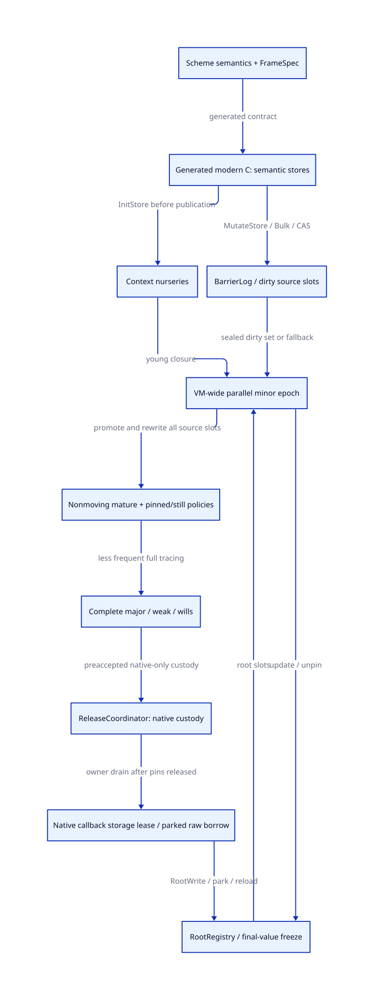

#+TITLE: Generational GC as a modern C runtime redesign
#+SETUPFILE: ../../../modeling/org/setup.org
#+CATEGORY: gc
#+PROPERTY: header-args :eval never :exports code
#+OPTIONS: toc:3 num:t

* RESEARCH Decision and evidence boundary :modern_c:gc:smp:
:PROPERTIES:
:CUSTOM_ID: generational-modern-c
:STATUS: candidate-contract-local-kernels-checked-source-open
:OWNER: GC architecture
:AUTHORITY: models/sysml/generational-admission.sysml
:EVIDENCE_CLASS: source-review-and-conditional-model
:END:

Modern generated C is the selected implementation direction. A generational
collector is a substantive runtime redesign candidate, independent of adding
Zig. Allocation, mutation, root ownership, continuation, worker participation
and native cleanup must change together. Changing the implementation language
supplies none of those algorithms or proofs automatically.

Copying, generations, parallel collection and concurrent mutation are four
independent axes. The inspected Gambit source already has parallel STW copying
and chunk stealing. It does not establish an active age-selective collector.
The useful research question is which work a young collection can safely omit,
and which new mutator, synchronization, space and major-cycle costs pay for it.
This is not a claim that every present SMP path is broken or that generations
will improve every workload.

** Source and publication ledger
:PROPERTIES:
:CUSTOM_ID: evidence
:END:
#+NAME: generational-evidence
| ID | Grounded evidence | Consequence / limit |
|---+---+---|
| G-S1 | [[file:../../../../vendor/gambit/lib/mem.c::60][mem.c:60-86]], permanent/still/movable classes; [[file:../../../../vendor/gambit/lib/mem.c::3410][3410-3469]], section flipping and worker initialization | Existing still/permanent classes are not age-based generations. Source algorithms and configured binary behavior are separate. |
| G-S2 | [[file:../../../../vendor/gambit/lib/mem.c::3490][mem.c:3490-3665]], forwarding/copy path; [[file:../../../../vendor/gambit/include/gambit.h.in::2951][header:2951-2971,3256-3257]], header classes and constructors | Reserved generation tags do not implement survivor aging, selective collection or barriers. |
| G-S3 | [[file:../../../../vendor/gambit/include/gambit.h.in::5482][header:5482-5485]], VECTORSET/CAS; [[file:../../../../vendor/gambit/gsc/_t-c-2.scm::3356][_t-c-2.scm:3356-3365]], disabled SSB branch | Direct pointer writes and an inactive reservation hook must become explicit semantic stores. Queue ordering fences are not generational write barriers. |
| G-S4 | [[file:../../../../vendor/gambit/lib/_kernel.scm::3154][_kernel.scm:3154-3162,3439-3550]], frame/denv setters and heap/stack continuation writes | A mature captured frame is mutable. Its age alone cannot authorize skipping its interior. |
| G-S5 | [[file:../../../../vendor/gambit/lib/mem.c::3969][mem.c:3969-3986]], RC root tracing; [[file:../../../../vendor/gambit/lib/c_intf.c::6511][c_intf.c:6511-6562]], native entry and marker | Root membership, borrowed native identity and allocating-entry protection remain part of minor GC. Existing cumulative patch changes some baseline gaps; it does not add generations. |
| G-S6 | [[file:../../../../vendor/ocaml/runtime/minor_gc.c::235][OCaml minor_gc.c:235-252]] and its domain rendezvous paths | Learn selective young scanning and coordination. Local vendor bytes do not identify an installed OCaml binary. |
| G-P1 | [[https://cisco.github.io/ChezScheme/csug10.0/smgmt.html][Chez Scheme guide, section 13.1]] | Age-selective copying and promotion are established design options; this manual is not a proof of our FFI or collector. |
| G-P2 | [[https://anil.recoil.org/papers/2020-icfp-retropar.pdf][Retrofitting Parallelism onto OCaml, sections 4.3-4.4 and 5.4]] | Read barriers can change C safepoints. Coordinated parallel minor GC is an alternative with rendezvous cost. Learn the tradeoff rather than copy its fiber semantics. |
| G-P3 | [[https://mailman.iro.umontreal.ca/pipermail/gambit-list/2019-November/009234.html][Feeley, 2019, Real-time or generational gc?]] | Author identifies C/FFI assignment and remembered-table allocation as migration hazards. This historical statement is not current runtime qualification or a theorem that every barrier must collect. |
| G-P4 | [[https://www.iro.umontreal.ca/~feeley/papers/FeeleyMillerLFP90.pdf][Feeley/Miller, A Parallel Virtual Machine for Efficient Scheme Compilation, section 2]] | Preserve semantic/native separation and explicit machine contracts; this paper does not prove the selected current collector is generational. |
| G-P5 | [[https://simonmar.github.io/bib/papers/parallel-gc.pdf][Marlow et al., Parallel Generational-Copying Garbage Collection with a Block-Structured Heap, sections 3-4]] | Block work, forwarding and generational selection can be separated. Lazy-language promotion heuristics and published speedups cannot be transferred to Gambit. |
| G-P6 | [[https://www.iro.umontreal.ca/~feeley/papers/ismm98.pdf][A Compacting Incremental Collector and Its Performance in a Production Quality Compiler]] | Fetch returned access denied in this study. Do not use search snippets as a read paper or infer a generational proof from its title. |

The [[file:studies/gc-current-mechanism-audit.org][preserved mechanism audit]] and
[[file:studies/gc-native-runtime-design.org][historical candidate study]] remain provenance inputs. The latter's
historical Zig title is not the present implementation decision. This document
owns the modern-C design, with topology and proof dependencies in native SysML.

* RESEARCH Selected candidate and alternatives :architecture:
:PROPERTIES:
:CUSTOM_ID: policy
:END:

1. Execution contexts allocate into local young regions using generated bounds
   and initialization/publication contracts. A context is not an OS thread or
   collector worker. VM ownership and safe entry are explicit.
2. A VM-wide young epoch coordinates every mutator and root domain. Independent
   collector work grants allow parallel evacuation without manufacturing a
   PSTATE for a retired/blocked mutator. Cross-context young references are
   allowed because all relevant young regions share the collection cut.
3. Surviving young objects are promoted directly to a nonmoving mature-space
   candidate. This avoids a young survivor partition initially in the design
   space; it can increase major traffic. Existing still/pinned/permanent
   semantics, external still refcounts and capacity debts stay explicit.
4. Minor scanning consumes direct roots, remembered *source slots* (or cards)
   and the transitive young closure. Mature interiors can be omitted when the
   cut proves every old-to-young boundary, including newly promoted objects.
5. Complete major collection remains mandatory. Its tracing, weak/will phases,
   native finalization and space reserves compose with minor GC. A concurrent
   major collector is a separate candidate requiring its own marking/barrier,
   termination and memory-order proof; it is not assumed by this design.

An independent per-context minor alternative would require cross-context access
rules, promotion coordination/read barriers, or early-promotion restrictions.
The selected VM-wide candidate instead pays rendezvous and promotion contention.
This is a deliberate reflection on Gambit's C/FFI assumptions. An STW minor
collector remains a modern design; generation count is not a measure of quality.

** Generated store contract: preserve C's predictable safepoints
:PROPERTIES:
:CUSTOM_ID: store-contract
:END:
#+NAME: generational-store-matrix
| Operation | Necessary meaning | Fast-path / overflow obligation |
|---+---+---|
| InitStore | Unpublished initialized object's pointer fields | Prove unpublished extent and allocation class. Promotion or publication exposes any surviving young references; initialization is not a universal barrier exemption. |
| MutateStore | Pair/vector/box/closure/heap-frame/denv pointer mutation | Record source slot/card before an uncovered old-to-young store becomes visible; no allocation or collection inside the store. |
| RootWrite | RC/global/native-root slot update | Explicit root identity and owner permit; final stores before root freeze acknowledgement. Scan direct root slots each minor unless a separately proved root cache applies. |
| BulkWrite / decode | Deserialization, frame rebuild, field copy | Cover every pointer-bearing source slot or conservatively dirty a valid range; publish only complete initialized objects. |
| CAS | Successful pointer replacement | Atomic language semantics plus conservative dirtying before CAS, including a failed-CAS false positive, is acceptable. Logging only a successful CAS still needs a no-uncovered-window proof. |
| Relocate | Collector writes forwarded references | Separate collector authority while mutator writers are closed; preserve root/layout pins. Do not recursively use an allocating mutator barrier. |

The selected [[file:generational-barrier-design.org][barrier refinement]] uses preallocated atomic dirty cards as complete
coverage and per-context bounded logs as enumeration hints. On log overflow,
publish a sticky flag and inspect card metadata; dirty payload ranges remain
selected. A full-known-region fallback needs its own layout/admission proof.
Poll/collect at the next *declared* safe point, after C locals are rooted. A full
log must not drop the reference, overwrite unconsumed records, or silently move
objects in the assignment helper. Barrier reset is epoch-scoped: while stopped,
retain/rearm every residual old-to-young edge, or prove direct promotion and
rewriting eliminated it. Dirty/source-slot lifetime continues through scanning.

Fallback can recover missing remembered precision among known managed regions.
It cannot recover an unknown raw C root, stale unregistered pointer, foreign
thread participation or use-after-free. Those profiles must be rejected or use
a separately justified conservative integration, not a false freeze receipt.

** Roots, continuations, native callbacks and weak semantics
:PROPERTIES:
:CUSTOM_ID: shared-roots
:END:

FrameSpec supplies exact active/captured frame layouts and pointer slots;
PointId identifies safepoint materialization. Capturing a =map= continuation
copies saved procedure/list/accumulator values and frame links, while denv and
multi-shot control semantics remain Scheme-owned. After a frame is promoted,
=##frame-set!=, =##continuation-set!= and denv setters still create young edges.
Restoration, deserialization, activation and native mutation must preserve the
same barrier/root contract. Old age proves none of these writes absent.

Every active and retained RC domain contributes actual slots, including roots
registered by nonzero processors. Marker allocation must protect the callee
before allocating. The [[file:../ffi/rc-freeze-publication.org][freeze/publication design]] distinguishes storage leases,
raw-value park/reload, scanner authority and nonblocking delete/cleanup.
A callback may retain native storage through GC; it may not use an old raw
Scheme pointer after relocation without a rooted reload. Exceptions and
continuation escape must acknowledge exact nested entry cleanup or stay out of
the supported profile.

Active registers/frames, globals, symbols, saved origins and externally held
still objects remain in the root-contributor inventory. The present still-list
preparation cannot simply disappear: identifying native-retained still roots
still costs work, and omitting their mature interiors additionally requires
complete dirty coverage. Stable address or positive native refcount proves
neither absence of young references nor immutable payload. Root enumeration
and retained still capacity are included in the cost model below.

The strong-boundary model below deliberately excludes weak edges. Weak/will
policies must distinguish young from old targets, avoid retaining weak referents
as strong roots and deliver finalization at permitted phase/owner boundaries.
Old objects can be conservatively retained until a major cycle; that changes
reclamation timing and resource retention. No generational deployment receipt
is possible without this separate semantic and capacity argument.

* RESEARCH Conditional proof, failures and refinement :quint:lean:ascent:
:PROPERTIES:
:CUSTOM_ID: proof
:END:

For a strong-reference graph, each reachable young path begins at a young direct
root or at an old-to-young boundary, then follows young edges until another
boundary. The Lean theorem =youngReachabilityCovered= proves this over arbitrary
graphs/path length given root coverage, all boundary coverage and young closure.
=rememberedSlotsSelected= additionally requires *source-slot* coverage: finding
a young object elsewhere does not fix an omitted old pointer after evacuation.
=minorSurvivorsRetained= composes coverage with evacuation. Residual dirtying is
an explicit premise, not a theorem inferred from clearing a queue.

The QNT kernel has four mature source slots, two young nodes (including one
child edge), and one RC slot. Nine named histories cover remembered frame writes,
RC roots, conservative overflow, clean mature skip and five omission controls.
The model records survivor custody and source selection; it does not implement
addresses, forwarding publication, duplicate-slot updates, weak phases, complete
minor/major interaction, or a native allocator. Positive-step simulation is
sampling, not exhaustive checking.

#+NAME: generational-freeze-refinement-bridge
| Real shared contract | Freeze projection | Young-scan projection / additional premise |
|---+---+---|
| Final-value handoff for every domain | closed, known, writers=0, raw empty, current receipt | closed/known and mutatorRunning=false only after *all* contexts, native writers and dirty-log publishers acknowledge the same VM epoch |
| Stable root membership | initialized/published and layout/generation-bound receipt | registered RC slot inventory; real adapter generalizes the single modeled RC slot to every active/retained contributor |
| Root/layout pin | pin with no unlink/transfer/free | pinned source slots and dirty-source extents survive all address updates; matching epoch/layout identities are required |
| Collector update and return | relocate then endGC then acquire/reload | Survivor custody alone is insufficient: write every selected source slot, preserve aliases and discharge forwarding/partial-copy debt before resume |

The two QNT kernels are not an executed product model. This bridge records the
required abstraction/simulation relation; neither a dependency edge in ASCENT
nor the local Lean lemmas prove it automatically. The full VM coordinator,
dirty snapshot and real forwarding/update proof remain in GC-GEN and existing
source/memory obligations.

#+NAME: generational-closure
| Need | Local evidence | Still open |
|---+---+---|
| GEN-H | Nine finite target histories and bounded positive-step samples | Concrete-source reachability and unbounded interleavings |
| GEN-I | Five named conditional Lean lemmas, including arbitrary-graph boundary coverage | Full collector induction, real address/identity and observation reflection |
| GC-GEN | Native SysML dependencies on GEN-H/I, GW-S, CO-S, HR-S, RC-DOMAIN and FZ-FREEZE | Every source store/root/frame, nonallocating barrier overflow, promotion capacity, major/weak/release composition |

Counterexamples retained in QNT: an unbarriered mature frame loses young custody;
a known root value elsewhere does not update an omitted source slot; an
unregistered RC root is not recovered by scanning dirty old objects; clearing a
dirty snapshot before scanning loses the boundary; unknown native writers forbid
the scan cut. Promotion capacity failure must retain source and partial-copy
custody; it cannot reset allocation cursors or resume mutators after publishing
partial forwarding. Existing copy/Tail proofs remain separate prerequisites.

#+NAME: generational-proof-source
#+INCLUDE: "models/sysml/generational-admission.sysml" src sysml

* RESEARCH Benefits, added work and falsifiers :cost:
:PROPERTIES:
:CUSTOM_ID: benefit-matrix
:END:

Use one equal-work interval with k young-pressure collection opportunities and
one complete major cycle. Let O_i be mature pointer slots and L_i mature live
words that the present full path would traverse/copy at opportunity i. Let R_i
be direct roots, Y_i young tracing work, D_i remembered source/card work, P_i
promotion work, W instrumented pointer stores and H coordination/capacity work.
Do not add units without measured or analytically justified weights c_*.

An explicit comparison is T_current = sum_i(root_i + young_i + matureScan_i +
matureCopy_i + coordination_i), versus T_candidate = barrier(W) + sum_j(root_j +
young_j + dirty_j + promotion_j + coordination_j) + major + release/retention.
The indices need not match: changed collection frequency, earlier promotion and
capacity failures must be charged, not canceled by assumption. Positive benefit
means T_current > T_candidate under the same allocation/mutation/control work
and the chosen memory bound; pause/span and peak memory need separate bounds.

#+NAME: generational-net-benefit
| Mechanism | Work genuinely removable | Added work / space | Positive condition | Falsifier |
|---+---+---+---+---|
| Age-selective minor | Mature traversal sum(c_o O_i), mature recopy sum(c_l L_i) between majors | Sum(c_d D_i + c_p P_i), dirty metadata and major cost | Avoided full work exceeds barriers, promotion, extra roots/coordination and complete major cost over the same interval | Large survivor fraction, mutation/card dirtiness approaching O_i, or frequent majors |
| C-safe bounded barrier | Hidden allocating barrier slow path can be excluded by contract | c_w W, atomic dirty writes or bounded logs, overflow full scan | Bounded record/fallback happens before store; no surprise safepoint | Overflow drops an edge, races clearing, or triggers GC with unrooted C locals |
| Mature continuation | Repeated scanning/copying of unchanged captured graphs | FrameSpec descriptors, dirty ranges, activation/root scanning | All frame/denv/decode/FFI writers covered and source slots rewritten | One real unchecked frame write invalidates skip; multi-shot roots cannot disappear |
| Context/worker separation | Dead mutator participation and donor-PSTATE impersonation | Domain inventory/pins and worker-grant/capacity bookkeeping | Every live root domain enrolled and scan assigned exactly; no blocking cycle | Unknown native producer, lost root, or worker tied to a nonparticipating owner |
| Nonmoving mature candidate | Repeated mature relocation and mature native address churn | Fragmentation/sweep metadata, major marking and promotion reserve | Mature residency dominates repeated-copy cost with bounded space | Fragmentation/reserve exhausts memory or retention dominates |
| Native release custody | Foreign destructor execution on an unqualified GC worker can be removed | Preallocated task custody, owner dispatch and shutdown drain | Native-only payload accepted before clear/free; no pin-to-destructor wait cycle | New managed root after weak cut, queue exhaustion under pin, or changed manual-release result |
| Zig substitution | No additional GC work removal follows from language change | Separate backend/runtime/compiler/ABI support if adopted | Must independently remove necessary support beyond the generated modern-C contracts | Same GC/barrier algorithms with only a new implementation language |

At most the mature traversal/copy component is removed from eligible minor
cycles; allocation, young survivor evacuation, direct roots, rendezvous, weak
obligations and major collection remain. If those removable components occupy
fraction f of total current cost, even their ideal elimination gives a bound
1/(1-f), before added costs. f is unknown here. No percentage, pause bound,
throughput gain or native speedup has been measured in this design-only study.

* Migration and retirement dependencies
1. Specify ModuleSpec/FrameSpec and generated semantic store/root operations.
   Close every runtime/FFI writer and unknown-escape profile first.
2. Make RootRegistry, context membership, worker grants and ReleaseCoordinator
   explicit. Close RC freeze/publication, borrowed-pointer reload and cleanup
   drain independently of generation selection.
3. Establish barrier conservation/overflow and stable dirty snapshots. Admit
   young-only scans only after all relevant store and root contracts close.
4. Prove evacuation/address rewrite, promotion capacity, partial-copy ownership,
   weak/will semantics and complete major/minor composition.
5. Only then retire unconditional mature traversal on eligible minor epochs and
   unchecked generated stores in the admitted profile. Retain a full major path,
   conservative known-region fallback and exact source/runtime qualification.

Preserving C generation/embedding is an architectural requirement, not a promise
that every old raw-pointer FFI binary remains admissible. Replacing unchecked
root/field access can require new handle APIs and source migration. The disabled
SSB hook is not simply switched on: semantic store completion and bounded
barrier lowering replace its implicit responsibilities under one selected
implementation owner.

The deliverables here are research and formal kernels. No runtime path has been
retired, no native profile admitted, and no runtime implementation/test performed.
See [[file:../../../../evidence/research/rc-freeze-publication/checks.json][the combined source-bound receipt]] for the exact local checks and the
[[file:../../../modeling/component-assurance.org][composed closure matrix]]. The [[file:diagrams/generational-admission.d2][D2 source]] and
 are projections of native SysML, not second architecture owners.
