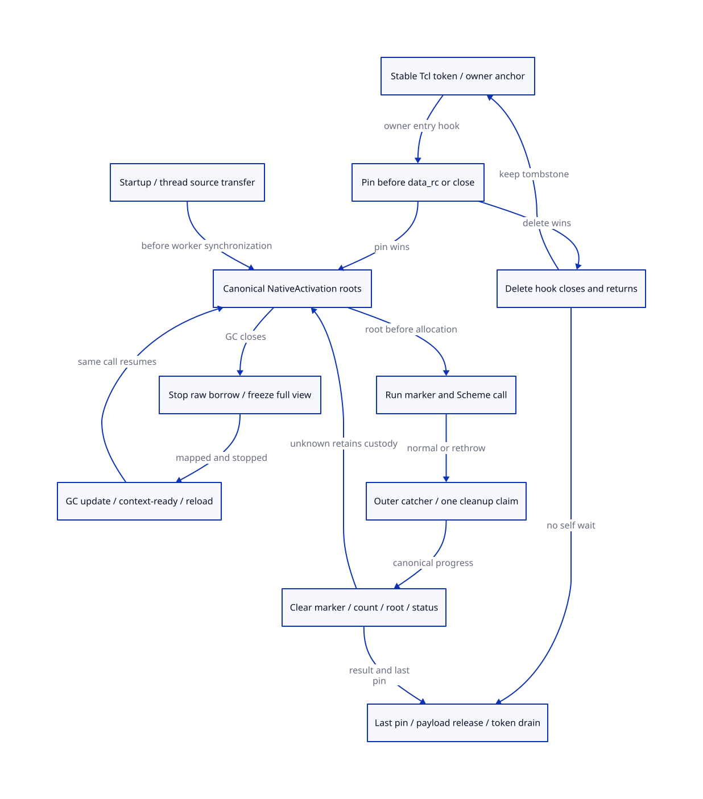

#+TITLE: Modern C Tcl Entry/Deletion, Parent Park/Reload and Run Exit Funnel
#+AUTHOR: Gambit runtime research
#+LANGUAGE: en
#+OPTIONS: toc:3 num:nil
#+TODO: OPEN | CONDITIONALLY-CHECKED
#+PROPERTY: header-args :eval never
#+STARTUP: overview

* Decision and evidence authority
:PROPERTIES:
:CUSTOM_ID: native-entry-close-cleanup-decision
:MAINLINE: MODERN-GENERATED-C
:STATUS: SOURCE-C-ORDER-AND-NATIVE-DISPATCH-OPEN
:END:

The first future modern-c source slice is NativeActivationScope covering both
actual ___run caller families and every exit. It includes rooted thunk origin,
marker ownership, all-context root scan, catcher restoration and canonical cleanup.
Changing only the textual marker kill is insufficient. Generated SFUN and the Tcl
adapter are subsequent consumers of the same contract, each with distinct gates.

[[file:models/sysml/native-entry-close-cleanup.sysml][SysML]] owns needs, dependencies, typed source-to-need routes, real caller paths,
C order, first-cut boundaries, payload equations and view topology. Native =sysml=
evaluation produces [[file:native-entry-close-cleanup-matrix.org][the matrix]] and [[file:diagrams/native-entry-close-cleanup.d2][D2]] / . [[file:../../../modeling/ascent/native-entry-close-cleanup.rules.scm][Actual ASCENT rules]] join
method, artifact, scope and digest, and publish the source routes from SysML.
[[file:../../../../models/gambit/native_entry_close_cleanup.qnt][QNT]] and [[file:../../../../models/gambit/lean/NativeEntryCloseCleanup.lean][Lean]] check the stated conditional protocol projections. [[file:../../../../evidence/research/native-entry-close-cleanup/checks.json][The receipt]]
retains source/C-order gaps; the [[file:native-ingress-root-handoff-design.org][ingress-origin predecessor]] is unchanged.

The existing vendor =modern-c= branch and its pre-existing vector edit are retained.
This study changes documentation/formal artifacts only: no runtime implementation,
native test, benchmark, commit, push or runtime retirement. Proposed names describe
contracts; none is an installed function or new implemented API.

* Source identities and the real Tcl dispatch
:PROPERTIES:
:CUSTOM_ID: native-entry-close-cleanup-tcl-source
:END:

The retained Tcl source is commit =cbf86d62348d6b052e1961b4df995960fb21545f=.
Its =generic/tclBasic.c= SHA256 and Git blob are independently reproduced in
[[file:../../../../evidence/research/native-entry-close-cleanup/tcl-source-identity.json][the source identity receipt]]. The official current manual is labeled Tcl 8.6.18;
it is separate evidence, not a claim that the capture or installed Darwin library
has that identity. Installed-version/source matching remains open. Online retrieval
of the commit URL failed in this turn; analysis uses the byte-verified local capture.

=TclInvokeStringCommand:2533-2565= prepares string argv, calls the extension and
frees its temporary stack storage after return. =EvalObjvCore/Dispatch:4465-4519=
schedules and invokes the object procedure/clientData. Delete at =3154-3325=
runs deletion traces and import handling, calls =deleteProc=, then removes the hash
entry and retires the Command. Command reference counts can preserve that structure
without postponing the extension's delete callback. They do not constitute a
ClientData pin. Current Gambit =scheme_call_cmd= reads =data_rc= before SFUN entry;
=scheme_delete_cmd= immediately releases the vector and RC storage.

The selected profile uses the interpreter's owner thread. GC workers update the
bridge's admitted root/control state; they do not call Tcl interpreter APIs.
Cross-thread requests must be delivered through an owner mechanism, with producer
lifetime tracked separately. A mutex around arbitrary cross-thread Tcl access does
not qualify it. Do not hold a bridge control lock across callbacks, native waits,
Scheme entry, conversion or Tcl event processing.

* Pin before payload and close without self-wait
:PROPERTIES:
:CUSTOM_ID: native-entry-close-cleanup-tcl-pin
:END:

** Separate token, root payload, Command and result lifetimes

#+NAME: tcl-entry-lifetimes
#+begin_example
OwnerAnchor -> StableToken(id, generation, OPEN/CLOSING, entry pins)
StableToken -> RootOrigin(owned still vector / registered root handle)
AcceptedEntry -> child NativeActivation, native argv lifetime, result acceptor
DeleteHook -> close admission; retain token and already accepted entries
PayloadRetirement -> closed and no admitted payload readers/result duty
TokenRetirement -> payload retired AND actual dispatch/owner-reader drain
#+end_example

At the replacement =scheme_call_cmd= first non-reentrant cut, pin a live stable
token before calling =data_rc=, allocating marker or invoking conversion. A pin
winner may finish even if deletion closes admission afterward. A close winner
must not read the payload; mapping this to an actual Tcl result is an adapter/ABI
obligation, not an invented successful return. The token needs independent
lifetime before the first hook: a pin acquired through freed ClientData is too late.
Opaque identity can remain while waiting for GC; it is not permission to read a
stale movable payload. Reuse the strong still-vector ownership where qualified.

At replacement =scheme_delete_cmd= entry, close the bridge admission before any
release that could reenter. Preserve the pinned Tcl ordering: deletion traces
precede deleteProc. Moving bridge close before those traces would change legal
trace reentry and is not claimed semantically equivalent. Already accepted entries
retain roots; new entry into the closed token uses the qualified rejection path.

A Scheme callback can delete its own Tcl command through nested evaluation. The
delete hook must return while that callback's pin remains; waiting for zero pins
there waits for its own stack to return. Defer payload retirement to the last
accepted return/result acknowledgement or an owner cleanup task. Claim release
under the short control domain, perform effects outside it, and settle once.
Do not use an event pump to make progress while holding the lock.

A closed token/tombstone can outlive payload retirement, rejecting a captured late
entry without dereferencing a freed vector. Zero pins does not prove there is no
captured dispatch, saved raw callback, reader or future owner event. Actual token
reclamation needs the admitted producer inventory and owner/library quiescence.
Tcl_Preserve(interp), Command refCount and bridge entry pins are distinct objects.

** Creation and dispatch boundaries still open

=Tcl_CreateCommand:2094-2234= can fail before install, delete an old command and
encounter a command recreated by deletion; one branch discards that recreated
structure. A NULL return or a delete callback is not universally an exact
installation/drain receipt for every token. Construction must distinguish never
installed, installed, displaced and unknown ownership. Raw command-info mutation,
private invocation, coroutine/queued dispatch and external saved callbacks require
separate admission. Retain unknown tokens or refuse those profiles. No claim of
complete Tcl production or bounded tombstone memory follows from the finite model.

* Parent borrow: park before waiting, reload before use
:PROPERTIES:
:CUSTOM_ID: native-entry-close-cleanup-parent
:END:

The real route is Scheme CFUN -> =tcltk_eval/Tcl_Eval= -> =scheme_call_cmd= -> SFUN
-> Scheme =##apply=. =gambit.h.in:10325-10338= materializes native/VM state;
=setup.c:1117-1200= contains synchronous-operation service and GC entry. Neither
alone provides a complete freeze receipt or independent-worker root adapter.

A SourceBorrow covers mapped parent locations, selected inputs, continuation/denv,
native activation, owner binding and known native reads/writes. Child publication
accepts the same invocation before source acknowledgement releases parent duty.
A lost acknowledgement retains overlap and queries the canonical acceptance.
Unknown parent activity blocks acknowledgement/retirement even if a child view
already exists: the pending activity could still touch the original locations.

If GC closes before child registration, stop raw accesses, materialize a complete
frame/map and freeze the original source view. Discard raw copies, release the
active borrow, and enter participating wait without abandoning the source roots.
The collector may scan/update only after acquiring this parked state. After the
whole-round/context/binding seal, acquire and reload current roots and native
resume state before reopening the same invocation. Do not reevaluate Scheme
operands, call the native operation again, or restore an old raw fp/hp/SCMOBJ copy.

Tcl's argv remains owned by its still-live callback frame. A participating wait
must retain that native frame and its temporary storage, use only qualified VM
service/wait work and avoid pumping Tcl events that can alter unmodeled context.
If the caller cannot stop raw borrowers or cannot provide its map, refuse freeze.
A counter decrement is not stop evidence. Do not wait for GC while holding a raw
borrow that prevents that same GC; do not fake a retry code across the C ABI.

* ___run: actual callers and the exit-funnel contract
:PROPERTIES:
:CUSTOM_ID: native-entry-close-cleanup-run
:END:

** Two actual caller families

- [[file:../../../../vendor/gambit/lib/setup.c::6395][Main startup]] binds the current OS thread, selects the program descriptor's
  first-module thunk, calls ___run and invokes cleanup on nonzero status.
- [[file:../../../../vendor/gambit/lib/setup.c::763][Processor startup]] starts from thread data_scmobj, participates in resize
  synchronization, calls ___run, sends its status to processor0 and continues
  servicing synchronous operations. The creation-side assignment is at
  =setup.c:977-1003=. A C thread field is not itself a root scan proof.

The worker copies =self->data_scmobj= to a C local before
=execute_sync_op_loop=. That loop can service combined operations, including the
GC branch at =setup.c:1029=, before ___run starts. A guard only inside ___run
therefore does not close this source interval. The first slice must transfer a
registered thunk origin before thread publication, preserve it through the sync
loop and reload it at the admitted run boundary. This is a source refinement
requirement, not a newly observed native failure.

___run is also exported through the GSTATE table at =6077-6078= and declarations
in =gambit.h.in:13398,14876=. The two families above are the direct callers found
in the selected repository corpus, not a complete external embedding inventory.
Unknown external/raw callers need declared source authority before joining the
managed profile; an unchanged C signature does not supply that authority.

** Real skipped cleanup path

[[file:../../../../vendor/gambit/lib/setup.c::3390][___run]] sets R0, enters BEGIN_TRY, allocates a marker, calls ___call and textually
kills the marker before END_TRY. At =3350-3390=, ___call catches VM control/error,
restores its local catcher, then rethrows a nonmatching status/marker to the outer
catcher. That bypasses the textual kill in ___run. The outer END_TRY still restores
its predecessor catcher before ___run returns the status. Preserve this behavior
while giving the owned marker/root an exit owner; do not treat every unwind as a
normal return or broadly restore arbitrary GVM registers on error.

** Proposed common epilogue

#+NAME: native-activation-exit-funnel
#+begin_example
source origin accepted -> activation root view published -> marker allocation
  -> call -> normal return OR outer catcher receives rethrow OR known marker failure
  -> END_TRY restores predecessor catcher
  -> claim canonical cleanup exactly once
  -> if marker exists: invalidate activation target; settle owned count decrement
  -> retire/transfer thunk, marker and result/error root duties
  -> deliver original status to the original caller
#+end_example

Keep authoritative cleanup progress in stable VM/context-owned activation state,
not solely in a modified nonvolatile automatic variable in the setjmp function.
A source-root acceptance must precede marker allocation. Known marker failure has
no marker count to drop but still has source-root retirement. Marker invalidation
must precede native frame exit so a captured continuation cannot return to an
already-gone C activation. Result/error backing and terminal intent retain an
explicit acceptor until known delivery.

The existing =kill_sfun_stack_marker:6553-6564= performs a field clear and still
refcount decrement without an allocating callback. It supplies useful effect
source, not proof that two writes are atomic, concurrently safe or replayable.
The new guard claims cleanup once and logs/refines progress. Unknown decrement
results retain the activation/root and require actual stop/result evidence;
never replay an already completed decrement or clear uncertainty by timeout.
Do not keep a control lock across callbacks or collecting cleanup.

* First modern-c source slice and retirement gates
:PROPERTIES:
:CUSTOM_ID: native-entry-close-cleanup-first-cut
:OWNER: MODERN-C-NATIVE-ACTIVATION
:END:

| Responsibility | First future source boundary | Required acceptance before retirement |
|---+---+---|
| Activation/root contract | Internal declarations in gambit.h.in and VM/context record | Stable identity, source-origin receipt, all-context slot inventory and cleanup owner |
| Root registration/scanning | mem.c and existing per-context root traversal | Startup and nonzero-processor coverage; GC close, freeze, relocation and reload refinement |
| Marker ownership | c_intf.c make/kill consumers | Root before allocation; marker live/invalid/count-settled and unknown-progress contract |
| First consumer | setup.c ___run, thread publication/pre-run synchronization and both actual caller families | Same external signature, original status/catcher/continuation behavior, common exit funnel |
| Next consumer | Scheme _ptree2.scm SFUN generation | Generated origin, conversion-prefix, exception and result handoff; no raw-SFUN retirement before qualification |
| Following adapter | Tcl create/call/delete and owner dispatch | Pre-payload pin, same-owner semantics, self-delete, installation/drain and result acceptance |

The first slice must change real ownership/scan/exit flow; an unused new helper or
post-call kill-only patch does not satisfy it. It may reuse program/frame root
locations and owned-still retention with explicit certificates. It must not claim
that RootRegistry storage pins automatically stop GC or that C callbacks can
arbitrarily migrate Tcl ownership. Preserve the portable C runtime and Scheme
semantic generator boundary. Native acceptance is a later gate; no old path is
retired by this research or by creating the modern-c branch.

* Models and quantitative boundaries
:PROPERTIES:
:CUSTOM_ID: native-entry-close-cleanup-models
:END:

QNT contains three protocol projections in one state product: Tcl token/payload
pin/delete lifetime; parent raw-epoch park/context/reload; ___run root/marker/exit
cleanup. Only parent raw-value epoch is explicit. Tcl/run root payload contents,
complete maps and owner/library drain/known settlement are premises. Interleaving
these projections is not a complete shared-VM/evaluator/ABI refinement.

24 named histories include 14 positive/retention cases and 10 unsafe controls.
A retained finite simulation counterexample exposed source acknowledgement after
unknown parent activity; the guard now preserves that source duty and a named
negative control retains the history. This is a model-design finding, not a new
native Gambit failure. Initial Lean authoring diagnostics are retained separately.
Lean checks 14 conditional operation/lifetime/epoch/count/payload declarations;
it does not establish full source simulation or target C memory order.

Native SysML evaluates an illustrative two-slot thunk/marker payload: 16B at
64 bits, or 32B for two live activations. These are root-slot examples, not struct
ABI sizes or compulsory new allocation. Existing still marker ownership or program
root aliases may avoid extra slots. Root maps/control records/native stack and
marker objects are additional, distinct backing. Counts are not person-days.

Payload retirement can precede token retirement; parent location reuse can avoid
copies; a single finalizer removes normal-only ownership assumptions. Each adds
pin/close/claim, metadata or freeze/reload work. Whole-round peak is the maximum
over time of unique backing plus separate roots/maps/token/native escrow. Lost ACK,
unknown cleanup and token tombstones can increase it. No speedup, bounded GC
latency, bounded total token storage or net peak reduction is proved.

* Primary references and qualification limits
:PROPERTIES:
:CUSTOM_ID: native-entry-close-cleanup-references
:END:

- [[https://www.tcl-lang.org/man/tcl8.6/TclLib/CrtCommand.htm][Tcl_CreateCommand manual]]: ClientData is delivered to the command/delete
  callbacks; argv storage belongs to Tcl through callback return. This API
  description does not certify every private dispatch or creation path.
- [[https://www.tcl-lang.org/man/tcl8.6/TclLib/Thread.htm][Tcl threads manual]]: use the interpreter on its creating thread. The bridge
  lock does not replace interpreter ownership or make reentrant lock use safe.
- [[https://github.com/tcltk/tcl/blob/cbf86d62348d6b052e1961b4df995960fb21545f/generic/tclBasic.c][Pinned Tcl implementation]]: local bytes independently match the recorded
  Git blob and SHA256; installed library equivalence remains unresolved.
- [[https://www.open-std.org/jtc1/sc22/wg14/www/docs/n1570.pdf][WG14 N1570]], 5.1.2.4, 6.2.4, 7.13.2.1: named C11 draft basis for
  synchronization, lifetime and modified automatic state after longjmp. Actual
  lock, scanner and cleanup adapter refinement remains open.
