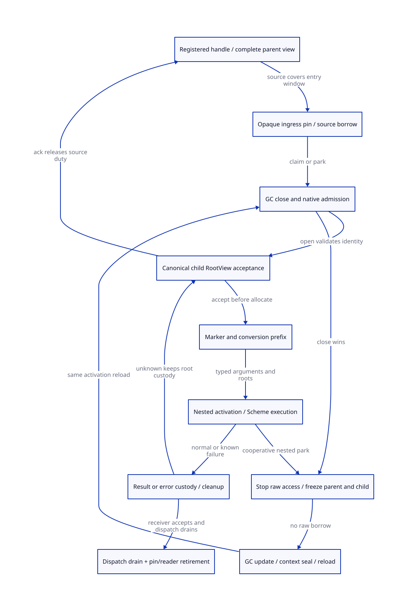

#+TITLE: Modern C Native Ingress: Root Origins, Parent Borrow and Child Custody
#+AUTHOR: Gambit runtime research
#+LANGUAGE: en
#+OPTIONS: toc:3 num:nil
#+TODO: OPEN | CONDITIONALLY-CHECKED
#+PROPERTY: header-args :eval never
#+STARTUP: overview

* Decision, branch and scope
:PROPERTIES:
:CUSTOM_ID: native-ingress-root-handoff-decision
:MAINLINE: MODERN-GENERATED-C
:STATUS: SOURCE-AND-C-MEMORY-REFINEMENT-OPEN
:END:

A native ingress view must inherit valid custody before it reads a movable value,
not just before the marker allocation. Preserve Scheme/C interoperability by
making the origin, activation, root lifetime and typed cleanup explicit. Handles
are one mechanism; existing owned-still/permanent retention and certified parent
frame locations can often be reused. Do not replace them blindly with duplicates.

[[file:models/sysml/native-ingress-root-handoff.sysml][SysML]] owns the component/model needs, dependencies, actual callers, handoff paths,
C ordering, cost rows, payload equations and diagram topology. Native =sysml=
evaluation produces [[file:native-ingress-root-handoff-matrix.org][the matrix]] and [[file:diagrams/native-ingress-root-handoff.d2][D2]] / . Actual [[file:../../../modeling/ascent/native-ingress-root-handoff.rules.scm][ASCENT DSL]] joins scope,
artifact, digest and required method, rather than merely linking files. [[file:../../../../models/gambit/native_ingress_root_handoff.qnt][QNT]] and
[[file:../../../../models/gambit/lean/NativeIngressRootHandoff.lean][Lean]] check conditional custody slices; [[file:../../../../evidence/research/native-ingress-root-handoff/checks.json][the receipt]] preserves unresolved source
and C-order refinement. The [[file:rest-allocator-root-publication-design.org][allocator/root-publication predecessor]] is unchanged.

At the user's request, =vendor/gambit= now has branch =modern-c= from its existing
recorded commit. Its pre-existing =lib/gambit/vector/vector.scm= edit is preserved
byte-for-byte. The user clarified that this turn completes research and creates
the branch only: no runtime implementation, native tests, benchmarks, commit or
push. Proposed interface names below are design contracts, not installed APIs.

* Actual producers and root classes
:PROPERTIES:
:CUSTOM_ID: native-ingress-root-handoff-source
:END:

** Tcl ClientData is an actual native root origin

[[file:../../../../vendor/gambit/examples/tcltk/tcltk.scm::135][scheme_call_cmd]] reads =data_rc(client_data)= and passes it to =tcltk_call= before
the generated SFUN marker exists. The [[file:../../../../vendor/gambit/examples/tcltk/tcltk.scm::221][c-define callback]] receives a Scheme vector
and converted string list, extracts the procedure and calls =##apply=.
Construction at =290-340= allocates RC storage and a still vector, sets its
procedure field and RC data, then installs the command. Deletion at =180-195=
releases the Scheme vector and the RC allocation.

The vector is explicitly STILL, so its address does not have the same movement
problem as an arbitrary movable SCMOBJ. Its fields still need GC scanning, and
delete/creation failure/in-flight lifetime remain independent responsibilities.
Current code does not expose a managed ingress receipt, callback dispatch pin or
queued-call drain receipt. Do not infer a race on every ordinary same-thread Tcl
call; this study requires actual owner/reentry/drain qualification before claiming
that a replacement handles all cases.

A new adapter can pass a stable managed acceptor identity in ClientData because
this API supplies a context parameter. It must acquire dispatch lifetime before
reading the payload. Adding a pin inside the SFUN after =data_rc= is too late to
protect an already-freed ClientData allocation. A native library unregister/drain
contract must cover queued and just-entering callbacks; zero registered child
views alone cannot prove no future native callback will dereference the token.

** Static function callbacks differ from dynamic C closures

[[file:../../../../vendor/gambit/tests/mem.scm::245][The retained foo/hop test source]] declares a function-typed parameter, converts
=hop= and invokes it from C. =SCMOBJ_to_FUNCTION= at [[file:../../../../vendor/gambit/lib/c_intf.c::2887][c_intf.c:2887-2940]] selects the
static c-define host when available, otherwise attempts =make_c_closure=.
The retained source is not a new current-host execution witness.

=fn-param-converter= and =build-c-define= at =_ptree2.scm:3186-3226= produce distinct
SFUN origins. A static c-define label does not need to read a dynamic selector.
The dynamic branch in [[file:../../../../vendor/gambit/lib/os_dyn.c::744][os_dyn.c:744-791]] allocates an RC-backed thunk holding the
Scheme procedure; that thunk stores its identity in global =c_closure_self= and
jumps to the converter. The source explicitly marks this variable as needing
thread-local storage. =make_sfun_stack_marker= reads it after allocating the marker.

Capture an activation-local selector before any allocation, callback or nested
entry, and restore exact parent identity on exit. TLS alone removes only the
cross-thread sharing issue; it does not provide a nested activation stack, VM
binding or executable-entry lifetime. Re-reading a mutable selector after a
nested entry is not an identity proof. A concrete overwrite/reentry route between
two particular statements remains a source/platform obligation, not an observed
native failure in this study.

The =C_CLOSURE_CODE_SIZE= guards at =os_dyn.c:633-675= describe selected x86-32,
ppc32 and sparc branches. No Darwin arm64 dynamic closure support is established
by this file. Unsupported generated thunk profiles reject conversion. Do not
infer arm64 capability or native concurrency defects from inactive code branches.
A mature closure backend is a possible separate service; modern C does not
portably synthesize an arbitrary context-free C callback closure on its own.

** Existing still retention is reusable evidence

[[file:../../../../vendor/gambit/lib/c_intf.c::4333][The C-to-Scheme conversion contract]] states that NULL PSTATE creates permanent
objects, while a non-NULL PSTATE creates still objects with refcount 1 and requires
=release_scmobj=. =alloc_scmobj_still= at =mem.c:1675-1708= links and initializes
that ownership; =release_scmobj:1730-1739= decrements only still objects.
=setup_still_objs_to_scan:4210-4248= queues positive-refcount still objects for
scanning; =6800= invokes setup for the participating processor.

The string-list converter at =c_intf.c:5732-5800= retains the partial list and
string, creates a pair, releases superseded references, and rolls back known
failures. This is real existing prefix ownership. Refine its all-owner scan and
initialization assumptions; do not label every converted C local as an unrooted
movable pointer. Stable address and strong count still do not permit arbitrary
field mutation during a worker scan. The raw =scheme-object= pass-through case
needs its own origin proof instead of inheriting the owned-result contract.

** Marker and exception producers extend beyond SFUN

=_ptree2.scm:2902-3008= emits BEGIN_SFUN before SCMOBJ-prioritized conversion;
=3145-3187= emits SFUN_ARG stores and the call afterward. =c_intf.c:6511-6545=
contains the explicit proc_or_false protection TODO around marker allocation.
Protect target and every incoming movable value before that allocation, but only
after proving their original source authority.

[[file:../../../../vendor/gambit/lib/setup.c::3390][___run]] also calls =make_sfun_stack_marker= outside generated SFUN. It is a
separate ingress producer with a thunk origin, catcher and cleanup obligation.
Do not assume that changing SFUN macros covers it, processor run or all raw
=___call= users.

Generated SFUN_ERROR* also calls the Scheme conversion-error handler through the
same marker; see =gambit.h.in:10046,10052,10058=. That is an additional reentry
edge. Keep original marker, error arguments and conversion prefix alive until
that handler finishes or an accepted terminal escape takes custody. The finite
model does not refine this handler-specific dispatch/error semantics.

* Origin and handoff data contracts
:PROPERTIES:
:CUSTOM_ID: native-ingress-root-handoff-contract
:END:

#+NAME: ingress-custody-contracts
#+begin_example
RootOrigin = RegisteredHandle | ParentLocationBorrow | OwnedStill | Immortal
RootHandle = (live VM namespace, slot identity, non-reused generation)
IngressKey = (VM/context incarnation, parent activation, native invocation serial)
IngressPin = (RootOrigin, stable registry/dispatch storage lifetime, IngressKey)
SourceBorrow = (mapped parent locations, epoch, allowed raw reads, source custodian)
ChildRootAcceptance = (IngressKey, canonical child view, exact roots/prefix/map,
                       marker/code/result backing, source-to-child receipt)
TerminalAcceptance = (same activation, result/error custodian, cleanup progress,
                      nested obligations, confirmed write closure)
ReclaimReceipt = (terminal acceptance, no pins/readers/nested views/unknown work,
                  actual native dispatch unregister-and-drain evidence)
#+end_example

Raw SCMOBJ is a representation, not a fifth origin. Immediate values and proven
immortal code/data can avoid a relocation handle; their validity/lifetime still
needs a declared origin. A RootHandle lookup needs a live VM anchor and registry
object before any dereference. A generation check after reading freed storage
cannot repair that lifetime error. Specify generation wrap refusal or prove a
non-reuse bound; no finite counter is assumed mathematically unique forever.

** Handle path: keep pins separate from raw execution authority

Pin the canonical handle storage under the same lookup/retire arbitration that
can delete it. Before admission retain only opaque identity. A storage pin does
not stop GC: the registered payload cell can be scanned/updated while the native
caller waits without reading it. After the appropriate round/context seal,
acquire admission, resolve the current payload and register the child root view.
Do not cache a raw payload across the wait or use a detached raw pointer as a pin.

Deletion closes new claims; a claim accepted earlier may retain its target through
child execution. Reclamation waits for native dispatch drain in addition to root
and registry pins. If an external library can invoke a freed function pointer
before the new hook runs, this design alone has no admission proof: unregister
semantics, persistent trampoline lifetime or a stronger external dispatch adapter
is required. Unknown origin or unsupported target rejects the managed profile
before relying on a callback ABI error return that has not been defined.

** Parent path: no gap and no GC wait cycle

The parent's root/activation lease must exist before entering the foreign call.
BEGIN_CFUN_CTX/W_ALL at =gambit.h.in:10325-10338= provides source materialization
hooks, but does not itself prove the new origin, participating wait or freeze
protocol. Export a SourceBorrow only over locations covered by the parent's map;
include continuation/denv and exact same-call restoration state.

Child acceptance publishes an updateable view before relinquishing raw borrow
rights. Keep source custody until the canonical acceptance is known; a lost ACK
retains overlap and queries the same IngressKey. Do not register another child or
drop parent roots speculatively. Same-location aliases need a certified scan/update
plan; redundant custody need not require redundant payload copies.

If GC close wins before child publication, do not wait for OPEN while an active
raw borrow prevents GC. Stop all raw accesses, discard raw C copies, park a complete
parent/source view under its existing scan registration, let collection complete,
then acquire/reload and retry this same invocation. The native C stack/catcher
must remain valid for this participating wait. If raw borrowers cannot stop or the
parent has no freezeable view, refuse the profile; a counter decrement alone is
not a stop receipt. No invented retry integer or error is returned to Tcl/C.

* Marker, conversions and nested activation
:PROPERTIES:
:CUSTOM_ID: native-ingress-root-handoff-nesting
:END:

Child acceptance precedes marker allocation, so marker failure still has an exact
root custodian and source receipt. Each collecting conversion must have a safe
initialized prefix, typed temporary/result ownership and defined cleanup. Reuse
owned-still retention where its scan and mutation contract holds. A descriptor
allocation cannot collect unregistered incoming values; embed/pre-reserve its
registration metadata under the existing source lease or fail before raw access.

Each nested callback has a distinct activation key and view. OS thread identity
or processor index is not sufficient: same-thread nesting must retain parent and
child roots, target selector, marker, result and native backing independently.
Park/reload covers every live view. Parent exit cannot reclaim a still-active or
unknown child. A known nested return restores exact parent binding/catcher and
selector; a later callback is a new invocation even if it uses the same thread.

A missing marker does not release the source root duty. A known conversion failure
releases/transfers only its initialized owned prefix, once, and delivers the
original error through a qualified adapter. Unknown marker allocation, native
write, callback stop or cleanup result keeps canonical custody; it is not a
successful cancellation. The formal model treats complete root maps and confirmed
stop/drain actions as premises, not proofs of real library behavior.

* Failure and terminal exit
:PROPERTIES:
:CUSTOM_ID: native-ingress-root-handoff-exit
:END:

=___call= at =setup.c:3350-3390= can rethrow an error after its local catcher;
=___run= and generated END_SFUN have marker kill textually after that call.
=propagate_error:853-866= throws nonzero errors to the installed catcher.
The setjmp branch at =gambit.h.in:9979-9988= restores the old catcher on its END_TRY
path. A nonlocal escape can skip lexical marker/conversion epilogues. This is a
real control-flow path requiring qualification, not a claim that every error
necessarily leaks in current source.

The modern C guard needs VM-canonical cleanup progress and ownership states which
an outer catcher can settle without relying on skipped C epilogues. After longjmp,
modified nonvolatile automatic locals in the setjmp function can be indeterminate;
do not keep the only cleanup progress there. Capture known terminal intent before
propagation, finish or transfer nested duties, preserve accepted result/error
backing, invalidate the correct marker, and drop each original native/still
reference only after another owner has accepted it or final release is known.

Confirmed stop closes write authority; it does not by itself prove nested exits,
result delivery or a native library queue is drained. Unknown exits can keep roots
and executable/native backing retained and may still block GC when raw writes
cannot be excluded. A structurally scan-safe root store may remain collectable
without reclaiming its storage, but that requires a separate write-closure proof.
No bounded cleanup time, GC latency or peak theorem follows from a timeout.

* Migration and quantitative evaluation
:PROPERTIES:
:CUSTOM_ID: native-ingress-root-handoff-migration
:END:

1. Classify real origins in Scheme-generated bindings and direct native adapters.
   Cover SFUN, Tcl ClientData, function converters and ___run independently.
2. Specify live VM/dispatch anchor, handle lookup/pin and typed owned-still cleanup.
   Keep handle storage lifetime distinct from payload access/freeze authority.
3. Generate parent location borrow and canonical child acceptance keyed by activation.
   Add close-wins participating park/reload before introducing root retirement.
4. Generate marker/conversion-prefix/terminal guard hooks and all-context root scan
   adapters. Preserve synchronous ABI, Scheme continuation and exception meaning.
5. Qualify known static/userdata paths before enabling an actual dynamic closure
   backend. Target ABI, entry lifetime and nested selector must all close.
6. Retire unmanaged reads/implicit cleanup only for routes with source/C-order
   receipts and later native acceptance. Branch creation retires no runtime path.

The native SysML equations show an illustrative root-payload envelope of 48B for
four input plus two converted slots at 64 bits, and 96B for two such live views.
They exclude map/descriptor/header/registry/marker/native backing and are not an
ABI size, measured allocation or mandatory net addition. Existing still-owned or
mapped parent values may avoid duplicate slots. Root copying/lookup can decrease
only when that reuse saves more work than pin, acceptance and coordination add.
Peak accounting uses unique backing plus separate roots/maps/native escrow; never
count a slot already inside existing backing twice. Arbitrary nesting and unknown
native debt have no proved bound. No positive speedup or net peak drop is claimed.

* Models, evidence and open duties
:PROPERTIES:
:CUSTOM_ID: native-ingress-root-handoff-models
:END:

QNT checks 19 histories (11 normal/retention and 8 unsafe controls), plus bounded
handle, parent and unowned-raw profiles. It separates opaque pin from raw borrow,
models overlap on lost ACK, close-wins park, one nested callback, one GC/reload,
known failure and unknown retention. It does not model real C instruction order,
arbitrary nesting, ABI selection, a complete native acceptor or fair termination.
Externally confirmed stop and dispatch drain are named premises, never timeouts.
The parent/handle profile already assumes a registered complete source view.

Lean checks 15 conditional declarations for custody, identity, raw-epoch exclusion,
reclamation and payload equations. Step covers publish/ack/collect; real source
coverage, selector correctness, scan maps and weak-memory refinement remain open.
ASCENT must keep those obligations open even when the finite model passes.
The first native SysML authoring diagnostic (reserved identifier =exit=, renamed
to =terminal=) is retained; it is a tool/model diagnostic, not a runtime defect.

* Standards and research
:PROPERTIES:
:CUSTOM_ID: native-ingress-root-handoff-references
:END:

- [[https://www.open-std.org/jtc1/sc22/wg14/www/docs/n1570.pdf][WG14 N1570]], 5.1.2.4, 6.2.4, 7.13.2.1 and 7.17: named C11 draft basis for
  synchronization, storage lifetime and longjmp state. The concrete modern C
  adapter still needs a target/source refinement; visibility alone is not lifetime.
- [[https://www.cs.kent.ac.uk/pubs/2009/3128/content.pdf][Baker et al., Accurate Garbage Collection in Uncooperative Environments
  Revisited]], sections 3-5: compiler-generated root materialization is relevant to
  the location-view design. Its evaluated environment and performance figures do
  not prove Gambit SMP, native callback or continuation correctness.
