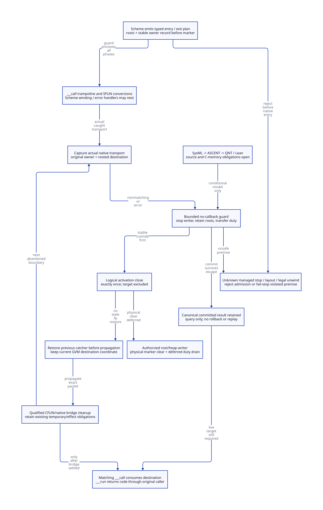

#+TITLE: Original-Owner Exit Guards for Generated SFUN and ___run
#+OPTIONS: toc:3 num:nil
#+PROPERTY: header-args :eval never :exports code
#+STARTUP: overview

* Architectural decision
:PROPERTIES:
:ID: gambit-owner-exit-guard
:CUSTOM_ID: owner-exit-guard-decision
:STATUS: SOURCE-AND-MEMORY-REFINEMENT-OPEN
:AUTHORITY: models/sysml/owner-exit-guard.sysml
:END:

Modern generated C remains the mandatory runtime direction. Scheme owns conversion
policy, continuation semantics, dynamic-wind and generation of root/exit metadata.
One shared modern C service owns stable invocation records, logical activation
closure, custody settlement and deferred physical marker retirement. These are
proposed replacements for implicit responsibilities, not runtime implementation.

[[file:models/sysml/owner-exit-guard.sysml][SysML]] is the maintained authority for component needs, dependencies, source
routes, caller inventory, costs and diagram topology. Its native projection feeds
[[file:../../../modeling/ascent/owner-exit-guard.rules.scm][ASCENT rules]] and the [[file:../../../modeling/ascent/owner-exit-guard.request.scm][exact-source request]], associating [[file:../../../../models/gambit/owner_exit_guard.qnt][QNT]] histories and
[[file:../../../../models/gambit/lean/OwnerExitGuard.lean][Lean]] conditional laws with their exact obligations. [[file:owner-exit-guard-matrix.org][Closure/benefit matrix]],
[[file:diagrams/owner-exit-guard.d2][D2]] and  are generated views. [[file:../../../../evidence/research/owner-exit-guard/checks.json][Evidence receipt]] records scope and retained
failures. [[file:foreign-shell-unwind-design.org][The safe-shell study]] supplies open root/commit/reclaim prerequisites;
its proofs are not inherited as complete source refinements.

#+begin_quote
An inner escaped activation must surrender its own responsibilities without
restoring its old GVM frame, closing the live destination marker, discarding an
already committed result, or running arbitrary cleanup callbacks during transport.
#+end_quote

* Real generator and caller closure
:PROPERTIES:
:CUSTOM_ID: owner-exit-guard-source
:END:

#+NAME: guarded-generation-cuts
| Source cut | Existing behavior | Proposed modern C replacement or reuse |
|---+---+---|
| _ptree2.scm 2902-3030 | c-make-function emits void, SCMOBJ and typed-native BEGIN/ERROR/END; Scheme-object parameters converted first | Generate one enclosing entry/exit plan for each family, preserving parameter order and native ABI |
| _ptree2.scm 3145-3187 | c-function selects MLBL for c-define, false for dynamic closure; body emits arguments and ___call | Emit ProcOrigin and invocation identity; guard begins before marker/all argument conversions |
| gambit.h.in 10043-10059 | marker allocation at BEGIN; error handler reentry; kill then propagate at END | Replace lexical-tail-only settlement for admitted cohort; cover result and error conversion outside BODY |
| _ptree2.scm 3239-3329; header 10325-10392 | cleanup? selects CFUN TRY, W_ALL/R_ALL and conversion-end cleanup; AT_END is emitted | Reuse qualified CFUN bridges; do not delete their temporary/native-effect obligations |
| setup.c 3276-3390 | ___call catches trampoline; mismatched marker/error rethrows before normal restoration | Preserve dispatch and matching; guard settles at its own boundary after inner catcher restoration |
| setup.c 3395-3420 | ___run catches C throws and returns err; normal-path marker kill can be skipped | Reuse its catcher and add stable record plus a common settlement funnel after TRY |
| setup.c 763-835,6400-6443 | processor ___run result sent to P0 collective; startup error calls cleanup | Preserve caller error/termination/sync behavior after guarded result return |

The inventory is source-bound, not a census of all third-party direct calls to
exported functions. Unsupported external/nested ___run or private macro users need
an explicit entry profile. No direct exported ___call is silently made safe by
changing generated SFUN alone.

Actual examples constrain the design. [[file:../../../../vendor/gambit/tests/server.scm::15][server.scm]] catches exceptions in Scheme and
returns a native string through c-define. [[file:../../../../vendor/gambit/tests/mem.scm::274][mem.scm]] passes a function-valued hop to
C foo. [[file:../../../../vendor/gambit/examples/tcltk/tcltk.scm::124][Tcl command callbacks]] call tcltk_call; Scheme can invoke tcltk_eval, whose
C error path calls the separately generated tcltk_eval_error callback. This is a
real nested call graph. Selecting an outer continuation as its destination is a
design case, not an existing executed native witness. Arbitrary unwinding through
Tcl is not admitted merely because those edges exist.

* Guard placement and typed exit plan
:PROPERTIES:
:CUSTOM_ID: owner-exit-guard-placement
:END:

#+NAME: native-entry-plan
#+begin_example
reserve stable InvocationRecord + roots + deferred-settlement capacity
capture original OS-thread / processor / activation generation and previous catcher
protect procedure + arguments + ancestor/error/result cells
install SFUN guard before marker allocation
  allocate marker, reload protected values
  convert all inputs in existing Scheme-selected order
  ___call, including conversion-handler reentry
  convert and root/capture output; query canonical result/right state
capture either normal completion or actual C transport into the stable record
restore previous catcher; settle current invocation once; propagate/deliver by role
#+end_example

This is conceptual control flow, not compilable C or a runtime patch. Concrete
catcher restoration uses the real TRY scope discipline: END_TRY restores its
previous catcher before a later propagate_error. Settlement may be performed in
a common post-TRY funnel; it must never rethrow to its own still-installed catcher.
The QNT split into handoff/invalidation/restoration/pop expresses required events,
not a requirement for separate machine atomics or this exact C statement layout.\nA separate restoreEarly action and named commonPostTrySettlementTest explicitly\ncover END_TRY restoring the previous catcher before bounded custody settlement;\nthe later restore step verifies that same previous catcher before propagation.

The stable record pointer is initialized before setjmp and not reassigned across
it. Mutating progress, errors and ownership live in the record, not changed
nonvolatile automatic variables in the function containing setjmp. Standard C
setjmp restrictions and selected compiler builtins require separate qualification;
adding volatile neither supplies roots nor permits racing memory accesses.

#+NAME: exit-plan-data
#+begin_example
EntryPlan {
  role: SFUNVoid | SFUNSchemeObject | SFUNNativeResult | RootRun;
  procOrigin: StaticModuleEntry(codeLease) | CapturedCClosure(rcLease,codeLease);
  invocation: (id,generation,parent,originalActivation,originalOwner);
  roots: stable cells for procedure, live arguments, marker, result/error and destination;
  exits: Normal | NativeError(code, optionalRootedData) | ContinuationEscape(destination);
  cleanup: qualified temporary/native bridge descriptors, not arbitrary destructors;
}
InvocationRecord {
  markerReady; canonicalResultControl; initializationDuty; sourceRootLocations;
  exitPacket; settlementState; logicalActivationState; physicalMarkerDuty;
}
#+end_example

Static c-define module entries and captured dynamic procedures are different proof
cases. A proven permanent entry may not need a movable-procedure root, but still
needs a valid code/module lease. ___run's thunk and dynamic closures cannot inherit
that exception without proof. Capture dynamic closure identity before reentry;
the process-global c_closure_self TODO remains a required redesign, not fixed here.

** Outcome rules by role
:PROPERTIES:
:CUSTOM_ID: owner-exit-guard-outcomes
:END:

#+NAME: native-outcome-matrix
| Outcome | SFUN | RootRun | Retained custody |
|---+---+---+---|
| Normal/matching Scheme return | Finish conversion and native return under exact ABI | Return NO_ERR through existing caller | Root/native result handed to qualified consumer before record retirement |
| Marker allocation failure | Never kill an uninitialized marker; propagate existing C error after guard | Return original allocation error after common funnel | Entry/procedure roots and record survive until failed-entry settlement |
| Conversion failure | Existing Scheme handler may return, reenter or escape | Not a blanket conversion of errors into successful return | Per-invocation errdata/handler roots; parent slots are not PSTATE scratch |
| Nonmatching continuation | Settle only abandoned invocation, then propagate exact destination | Existing root-only profile cannot be crossed as an arbitrary SFUN | Destination marker/frame handle retained; no fabricated native result |
| C transport error escaping ___call | Guard then propagate to previous qualified catcher | Guard then return original err, preserving startup/P0 caller logic | Stop/init/result disposition remains separate from code |
| Commit succeeded but delivery escapes | No rollback or repeated wrapper/native operation | No reinterpretation of code as resource disposal | Canonical result root/right persists until exact consumers drain |

A Scheme exception caught within Scheme is not automatically a C transport error.
The conversion handler in _kernel.scm 149-178 raises or invokes a Scheme handler;
the native guard acts only on the actual outcome reaching its boundary. Preserve
Scheme error-to-string behavior in server.scm and every custom conversion policy.
A void/native-scalar ABI cannot safely return a fabricated default value on escape.
A result-style foreign adapter is a separate explicitly qualified interface change.

* Nested continuation escape and live target preservation
:PROPERTIES:
:CUSTOM_ID: owner-exit-guard-transport
:END:

#+NAME: nested-transport-example
#+begin_example
RootRun R -> SFUN A -> native bridge -> SFUN B -> Scheme
Scheme selects continuation returning to live A
  B's ___call catches/rethrows destination A (does not consume A's frame)
  B guard retains B roots/result, transfers stopped InitDuty, logically closes B
  restore B's previous catcher; qualified intervening CFUN bridge settles
  A's ___call recognizes its own marker, consumes A's return frame once
  A remains live until its own conversion/native return and guard settlement
#+end_example

Escape to R similarly closes B and A, excluding R until its actual matching
return. Only matching ___call performs the fp increment and R0 restoration shown
in setup.c 3383-3390. Inner guards must not restore their entry fp, na, r0, cached
root values or old continuation snapshot. The transport's frame coordinate is a
logical/rooted identity, not an address promised stable through moving GC. Any
actual frame dereference requires current managed-owner permission and reloaded
roots. The no-callback settlement slice preserves the selected coordinate.

Internal trampoline trips are not exits of the invocation. setup.c 3350-3380
consumes UNWIND_C_STACK_TO_TRAMPOLINE in its own loop where that mode is selected.
The outer guard must not invalidate a marker, move InitDuty or report a native
error for that event. The proper-tail-call host branch and ordinary trampoline
branch keep their existing dispatch contracts; no Scheme tail call is turned
into a chain of new C guards. A model history treats an internal trip as local
state-preserving work; source/host-ABI refinement remains open.

Scheme retains all dynamic-wind work. _thread.scm 4794-4812 and 4915-4995 call
before/after procedures and can reenter while choosing a continuation path. Do not
run these procedures again as C finally actions. The packet is captured at the
actual native catcher after the applicable Scheme path, not speculatively before
an after procedure that may redirect control. QNT does not simulate winding.

The existing wrong-processor hook is checked before marker invalidity in
_kernel.scm 1034-1064; _thread installs migration at 3127. New logical return
validation must preserve that observable routing/error order. A processor number
or a moved Scheme thread does not grant permission to longjmp across OS threads
or into a dead native activation. Return delivery needs original activation
identity/generation and owner-local admission; a queued cross-processor request
is not an acquired right to jump. Physical C stack migration is not proposed.

* Roots, logical marker closure and deferred physical retirement
:PROPERTIES:
:CUSTOM_ID: owner-exit-guard-roots
:END:

All roots, canonical results and pending duties that outlive C pop reside in
stable off-stack records. Registering pointers into a C local root frame and
leaving them after longjmp is invalid. Handoff changes ownership of stable cells;
it does not copy stale SCMOBJ values out of the abandoned C stack. Source root
coverage and collector relocation remain explicit inherited obligations.

Current kill_sfun_stack_marker writes vector[0]=false and decrements still
refcount. Under a frozen independent-collector view, executing this raw sequence
would bypass root-write authority. The selected design therefore separates:

1. Logical activation close: publish Closed in authoritative native invocation
   control, rejecting new return claims for this generation before C activation
   disappears. Root/custody metadata remains backed and registered.
2. Physical marker retirement: an owner/collector service with the actual heap/root
   write permit clears marker[0], records its barrier/epoch obligation and drops
   the marker pin exactly once. Pending retirement retains procedure/marker roots.

The return handler must consult authoritative activation state as well as the
legacy marker representation. This is a kernel/entry ABI refactoring requirement;
wrapping kill_sfun_stack_marker alone is insufficient. Owner-local serialized
return delivery must reject stale queued requests and settle any already acquired
return claim before pop without waiting for another managed callback. Otherwise
that entry profile cannot promise bounded settlement and must be rejected.

Physical clear/refcount bookkeeping needs a qualified bounded, nonthrowing update
under exclusive authority. An unknown outcome must not replay decrement. Keep the
physical-duty record and backing until completion or a proved query/stop protocol;
an owner-death/signal fault in an unqualified raw update is not repaired by a
logical Closed flag. No atomicity or Darwin ABI claim is inferred from QNT.

For SCMOBJ native results, retain the canonical result root across C return until
the caller has an admitted root/borrow or an explicit no-GC delivery window with
continuous root coverage. A raw automatic return variable is not sufficient for
an independent scanner. Native strings have separate release rights and library
handoffs. Void has no result payload but still needs marker/duty settlement.

* Initialization, already committed results and unknown states
:PROPERTIES:
:CUSTOM_ID: owner-exit-guard-custody
:END:

#+NAME: escaped-duty-matrix
| State at guard | Initialization owner after supported settlement | Result/native authority | Allowed next event |
|---+---+---+---|
| No marker created | None; failed entry record still owns any preentry duty | Existing escrow unchanged | Return/propagate failure, then retire only drained records |
| Known stopped partial shell | Pre-backed service holds exact InitDuty and rooted inputs | Escrow owns before canonical commit | Safe parking; later qualified continuation or disposal, never duplicate initializer |
| Complete but uncommitted | Service retains exact progress/result root | Escrow still owns | Query authoritative record then finish or typed rollback once |
| WrapperCommitted | No recreated initialization duty | Wrapper retains canonical result/root/right | Outcome query and role-specific error/delivery; no rollback |
| Native-only outcome unknown, managed duties isolated | Exact native debt retained off-stack | No inferred disposition/refund | May propagate only under an already qualified isolation envelope |
| Unknown managed writer/layout/root/return claim | No safe handoff can be asserted | Retain all current custody | Reject before entry; violated admitted premise is fail-stop/quarantine, not local recovery |

Refusing an unsafe permission after a C escape has started does not mean continuing
the old function or blocking forever waiting for that same owner. Entry admission
must reserve enough stable storage and establish bounded settlement and legal
unwind policy before the call. If such a critical premise is violated, the design
must fail-stop the affected runtime/VM under a separately defined retention policy;
it must not announce GC resume, ordinary return, transfer completion or successful
cleanup. The QNT fatal state retains active records and makes no progress claim.

Settlement itself allocates no managed object, calls no Scheme/foreign destructor,
and performs no collective that waits for the owner. Deferred destruction is
permitted only by the origin's effect/timing contract; custom AT_END and arbitrary
library frames cannot be delayed by assertion. Child processor termination still
uses its P0 synchronous operation and service loop after ___run returns.

* CFUN bridges and retirement dependencies
:PROPERTIES:
:CUSTOM_ID: owner-exit-guard-bridges
:END:

The new SFUN guard closes only the invocation it owns. Intervening C activations
can own converted strings, argument buffers, foreign borrows and custom AT_END
work. c-make-function's cleanup? and CFUN_BODY_CLEANUP already provide selected TRY
coverage; conversion-end releases remain meaningful. Reuse them when exact effect
and register-reload behavior qualify. Do not retire them merely because a new
outer guard exists.

Every supported mixed edge needs a BridgeSpec stating exact temporaries, cleanup
origin, callback/throw behavior, native effects, result/error transport and root
leases. If it may reenter or change destination, its existing semantics must be
modeled explicitly; it is outside the bounded no-callback bridge profile here.
No arbitrary C, Tcl or other native library activation is crossed by fiat.

#+NAME: guard-migration-order
| Order | Replacement or reuse | Retirement/admission gate |
|---+---+---|
| 1 | Scheme emits complete EntryPlan/ExitPlan/ProcOrigin and stable root locations | All three SFUN result families and input/result/error conversions mapped |
| 2 | Modern C shared invocation/activation/custody service | Root-domain ownership, backed reservations, no-cycle settlement and canonical-result access qualified |
| 3 | Logical close + authorized physical marker retirement | Kernel return claims, processor-hook ordering, old kill/refcount/read consumers replaced for cohort |
| 4 | SFUN enclosing guard and ___run common funnel | Normal, failed marker, error handler, nonmatching destination and run-code paths refined |
| 5 | Qualified CFUN/native bridge descriptors | Existing TRY/temporary/AT_END obligations preserved or individually replaced; no blanket deletion |
| 6 | Retire old lexical-tail-only cohort paths | Complete source/memory refinement and later separately authorized native acceptance; zero routes retired now |

* Formal scope and retained counterexamples
:PROPERTIES:
:CUSTOM_ID: owner-exit-guard-formal
:END:

QNT contains three original-owner activations, explicit catcher chain and
handoff/close/restore/pop steps, separate target matching, bridge debt, stopped
initialization duty and committed result roots. Marker/killed are logical state
and close counts, not physical heap writes or refcount operations. Histories
exercise normal SFUN/___run return, error-code return, child/whole-chain escape,
pre/postcommit custody, bridge sequencing, failed stop and retained fail-stop.
Sampling is not exhaustive, a fairness proof or a simulation of Scheme winding.

A retained earlier simulation found an overstrong invariant: it required every
successfully matched marker to stay live until final record detachment. A legal
later exit has a transient point after logical close but before pop. The repaired
invariant permits that point only in the target's own guarded exit, while keeping
a transport destination live until match. A named history preserves this cut;
this is a model correction, not evidence of a native bug. The raw failure is kept.

Negative controls reject restoration of abandoned fp, early target close, lost
committed root, lost init duty, double logical close, rethrow to own catcher,
retargeted packet, premature root retirement, skipped bridge and wrong owner.
The badStep negative run deliberately violates the invariant. No native witness
or runtime acceptance is inferred from these controls.

Lean proves root/init-count conservation, preservation of committed result and
its root, and target-frame/coordinate preservation for its explicit non-target
settlement/query Step/Trace. It also proves pop-gate rejection lemmas. Its
induction does not cover every QNT action, moving-GC cells, physical marker write,
Catcher ABI, arbitrary code/library lifetime or actual C memory behavior.

The SysML marker-write requirement states the physical permission contract but
has no supplied source proof. ASCENT's exact scope/digest/method joins keep it and
other source/native-memory needs open; synthetic all-scoped receipts test wiring,
not actual qualification. No complete component is admitted by local formal slices.

* Benefits and simultaneous physical peak
:PROPERTIES:
:CUSTOM_ID: owner-exit-guard-benefits
:END:

The generated matrix separates logical counts from actual machine work. For k
escaped activations, perform at most k logical marker closes and O(k) bounded
settlement work, excluding the live target and arbitrary bridge/destructor work.
Each admitted SFUN gains an enclosing guard; ___run can reuse its existing
catcher. At depth d, stable record/root capacity is O(d+R) for R additional live
cells, rather than duplicated process-global scratch or separate result objects.

#+NAME: guard-peak-law
#+begin_example
Peak = max_t [ H(t) + P(t) + N(t) + Q(t) ]
P = physical guard/root/result/deferred-marker pool backing not already in H
N = unique live native backing, shared across escrow and committed-wrapper authority
Q = unknown/quarantine backing not already counted elsewhere
Logical close / C pop / result ACK earns no physical refund.
Positive latency gain requires removed reverse waits/repeated work
  > guard/bridge/publication/root-scan/reclamation costs on the same admitted path.
#+end_example

Deferred physical marker clearing can extend procedure and marker retention.
Charge real pool backing once, not backing plus its live logical records again.
No record layout size, whole-round peak reduction or speedup is established.
Bounded reservation limits retained exposure by rejecting new entries when full;
without native-size/admission bounds unknown retention has no finite bound.

* Learning and source references
:PROPERTIES:
:CUSTOM_ID: owner-exit-guard-learning
:END:

- [[https://ocaml.org/manual/5.3/intfc.html][OCaml C interface]], sections 5 and 7.1-7.2: callbacks can bypass C cleanup;
  rooted typed result APIs allow cleanup before propagation. Learn the explicit
  boundary; Gambit's full continuations, marker routing and P0 runtime termination
  are additional contracts, not supplied by copying the OCaml interface.
- [[https://www.open-std.org/jtc1/sc22/wg14/www/docs/n1570.pdf][WG14 N1570]], 7.13.1.1 and 7.13.2.1: legal setjmp placement, changed automatic
  values and original-thread/live-activation restrictions. Committee-draft rules
  do not qualify selected compiler builtins or actual Darwin code generation.
- [[https://cs.brown.edu/people/mph/HerlihyW90/p463-herlihy.pdf][Herlihy and Wing (1990)]] informs distinct logical activation-close and
  canonical result linearization points. Neither establishes safe physical
  reclamation or a C source refinement by itself.
