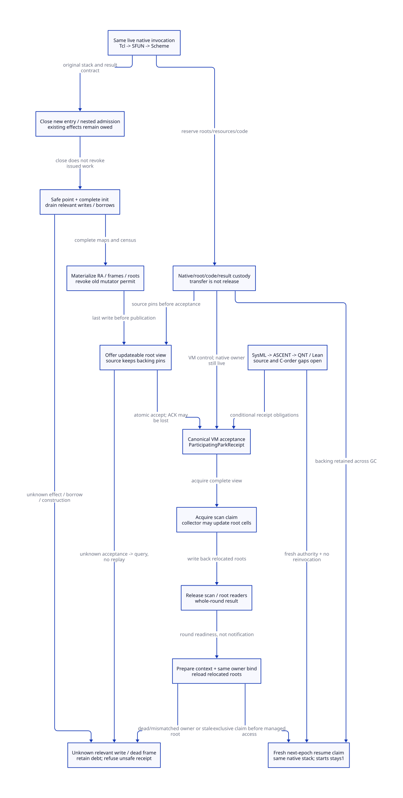

#+TITLE: Modern C Participating Park, Frozen Root Views and Same-Invocation Resume
#+AUTHOR: Gambit runtime research
#+LANGUAGE: en
#+OPTIONS: toc:3 num:nil
#+TODO: OPEN | CONDITIONALLY-CHECKED
#+PROPERTY: header-args :eval never
#+STARTUP: overview

* Architecture decision and scope
:PROPERTIES:
:CUSTOM_ID: participating-park-root-view-decision
:STATUS: SOURCE-AND-NATIVE-ORDER-REFINEMENT-OPEN
:MAINLINE: MODERN-GENERATED-C
:END:

Select an explicit participating park protocol in the modern C runtime. Keep the
original native invocation alive while transferring authority over its described
roots to the collector. This avoids introducing a dependency on completing a synchronous
callback before collecting its own heap. It does not stop arbitrary machine code,
make an interrupted object scan-safe, or recover a dead native stack.

Scheme supplies SafePointSpec, FrameSpec, constructor completion, continuation and
exception exit plans. Modern C owns admission, effect/borrow census, updateable root
cells, canonical park acceptance, scan/resume arbitration and native-frame leases.
The current cooperative path already collects inside a Scheme callback and
resumes its original call. Same-call resume and zero extra invocations are
correctness preservation relative to that baseline, not newly eliminated work.
The new architecture makes the context/participant/worker separation explicit.

An independent collector worker gets a scan capability; it does not become the
native caller, reuse its catcher or resume Scheme on its behalf. Zig would need the
same protocol and evidence. No Zig-specific reduction of necessary runtime work is
established here.

[[file:models/sysml/participating-park-root-view.sysml][SysML]] is the semantic authority for model needs, dependencies, source routes,
custodians, source caller rows, benefit/peak rows and diagram topology. Native
SysML evaluation projects [[file:participating-park-root-view-matrix.org][the matrices]] and [[file:diagrams/participating-park-root-view.d2][D2]] / . Actual
[[file:../../../modeling/ascent/participating-park-root-view.rules.scm][ASCENT DSL]] selects exact method, artifact, digest and scope; it does not grant
runtime authority. [[file:../../../../models/gambit/participating_park_root_view.qnt][QNT]] explores bounded interleavings; [[file:../../../../models/gambit/lean/ParticipatingParkRootView.lean][Lean]] proves conditional
root-authority preservation. The [[file:../../../../evidence/research/participating-park-root-view/checks.json][receipt]] retains source and C-memory gaps.
The [[file:future-epoch-reentry-gate-design.org][previous gate study]] remains unchanged and its selected imports remain open.

* Actual source chain and the non-safepoint counterexample
:PROPERTIES:
:CUSTOM_ID: participating-park-root-view-source
:END:

** One synchronous native invocation crosses the Scheme safe point

=examples/tcltk/tcltk.scm:124-175,221-228= supplies a real native route:
=scheme_call_cmd -> tcltk_call(data_rc(client_data), argv+1) -> Scheme apply=.
The native command needs the returned char string before installing the Tcl result.
Its argv and the native frame remain live across the Scheme call. Parking in the
Scheme body must preserve that original return/result contract. Reinvoking the
callback, returning invented pending success, or moving the raw stack to a worker
is not an equivalent implementation.

=include/gambit.h.in:10043-10064= and =gsc/_ptree2.scm:2902-3030,3145-3187=
show SFUN marker allocation, conversions, Scheme entry and conversion-error handler
calls. A wrapper may allocate or reenter before =___call=. Consequently its root
and effect envelope starts at the early generated/native ingress, not at a late
park flag in =___call=.

** A GVM safe point is a completed representation contract

=lib/_kernel.scm:270-285,306-338,1960-1978= saves return state and GVM registers,
uses W_ALL before stack/heap-limit and GC services, reloads through R_ALL and
restores the return address. The sync-op interrupt at =1428-1444= similarly wraps
=service_sync_op= with RA save, W_ALL, R_ALL and RA restore. The current service
runs the processor barrier/combined-operation loop in =lib/setup.c:1049-1149=;
=___garbage_collect= builds the operation and returns its result at =1182-1200=.
This is current cooperative participation, not an existing independent-worker park
receipt issuer.

The generator =gsc/_t-c-1.scm:2132-2168= creates ALL resource sets from read/write
resource vectors. Header =6801-6803= selects M/P variants; =6983-6991,7058-7091=
implements heap/fp/register write-back and reload. Supplied generated kernel output
at =lib/_kernel.c:9017-9020,12117-12120= has different selected write sets.
W_ALL therefore describes generated GVM state, not every C local variable. This
checked-in output is source evidence, not proof of regeneration with this host.

A particularly useful negative witness is =lib/_kernel.scm:536-575,908-942=:
the rest/keyword list loop calls W_ALL around =___heap_limit=, then states that it
must remove arguments and create complete continuation frames before collecting.
The first W_ALL there is not a legal park receipt cut. The completion plan must
finish frame repair and protect the partial list/arguments, or expose a separately
proved scan-safe construction layout. Likewise still linkage before field init
and the marker input-root TODO cannot be admitted by merely freezing a flag.

** Frozen topology has collector-updateable cells

=lib/mem.c:3898-3966= scans frames using fp, return-specific size/link/gcmap and
captured continuation. =6511-6574= scans actual register, saved, type-cache and
processor cells. =3969-3987= passes =&h->data= from the RC list to =mark_array=.
The collector can change the root cell after relocation. Freeze means no mutator
write, stable cell addresses/topology and backing lifetime; it does not mean the
old SCMOBJ bit pattern stays valid in an unregistered C alias.

All-domain RC integration remains necessary: =mark_rc= is selected in the P0
branch at =6844-6850=. This study does not turn that route into a complete nonzero
processor root adapter. Every borrowed moving value must use a protected handle
and reload, be copied to proven native-only storage before park, or prevent park.
Keeping its old C value while scanning another registered copy is insufficient.

* Records and admission predicates
:PROPERTIES:
:CUSTOM_ID: participating-park-root-view-records
:END:

#+NAME: participating-park-records
#+begin_example
ActivationKey = (VM incarnation, native owner incarnation, invocation, nesting path)
ParkKey = (ActivationKey, old epoch, park attempt)
SafePointSpec = (PointId, FrameSpec, RA/FP/register spill set, root-slot domains,
                 InitSpec completion, exceptional resume/exit plan)
NativeFrameLease = (same live OS thread, stack/catcher chain, marker return right,
                    origin/library code, borrowed input, result and resource backing)
RootView = (ParkKey, stable cells/topology/layouts, all-domain root coverage,
            constructor/result roots, relocation generation, scan capability)
ParkOffer = (SafePointSpec, RootView, closed writer/entry census, native-frame lease)
ParticipatingParkReceipt = (canonical accepted ParkKey, VM custody, view identity,
                            last-effect evidence, no old mutator authority)
ResumeClaim = (ParkKey, next epoch, whole-round/capacity result, prepared context,
               exact same owner binding, scanner/readers drained, reloaded roots)
#+end_example

These are proposed contract shapes, not implemented runtime structs. Stable
identities distinguish invocation, park attempt and GC round: a retry of a query is
not another park, and a later park in the same invocation cannot reuse an old receipt.

#+NAME: participating-park-eligibility
#+begin_example
Eligible = complete generated safe point AND complete/scan-safe construction
        AND materialized described roots AND complete activation/effect census
        AND closed new relevant entry AND relevant issued effects = 0
        AND raw mutable root borrowers = 0 AND unfrozen nested writers = 0
        AND no unresolved relevant write outcome AND live native frame lease
        AND canonical root/resource backing reserved and protected
ParkReceipt = Eligible AND release-published RootView AND canonical VM acceptance
Resume = ParkReceipt AND scan/readers released AND whole round/capacity known
      AND context prepared AND same live native owner bound
      AND relocated root cells reloaded AND fresh next-epoch claim won
#+end_example

Unfrozen nested writers are not all suspended native ancestors. The complete
ancestor/catcher/marker chain remains rooted and leased. A currently executing
nested callback must reach its own admitted cut or return before the enclosing
view can be declared complete. The one-nested-debt QNT abstraction does not prove
coverage of arbitrary recursive native callback stacks.

* Ordered protocol and C memory contract
:PROPERTIES:
:CUSTOM_ID: participating-park-root-view-protocol
:END:

** Prepare and offer while the source remains custodian

1. Reserve park/root/receipt metadata and native/code/input/result leases before
   accepting a managed activation. Close new relevant callback/writer admission
   under the same domain that registers claims. Existing claims and post-unlock
   publisher effects remain owed. Do not wait while holding the queue or admission
   mutex needed by the worker, return path or callback.
2. The live owner reaches a generated legal boundary. Complete frame repair and
   initialization maps; settle or explicitly freeze every nested activation and
   root/effect borrower. A GC-relevant operation with unknown write disposition is
   still outstanding. A timeout, epoch bump or disabled interrupt cannot erase it.
3. Under exclusive owner root-write authority, save RA/FP/HP/registers, native
   handles, marker/result/construction roots and the exact resume PointId. Then
   revoke the old mutator permit and release-publish the complete view. No relevant
   writer can enter between the last spill and this publication.
4. The source pins the view, code and native frame while the offer is pending.
   Publication itself does not authorize scanning. A failed/rejected offer remains
   source-owned; rollback requires canonical proof that accept/scan did not win.
   Otherwise retain pins and query the same attempt. Do not rematerialize a second
   independently owned copy as recovery for a missing response.

** Canonical acceptance and collector claim

5. Under one scan/resume/exit arbitration state, the VM accepts the exact offer,
   records the root-view responsibility and signs the receipt. Acceptance is the
   proposed linearization point. The source cannot restore its write permit on a
   lost ACK. A protected query reports the canonical state without running native
   code. VM control custody does not mean the VM can move or destroy the native
   stack: that backing remains leased to the same owner thread.
6. A worker acquire-claims the accepted view. It may update described root cells;
   the parked owner must neither dereference cached moving values nor execute a
   new nested managed callback. Root topology/backing cannot be withdrawn during
   a claim. Worker failure or unknown scan completion retains canonical scan debt;
   a scanner flag cannot be cleared by timeout. Recovery needs actual stop and
   task-progress evidence from the shared worker contracts.
7. Publish scan completion with release order after root writes, then release all
   claims/readers. A successful root scan is not the entire GC result: strong,
   weak, cleanup, capacity and context preparation must also finish. An outstanding
   cleanup callback that requires this owner must be safely handed off until after
   reentry, or its delayed profile must be rejected. Waiting for it inside GC would
   recreate =owner waits GC -> cleanup waits owner=.

** Resume exactly the original invocation

8. Prepare fp/hp/limits and the error/capacity outcome, bind the exact same live
   native owner and VM/context incarnation, acquire completed root writes and
   reload all generated and native handles. Publish next-epoch readiness only
   after these steps. =lib/mem.c:7003-7085= raises INTR_GC before
   =prepare_mem_pstate=; notification alone is not this authorization.
9. The owner wins an exclusive resume claim against late scan/exit claims and
   obtains fresh next-epoch membership before its first managed access. Continue
   after the park service at the recorded PointId; restore GVM state/RA and return
   through the same SFUN/Tcl native frames when the Scheme computation completes.
   Invocation starts remain one; resume is not a second native call. The old epoch
   remains closed. Retire the old view only after all old reader/capability debt is
   settled, not on receipt delivery.
10. Exception or continuation escape uses the same-owner generated exit plan.
    If scanning has begun, it cannot destroy leased stack/root backing until scan
    authority returns and safe exit authorization is acquired. Settle marker,
    result, constructor and native cleanup duties before stack destruction; a
    finished inner callback does not retire the outer activation. An external
    longjmp/signal escape that bypasses this plan rejects managed admission.

The C refinement needs a compatible lock or atomics protocol for these publication
and claim cuts, plus a lock-order proof. Release/acquire on a ready flag cannot
repair an unregistered plain C root write racing the scanner. No seq_cst flag can
revoke an already issued machine store. Locks guard state transitions only; the
owner and collector wait with no GC-critical mutex held. The QNT atomic steps are
specification operations, not a claim that each step is one hardware instruction.

* In-flight native calls, failure and unknown-result custody
:PROPERTIES:
:CUSTOM_ID: participating-park-root-view-custody
:END:

| Condition | Custodian and admissible next action | Forbidden inference |
|---+---+---|
| Live original call at admitted safe point | Keep native stack/catcher/input/result/code; transfer root scan authority | Native invocation must finish before its own GC |
| Issued relevant store/helper/borrow | Source obligation until known completion or qualified freeze | Entry closure or timeout proves stop |
| Native-only external work | Separate effect-isolation and backing/result escrow proof required | Every native in-flight operation necessarily blocks GC, or is automatically harmless |
| Offer rejected before acceptance | Source retains pins; rollback only after exclusion of accept/scan | Error result frees roots immediately |
| Acceptance response lost | Canonical VM record owns park control; source retains query/pins until resolved | Restore old permit or replay callback |
| Scanner completion unknown | VM keeps scan/root duty; refuse unsafe resume | Notification or empty worker queue means done |
| Result known, context/binding/reload unknown | Keep parked current invocation and result roots | Result availability is a resume seal |
| Native owner known dead | No same-call resume; separate stopped-owner cleanup if all writes known stopped | Transfer native catcher to worker |
| Owner/helper stop unknown | Retain backing and relevant debt; may block GC | Join error proves no writes remain |

=___call= at =lib/setup.c:3276-3391= installs the native frame/marker relationship
and catcher; =include/gambit.h.in:9981-9987= uses a stack jump buffer. Return-to-C
at =lib/_kernel.scm:1020-1072= rejects wrong processor and repeated/dead marker.
The present mechanism does not provide arbitrary owner death recovery. The chosen
profile keeps the original OS thread and live stack; context migration across
native threads is refused unless a future explicit stack/ABI design proves it.

The real device select wrapper at =lib/_kernel.scm:4503-4519= uses W_ALL and R_ALL;
=lib/os_io.c:1532-1549= provides a wakeup channel. Neither is a universal native
park receipt. Native syscall cancellation, lock retention and borrowed payload
access require origin-specific qualification. A park awaiting a helper cannot
require that helper to enter managed code through the closed gate to acknowledge.

* Conditional proof, counterexamples and remaining closure
:PROPERTIES:
:CUSTOM_ID: participating-park-root-view-proof
:END:

QNT separates close, debt completion, legal boundary, materialize, offer, accept,
scan claim, root relocation, scan release, whole-round completion, context prepare,
bind, reload, next publish and same-call resume. Clean and outstanding-debt initial
profiles are bounded to one of each debt and epochs zero/one. Lost ACK/query is
separate from acceptance. Unsafe histories deliberately expose missing construction,
raw borrower, nested callback, source offer mistaken for acceptance, late root
writer, scan/resume overlap, stale cached root, replay and dead native frame.

Lean checks eligibility exclusions and root-authority Step/Trace preservation:
collector root relocation is permitted while mutator writes are forbidden;
relocated cache needs reload; resume does not increase starts; loss of response
preserves acceptance/backing. Boundary and Ready are explicit premises. This is
not a full simulation of all QNT actions, generated C or native exception ABI.
SysML requirement declarations/instances are not automatically discharged by
native parsing/evaluation. ASCENT leaves every source/C-order obligation open.

#+NAME: participating-park-closure-frontier
| Need | What must be proved beyond the local model |
|---+---|
| PP-SAFE | Generated spill/init/FrameSpec coverage at every admitted cut; reject known partial rest cut |
| PP-ROOT | All-domain RC/native/constructor roots and alias/updateable-cell census |
| PP-EXCLUDE | Complete live effect/helper/nested/borrow manifest and stop evidence |
| PP-RECEIPT | Actual source pins, canonical accept/query and scan/exit arbitration |
| PP-RESUME | Same native stack, full round/context/binding/reload before fresh permission |
| PP-SEMANTICS | Synchronous result, exception/continuation and recursive activation refinement |
| PP-ORDER | C lock order, weak-memory publication and native ABI mapping |

The imported future-epoch gate, queue, custody, synchronous semantics, reentry and
C-order scopes are preserved, not requalified. The five actual repository queries
include missing history, wrong scope, stale digest and synthetic all-scoped controls.
Synthetic readiness tests the rules; it is not native readiness.

* Work and peak-memory accounting
:PROPERTIES:
:CUSTOM_ID: participating-park-root-view-benefit
:END:

The quantifiable design benefit is a permitted dependency structure and bounded protocol work,
not a measured speedup. For A live activations, R distinct described root slots
and D live effect/borrow duties, control metadata is O(A+R+D) and root scanning is
O(R). This protocol alone creates no mandatory O(reachable-heap) snapshot. Retained
root reachability can still keep a large heap alive, and constructor/native input
snapshots required by their own semantics add actual storage.

#+NAME: participating-park-work-law
#+begin_example
ExtraNativeInvocations(park/query/resume) = 0
Wait edge removed conditionally: GC -> complete original synchronous callback
Added work: generated spills + admission/census + park accept + scan arbitration
          + root reload + resume claim + lifetime/exception bookkeeping
Positive CPU-work benefit iff actual removed baseline CPU work > added CPU work\nWait-cycle removal is a separate dependency-graph property, not CPU work or speedup
Peak = max_t(H(t) + P(t) + N(t) + Q(t)), each physical backing counted once
Park delta = descriptor/receipt/root/effect pools + any actual snapshots
           + increased overlap of retained native/code/root backing
#+end_example

H is managed storage, P protocol pools, N native backing and Q separately retained
or quarantined backing not already included. Do not add a stack already counted in
N again merely because it is now leased. The inherited marker candidate adds 24
bytes per aligned-wrapper request in the selected 32/64-bit arithmetic; it is not
newly introduced by parking, ABI admission, a page/RSS measure or the complete
protocol budget. A native frame may live longer without being copied. No whole-
round peak reduction is proved; unbounded unresolved debt can retain memory without
a finite reclamation bound. Detailed source-backed costs and falsifiers are in the
native-projected matrix.

* Migration and evidence basis
:PROPERTIES:
:CUSTOM_ID: participating-park-root-view-migration
:END:

1. Generate semantic safe-point/init/exit plans and census every admitted ingress,
   root writer and native borrower. Retain existing C behavior for unqualified
   origins; do not claim a compatibility flag solves missing root coverage.
2. Rebuild all-domain RootRegistry and split context, participant and worker roles.
   Introduce canonical park/scan/exit/resume arbitration and exact custody first.
3. Connect full round/capacity/context preparation and same-owner reentry. Qualify
   the sync Tcl route without changing its result contract, then expand profiles.
4. Retire blanket park assumptions, unmanaged direct entry and PSTATE lifetime
   shortcuts only after their admitted callers have equivalent generated contracts.
   W/R instructions can remain implementation output; retire implicit responsibility,
   not useful state-transfer operations. Zero production paths retire in this study.

Learn from [[https://ocaml.org/manual/5.2/intfc.html][OCaml's C interface]], sections 22.5 and 22.12.2: registered cells are
relocation-aware; releasing runtime ownership prohibits managed access until
reacquisition. Acquisition/release may themselves run asynchronous callbacks.
Gambit should make transition effects explicit rather than copy a lock API and
assume it preserves arbitrary continuations. Its moving continuations, native
marker/catcher chain and partially constructed frames require their own proof.

[[https://arxiv.org/abs/2307.14909][Targeted Static Analysis for OCaml C Stubs]] (Török, 2023, workshop submission)
uses language-derived caller/runtime models to reason about C value dereferences.
This supports a generated caller/effect/root checking direction; it does not prove
Gambit coverage or supply a ready-made verifier. [[https://cs.brown.edu/people/mph/HerlihyW90/p463-herlihy.pdf][Herlihy and Wing (1990)]] supplies
the abstract operation/result distinction used for accept versus ACK; the C
linearization proof remains separate. [[https://gcc.gnu.org/onlinedocs/gcc/Nonlocal-Gotos.html][GCC's nonlocal-goto documentation]] distinguishes
its builtins from standard setjmp/longjmp and constrains use of its saved frame.
Neither API licenses transplanting a raw catcher to a collector worker. The exact
compiler/ABI and generated exception source refinement remains open.

All work here is source inspection, architecture, native model tooling and formal
checks. There is no runtime implementation, native test, measured latency or peak,
new version naming, person-day estimate, commit or push.
