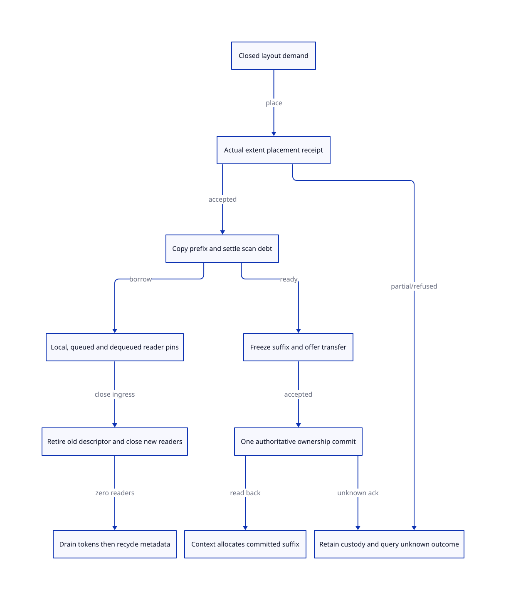

#+TITLE: Physical promotion extents, worker-tail transfer and epoch reader retirement
#+SETUPFILE: ../../../modeling/org/setup.org
#+CATEGORY: gc
#+PROPERTY: header-args :eval never :exports code
#+OPTIONS: toc:3 num:t

* RESEARCH Replace implicit PSTATE lifetime with explicit modern-C ownership :modern_c:gc:smp:ffi:
:PROPERTIES:
:CUSTOM_ID: promotion-interval-handoff
:AUTHORITY: models/sysml/promotion-interval-handoff.sysml
:STATUS: target-kernel-checked-source-and-platform-open
:EVIDENCE_CLASS: current-source-and-conditional-formal-design
:END:

[[file:promotion-residual-design.org][The preceding capacity and residual study]] supplies a conditional payload bound,
not a placement, transfer or reader-drain proof. This refinement makes those
three capabilities separate: RegionReceipt, TailReceipt and RetirementReceipt.
Modern generated C is mandatory. Scheme still owns semantic StorePlan, FrameSpec,
PointId, root and continuation identities; the C runtime owns actual storage,
publication and lifetime. Zig supplies none of these obligations automatically.

Native SysML owns the requirements, concrete caller rows, exact QNT/Lean scopes,
prerequisites and cost/view rows. [[file:promotion-interval-handoff-matrix.org][Generated matrices]] and  project its evaluated
values. The root [[file:../../../../models/gambit/promotion_interval_handoff.qnt][QNT kernel]] and [[file:../../../../models/gambit/lean/PromotionIntervalHandoff.lean][Lean statements]] are target mathematics, not
copies of today's collector. No runtime, Scheme generator, native test, benchmark
or build profile is implemented. No typed requirement is claimed satisfied.

* Source-backed allocation: a sum is not a placement
:PROPERTIES:
:CUSTOM_ID: physical-extents
:END:

mem.c:540-598 computes an aligned returned block inside a separately owned
container; free_mem_aligned_heap:657-670 recovers that container. The underlying
heap allocator in os_base.c:445-477 selects code-memory backing when
SUPPORT_LOWLEVEL_EXEC is active, otherwise ordinary allocation. A data allocator,
executable code allocator and platform page commitment are distinct services;
this study does not qualify an installed Darwin profile, W^X behavior or RSS.

The source expansion adjust_msections:891-1057 can publish a replacement section
index before all requested sections have been obtained, and updates nb_sections
for every successful section. It returns void. A failed expansion can leave
some new sections and a new index allocated. setup_mem_vmstate:4828-4838 compares
actual count with requested count; resize_heap:6441 onward also inspects actual
results and can reduce the overflow reserve. These actual partial results must
be represented, not collapsed into a Boolean grant or rolled back by guessed
requested bytes. Contraction frees tail sections; it does not merely lower a
capacity counter. Both payload sections and replaced index arrays need lifetime
protection once reader/worker ownership is decoupled.

#+NAME: region-receipt-data
| Record | Required data / issuance rule |
|---+---|
| BackingExtent | AllocationObjectId, generation, owning allocator/deallocator, base pointer, requested container bytes, returned payload offset, permitted read/write interval and backing class. Object identity is not a recyclable numerical address. |
| Placement | Object/frame identity and target layout, extent ID, [lo,hi) offsets, alignment, initialized prefix and work-descriptor owner. Checked arithmetic before pointer construction. |
| RegionReceipt | Exact physically allocated storage objects and accepted offsets, disjoint source/destination/resume roles, exact VM/epoch/layout snapshot and complete per-object placement or a proved monotone packing plan. |
| PartialAcquisition | Request/operation ID, each allocated container/index/section and current owner; known failed, accepted, in-progress or outcome-unknown. Only the actual owned unpublished subset is refundable. |
| Native backing premise | Allocator-issued accessible storage is stronger than an integer budget or unbacked address reservation. It is not a guarantee of resident physical pages, no future OS failure or a measured RSS peak. These require a separately qualified platform policy. |

For each container use the actual allocator equation:
=extra + (words+modulus)*wordBytes=, where mem.c:568-579 adjusts multiplier for
pointer alignment and adds deallocation-pointer room. Section payload uses
=WORDS(sizeof_msection(MSECTION_SIZE))*wordBytes= and the index uses
=WORDS(sizeof_msections(max_nb_sections))*wordBytes= (header:11290,11303).
Allocator-internal metadata and mapping/page rounding are extra platform terms;
no guessed sizeof value is treated as evidence. Add container bytes once, not
both an enclosing allocation and every overlapping role interval.

The placement condition is stronger than sum_i free_i>=B. Two disjoint four-word
holes cannot hold one six-word target object even though their sum is eight.
For every target o require an actual extent e and aligned offset p with
=[p,p+t(o)) subseteq e= and disjointness from every live claim. If no such
placement exists, reserve fails before any forwarding. Whole-section dedicated
promotion arenas simplify this condition but still pay rounding and largest-
object costs. A custom_msection_alloc hook (mem.c:3098) needs the same receipt or
is refused; a returned pointer alone cannot declare another owner's bytes free.

Use offsets within an allocator-issued C object. Pointer subtraction, ordering
or addition across unrelated allocations is not justified by an integer address
comparison. Conversion to tagged Scheme representations retains a separately
qualified ABI/address model. The C committee draft N1570 sections 6.5.6 and 6.5.8
support this distinction; it is not a claim of host conformance to every profile.

The preceding Bpayload<=Y+S remains useful only after the nursery/stack census
closes and layout conversion is accounted for. A captured FrameRef can encode a
stack address as a fixnum: mark_captured_continuation explicitly decodes that
case. Generic heap-pointer age tests cannot replace FrameSpec-aware root/stack
coverage. The existing complete minor/root/weak obligations remain mandatory.

* Tail transfer is an ownership transaction, not a counter refund
:PROPERTIES:
:CUSTOM_ID: tail-transfer
:END:

Today's collector restores execution on the same PSTATE. After strong/weak/
cleanup barriers, garbage_collect_pstate:7038-7080 resizes, guarantees heap fudge,
accounts occupancy and calls prepare_mem_pstate. That helper:4525-4562 writes
fp/hp and allocation limits from current private cursors, approximate free space
and MSECTION_FUDGE. This already reuses remaining space. A future cross-owner
handoff must preserve that useful behavior without claiming it as a newly
invented allocation saving.

There are six direct prepare_mem_pstate calls in the reviewed mem.c: setup
at 4717, GC return at 7080, stack-limit overflow/relocation at 7215 and 7358,
stack-overflow undo at 7402, and heap-limit handling at 7500. The native caller
row lists the definition at 4525 and these six endpoints separately. All six are
migration consumers. Stack undo restores a previous msection and free list;
heap_limit can consume that free list or obtain another section. Neither may
reconstitute an old worker-owned limit after transfer. This census is a lexical
closure for the static helper, not a whole-program foreign alias proof.

For a worker region use immutable coordinates:
=physical [base,end), copied prefix [base,prefixEnd), free suffix
[prefixEnd,allocationEnd), protected guard [allocationEnd,end)=.
The prefix includes validated header/body/chunk/filler grammar. scanFrontier,
private cursor, initialization progress, Tail obligations, queued/dequeued tasks
and frame/object-start maps must be explicit. A suffix is transferable only when
its overlapping copy/scan/deferred-write obligations settle. Prefix readers may
remain only with an immutable footprint that cannot inspect or write the suffix;
otherwise drain them first. Next-GC layout covers both the copied prefix and
new context objects, with no guessed scan-through of unused space.

#+NAME: tail-transfer-state-machine
| State | Action and authority | Failure custody |
|---+---+---|
| WorkerOwned | Worker may allocate under its exact region grant; copied prefix/root debts explicit | It retains the interval and all debts on failure. |
| FrozenOffer | Stop worker allocation into offered suffix; reserve immutable layout/transfer record before publishing offer | Sender owns a frozen, unavailable suffix. Cancellation before commit may withdraw only after receiver acceptance settles. |
| TargetAccepted | Receiver proves same VM/epoch/generation, alignment, actual demand and complete prefix/index/guard acceptance | Acceptance does not yet allow either receiver writes or sender reuse. Target rejection leaves source ownership intact. |
| Committed | Lifecycle coordinator changes expected owner to receiver once, keyed by TransferId and region generation; attach layout and credit atomically under its short lock | This is the ownership linearization point. Receiver may act only after acquiring/reading back committed authority. |
| OutcomeUnknown | Lost reply/timeout/cancellation does not undo commit | Query the authoritative record by exact identity. Sender remains frozen; receiver follows committed state. No duplicate offer, timeout refund or reconstructed old hp. |
| RetiredRecord | Record may be recycled only after both endpoints/tasks have settled their references | Bounded operation slots apply backpressure rather than overwriting an unresolved identity. |

Transfer commits role ownership, not new Scheme allocation. bytes_allocated
accounts before/after occupancy at mem.c:7000,7049 and uses words_movable_objs:
359-369; charging the copied prefix as freshly allocated context words would
change allocation statistics. New context allocation consumes only its suffix.
Copied/live prefix bytes remain charged as storage even after all scan debt ends.

A worker tail is not simultaneously a separate context failure/nursery grant.
First calculate what requested context work fits; reserve any shortfall from
separate backing. Do not release a pre-existing failure-delivery reserve until
the committed suffix has accepted equivalent role/continuity requirements. A
usable heap suffix does not automatically satisfy a stack-growth or emergency-
unwind demand. Independent workers may be fewer than contexts; root domains and
allocation checks continue to cover every context.

* Reader acquisition, final use and retirement cut
:PROPERTIES:
:CUSTOM_ID: reader-drain
:END:

The old runtime uses phase barriers and PSTATE lifetime, not a card-descriptor
reader registry. The new protocol therefore needs real reader adapters; merely
renaming workers_count as reader_count cannot close it. [[file:promotion-interval-handoff-matrix.org][Eight native caller
families]] distinguish publication, scanning, frame/root helpers, restoration,
resize and cleanup. Public aliases/native embedding prevent global closure by
text search; unknown raw consumers must be admitted with a declared footprint
or rejected.

The selected modern-C design uses a short VM lifecycle mutex for descriptor
selection plus pin admission. The caller acquires the lock, obtains a current
live descriptor, creates its finite ReaderToken, then releases the lock before
any pointer escapes or scanning begins. Loading a raw descriptor pointer and
incrementing its refcount later is forbidden: retirement/free can occur in
between. This is deliberately a lock-based target admission protocol, not an
unproved lock-free reclamation algorithm.

A token names descriptor VM/epoch/generation, actual access footprint, owner
activation/task and last-use endpoint. Native root membership is a different
lease: a long-lived RC root can stay registered without holding a raw pointer
across a moving collection. A parked callback releases finite raw borrows after
materializing roots, then reloads under a new permitted descriptor. Waiting for
the full callback lifetime while that callback waits for GC is a cycle.

Token and operation slots are preallocated and checked for exhaustion/counter
overflow before admission; generations cannot wrap into an unresolved identity.
Scheme/nonlocal exits and asynchronous native cancellation cannot cross an
owned lifecycle/queue critical section. Cross-library exits must settle explicit
guards or be refused by the admitted effect profile. A lock name alone provides
none of these properties.

** Queue and private-cursor custody

- end_heap_chunk:3241-3305 publishes contents/links under the queue lock. Acquire
  the task's pin before publication; the producer keeps its private pin until
  the task record owns one. Publish failure/unknown result remains in a bounded
  outgoing-operation record, not a dropped reference.
- scan_movable_objs_to_scan:4321-4382 dequeues, unlocks, then scans a pointer.
  The queue token becomes the in-flight scanner token before unlock. Empty
  queue is therefore not equivalent to no old-layout users.
- scan:6692-6730 steals from another PSTATE queue and calls the same complete-
  chunk scanner after unlocking. The same exact task token transfers; it is not
  newly counted at both owners. Private scan_ptr/body initialization has a pin
  even when the chunk was never queued.
- scan:6738-6768 decrements workers_count when idle. The target must settle its
  last private/dequeued/child task token before this endpoint; zero workers
  still says nothing about independent root, FFI, debug or restoration borrows.

Do not nest lifecycle and queue locks. Prepare a publish ticket/pin under the
lifecycle lock, release it, then enqueue under the queue lock. The ticket owns
coverage during the gap. Dequeue transfers the queue token without releasing it;
release the token under the lifecycle lock after queue unlock and final use.
A derived child reader is allowed after retirement only while its exact parent
pin remains live and forkPin records child ownership before parent release,
under the lifecycle lock. This prevents a zero-count gap. A queued or unknown
operation is still a token owner. A generation boundary never erases that debt.

** Retirement, shutdown and forbidden forced drain

Retire the old descriptor under the same lifecycle lock: close unparented old
admission and publish the replacement descriptor. Existing readers and their
protected child transfers settle normally. At a zero-token observation under
that lock, no parent remains to create an old child; the zero is stable unless
an invalid raw consumer exists. Waiters use the predicate/condition-variable
loop under the lock; releases signal and the wait releases/reacquires the lock.
No allocator, Scheme callback, destructor, join or blocking native call executes
while holding lifecycle/queue locks.

A new descriptor may use the second preallocated card bank while old readers
finish, but no third bank/epoch reuse occurs until the oldest bank is eligible.
Unknown reader exit/join keeps its token. A timeout, thread ID reuse or processor
removal is not a last-use proof. Retention/backpressure can therefore block
progress; neither bounded latency nor crashed-reader recovery is claimed.

Distinguish reset permission from payload free permission. Zero readers plus
retirement allows old metadata reuse only after other card/root obligations.
The physical allocation can still hold mature objects, continuation frames or
context suffixes. Free additionally requires semantic dead/relocated payload,
no live interval owners, settled root/control/native leases and correct allocator
provenance. Epoch retirement is not the GC reachability algorithm.

Real retirement consumers include adjust_msections contraction and replacement
index freeing; setup.c:884-950 resize removal calls cleanup_pstate then thread
exit; cleanup_pstate:4665 calls interrupt and memory/OS cleanup; cleanup_vmstate:
4773 calls memory cleanup. mem.c:4938-4966 destroys allocation/termination sync,
cleans processor zero (with an other-processors TODO) and frees msections. These
current preconditions are not a demonstrated reachable native bug. With detached
workers/retained root domains, explicit drain must precede sync destruction and
actual section/index free. A destructor that needs the same GC/root pin must be
delivered through the separately accepted cleanup protocol, not waited on here.

* Failure and unknown-outcome ledger
#+NAME: interval-failure-matrix
| Boundary | Required owner | Retry / release condition |
|---+---+---|
| Partial section/index expansion | Acquisition operation owns the exact successful allocation set; old storage still owned separately | Reconcile actual IDs/counts, budget held partial results; release only known unpublished unborrowed allocations. No fresh unbounded retries under an unknown result. |
| Pre-forward reservation refusal | Source/root/card snapshot remains authoritative; release only private unused target claims | Admitted major/retry/protected failure delivery. All forwarding must be absent globally, not merely in one worker. |
| Post-forward reserve/initializer breach | Canonical copy subframe and initialization/scan owners; retain both spaces/root pins | Quarantine ordinary resume/reclaim. No reconstructed old cursor or counter refund of visible target bytes. |
| Target rejects offer | Sender retains a frozen suffix until rejection is known and acceptance/borrow records settle | Resume worker ownership or offer elsewhere only after rejection resolution. |
| Commit accepted, reply lost | Authoritative owner record; sender frozen, receiver permitted by read-back only | Same TransferId query, not second commit or optimistic rollback. |
| Queue publication / reader exit unknown | Exact outgoing task or reader token retains descriptor/region | Reconcile unique queue operation or last use; queue-empty, idle, join-failure and timeout do not discharge it. |
| Shutdown with unresolved pins | Root/region/retirement coordinator keeps storage and synchronization usable | Close all ingress and settle actual descendants before destruction. Refuse/hold/quarantine rather than force-free. |

Today's adjust_msections is synchronous; partial success is observable in its
actual structure, not a demonstrated lost RPC reply. OutcomeUnknown is a target
service/ownership-delivery state and unresolved-exit obligation, not evidence
that malloc normally returns an unknowable result. Native allocation starts
with an owned operation record and uses a no-nonlocal-exit commit interval to
attach returned backing. An allocator that cannot publish/reconcile its actual
result under that contract is refused; no recovery or finite-memory guarantee
is invented for an orphaned unknown allocation.

* Proof routes and quantified decision
:PROPERTIES:
:CUSTOM_ID: proofs
:END:

IH-H binds 19 named histories and a 100-sample positive run, max 80 steps,
initial seed 17. The model has one allocator-backed [0,12) region, copied prefix
[0,6), suffix [6,10), guard [10,12), one transfer and two reader IDs. Controlled
omissions preserve fragmentation/sum-only allocation, duplicate ownership,
unfinished/stale offers, rollback after unknown commit, lost queue/dequeued pins,
early reset, pin-after-reset and free-live-region counterexamples. There is no
full GC, several-bank algorithm, C memory model or arbitrary crash proof.

IH-I binds thirteen named conditional statements: splitConserves, noCrossBoundary,
sumDoesNotFitFragment, commitExclusive, ackDoesNotRestoreWorker,
dequeuePreservesPin, noReadersNoTasks, handoffNoZeroGap,
liveOwnerForbidsFree, reuseBound, peakReuse, lateRefundCannotBeatPre and
peakBelowRequiresBoth. The last two make the phase-peak limitation explicit.
Offset arithmetic assumes
compatible units and a valid single allocation; the algebraic peak identity is
not a separation theorem. No whole QNT transition induction, source simulation,
allocator provenance or liveness proof is claimed.

IH-EXTENTS/IH-TAIL/IH-READERS/IH-MEMORY remain open. SysML explicitly connects
PR-BOUND to extent/tail refinement, PR-RESIDUAL to readers/memory, PR-MEMORY to
memory and PR-FFI to readers; their prerequisite chains include original GW-S,
CO-S, FZ publication/census/freeze, RC lifetime and WB memory requirements.
Actual ASCENT facts and matching-scope receipts qualify only IH-H/IH-I. Missing
source/order premises must block upstream admission despite synthetic local
passes. Generated matrices below keep exact subjects and dependencies visible.

#+INCLUDE: "promotion-interval-handoff-matrix.org" :minlevel 2

** Work and peak-space equations
:PROPERTIES:
:CUSTOM_ID: costs
:END:

For target context i, q_i is the accepted, aligned, role-compatible suffix amount
that replaces an actual fresh-resume demand r_i. Require
=0<=q_i<=min(usableTail_i,r_i)= and globally disjoint suffix ownership. Q is the
sum of accepted q_i, never the sum of all advertised free tails. Publication or
read-back unknown grants zero speculative refund. Current same-PSTATE restoration
already reuses tails; Q is an opportunity relative to a naive separated-worker/
context architecture, not a proved improvement over today's Gambit.

The preceding study's summed occupancy equation must be refined by phase before
calling it a true peak. Separate Qg (guaranteed, backed and role-compatible in
the preflight placement plan) from Qo (opportunistic slack known only after
copy completion). In one byte unit with disjoint live allocation terms:

#+NAME: interval-phase-peak-matrix
| Phase | Simultaneous occupancy bound | Valid reuse credit |
|---+---+---|
| Preflight / copying | RetainedSources + ExistingMature + Destination + (FreshResume-Qg) + Metadata + HeldPartial | Qg only, committed as a disjoint future-context suffix before forwarding; copying cannot consume it |
| Post-copy, transfer pending or unknown | Actual retained sources + mature + destination + still-owned fresh resume + metadata + partial outcomes | No speculative Qo credit; authority must show which exact fresh allocation can be released |
| Committed context resume | Actual retained sources + mature + destination + (FreshResume-Qg-Qo) + metadata + partial outcomes | Qo only after commit/read-back and actual release of the displaced fresh storage |
| Actual peak | Maximum over all phases, including acquisition and failure reconciliation | A post-copy refund does not subtract from an earlier simultaneous peak |

Qg is not a second overlapping grant of the whole worker arena. Its reserved
future suffix is outside the proved copy/scan-write upper frontier; actual
post-copy slack below that frontier may become Qo only later. If guaranteeing
Qg requires increasing Destination by the same amount, it supplies no net space
gain. Against the same naive separated placement, positive preflight reduction
requires Qg to exceed extra destination, metadata and retained-partial costs;
otherwise peak reduction may be zero or negative. This corrects any reading of
the earlier aggregate equation that subtracts a late refund from peak memory.

Destination includes the reused suffix, so subtracting reuse from it as well is
double credit. Include active and retired descriptor/index generations, two card
banks, global seed/context logs, frame/object indexes, task/reader records,
alignment, allocator/page overhead and preserved failure reserves. HeldPartial
has an explicit finite budget with no new acquisition when an old unknown
operation has no free slot. It is not silently absorbed into free space.

If one role-compatible physical interval of size q replaces an actually required
fresh extent without changing any other storage or guard, extra fresh storage
falls by q. Otherwise the reduction can be zero. Fragmentation, rejected offers,
late borrowers or different stack/heap roles are concrete falsifiers. No native
RSS value, peak percentage, speedup, person-day or Zig saving is invented.

The retained mature continuation work condition remains A<(k-1)*M under matched
complete accounting. A now explicitly charges placement, pin admission/release,
queue transfer, immutable-index access, read-back/reconciliation and lifecycle
coordination. Claiming stronger modern-C ownership while hiding these costs would
not establish net benefit. The design amplifies reusable shared continuations
and detached worker scheduling only when full source closure makes these
removals safe; portable native contracts are the enabling interface.

* Primary research and migration decision
#+NAME: interval-primary-evidence
| Primary reference | Mechanism learned / Gambit-specific limit |
|---+---|
| [[https://mc.uwaterloo.ca/pubs/debra/paper.podc15.pdf][Brown, Reclaiming Memory for Lock-Free Data Structures, sections 1-3]] | Logical retirement differs from safe freeing; a sleeping old reader can prevent reclamation. We choose explicit bounded retention/backpressure, not the paper's signal-based neutralization or performance claims. Arbitrary Scheme/native continuations cannot be discarded by a reclamation signal assumption. |
| [[https://www.open-std.org/jtc1/sc22/wg14/www/docs/n1570.pdf][C committee draft N1570, 6.5.6, 6.5.8, 7.17, 7.26.4]] | Same-allocation pointer arithmetic, synchronization and condition-variable predicate discipline. Declared lock protocol does not prove target C accesses or installed platform conformance. |
| [[file:../../../../vendor/gambit/lib/mem.c::4525][Gambit prepare_mem_pstate and GC return]]; [[file:../../../../vendor/gambit/lib/setup.c::884][resize/removal]] | Reuse actual existing cursor/fudge/parallel-scan assets. Replace implicit ownership only after every setup, restore, undo, allocation, scan and teardown consumer adopts the explicit contract. |

A Fraser report PDF and an earlier Brown URL were inaccessible during this read;
no claims are derived from their unavailable full text. The fetched Brown PODC
paper is the primary reader-retention source. None of its benchmark numbers or
crashed-thread reclamation guarantees transfer to this runtime.

Migration order: generate layout/size/role descriptors; ledger actual allocations
and partial outcomes; split context and worker cursors; adapt all six restoration
calls plus setup/resize/undo consumers; pin local/queued/dequeued and native/root
borrowers; install idempotent tail commits; gate contraction/index replacement/
shutdown destruction on real drain. Retire implicit PSTATE-only layout authority
and combined worker-idle/lifetime assumptions only after all their actual
consumers close. No runtime path is declared retired by this research.
