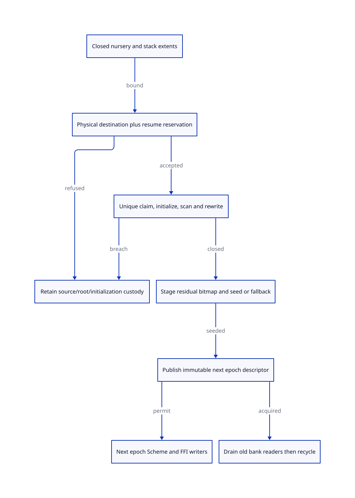

#+TITLE: Promotion capacity and residual remembered-set handoff
#+SETUPFILE: ../../../modeling/org/setup.org
#+CATEGORY: gc
#+PROPERTY: header-args :eval never :exports code
#+OPTIONS: toc:3 num:t

* RESEARCH Modern C: amplify shared continuations without hidden capacity debt :modern_c:gc:smp:ffi:
:PROPERTIES:
:CUSTOM_ID: promotion-residual
:AUTHORITY: models/sysml/promotion-residual.sysml
:STATUS: conditional-target-kernel-source-refinement-open
:EVIDENCE_CLASS: source-research-and-formal-controls
:END:

This refines [[file:generational-barrier-design.org][the barrier/cut contract]], not the shipping collector. Gambit's
current movable semispace collector already has parallel collection, section
allocation, stack forwarding and overflow support. Modern generated C is the
mandatory reconstruction path; the purpose is to make Scheme's shared multi-shot
continuations cheaper to retain/reuse and native participation explicit. Zig
would still need all capacity, identity, ownership and ordering contracts here;
this study supplies no incremental Zig benefit or second runtime commitment.

SysML owns typed receipt requirements, exact needs/dependencies, source families,
benefit rows and diagram topology. [[file:promotion-residual-matrix.org][The generated matrices]] and  consume
native evaluated values. Root-level [[file:../../../../models/gambit/promotion_residual.qnt][QNT]] and [[file:../../../../models/gambit/lean/PromotionResidual.lean][Lean]] describe the target protocol. No
runtime source, generated runtime, build profile, native test or benchmark is
implemented. Requirements are not satisfied runtime instances.

* Closed source extents, rather than a survival estimate
:PROPERTIES:
:CUSTOM_ID: capacity
:END:

Let Y be the union size, in words, of all allocated nursery object extents at
the writer/root cut, including headers/padding; S the union of every retained
context's allocated stack extents that can contain capturable frames. Neither
is the amount predicted to survive. A failed/unknown join does not remove its
root domain or stack from this census. Still/permanent storage classes in
mem.c:60-86 are not existing ages; this candidate allocates such externally
stable objects outside the copying nursery and scans their young references.

For each unique nursery object o, define t(o) from the target representation,
alignment and header requirements. For each distinct capturable stack frame f,
define h(f) from its FrameSpec/RETN/RETI layout. Heap frames already counted in Y
must not be charged again as stack frames. Shared continuation chains require
canonical frame identity =(stackRegion, generation, frameBase)=, not a count of
roots or continuation shells. A traversal that allocates during this census
would itself invalidate the cut unless separately admitted.

#+NAME: promotion-source-equations
| Quantity | Source-grounded equation / limitation |
|---+---|
| Current 64-bit, no-handle copied object | mem.c:3533-3608 copies HD_WORDS+1 words; unchanged target layout permits sum t(o) <= Y. Changed headers/alignment require their actual delta, not this inequality. |
| Captured stack frame | mem.c:3727-3799 allocates fs+FRAME_EXTRA_SLOTS+SUBTYPED_BODY = fs+2. header:9224-9226 reserves roundUp(fs+3,4) stack words. Therefore heap extent <= original complete stack extent. |
| Maximum admitted current frame | mem.h:65-67 declares fs<=8192; maximum heap frame 8194 words, 65552 bytes when word=8. This is a source-layout bound, not a configured executable qualification. Invalid/unknown frame descriptors reject the receipt. |
| Exact payload bound | Bpayload = sum_unique_nursery t(o) + sum_unique_stack_frames h(f). With unchanged admitted layout, Bpayload <= Y+S. Relative to fs alone a frame adds 2 words; adding another 2 per frame to S double-counts it. |
| Source capacity minimum | mem.c:503-509 uses 131072-2*8194=114684 words for its global section sizing equation in the no-handle profile. This is NOT a worker's available copying half. |
| Copying half | mem.c:3314-3323 sets heap limit at start+65536; prepare_heap_msection:3389-3408 subtracts 2 and consumes the first link. Shared stack/heap:3326-3355 instead splits remaining space 3/4 to heap, 1/4 to stack after fudge. |

The source contains #error checks requiring SUBTYPED_BODY=1 and
FRAME_EXTRA_SLOTS=1 in captured-frame copying. A generic header branch advertises
handles (header:3118-3135); that does not make handles supported by this copying
path. The bound is scoped to the checked no-handle layout. A modern layout can
change the constants, but must regenerate both capacity and root decoding.
RETI uses actual_ra to obtain fs/link; it is not a second frame charged in
addition to the decoded frame. Break links/end markers terminate or redirect
the chain; they are not guessed Scheme pointer payloads.

The same admitted disjoint extents bound candidate descriptor population: every
no-handle heap object occupies at least one header word, and every nonnegative-
fs stack frame occupies at least four aligned words. Thus Nheap<=Y,
Nstack<=floor(S/4), and N<=Y+floor(S/4) for these two candidate classes. This
can provision a conservative claim table without knowing survival. It excludes
additional root/card/weak-task records, which require their own population and
queue bound; it is not a bound on every runtime descriptor or foreign resource.

** Worker and context capacities must describe disjoint intervals

mem.c:3241-3410 puts chunk links into the copied space: first link, end links and
possibly an empty final chunk. MSECTION_CHUNK=255 is a publication trigger, not
an upper bound on a chunk containing a large frame. Counting ceil(B/255) links
without proving the publication schedule is unsound. Repeated empty endings or
pre-CAS alignment pads also need a bound. In the 32-bit branch:3554-3570 padding
can precede the forwarding CAS, while loser undo:3598 only decrements the header;
claim attempts are not bounded just by worker count. The 64-bit existing path
already avoids copying a loser's body and undoes the header; credit that asset.

The selected reconstruction uses a preallocated per-object/frame claim record
before assigning destination payload. Claim ownership, target interval and
initialization/scan obligations are separate from exposing the canonical address.
Each admitted unique object receives one payload interval. Losers acquire the
canonical descriptor; they cannot allocate duplicate bodies, refund another
winner's credit or dereference an unready payload. Descriptor allocation must
itself be included in preflight. An owner that stops after claiming still owns
the pending initialization, or transfers its complete subframe to an admitted
helper; claim-first alone proves neither helping progress nor bounded latency.
This is primarily a correctness and ownership reconstruction. Because today's
64-bit path already avoids loser body copying, this study assigns no duplicate-
body work saving to it; any retry/padding improvement needs a matched schedule.

Choose monotone segment packing, no empty publication loops and a maximum target
extent a. If K destination segments are committed, each abandoned packing tail
is <a words; fixed link slots per segment and bounded work/scan descriptors are
charged explicitly. This is a proposed allocator obligation, not an established
bound on today's custom_msection_alloc or arbitrary chunk schedule. Large target
objects use separately reserved exact extents; do not assume an arbitrary object
fits a segment. Reject a malformed/unsupported layout before forwarding.

#+NAME: physical-capacity-equations
| Term | Required bound / ownership |
|---+---|
| Bdest | Bpayload + Tpacking + Llinks + Dalignment; Tpacking < K*a only under the selected monotone packing law. Do not charge alignment again if already in t(o). |
| Bwork | Precommitted native task/claim/scan descriptors for all candidates and fixed worker state; no hidden malloc in an evacuation slow path. In bytes, N*d + W*w plus bounded queues, with actual generated sizeof/alignment still open. |
| Bresume | Separate disjoint context nursery/stack/failure-delivery reserves; not the same free tail already promised to a worker. |
| Admission | Physical destination and metadata commitments cover Bdest+Bwork+Bresume after unit conversion, with exact region/generation/epoch and nonoverlapping intervals. Integer/address overflow and largest contiguous extent checks precede authorization. |
| Peak | Retained source extents + existing mature/still/native live storage + committed destination + disjoint resume storage + all simultaneously live metadata. Virtual reservation is not this physical commitment. |

Worker-tail to context transfer requires a SegmentLayout receipt: initialized
copied prefix and object-start map, scan frontier, outstanding Tail/chunk claims,
private cursor, disjoint new-allocation suffix and its check limit. A zero free
counter or generic finished flag does not transfer these facts. At the next GC,
new objects and the copied prefix use distinct valid layout ranges; neither may
be skipped or interpreted as raw unused space. This source refinement remains
PR-BOUND open, linked to existing GW-S custody obligations.

mem.c:6316-6468 sizes sections using occupied words, target processor count,
recent history and overflow reserve; adjust_msections can fail physically, and
the reserve may be reduced to deliver overflow or become fatal. These are useful
recovery assets. They do not authorize a failed destructive young promotion to
resume a mutator or reuse a half-initialized frame.

* Residual producers and the epoch publication cut
:PROPERTIES:
:CUSTOM_ID: residual
:END:

Define R as a conservative set of cards covering all mature-to-young edges in
the *post-collection* layouts. It is not simply the old dirty set, and it is not
necessarily empty. Collector-created mature frame/object ranges must join the
scan/remembered ledger even when they had no old source card. The next descriptor
also publishes these new region generations and FrameSpec/object-start metadata.

#+NAME: residual-producer-ledger
| Real source / target producer | Required result at the cut | Residual classification |
|---+---+---|
| mark_array, mem.c:3490-3665 | Every live young referent copied once, all actual source aliases rewritten, destination fully initialized and scanned | Under complete direct promotion, its strong destination edges cannot target the evacuated nursery; otherwise keep exact R and live young-space lease. |
| mark_captured_continuation, mem.c:3667-3811 | Decoded stack frame canonicalized, link/RA structure validated, copied fields scanned including denv/closure references | Newly mature frame ranges are producers; stack-to-heap forwarding alone is not proof that their young fields have been rewritten. |
| frame/denv setters and decoder | _kernel.scm:3439-3558,3595-3727; _thread.scm:340-565; _io.scm:11706-11727 | Settled epoch-e writers contribute before the cut; post-resume stores acquire e+1 and premark that bank. No independent raw-writer exception. |
| native RC data | mem.c:703-829; mark_rc:3969-3986; os_dyn.c:744-795 | RootWrite/freeze and relocation concern a root slot, not a managed card. RC root can expose young closure graphs; they must join the same closure. |
| marker / Tcl still vector | c_intf.c:6511-6562; tcltk.scm:288-342; invalidate marker:6557 | Still payload is a managed source outside copying nursery; installing a young procedure requires coverage. Clearing marker to false creates no young edge but must settle root/borrow ownership. Existing patch protection is retained, not counted as new benefit. |
| weak/will/finalizer work | mem.c:4387-4455 and existing full-GC weak phases | Complete semantic closure or preserve debt/leases and refuse normal source reclamation. Foreign destructor reentry cannot be smuggled through a sealed cut. This study does not prove the full weak/finalization algorithm. |

With VM-wide stopped admitted writers, full promotion of every live young object,
complete strong/weak alias processing, no new young allocation during collection
and final collector-created range scanning, R can be empty. This is a derived
postcondition, not a premise inferred from the word "minor". A two-age survivor
policy, partial collection or unresolved weak edges invalidate that conclusion;
they need explicit remembered survivors and retained/replacement young extents.
The finite conservative QNT branch retains source storage; it does not claim that
unrewritten source references become safe to reclaim after bitmap handoff.

** Selected staged protocol and C ordering

1. Close ingress for epoch e. Acquire final acknowledgements from every admitted
   Scheme/FFI/root/collector producer. Wait for exact finite operations, not the
   complete lifetime of callbacks whose continuation requires this GC. Retained
   owners are still root domains; unknown raw aliases refuse the cut.
2. Finish copying, initialization, scans, alias rewrites and weak producer closure;
   derive conservative R against pinned *new* layouts. Reserve the next bitmap,
   bounded global seed endpoint and immutable epoch descriptor before reset.
3. In an inactive preallocated card bank, mark all R and write seed hints. A
   global seed endpoint is independent of context-owned hint logs. If seeds do
   not fit, publish sticky overflow for e+1 before exposing the descriptor.
   Include this endpoint in every next cut; R bits alone are insufficient.
4. Release-publish one immutable descriptor =(VM,e+1,regions/generations,bank,
   globalSeedEndpoint,contextLogEndpoints,overflow)=. New writer permits acquire
   exactly this descriptor and revalidate owner/value/region after reentry.
   Ordinary source-slot races still require an admitted C access policy.
5. Only after every old permit, scanner and native borrower of the old descriptor
   settles may its bank/endpoints/layout metadata be reset or recycled. Ownership
   of an old card address is not authority to clear the new bank. Prevent ABA
   with generation identity, not modulo-two bank index alone.

An acknowledged, read-back committed descriptor is the linearization boundary.
If delivery/commit status is unknown, query the monotone current descriptor by
identity; keep both banks and old pins until the outcome is resolved. Do not
blindly retry publication or resume two epochs. If an admitted old writer has
an unknown outcome, no such descriptor is issuable. A mere timeout or thread
join result does not settle the write.

Preparation is noncollecting and bounded in storage. No Scheme callback, native
allocator, destructor or poll may occur while holding a bank/claim metadata lock.
Nested callbacks obtain same-owner permits before close or e+1 permits after
publication; they cannot wait on themselves to settle. Unknown external threads
are a refusal, not an excuse for a full known-card scan. These obligations refine
[[file:../ffi/rc-freeze-publication.org][the root freeze/borrow contract]]; the epoch pin is not a resource-release join.

** Failure custody and forbidden shortcuts
#+NAME: promotion-failure-matrix
| Cut / failure | Custodian and recovery boundary | Forbidden action |
|---+---+---|
| Reserve rejected, no forwarding anywhere | Original sources/roots/cards remain authoritative; release only private unused claims; admitted major/retry or protected failure delivery | Roll back already committed Scheme stores; claim that per-worker no-forward means global no-forward |
| Canonical claim won, partial initialization | Winning descriptor/subframe retains payload progress, Tail and scan debts; explicit helper transfer or quarantine | Reset to MarkCurrent, release destination credit, publish payload-ready without initialization |
| Destructive forwarding then unexpected capacity breach | Retain both spaces, descriptors, roots, old cards and all debts; quarantine blocks ordinary resume/reclaim | Use old overflow reserve as proof of rollback or general recoverability |
| Next bank preparation fails | Old bank/layout/root pins remain; staging is discardable before publication; retry while collection remains stopped | Clear old cards early or expose an incomplete seed endpoint |
| Next descriptor committed, acknowledgement lost | Published epoch owns next writes; coordinator retains old storage until read-back/drain | Clear both banks or issue a new conflicting epoch |
| Old descriptor readers fail/unknown | Retain metadata and ownership records; bound admission or quarantine | Recycle bank after a fixed delay, join failure or refcount guess |

Counterexamples are retained as QNT omission controls: duplicate claim charge;
refund after forwarding; seal with pending writer; source free before settled
rewrite; residual bit without next enumeration; install before staging; premature
old-bank clearing; stale epoch; and mutator reopen from quarantine. Positive
histories cover exact 7-word credit, private refund, preflight retention, partial
failure custody, zero-residual full promotion and conservative fallback handoff.

* Mathematical and source-refinement obligations
:PROPERTIES:
:CUSTOM_ID: proofs
:END:

#+NAME: promotion-proof-matrix
| Native need | Subject and role | Remaining premise |
|---+---+---|
| PR-H | 17 named QNT histories; 100 bounded positive simulations, max 80 steps, initial seed 17 | Two cards/two unique objects (3+4 words), one pending writer, one handoff. Not exhaustive, liveness, a full multiepoch GC or native reachability. |
| PR-I | Ten named Lean statements: frameFitsStack, payloadBound, fullBound, claimConserves, refundConserves, seedComplete, residualCovered, zeroResidual, disjointPeak, positiveWork | Arithmetic/coverage under explicit premises; no whole QNT step induction, C simulation, source enumeration, contiguous-space or separation proof. |
| PR-BOUND | Unique layout census and physically disjoint reservations, claim-first lowering | Generated FrameSpec complete; actual alignment, task bounds, packing/link policy, physical allocation and recovery/resize consumers. |
| PR-RESIDUAL | Final edge classification, weak closure and collector-created ranges; next bank/seed transaction | All actual residual producers close; retained young-space leases; empty R postcondition cannot be assumed. |
| PR-FFI | RC roots, marker/still payload, native permits and callback/delete cleanup | Public aliases/dynamic native code require admission or refusal, owner census and nonblocking exit custody. |
| PR-MEMORY | Claim/payload-ready and descriptor publication; reader retirement | Exact atomic fields, C race freedom, release/acquire read-from, generation/ABA and lock/progress obligations. |

WB-PROMOTE depends on PR-BOUND/PR-MEMORY; WB-SNAPSHOT depends on
PR-RESIDUAL/PR-FFI. These have explicit dependencies on WB writer/log/memory,
GW-S, FZ census/freeze and RC membership contracts in SysML. ASCENT consumes the
native projection as actual facts, not inferred correctness from filenames.
Matching formal receipts qualify only PR-H/PR-I. Synthetic all-receipt controls
and missing-bound/residual/FFI/order controls check dependency blocking. Neither
formal artifacts nor source routes qualify PR source/native needs.

The compiler-generated layout census, peak memory equation and source-chain
closure are proof obligations for the refactoring; a successful finite history
is not evidence that today's runtime satisfies them. Source/head identities,
formal diagnostics and retained counterexamples are in the source-bound receipt.

* Quantified work and peak-space decision
:PROPERTIES:
:CUSTOM_ID: benefits
:END:

#+INCLUDE: "promotion-residual-matrix.org" :minlevel 2

For k young collection opportunities and an unchanged mature captured graph of
matched traversal/copy cost M, one comparable candidate major plus complete
added work A gives candidate mature-related work <= M+A versus baseline k*M.
The sufficient strict improvement condition is A<(k-1)*M. A must charge barrier
stores after valid elision, every root/dirty-card/layout scan, promotion, weak
work, coordination and extra major work; lowering a survival estimate is not a
valid reduction of reservation correctness. This is a work bound, not elapsed
time, pause latency or native speedup.

Let card count C, card-entry bytes b, P writing contexts, context log capacity L,
seed endpoint capacity Ls, entry bytes e, candidate descriptor count N, bytes d.
The selected two-bank design requires 2*C*b + (P*L+Ls)*e + N*d plus epoch/root/
queue/worker metadata. Relative to an already budgeted single bank/context-log
scheme, the explicit incremental floor is C*b+Ls*e+N*d before queue and layout
indexes. All terms are measured from actual target types eventually, not assigned
fictional byte values here. Two banks are reusable across epochs only after old
readers drain; a stalled reader forces retention/backpressure, never unlimited
silent extra banks.

PeakCandidate is a simultaneous extent union, including retained source and new
destination at once; compare it with PeakBaseline for the SAME allocation/root
history and admitted configuration. A source stack interval transferred to a
new role is charged once; if retained concurrently with copied frames both
physical extents count. The new collector can reduce repeated work while
increasing peak memory. A bound Y+S too large for available destination means
preflight refusal or an explicitly admitted major/retry, not speculative copying.

* Primary evidence and reflection for Gambit
#+NAME: promotion-primary-evidence
| Primary reference | Learned mechanism and boundary |
|---+---|
| [[https://anil.recoil.org/papers/2020-icfp-retropar.pdf][Sivaramakrishnan et al., Retrofitting Parallelism onto OCaml, section 4.4]] | Coordinated parallel promotion can avoid read-barrier safepoints in its C API; intermediate forwarding state matters. Gambit's exposed continuation layouts and independent root domains demand their own capacity/ownership proof. No OCaml benchmark or one-shot fiber assumption transfers. |
| [[https://simonmar.github.io/bib/papers/parallel-gc.pdf][Marlow et al., Parallel Generational-Copying GC, sections 2.1 and 4.1]] | Multiple aging steps can leave old-to-young pointers after evacuation; scavenging must re-record them. This directly motivates residual handoff if Gambit later adopts survivors. It does not establish residuals in a complete all-promote minor. Block/work distribution must account for space and load, not merely worker count. |
| [[file:../../../../vendor/gambit/lib/mem.c::3490][Gambit copying and captured frames]]; [[file:../../../../vendor/gambit/lib/mem.h::63][allocation constants]]; [[file:../../../../vendor/gambit/include/gambit.h.in::9224][stack layout]] | Reuse existing forwarding/decoding and parallel assets; replace implicit shared allocation and phase-dependent layout authority with generated modern-C contracts. Static source bounds are not installed Darwin profile receipts. |

* Refactoring order and real retirement conditions
1. Scheme emits complete FrameSpec/object layout/store/root plans; generate target
   layout sizes and source/target extent validators from the same semantic plan.
   Keep existing C emitter until the real continuation/GC/module consumers agree.
2. Separate execution-context stack/root domains from worker claims/reserves.
   Replace implicit PSTATE cursor custody only after private-prefix/Tail/queue,
   resize and restoration consumers adopt explicit interval ownership.
3. Add complete mature source coverage and native writer admission. Retire raw
   payload writes only after all actual callers are converted or rejected.
4. Replace implicit chunk/free-counter admission with physical reserve receipts
   and claim-first destination ownership; credit existing loser-body avoidance.
5. Install staged remembered-set epoch publication and reader retirement. Retire
   full mature minor scanning only after residual/weak/FFI closure is proved.
6. A major/weak/finalizer/release path remains necessary. No old path is declared
   retired by this research-only study; native admission and matched work/peak
   qualification are later gates.
