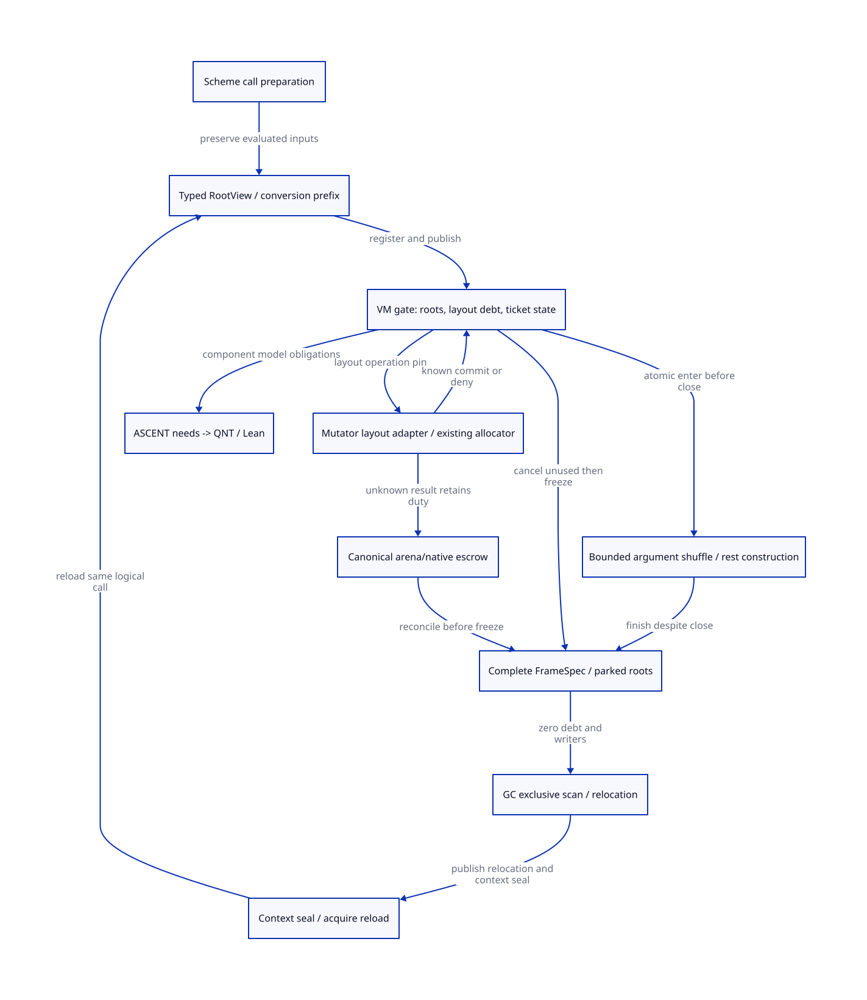

#+TITLE: Modern C Rest Allocator Integration, Complete Caller Roots and Publication
#+AUTHOR: Gambit runtime research
#+LANGUAGE: en
#+OPTIONS: toc:3 num:nil
#+TODO: OPEN | CONDITIONALLY-CHECKED
#+PROPERTY: header-args :eval never
#+STARTUP: overview

* Decision and evidence boundary
:PROPERTIES:
:CUSTOM_ID: rest-allocator-root-publication-decision
:MAINLINE: MODERN-GENERATED-C
:STATUS: SOURCE-AND-C-MEMORY-REFINEMENT-OPEN
:END:

Refactor the Scheme producer and C runtime boundary together. A modern C runtime
consumes CallInputSpec, FrameSpec and a MutatorLayoutAdapter; it does not discover
missing Scheme roots from arbitrary C locals. Preserve evaluation, tail calls,
continuation and C portability while making their layout and custody explicit.

[[file:models/sysml/rest-allocator-root-publication.sysml][SysML]] owns obligations, dependency edges, allocator paths, caller routes, C order
contracts, cost rows and diagram topology. The native =sysml= tool evaluates these
into [[file:rest-allocator-root-publication-matrix.org][the matrix]] and [[file:diagrams/rest-allocator-root-publication.d2][D2]] / . Actual [[file:../../../modeling/ascent/rest-allocator-root-publication.rules.scm][ASCENT rules]] join exact method,
artifact, digest, check and scope; they do not treat file links as proofs.
[[file:../../../../models/gambit/rest_allocator_root_publication.qnt][QNT]] and [[file:../../../../models/gambit/lean/RestAllocatorRootPublication.lean][Lean]] check the stated abstract slices. [[file:../../../../evidence/research/rest-allocator-root-publication/checks.json][The task receipt]] records open source
and native-order duties. The [[file:rest-capacity-preflight-design.org][predecessor]] remains unchanged and unqualified at the C
boundary. No runtime implementation, native test, benchmark or production path
retirement is performed here. An architecture design is not a current allocator.

* Concrete allocator integration
:PROPERTIES:
:CUSTOM_ID: rest-allocator-root-publication-allocator
:END:

** Separate policy thresholds, backing and physical leases

=mem.c:280-306= makes allocation cursors, section identities, free list and RC head
PSTATE fields. =prepare_mem_pstate:4525-4567= derives PSTATE =heap_limit= and
=stack_limit= using approximate free space and fudge, and refreshes interrupts.
These are pressure/detection thresholds. They do not prove a contiguous,
exclusive heap/stack window. Simply raising them to a requested size bypasses
policy and does not create space.

=___heap_limit:7428-7505= recovers fp/hp, may pop a local free msection, or enters
ALLOC_MEM_LOCK and conditionally calls =next_heap_msection_without_locking=.
=next_msection_without_locking:3090-3129= can assign the next arena section or
fall back to sharing; shared heap/stack setters repartition remaining capacity
at =3140-3174,3330-3356=. =prepare_mem_pstate= then publishes new pointers/limits.
Its return 1 requests GC; return 0 reports that this helper completed. Neither is
a physical per-call receipt with complete caller roots.

Select these explicit operations, as design interfaces, not implemented symbols:

#+NAME: allocator-interface-contract
#+begin_example
prepareCallView(callSpec, currentFrameMap) -> RegisteredRootView | KnownError
tryCurrentWindow(view, H, maxStackCoordinates, metadata) -> Lease | NeedLayout
beginLayoutOperation(view, request) -> PinnedArenaTransaction | AdmissionClosed
prepareLayout(transaction) -> KnownAssignment | KnownDeny | Unknown
commitLayoutResult(transaction, result) -> CurrentLayout | RetainedEscrow
tryGrant(view, currentLayout, demand) -> UnusedLease | Denied | AdmissionClosed
enterConstruction(unusedLease) -> ActiveWriter | CanceledOrStale
finishConstruction(activeWriter, completeFrame) -> FrameReady
#+end_example

The current-window fast path must validate checked offsets in each actual C
allocation object, alignment, real metadata, owner, semispace, layout generation
and heap/stack disjointness. Do not subtract/compare pointers across unrelated
msections. A shared section needs one coordinate model and actual simultaneous
FrameSpec stack maximum, not a sum of scalar free counts. No =hp= advance occurs
at grant. Initialized objects advance the ordinary allocation prefix; remaining
lease capacity is accounted once inside the same backing.

** Layout changes have custody even when no grant is issued

The transaction registers a layout-operation debt under the VM gate before using
an allocator path that can change section ownership. It pins the context/root
view/backing and records removed free-list entries, assignment, current section,
known progress and layout generation. The gate is released before allocator
locking or native backing acquisition. Complete assignment under ALLOC_MEM_LOCK,
release that lock, then commit the result under the gate. Do not nest the two
locks, invoke callbacks, run GC, or wait while holding either.

If close wins meanwhile, an already admitted layout operation must settle its
ownership but cannot issue a fresh grant. GC waits outside the locks for this
debt, then acquires the gate to recheck closure. Failure of physical fit after a
known section assignment leaves the section owned/accounted by the context or
VM escrow. It does not imply rewinding a cursor or undoing a free-list pop.
A lost return value retains the canonical transaction; query/reconcile the same
request. Unknown native assignment, owner stop or raw write cannot become denial,
refund or a zero debt by timeout. Such uncertainty can still block GC.

=prepare_heap_msection:3389-3407= reserves chunk markers/first link for the collector
layout; copy branches call it at =3540-3552,3740-3750=. The mutator switch has a
different source sequence. Do not add this call blindly or reuse collector chunk
size as a mutator rest bound. The selected MutatorLayoutAdapter must prove where
its live prefix, link/markers and guards actually are for each supported mode.
Handles and alternative layouts remain unqualified until that adapter closes.

** What must be covered by layout exclusion

Audit owner-private local free-list reuse; global section assignment; both
heap/stack sharing setters; stack limit migration/recycling; GC flip/reset;
context preparation and resize; cleanup; and every helper that refreshes PSTATE
limits/cursors. A gate around only ALLOC_MEM_LOCK misses local and GC paths.
The current source does not implement this unified admission domain. Existing
native backing growth is not demonstrated to be the same as =___heap_limit=;
allocator-native acquisition must retain its own result/rollback provenance.

* Complete roots at the three actual producers
:PROPERTIES:
:CUSTOM_ID: rest-allocator-root-publication-callers
:END:

** Dynamic apply: hand-written embedded C is a producer

=_kernel.scm:2989-3060= performs a Scheme wrapper splice, enters local =app=,
then embedded C pops proc/args, pushes CARs while advancing CDR, enforces the
8192-argument limit, loads registers and jumps. =not interrupts-enabled= does
not make arbitrary new allocating helpers safe. Insert a mapped preparation
helper before =POP_ARGS2=, after the original wrapper splice. Retain exact proc,
post-splice spine, continuation/denv and staging progress in updateable slots.

The retained generated =lib/_kernel.c:19385-19445= shows a POLL and mapped label
before that embedded block, followed by raw POP/PUSH and dispatch. It corroborates
the producer shape, not a newly compiled current-profile execution witness.

A stable-input profile may count then expand. General mutable input must not
silently use this two-read algorithm: single-read staging needs a rooted source
cursor and initialized element prefix at every collecting growth point, original
CAR/CDR observation/error order and argument-limit rollback semantics. Rooting
the original spine alone does not freeze its contents. Its qualification remains
open; this model does not prove arbitrary concurrent Scheme list mutation safe.

** Direct calls: prepare a logical region, not a late C macro

=_front.scm:3370-3705= evaluates/saves slot arguments, evaluates register operands
with spills, reloads registers, adjusts slots, seals the block and emits
=make-jump=. Helpers =save-opnd-to-reg/save-opnd-to-stk:3780-3830= preserve liveness
through copies. =_gvm.scm:466-473= carries jump frame/target/return/nargs/poll/safe.
=_t-c-2.scm:631-640,675-681= dispatches copy/jump independently;
=targ-gen-jump:1318-1405= can write R0, inline, check, adjust the stack and dispatch.

Consequently there is no existing universal producer cut named "all arguments
have been evaluated but no destructive placement has occurred". Add a Scheme
CallPreparation region with per-evaluation location maps and a final complete
view, followed by a certified noncollecting commit/move schedule. Existing copies
may be reused if their certificates cover every live input and original
continuation; they need not all be replaced by extra copies. A late backend-only
reservation is not evidence of that certificate. Keep the actual selected
evaluation order and exceptions; spilling a reference is not reevaluating it.

The final grant follows every possibly collecting check and precedes the commit
interval. Preserve late-bound global lookup timing: use a target-independent
capacity envelope when necessary, or stage a target only at its original allowed
read point. Do not move an observable lookup across a GC callback or reread it
on capacity retry. Local/inlined calls need their own shape/effect certificate;
not every call reaches generic rest construction. =targ-gen-label-entry:718-774=
selects GET_REST versus GET_REST_KEY/GET_KEY_REST/GET_KEY and wrong-arity handling;
this study qualifies only the selected ordinary-rest demand, not every optional
or keyword entry.

** Native SFUN: roots begin before marker creation

=_ptree2.scm:2902-2930= prioritizes SCMOBJ parameters during conversion;
=3145-3187= emits the SFUN_ARG loop after conversion. However,
=BEGIN_SFUN* in gambit.h.in:10043-10059= creates a marker before that conversion.
=c_intf.c:6509-6546= explicitly notes that proc_or_false may have been collected
by marker allocation. Therefore protecting only the final converted arguments is
too late. First require an ingress origin: registered RootHandles or a still-live parent
RootView borrow/epoch pin that protects the incoming values until child-view
registration commits. A bare movable SCMOBJ parameter cannot be made safe
retroactively by acquiring a mutex: GC could relocate it before registration,
including while that mutex is being acquired. Handle-only callers may wait with
handle identities and resolve/reload them only after the required admission;
parent-borrow callers must keep the parent duty alive until child membership
accepts it. Reject unknown/raw origins from the managed profile. This is an
additional caller/ABI duty, not a proof that all current SFUN uses are broken.

With that origin established, publish an activation-bound, nonallocating initial descriptor for proc,
all incoming SCMOBJ parameters and the original control state before marker
allocation. Metadata exhaustion at this point must fail without first collecting
unregistered values. Scalar native parameters are not Scheme roots; pointer
parameters need typed lifetime/borrow descriptions.

Converting one argument can allocate and relocate previously converted values.
The conversion view therefore carries an initialized prefix and rooted temporary
results at every conversion safepoint, not just at =SFUN_CALL=. Current raw C
locals are not automatically included in =mark_registers= or =mark_saved=.
Existing RC head is PSTATE-local, while =mark_rc= is called in the processor0
branch at =mem.c:6845-6858=. It cannot be the assumed universal nonzero-owner
RootView scanner. Add an explicit all-admitted-context scan/update adapter.

Only after all admitted conversions, cleanup plans and collecting checks complete
may the runtime grant the final noncollecting window before the first SFUN_ARG.
That macro writes =PSSTK(FRAME_SPACE(2)+i)= directly; =setup.c:3276-3360= documents
that arguments already exist when =___call= creates its return frame. Never insert
a collecting reserve in that gap. Keep the native activation/catcher alive until
normal return or the selected terminal exit. Nested callbacks register distinct
views and leases; arbitrary raw reentry, allocating cleanup inside commit or
unknown converter effects must reject this profile.

* C publication and GC arbitration
:PROPERTIES:
:CUSTOM_ID: rest-allocator-root-publication-order
:END:

** Select a coherent control domain

Use one short VM control mutex as the baseline proof domain for membership,
OPEN/CLOSING, layoutOps, unused/active lease transitions and snapshot pins.
Its implementation must provide acquire/release semantics. This is a correctness
baseline, not an assertion that a single VM mutex is the final scalable design.
Owner-private root/heap fields remain ordinary C only while ownership excludes
conflicting accesses. Optimizing to per-context gates or packed CAS requires a
new membership-close/refinement proof. No per-CONS atomic is required by this
selected design.

Grant publication does not authorize entry. Entry acquires the gate and atomically
validates OPEN and the full identity while claiming ACTIVE. GC close sets CLOSING
in that same domain before waiting. If entry wins, bounded noncollecting
construction drains to a full frame; if close wins, unused tickets are canceled.
Checking OPEN with an acquire load and incrementing a separate active counter
later leaves a gap even when both accesses are atomic. A stale grant reply cannot
supply the missing claim. Pin the registry object before dereferencing it; serials
do not protect freed storage.

** Registration is not freezing

Publishing a fully initialized root descriptor makes it a member whose custody
GC must close. A parent/root ingress pin must cover the interval before this
registration; initial C slot writes alone do not create that pin. It does not let
an independent worker scan slots concurrently with
the owner, argument conversion, native borrowers or partial frame stores. A root
freeze requires: closed future entry; no active constructor; no layout operation
or unknown result; full mapped frame/initialized conversion state; excluded raw
borrowers; stable activation and scan pins. Collector writes relocations only
while that view is exclusively frozen. Preserve this separation in the model.

#+NAME: publication-happens-before-chain
#+begin_example
root slot/map initialization -> root membership unlock-release
  -> gate acquire on registration/closure observation
last constructor stores + initialized hp prefix + complete frame
  -> PARKED unlock-release -> collector gate lock-acquire -> scan/update
collector relocation + context-ready completion
  -> resume-seal release -> owner acquire -> reload each root -> new grant/use
#+end_example

The first chain alone does not order later mutable root writes. The PARKED chain
and exclusive freeze supply that later ordering. Resume notification without
context preparation and root reload is insufficient. Descriptor/ticket recycling
also requires no collector snapshot reader, query pin, native borrower, pending
terminal acknowledgement or unknown transaction; publication ordering is not a
reclamation protocol.

=gambit.h.in:6802-6803= selects W_ALL/R_ALL register-state macros. These are not
the new root membership/freeze protocol. Existing lock variants at =6190-6283=
and __sync barriers at =11015-11026= require concrete profile qualification;
plain volatile access does not establish the proposed ISO C synchronization.
The study does not classify every current implementation as broken: it refuses
to import unproved target assumptions into the new modern C contract.

* Failure custody and migration order
:PROPERTIES:
:CUSTOM_ID: rest-allocator-root-publication-custody
:END:

1. Generate CallInputSpec/location and per-conversion root plans, including original
   continuation/denv, marker/proc, native result/cleanup backing and nested views.
2. Introduce the all-context root scan/update adapter and membership/freeze pins.
   Reuse existing register/frame traversal only with explicit location coverage.
3. Add layout transaction and MutatorLayoutAdapter over existing allocator paths.
   Cover local reuse as well as global assignment/reset; register all layout writers.
4. Introduce coherent grant/entry/close control and noncollecting commit certificates.
   A failure before grant can collect from the mapped view; a partial commit cannot.
5. Preserve old generated/raw paths for unqualified profiles until actual source,
   layout and C-order obligations pass. Route managed callers directly through the
   new contract; do not stack an extra advisory wrapper over unchanged raw stores.
6. Retire per-CONS helper calls only inside qualified leases, raw SFUN_ARG producer
   assumptions only after the typed commit writer owns that route, and implicit
   call-root reconstruction only after the generated location plan is complete.

Known pre-layout denial retains logical roots and original cursor. Known denial
after assignment retains roots and a new current layout; rematerialize cursor
state. Unknown assignment/entry/stop keeps canonical duty and backing until a
real settlement, never speculative rollback. Unused ticket invalidation precedes
GC/layout reset; active constructors drain. After collection reload the same
logical call, never reevaluate operands. A completed rest packet needs fresh
execution authority, not another initialization ticket. Multi-shot continuation
may recreate semantic call preparation, but must not clone a linear physical lease.

* Quantification and remaining gates
:PROPERTIES:
:CUSTOM_ID: rest-allocator-root-publication-benefit
:END:

The native SysML projection imports the predecessor's no-handles four-argument
budgets: 14/12 words, 112/96 bytes at 64 bits, and the conditional 65533-word fresh
half candidate. Physical adapter qualification remains open. A full msection
payload is 1MiB at 64 bits. Root maps, headers, metadata, allocator batches, stack
backing and RSS are separate. Staging n values adds approximately n*wordBytes
payload plus its representation and roots; free slack in existing backing must
not be counted twice as a second physical allocation.

Saved rest checks/helpers (up to k in the selected handler loop) must outweigh
root materialization, staging, gate contention and required safepoint pressure
work. A no-GC interval adds bounded constructor work to GC response latency;
unknown native/owner outcomes have no proved bound. Whole-round peak is the
maximum over time of unique backing plus separate root/staging/native escrow
storage, not a sum of capacity grants. Neither net peak reduction nor a speedup
is established. The matrix records conditions and falsifiers without person-days.

** Model scope and counterexamples

QNT covers one abstract control domain, caller route profiles, a layout operation,
known/unknown denial, close versus enter, root freeze, one relocation/reload and
14-word completed construction. It assumes linearizable gate operations and
complete roots. Named unsafe controls retain publication-without-HB, scan during
layout/partial construction, unknown refund, layout ABA, root drop, missing
resume ordering and split entry/close. It is not a C weak-memory litmus model,
a weakly fair termination proof or an exhaustive arbitrary-caller simulation.

Lean checks conditional gate invariants and composes explicit HB premises. Its
Step relation covers publish/close/finish; other transition lemmas and C source
simulation remain distinct. A further source-level counterexample is bare native SCMOBJ ingress -> GC
relocation before registration -> publish a stale slot; root publication cannot
repair it. RootHandle/parent-pin qualification is an explicit ARP-NATIVE premise,
not a QNT-checked arbitrary native-entry theorem.

Actual C reads-from, lock adapter, object provenance,
all writers and cleanup/exception coverage must still be supplied. Initial model
authoring diagnostics are retained: one negative control exposed a missing
resume-HB distinction; Lean case binders were corrected. These are modeling/tool
diagnostics, not observed Gambit native defects.

* Standards and research evidence
:PROPERTIES:
:CUSTOM_ID: rest-allocator-root-publication-references
:END:

- [[https://www.open-std.org/jtc1/sc22/wg14/www/docs/n1570.pdf][WG14 N1570]], sections 5.1.2.4, 6.5.6, 7.17 and 7.26: use happens-before,
  synchronization, C object bounds and data-race rules to constrain the proposed
  adapter. This is a named C11 draft baseline, not an assertion about every later
  standard revision. Release/acquire must have the required synchronization
  relationship; unrelated atomic variables do not automatically provide one
  coherent admission decision. Racy non-atomic roots are not repaired by volatile.
- [[https://www.cs.kent.ac.uk/pubs/2009/3128/content.pdf][Baker, Cunei, Kalibera, Pizlo and Vitek, Accurate Garbage Collection in
  Uncooperative Environments Revisited]], sections 3-5: explicit root support and
  compiler cooperation are relevant to the location-plan design. The paper's
  evaluated setting does not establish Gambit SMP, tail-call or continuation
  correctness; none of its performance figures is transferred to this design.
