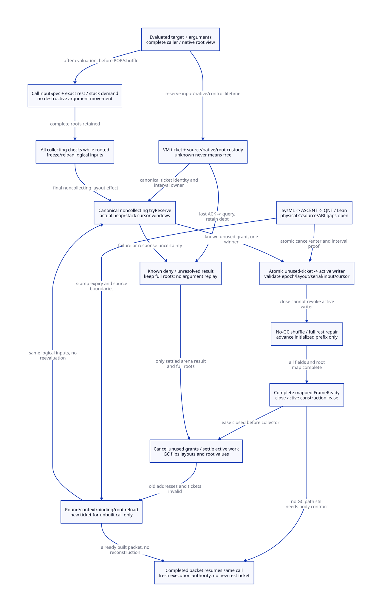

#+TITLE: Modern C Physical Rest Capacity, Caller Preflight and Ticket Reissue
#+AUTHOR: Gambit runtime research
#+LANGUAGE: en
#+OPTIONS: toc:3 num:nil
#+TODO: OPEN | CONDITIONALLY-CHECKED
#+PROPERTY: header-args :eval never
#+STARTUP: overview

* Decision and authority
:PROPERTIES:
:CUSTOM_ID: rest-capacity-preflight-decision
:STATUS: SOURCE-AND-NATIVE-ORDER-REFINEMENT-OPEN
:MAINLINE: MODERN-GENERATED-C
:END:

Make rest reservation a typed modern C allocator/root protocol generated from a
Scheme CallInputSpec and FrameSpec. A physical ticket is an exclusive, ephemeral
cursor-window capability, not a byte count, a compiler reserved counter, an
advanced heap pointer, or a Scheme continuation value. It is issued only while
all logical call inputs and the original continuation have a complete root view.

The selected interval starts before the first destructive argument expansion and
first rest CONS. Existing calls do not issue this ticket. Three producer routes
need distinct generator changes; source placement and C allocator refinement remain
open. No runtime implementation or native test is performed in this study.

[[file:models/sysml/rest-capacity-preflight.sysml][SysML]] is the semantic authority for model needs, dependencies, source routes,
custodians, caller/cost rows, physical budget equations and diagram topology.
Native evaluation projects [[file:rest-capacity-preflight-matrix.org][the matrix]] and [[file:diagrams/rest-capacity-preflight.d2][D2]] / . Actual [[file:../../../modeling/ascent/rest-capacity-preflight.rules.scm][ASCENT DSL]]
checks method/artifact/digest/scope and dependency conjunctions. [[file:../../../../models/gambit/rest_capacity_preflight.qnt][QNT]] explores
bounded reservation/failure/GC histories; [[file:../../../../models/gambit/lean/RestCapacityPreflight.lean][Lean]] checks conditional interval,
stamp, initialized-prefix and lifecycle laws. [[file:../../../../evidence/research/rest-capacity-preflight/checks.json][The receipt]] keeps model evidence
separate from source/ABI admission. The [[file:rest-frame-park-cut-design.org][prior full-frame park cut]] is preserved;
its selected source and ordering premises remain open.

* Physical budget: move the start point before the first CONS
:PROPERTIES:
:CUSTOM_ID: rest-capacity-preflight-budget
:END:

The real generic handler in =lib/_kernel.scm:491-590= reads na/np, pushes register
arguments, CONS'es excess arguments, and on need-GC completes the list and a vector
before entering the mapped helper frame. The earlier study's Brepair started after
the checked CONS. Caller-side preflight must include every rest pair:

#+NAME: caller-preflight-word-equations
#+begin_example
k = na - np + 1                       (valid rest shape; np includes rest slot)
pairWords = 2 + PAIR_BODY
Hcaller = k*pairWords + np + VECTOR_BODY
BrepairAfterFirstCons = Hcaller - pairWords
#+end_example

For four actual arguments, no handles: zero required gives np=1,Hcaller=14 words;
one required gives np=2,Hcaller=12. At eight-byte words these are 112B and 96B,
compared with the inherited 88B/72B remaining-work examples. Handles use body prefix
two and yield 19/16 words. These are source macro-profile data words, not actual
allocation success, new net memory overhead, pages or RSS. The packet may be
unused on a no-GC fast route; reserve is an envelope, not forced initialization.

=lib/mem.c:3315-3325,3395-3407= selects a tospace half, reserves two terminal marker
words, writes its first link word and starts the data chunk. With section size
131072 words from =lib/mem.h:63-71=, a fresh, separately owned heap half has a
candidate data capacity of 65536-2-1=65533 words. Under max arguments 8192 and valid
np>=1, the heap-only rest envelope is at most 24578 words without handles or 32771
with handles. SysML evaluates these inequalities for 4/8-byte word profiles.

This establishes arithmetic feasibility in a fresh separate half, not a ticket
issuer. Existing live objects, actual section availability, alignment/header mode,
copying/worker capacity and stack demand remain separate. A fresh whole msection's
payload is 131072*wordBytes: 1MiB at eight-byte words. Assigning an existing pool
section adds no new payload allocation; growing the backing pool can add a whole
section or allocator-selected batch. Neither is the small Hcaller byte count, and
neither is a measured RSS change.

* Actual heap/stack interval contract
:PROPERTIES:
:CUSTOM_ID: rest-capacity-preflight-physical
:END:

#+NAME: physical-ticket-contracts
#+begin_example
CallInputSpec = (logical call/continuation branch, target resolution mode,
                 exact evaluated input handles or stable staged argument packet,
                 na/shape, input generation, caller FrameSpec, resume/exit plan)
CapacityRequest = (CallInputSpec identity, heap envelope, stack-demand coordinates,
                   root/control metadata capacity, expected owner/epoch/layout)
RestCapacityTicket = (canonical request/ticket serial, VM/owner/context incarnation,
                      collection epoch, msection identity + semispace/layout,
                      actual heap [lo,hi), stack [lo,hi), expected hp/sp,
                      demand/input/FrameSpec identity, unused/active/closed state)
FrameReady = (initialized allocation prefix, complete packet/continuation map,
              released construction writer and retained roots/native backing)
#+end_example

Use actual offsets inside one validated allocation/layout object, checked sizes
and alignment. A ticket requires enough heap words, enough stack words, no overlap
and no outstanding conflicting allocation capability. If heap and stack share a
section, enforce heapHi<=stackLo with the required guards. Independent scalar free
counts are insufficient. =lib/mem.c:3140-3174,3330-3356= repartitions shared limits
with fudge and a quarter/three-quarter split; the same address range cannot be
promised to both roles. Precise stack demand is the maximum simultaneous coordinate
extent of outgoing arguments, current continuation and helper/native return frames,
not an unqualified sum of frame sizes from different phases. Each caller FrameSpec
must supply this proof. The earlier eight-word helper specimen is not that proof.

=alloc_mem_lock= protects selected msection operations, not the complete call grant
lifecycle. Rebuild a shared canonical reservation registry/allocator-owner protocol.
A fast candidate leases current data slack without advancing hp. A slow noncollecting
candidate can assign an owned section or return known denial. Its actual helper/
OS-allocation effect and unknown-result closure must be qualified. Do not call a
collecting allocator while holding an arena/GC-critical lock.

=lib/mem.c:3238-3270,3395-3407= and the CONS/vector macros inform the selected
initialized-prefix contract. Advancing hp over an uninitialized reservation is
not itself a layout/root-safety proof. This profile avoids needing a new sparse-gap
or filler-object contract; it does not assert that every unreachable gap in the
current source heap is automatically scanned or is an observed native bug. Instead:

1. Record an exclusive cursor window while hp remains unchanged.
2. After the atomic unused->active claim, permit only the generated bounded
   no-GC/no-managed-reentry shuffle/repair sequence. No competing allocator may
   consume this window; no old heap_limit or stack migration may change its layout.
3. Write complete objects, then advance hp by their actual words. The same record
   tracks initialized used words and unused reservation, with used+unused=budget.
   Global allocation pressure must not count both the whole grant and committed
   hp growth as separate consumption.
4. At full FrameReady, close the construction lease and release only unused
   capacity. Do not refund initialized objects or rewind hp after their publication.
   Existing packet/stack/root backing remains live through GC and overflow handling.

The chunk-limit checks at =lib/mem.c:3540-3623,3740-3800= belong to collector
copying/publication paths. Do not silently treat MSECTION_CHUNK as a hard mutator
rest-loop limit, or subtract a copying-chunk link after every fixed number of
mutator pairs without proving the role mapping. The handles copy path also has
an allocation TODO at =3540=: handles budget profiles here are arithmetic, not
collector/backend admission.

Chunk links/markers are outside Hcaller data words. A plan spanning chunk/msection
transitions must describe and reserve those actual transitions. The chosen first
profile uses one contiguous data window, or refuses the grant. This is a semantic
layout choice for current bump macros, not a proof that arbitrary fragmented
segments can be substituted for one contiguous range.

* Three caller-side issuance positions
:PROPERTIES:
:CUSTOM_ID: rest-capacity-preflight-callers
:END:

** Dynamic apply: before POP_ARGS2 and outgoing argument expansion

=lib/_kernel.scm:2989-3060= has a Scheme wrapper that may splice its own rest list,
then calls local app. The inline C immediately POP_ARGS2(proc,args), walks the
list while PUSH'ing cars, counts na, restores argument registers and jumps target.
The >MAX_NB_ARGS branch removes pushed arguments and invokes the existing error
route. A reserve that can GC inside this loop is too late.

Introduce CallInputView at the Scheme app boundary after original evaluation and
wrapper splice, before those pops/PUSHes. It roots proc, input list or staged
arguments and caller continuation in a complete described view. A denied reserve
can collect, reload these cells and retry the capacity operation without repeating
argument expressions, redoing the wrapper splice or starting the target procedure.

Counting before expansion introduces an extra O(n) pass. It is equivalent only
with a qualified immutable/unshared or version-stable input spine. General mutable
input needs a scan-safe, single-read CallArgPacket builder recording exactly the
values/continuations selected in the original read order. Staging must root its
initialized prefix, pending spine and target before any growing allocation; it
cannot turn a partially filled ordinary vector or raw outgoing stack into a GC
view. This adds O(n) storage/read-copy work, and is not implemented/proved here.
Improper/cyclic inputs, concurrent mutation and original error ordering require
explicit refinement; do not invent an eager validation policy and call it equivalent.

** Direct calls: before destructive moves, not merely before the jump instruction

=gsc/_gvm.scm:466-473= carries target, return, nargs, poll and frame in jump IR.
=gsc/_t-c-2.scm:1316-1390= can overwrite R0 or move its destination, run block checks,
adjust the stack, then inline/jump to local, known, global or generic targets.
=1120-1143= uses compile-time reserved counters to emit checks; those counters do
not own physical storage. =2490-2499= emits stack adjustment.

Scheme semantic completion must produce a pre-shuffle CallInputSpec from the
existing logical operands/continuation, before their earliest destructive move.
Perform every collecting/interrupt check with that complete view. Final physical
tryReserve then precedes a noncollecting grant-consume/shuffle/entry interval.
Reinserting the old POLL after grant invalidates this contract unless it cancels
and returns to the complete view first. Exact GVM move-scheduling and all direct/
inlined call placements remain source-refinement obligations.

Preserve target resolution timing. A first-class proc value or immutable direct
code target can be rooted once. A global target may be resolved at the original
final JUMPGLO operation; hoisting its read before a collecting callback can select
a different procedure. For late-bound calls, a target-independent capacity envelope
based on na and the allowed representation can preserve that lookup point. The
actual target/arity is then checked noncollectingly at consumption. If a slower
resolved-target branch is required, root the already selected value rather than
reread the global cell. The model's already evaluated target premise does not prove
general late-binding equivalence. Avoid charging generic rest work to specialized
calls that already construct arguments directly or bypass rest handling.

** Native entry: rooted conversion staging before SFUN_ARG and ___call

=gsc/_ptree2.scm:2902-2930,3145-3187= converts parameters, then emits outgoing
SFUN_ARG stores before SFUN_CALL. =include/gambit.h.in:10043-10071= allocates a
marker at BEGIN and writes raw outgoing stack slots. =lib/setup.c:3276-3360=
explicitly assumes the C caller has already placed arguments before ___call builds
the return-to-C marker frame. A collecting reserve inserted there has no automatic
complete view of arbitrary converted C locals/outgoing slots.

Generate a typed NativeCallInputView/root frame before raw stores, protect the
procedure before marker allocation, retain the same native invocation/catcher,
convert under explicit rooted ownership, and sign capacity before raw outgoing
movement. =lib/c_intf.c:6509-6564= still has a marker input-root TODO. The all-domain
native/RC adapter and conversion/error/cleanup source proof remain open. A known
capacity denial can use only the origin's rooted failure/retry/exit contract; do
not return invented pending success or enter a Scheme error handler over an
unframed outgoing stack. Original C result ABI and synchronous Tcl semantics stay
binding.

* Failure custody, GC invalidation and reissue
:PROPERTIES:
:CUSTOM_ID: rest-capacity-preflight-lifecycle
:END:

Grant, cancel-unused, begin-construction and GC/layout closure share a canonical
arbitration state. A lost reply does not decide which operation won.

| State | Custody and admissible transition | Forbidden shortcut |
|---+---+---|
| Known deny before movement | Complete CallInputView and original cursor retained; collect/error/retry at this full view | GC from inside a partial outgoing stack |
| Granted, ACK lost | VM retains unused ticket/range; source retains roots and queries same request | Make a duplicate reservation or guess denial |
| Close wins before begin | Canonically cancel unused grant; stale later success reply cannot authorize entry | Begin using a cached successful response |
| Begin wins before close | Construction writer remains counted; finish bounded repair and full frame, then close lease | Clear active count or reclaim range on cancellation request |
| Native arena result unknown | Keep request, backing and transaction debt until actual outcome is known | Timeout becomes denial/refund |
| Layout/GC readiness unknown | Keep canonical custody and full roots; refuse new cursor permission | Notify means prepared context |
| Known GC completion | Reload roots/context, recompute or validate input plan and acquire fresh physical ticket for unbuilt call | Reuse old epoch/layout/serial or reevaluate operands |
| Packet constructed before GC | Retain packet roots; obtain fresh execution authority and follow nargs=-1 resume | Acquire a second repair ticket and rebuild rest |

=lib/mem.c:3413-3450= flips tospace and resets per-PSTATE free list, section/cursor
and chunk queues. =7428-7505= may change heap msection even without GC;
=7115-7208,7380-7388= can migrate the stack/recycle sections. Thus tickets bind
both collection epoch and allocator-layout incarnation, plus owner/context,
serial, input/shape and expected cursor. Same address or processor number is not
identity. Counter/identity wrap and arbitrary repeated collections need their own
lifetime proof; this model covers one collection and a bounded serial history.

Unused grants close before GC. Pending arena transactions need a known settled
outcome before their layouts can reset. An active partial constructor cannot cross
the collection cut: finish initialized packet/full frame and close the writer first.
Unknown stop or raw in-flight stores can therefore still block GC; no universal
progress or owner-death recovery is claimed.

After full round/capacity outcome, prepare context, bind the exact live owner and
reload relocated CallInputView cells. Reissue against the current actual intervals
with a fresh serial/epoch/layout; a stale old reply/refund must not modify that new
record. The already-built packet follows the prior fresh-execution protocol instead
of reacquiring construction capacity. Source notification precedes prepare_mem_pstate
at =lib/mem.c:7003-7085=, so a GC interrupt is not issuance authority.

CallInputSpec is semantic data; a capacity capability is linear allocator state.
A captured Scheme continuation must not clone an unused/active physical ticket.
All collecting/callback-capable checks precede the final grant, and capture/restore
at an admitted complete view produces a new continuation-branch identity and new
physical request where semantically appropriate. This preserves legitimate Scheme
multi-shot behavior rather than confusing it with a duplicate reservation response.
The bounded model covers one continuation branch; native return markers still
constrain return to an already exited C invocation.

* Model and source refinement map
:PROPERTIES:
:CUSTOM_ID: rest-capacity-preflight-refinement
:END:

| Design/source transition | QNT | Lean / remaining obligation |
|---+---+---|
| Complete logical input staging | prepareView | Complete caller/native roots are a source premise |
| Canonical request / known denial | request/deny | Full roots and cursor preserved; actual helper effects open |
| Actual disjoint window grant | grant/observe | Fits/Physical interval laws; source offset/ownership mapping open |
| Lost response / cancel versus enter | loseResponse/query/cancelUnused/enter | Ticket identity and conditional lifecycle; full C linearization open |
| Initialized-prefix writes | cons/pack | used/initialized/hp preservation and used+unused=budget |
| Full frame and writer closure | makeFrame/closeLease | finish requires completion; imported FrameSpec proof remains open |
| GC/layout invalidation | collect/reassignLayout | Live tickets cannot cross collection; same-epoch layout stamp exclusion |
| Relocated roots and retry | prepareContext/bindOwner/reloadRoots/request | New stamp, no operand reevaluation; actual caller restore proof open |
| Completed packet/body entry | resumeBody | No second construction; subsequent target-body safe points outside scope |

The QNT finite geometry uses offsets inside [0,64), actual four-rest-argument heap
budget 14, and a conservative example stack request 12. That stack value is not an
actual caller FrameSpec proof. Dynamic/native initializer profiles are simulated;
a direct route has a named positive history. Offset reuse demonstrates stamp
checks, not observed reuse of a native raw address. Source root/staging/representation
and coherent C atomics remain premises. Body entry is terminal: later target-body
GC needs a new safepoint/root contract. A retained wider-transition trace exposed
that scope mismatch; it is not discarded or relabeled as runtime failure.

Lean proves interval/disjointness and word arithmetic, stale epoch/layout/serial/
input rejection, initialized-prefix ticket/root State Step/Trace preservation and
budget partition. It does not model every QNT action, actual msection allocation,
late binding, arbitrary mutable staging, continuation branching or native ABI.
SysML native validation/evaluation does not prove its requirement instances.
ASCENT leaves all source/C-memory needs open and retains missing-history,
wrong-scope, stale-digest and synthetic all-scoped controls.

* Work, peak-memory matrix and retirement
:PROPERTIES:
:CUSTOM_ID: rest-capacity-preflight-benefit
:END:

The candidate whole-window contract can remove lease-internal per-CONS heap-limit
checks and raw msection-switching calls. Current code checks a prefix j with
1<=j<=k before either completing normally or entering its unchecked repair tail.
A qualified whole envelope needs one initial grant validation and a full-frame
pressure/safepoint decision, with pending GC honored before entry or at FrameReady.
These are logical operation counts, not equal-cost machine instructions or a
measured speedup. Native root staging, dynamic counting/copying, atomics and
retention can outweigh the saved comparisons. Capacity safety cannot suppress
GC requests indefinitely; the no-GC region is bounded by the admitted plan.

#+NAME: capacity-work-and-peak-law
#+begin_example
Positive CPU benefit iff removed baseline check/helper work > new preflight,
 root/staging, arbitration and completion-poll work
OccupiedData = initialized used words
UnusedReservation = grantedBudget - used words
LogicalBudgetCharge = OccupiedData + UnusedReservation (no double charge)
Peak = max_t(H(t)+P(t)+N(t)+Q(t)), unique physical backing once
#+end_example

H is managed backing, P protocol pools, N native backing and Q separate retained/
quarantined backing. Existing free sections can be reused without allocating a new
physical payload, while reservation still reduces available slack. Pool growth,
separate stack sections, O(n) staging and longer native/root/code retention can
increase peak. Unknown arena/stop outcomes may retain backing indefinitely.
No physical net peak reduction, RSS number or end-to-end speedup is established.

Migration first generates CallInputSpec and exact failure/root-view cuts for the
three producers. Next rebuild the allocator/root registry with actual disjoint
range ownership and initialized-prefix accounting. Then integrate cancel/enter/GC
closure, context reload and Scheme continuation/native exit plans. Retire admitted
raw partial-frame reserve calls, lease-internal heap_limit/POLL, unrooted native
outgoing stores and scalar-free-space-as-ticket assumptions only after equivalence
and source/C-order/ABI qualification. Keep useful CONS, W/R and nargs=-1 semantics.
Zero production paths retire here; this is C runtime/generator restructuring,
not a toolchain configuration selection. No Zig-specific removal of the necessary
support work has been demonstrated.

[[https://ocaml.org/manual/5.2/intfc.html][OCaml's C interface]] supplies the ownership lesson: registered roots can move,
managed accesses require runtime ownership, and ownership transitions may themselves
run callbacks. Gambit must additionally preserve its argument layouts, target
resolution, proper tail calls and native catcher chain. [[https://cs.brown.edu/people/mph/HerlihyW90/p463-herlihy.pdf][Herlihy and Wing]] supports
the canonical grant/cancel/enter versus reply distinction; a C linearization proof
is still required. Neither source supplies a ready Gambit allocator or performance
result. No runtime implementation, native tests, version naming or person-day
estimate is part of this study.
