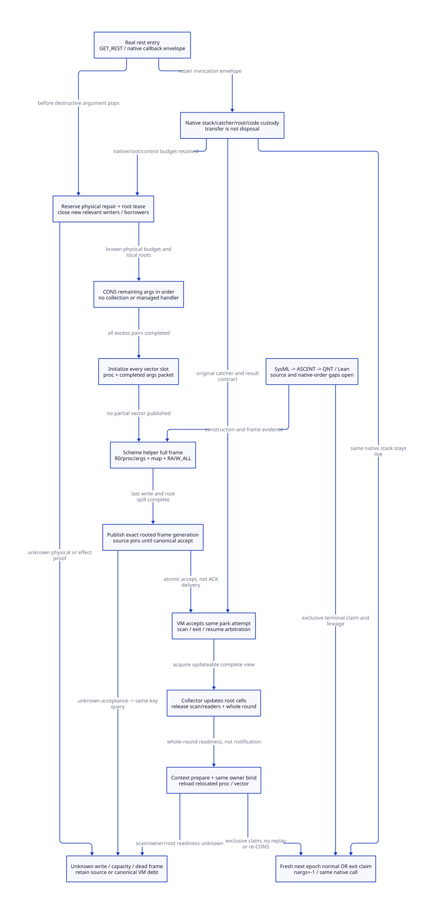

#+TITLE: Modern C Rest Construction, Full-Frame Park Cut and Same-Call Resume
#+AUTHOR: Gambit runtime research
#+LANGUAGE: en
#+OPTIONS: toc:3 num:nil
#+TODO: OPEN | CONDITIONALLY-CHECKED
#+PROPERTY: header-args :eval never
#+STARTUP: overview

* Decision: complete the real rest protocol before signing park
:PROPERTIES:
:CUSTOM_ID: rest-frame-park-cut-decision
:STATUS: SOURCE-AND-NATIVE-ORDER-REFINEMENT-OPEN
:MAINLINE: MODERN-GENERATED-C
:END:

Use the existing finish-before-collection shape as the modern C semantic baseline.
Turn its hidden no-collection zone, argument/pair ownership, physical repair budget,
complete frame map and resume sentinel into generated contracts. Do not certify a
partial argument stack merely because W_ALL ran. Do not invent a second native
invocation to recover the first one after GC.

Scheme owns a RestConstructionPlan: target/arity semantics, pair order, complete
packet, FrameSpec/PointId, overflow retry, continuation and exception exit plan.
Typed modern C owns physical reservation, construction/root/native leases,
writer/borrow admission, canonical park acceptance and scan/normal/exit arbitration.
This strengthens the C backend and permits collector-worker separation without
sacrificing Scheme tail calls or native return identity. Zig would need the same
contracts; no language-specific reduction of necessary runtime work is shown here.

[[file:models/sysml/rest-frame-park-cut.sysml][SysML]] is the authority for needs, dependency edges, source routes, custody,
caller/cost rows, repair equations and diagram topology. Native SysML evaluation
projects the [[file:rest-frame-park-cut-matrix.org][matrix]] and [[file:diagrams/rest-frame-park-cut.d2][D2]] / . Actual [[file:../../../modeling/ascent/rest-frame-park-cut.rules.scm][ASCENT DSL]] joins method,
artifact, digest, scope and dependencies. [[file:../../../../models/gambit/rest_frame_park_cut.qnt][QNT]] checks bounded interleavings and
argument order; [[file:../../../../models/gambit/lean/RestFrameParkCut.lean][Lean]] checks conditional conservation and authority induction.
The [[file:../../../../evidence/research/rest-frame-park-cut/checks.json][receipt]] distinguishes those checks from source/native admission. The
[[file:participating-park-root-view-design.org][prior participating-park study]] and its scoped gaps remain unchanged.

* Actual sources and real callers
:PROPERTIES:
:CUSTOM_ID: rest-frame-park-cut-source
:END:

** Concrete Scheme function and retained generated entry

=vendor/gambit/tests/mix.scm:703-706= contains =(define (f3 . a) (list a))=;
=775-782= calls it with zero through four arguments. Retained expected C in
=tests/test5.ok:15745-15772= contains =GET_REST(0,0,0,0)= for its generic entry.
This is a real function and consumer specimen, not a fabricated benchmark.
Neither source inspection nor an expected-output file proves that this host ran
that code or that every optimized direct call uses its generic entry.

=examples/tcltk/test.scm:9-33= supplies a real native-envelope composition: button
commands use the =make-setter= closure, whose body calls variadic =tcl= with four
arguments. =tcltk.scm:572-593= exports procedure command arguments; =124-175,
221-228= invokes them through =scheme_call_cmd -> tcltk_call -> apply=. The body
then calls =tcltk#tcl command . args= at =673-674=. Its shape is one required
argument plus three rest arguments. The original native callback remains live
while that Scheme computation may enter rest handling and later call Tcl again.

This is source-reachable composition with a conditional generic-rest/heap-limit
branch. Inlining, direct-call specialization and actual heap pressure can bypass
it. No native execution, forced slow path or Tcl lifecycle qualification is claimed.
The f3 specimen establishes the generic emission separately; it is not relabeled
as a recorded Tcl-generated binary.

** Generator and ordinary entry

=gsc/_t-c-2.scm:718-772= selects GET_REST from required/optional/rest metadata.
=include/gambit.h.in:8176-8178= writes the target entry into temp1 and invokes
handler_get_rest only when nargs is nonnegative. =lib/setup.c:4740,5235= binds
that handler to kernel label 7. =lib/_kernel.scm:491-535= reads target parameter
count np and actual count na, pushes register arguments and handles under-arity
before constructing the rest list. Preserve that distinct wrong-arity path.

** The critical sequence is longer than W_ALL

=lib/_kernel.scm:536-590= performs this ordered chain:

1. Pop the rightmost excess argument, CONS it onto local =rest_param_list=,
   decrement the remaining count. Prepending while popping from the right retains
   source argument order.
2. At heap-limit crossing, W_ALL / =___heap_limit= / R_ALL adjusts allocation space
   or returns a need-GC indication. =lib/mem.c:7428-7505= does not invoke the
   collector in this function body. Its transitive helper/effect closure remains
   a source qualification obligation; this must not become an implicit collecting
   or managed-callback helper during refactoring.
3. If GC is needed, finish every remaining CONS without another limit check.
4. Initialize the vector header, place the completed rest list in slot np-1, pop
   required arguments into earlier slots, then END_ALLOC_VECTOR advances hp.
5. Pass target procedure and completed vector to =##rest-param-check-heap=.

The local C list, remaining arguments, target/temp1 and interrupted continuation
need source custody throughout this sequence. Their current safety relies on the
noncollecting repair interval; W_ALL does not register arbitrary C locals. The
modern construction lease must record both backing ownership and the prohibition
on collecting/reentrant managed entry until full-frame handoff. A lease is not
scanner permission for a malformed partial frame.

Pair/vector macros at =include/gambit.h.in:3149-3167,5313-5325= write header and
fields before advancing hp. A partially written vector is not a publishable
completed root packet. Registering its address or changing an epoch cannot make
uninitialized fields safe for a collector.

** The actual complete frame and scan cut

=lib/_kernel.scm:1992-2000= calls =##gc-without-exceptions= from the two-argument
helper. Its supplied generated C at =lib/_kernel.c:16779-16826= saves R0/proc/args
in slots 1/2/3, installs return label 2, adjusts fp by eight words and calls GC.
The retained return descriptors at =30101-30104= carry fs=5, link=0, gcmap=0x7.
=lib/_kernel.scm:2030-2048= / =lib/_kernel.c:16919-16960= then save frame RA,
W_ALL, invoke actual GC, R_ALL and reload RA.

This is the selected receipt cut: after the complete mapped helper frame and
last required RA/GVM/root spill, not after the first allocation-limit W_ALL,
not merely after END_ALLOC_VECTOR, and not merely after pushing two arguments.
=lib/mem.c:3823-3966= scans GC-map frame coordinates and captured continuations;
=6511-6574= handles described register/saved/type/processor roots. Mapping the
retained three stores to every current generator configuration remains a distinct
FrameSpec coordinate/refinement obligation. The supplied eight-word frame is
source evidence, not a regenerated ABI guarantee for this host.

* Capacity and local-root contracts before destructive work
:PROPERTIES:
:CUSTOM_ID: rest-frame-park-cut-capacity
:END:

#+NAME: rest-construction-contracts
#+begin_example
RestConstructionPlan = (target identity, na, np, required/rest shape,
                        pending argument coordinates, built suffix and count,
                        packet initialization map, FrameSpec, resume/exit PointIds)
ConstructionLease = (same activation, owned arguments/partial list/procedure,
                     no-GC/no-managed-reentry interval, last writer generation,
                     native stack/code/result leases, physical repair reservation)
RepairCapacityReceipt = (exact physical heap intervals and allocator ownership,
                         sufficient remaining pair/vector words,
                         stack/full-frame interval, metadata/root capacity)
FrameReady = (complete vector, full mapped call frame, last root/RA/GVM spill,
              closed relevant borrowers/writers, exact incarnation/generation)
RestParkReceipt = (canonical accepted same activation/attempt/epoch,
                   FrameReady view, VM scan custody, retained native-frame lease)
TerminalClaim = normal resume OR generated same-owner exit, next epoch only
#+end_example

For r remaining excess arguments after the checked CONS:

#+NAME: rest-repair-word-law
#+begin_example
pairWords = 2 + PAIR_BODY
Brepair = r*pairWords + np + VECTOR_BODY
TotalRestPairs = na - np + 1
SlowPacketWords = np + VECTOR_BODY
#+end_example

These are logical words in the selected movable-object macro profile. Header/body
constants differ with USE_HANDLES. Eight SysML-evaluated examples cover 4/8-byte
words, zero/one required argument and both body-prefix choices. With four actual
arguments, no handles and first-CONS limit crossing: f3 has r=3,np=1 and Brepair=11;
the one-required shape has r=2,np=2 and Brepair=9. The vector alone is respectively
two or three words. Repair bytes include unfinished pairs and the packet; they are
not all additional memory introduced by this refactoring.

Brepair stops at the completed packet. It excludes full-GC copying/promotion
space, context restoration and the target body's later allocations. For example,
f3's =(list a)= allocates a further pair after rest restoration; the next generated
AllocationCheckSpec must cover that body work. The model stops at body entry or
the chosen exit guard, not at the eventual native return or a whole-call peak.

=lib/mem.h:63-78= gives max arguments 8192, max formal parameters 1024 and
MSECTION_FUDGE=MAX_NB_FRAME_SLOTS+1+SUBTYPED_BODY. These constants alone do not
prove the joint physical interval for all remaining pairs, packet and stack frame.
The global normal-overflow-reserve formula is also not a signed per-constructor
contiguous-space receipt. No current out-of-bounds bug is inferred from that gap.

Preflight failure must occur at a previously complete caller/ingress boundary
with protected input roots, before entering this destructive protocol. Merely
inserting a reserve call after register-argument push and then invoking GC on
failure reproduces the partial-frame problem. Dynamic apply already retains its
input proc/list before argument expansion; =lib/_kernel.scm:3004-3024= also checks
the maximum argument count. The precise caller-side placement across dynamic apply,
static specialized calls and native entry remains an explicit open generator
obligation. Do not claim preflight can safely collect at any point before a POP.

The QNT initial state is after the first CONS with a granted physical-capacity
premise and live construction lease; it does not implement reservation or prove
these caller-side placements. Insufficient/unresolved capacity cannot enter the
admitted profile. A pool allocation failure after destructive work has started is
not permission to drop roots, call arbitrary Scheme, or wait for a GC requiring
that same malformed frame. Preserve source custody and refuse the receipt.

* Writer, native-borrow and exception arbitration
:PROPERTIES:
:CUSTOM_ID: rest-frame-park-cut-arbitration
:END:

** Close new admission, then settle old capabilities

Use the shared activation/root domain to stop new raw root borrowers/writers.
A capability issued before close remains counted through its final access.
Closing the gate does not revoke a CPU store or a queued/claimed callback. The
model lets an old writer finish after close and change the root generation;
materialization must capture that final generation before offer publication.
A write after accepted publication violates eligibility; do not repair it by
silently updating the receipt while a scanner may already be using the old view.

Relevant raw moving-value aliases must drain or use qualified stable handles.
Native-only argv/string/code/resource backing can remain leased if its effects
and dependencies are isolated; it need not finish the original native call.
An acknowledgment path that itself needs closed managed entry or a lock held by
the waiting owner is inadmissible. No complete foreign-origin census, all-domain
RC adapter or wait-cycle liveness proof is established by this bounded example.

** Exceptions cannot destroy a partial or scanning frame

The selected contract latches an ordinary managed exception/continuation request
while executing the bounded, noncollecting repair interval. It performs mandatory
completion, roots the packet, enters the complete mapped frame and reaches the
canonical park cut. No arbitrary Scheme error handler executes inside partial
vector initialization. This requires the generated effect plan and pre-reserved
capacity; it is not an assertion that any foreign asynchronous escape may be
postponed without changing semantics.

Once accepted, scan/normal-resume/exit claims share one canonical arbitration
state. A pending exit cannot clear a scanner flag or destroy its stack/root backing.
After scan/readers and whole-round/context readiness, the same owner wins exactly
one terminal claim. Normal restores the packet; exit runs the generated guard with
roots, marker, result and native cleanup duties retained. Exception requests after
a normal claim belong to the subsequent admitted execution/exit protocol; this
one-request model does not silently consume them or prove their delivery timing.

Mutual exclusion alone is insufficient: the claim must match the pending intent.
A pending exit forbids the normal claim; an exit claim without an admitted exit
request is also forbidden. Two retained negative controls exposed this missing
condition in the earlier local invariant. QNT, Lean and the SysML TerminalIntentLaw
now express it explicitly; the earlier failed controls remain evidence of model
refinement, not a discovered native runtime bug.

Actual GC overflow at =lib/_kernel.scm:1992-2004= raises a Scheme heap-overflow
exception while proc/args remain rooted; if the handler returns, it retries GC.
It does not reconstruct the original rest list. A nonreturning continuation escape
requires the same-owner exit plan. The local model covers one selected successful
round plus a pending terminal exit, not arbitrary returning overflow handlers,
multiple rounds or arbitrary dynamic-wind behavior. Every retry must use fresh
round/park identity; retaining the packet is not reuse of stale scan authority.

The C catcher in =lib/setup.c:3276-3420= and =include/gambit.h.in:9981-9987=
remains on the original live native stack. Return-to-C checks processor/live marker
at =lib/_kernel.scm:1020-1072=. A collector cannot longjmp into that stack, migrate
it by changing PSTATE, or resume it after native owner death. Uncontrolled native
longjmp/signal escape bypassing the generated guard rejects managed admission.

* Receipt issuance and recovery of the same invocation
:PROPERTIES:
:CUSTOM_ID: rest-frame-park-cut-receipt
:END:

1. At the admitted caller/ingress, reserve known physical repair/frame/control
   space and protect input/procedure/continuation/native backing. Enter the
   no-collection construction interval under its source lease.
2. Complete remaining pairs, every packet slot and the mapped helper call frame.
   Close new relevant borrowing/writing and settle every old final effect. Spill
   RA/GVM/root cells from the final generation; revoke the old mutator permit.
3. Release-publish FrameReady/offer while the source still pins backing. Canonical
   VM acceptance under scan/exit/resume exclusion signs the park receipt and
   transfers control responsibility. Publication alone does not permit scanning.
4. An acquire-claiming collector can update described root cells. Frozen means
   stable topology/backing and no mutator writes, not unchanged SCMOBJ bits.
5. Release scan/root readers, complete strong/weak/cleanup/capacity outcome,
   prepare context, bind the exact same live owner, acquire updated root cells and
   reload handles. A GC notification alone is not completion or reentry permission.
6. Publish next-epoch readiness, win the exclusive normal or exit claim, acquire
   fresh execution authority. Normal follows =##rest-param-resume-procedure=:
   reload proc/vector, push np vector fields in original order, restore argument
   registers and jump target with nargs=-1. GET_REST's nonnegative test bypasses
   reconstruction. The interrupted native callback/catcher continues unchanged
   in identity. Its eventual result still returns to the original native caller.

#+NAME: rest-failure-custody
| State or failure | Custody and permitted action | What it does not prove |
|---+---+---|
| Preflight rejected at qualified caller boundary | Source retains original rooted inputs; use original error/backpressure contract | Safe GC from inside an already partial rest frame |
| Partial repair/vector or old borrow/write unknown | Source retains construction/native lease; no park receipt | W_ALL or timeout makes partial data scan-safe |
| Completed offer rejected before canonical accept | Source retains packet and pins; rollback only after excluding accept/scan | Error response alone grants old write permission |
| Accept response lost | VM record owns park control; source queries same attempt and retains backing until resolved | Callback/constructor replay is safe |
| Scanner completion/stop unknown | VM retains scan/root duty; block unsafe terminal claim | Queue empty or worker flag reset is completion |
| Round/result known but context/binding/reload unknown | Keep parked packet/native frame | Result or GC interrupt authorizes reentry |
| Pending managed exception | Settle construction and scan; same-owner exclusive exit guard | Reclaim active marker/native stack during scan |
| Dead or uncertain native owner | Retain unresolved root/resource duty; no same-call resume | Another thread can inherit a raw C catcher |

The C implementation must order last effect -> final spill -> release offer ->
canonical accept/acquire scan -> collector root writes -> release scan completion
-> acquire reload -> fresh normal/exit claim. Use compatible registry locks or
atomics, not an unrelated ready flag beside racing plain stores. Hold no
GC-critical mutex across owner/collector waits. Actual C weak-memory, lock-order,
raw access and native ABI refinement remain open.

* QNT and Lean refinement map
:PROPERTIES:
:CUSTOM_ID: rest-frame-park-cut-refinement
:END:

#+NAME: rest-atomic-refinement
| Source/design cut | QNT action(s) | Lean check / open source obligation |
|---+---+---|
| Pop rightmost argument, prepend rest | consRemaining | Conserved / consPreserves; popAndPrependPreservesOrder |
| Finish remaining pair loop | consRemaining until left=0 | completedPairCount; capacity placement remains premise |
| Header, rest slot, earlier required slots, hp advance | beginVector/writeRestSlot/writeRequiredSlot/endVector | Cut rejects incomplete vector; actual store/ownership mapping open |
| Helper R0/proc/args stores and return frame | enterFrame | Eligible requires fullFrame and mapped; FrameSpec coordinates open |
| Last pre-close native write and borrow release | finishOldWriter/releaseBorrow/reconcileWrite | lateWriter/rawBorrow/unknown/staleSpill rejection |
| Final RA/GVM/root spill and permit removal | materialize | Cut eligibility; generator spill/effect coverage open |
| Source offer and VM acceptance | publish/accept/loseAck/query | Authority accept/response preservation; exact C linearization open |
| Claim roots, relocate, release scan | claimScan/relocate/finishScan | Authority Step/Trace, no concurrent terminal claim |
| Round, context, same owner, handles | finishRound/prepareContext/bindOwner/reloadRoots/publishNext | Ready is a separate premise, not full collector proof |
| Normal nargs=-1 or generated exit guard | normalClaim/restoreArguments OR exitClaim/exitGuard | exclusive normal/exits, resumeDoesNotReinvoke/Recons |

The finite QNT model uses four logical argument identities, zero or one required
argument, one existing native invocation, one old writer/raw borrower, one packet,
one selected round and epochs zero/one. It checks order, pair conservation,
complete vector slots, full frame before park, lost ACK, collector relocation,
stale cache, exclusive terminal claims and no duplicate native/rest work. Clean
and debt profiles are simulated nonexhaustively; unsafe controls remain retained.

Lean proves Progress conservation and pop-prepend order, repair arithmetic,
conditional Cut exclusions and Authority Step/Trace preservation. It does not
simulate every QNT action or decode actual C/FrameSpec/ABI automatically. Native
SysML parsing/evaluation is not proof of requirement instances. Actual ASCENT
queries include missing-history, wrong-scope, stale-digest and synthetic all-scoped
controls; synthetic readiness never grants native admission.

* Benefit, overhead and migration
:PROPERTIES:
:CUSTOM_ID: rest-frame-park-cut-benefit
:END:

Current Gambit already constructs each rest pair once and resumes its original
call after GC. Preserving those properties is not a claimed new CPU saving.
The modernization gain is an explicit, compositional contract for independent
workers, native roots, construction and exception ownership. It avoids adding
callback-completion waits or duplicate construction during that refactoring.

Repair work is O(r+np); metadata O(A+R+D) for live activations, distinct root
slots and native/effect duties; root visits O(R). Added work includes reservation,
root/effect registration, generation publication, scan/terminal arbitration and
fresh context/root reload. A CPU benefit requires actually removed baseline CPU
work to exceed these additions; absence of a wait cycle is a separate graph
property, not a speedup ratio.

#+NAME: rest-peak-law
#+begin_example
Peak = max_t(H(t)+P(t)+N(t)+Q(t)), each physical backing counted once
Already required rest backing = (na-np+1)*(2+PAIR_BODY)*wordBytes
Current slow packet backing = (np+VECTOR_BODY)*wordBytes
Retained helper stack specimen = 8*wordBytes, not every backend's universal ABI
New protocol backing = construction/root/receipt/borrow records and actual pools
Resume-induced extra rest pairs = 0; resume-induced extra native invocations = 0
#+end_example

H is managed heap, P protocol pools, N native backing and Q separate retained or
quarantined backing not already counted. Existing pairs, packet and helper frame
must not be charged again as newly introduced protocol storage. Reservations can
increase overlap even without copying; unknown duties can extend stack/code/root
retention indefinitely. Neither peak reduction nor bounded reclamation is proved.
The inherited marker layout delta in the matrix is historical candidate request
arithmetic, not a newly introduced rest cost or measured RSS.

Migration must first generate caller-side capacity/input-root plans and classify
noncollecting helpers. Then replace hidden local-root/partial-zone responsibility
with ConstructionLease and FrameReady, integrate all-domain root/native adapters,
and implement the canonical scan/normal/exit contract in a later implementation
phase. Retire unchecked implicit layout/lifetime responsibility only after each
admitted caller has equivalent contracts. GET_REST, CONS, W/R transfers and the
nargs=-1 semantic guard can remain useful generated operations. Zero production
paths retire here; direct specialized calls need their own equivalent contract.

Learning from [[https://ocaml.org/manual/5.2/intfc.html][OCaml's C interface]]: roots are updateable cells and managed access
needs runtime ownership; transition functions can themselves run callbacks.
Gambit additionally has partial incoming argument layouts and native continuation
return rights, so copying a blocking-section API is insufficient. The author
abstract of [[https://arxiv.org/abs/2307.14909][Targeted Static Analysis for OCaml C Stubs]] motivates generated
caller/runtime checking; it supplies no ready Gambit verifier. [[https://cs.brown.edu/people/mph/HerlihyW90/p463-herlihy.pdf][Herlihy and Wing]]
provides the accept-versus-response specification basis; actual C refinement is
still required. These sources support mechanisms, not numerical runtime claims.

All changes are design, documentation, formal models and evidence. No runtime
implementation, native tests, performance experiment, new version naming or
person-day estimate is part of this study.
