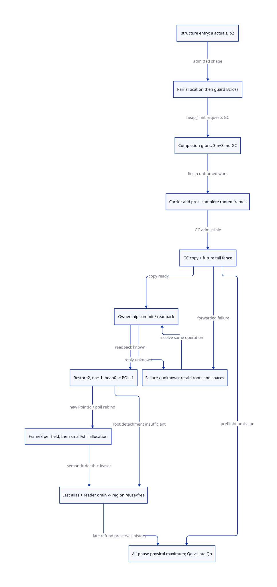

#+TITLE: Modern C Rest Construction, GC and Resume Envelope
#+SETUPFILE: ../../../modeling/org/setup.org
#+CATEGORY: gc-refactoring
#+PROPERTY: header-args :eval never :exports code
#+COLUMNS: %38ITEM %24STATUS %28OBLIGATION

* RESEARCH Decision and ownership
:PROPERTIES:
:CUSTOM_ID: rest-gc-resume-envelope
:STATUS: conditional-envelope-source-refinement-open
:AUTHORITY: GambitRestGcResumeEnvelope
:COMPONENT: gc-work; continuation; host-roots
:OBLIGATION: RG-COMPLETE; RG-RESUME; RG-LIFETIME; RG-PEAK
:END:

Modern generated C remains mandatory. Scheme owns the rest semantics, argument
shape, FrameSpec and PointId. The C runtime owns actual role-specific backing,
noncollecting completion, GC participation, current binding and region lifetime.
Zig supplies no additional GC or language-semantic proof for this chain. This
study makes the mandatory refactoring precise; it does not add another runtime.

[[file:models/sysml/rest-gc-resume-envelope.sysml][Native SysML]] owns needs, dependency endpoints, source routes, caller/cost rows
and the diagram. [[file:../../../modeling/ascent/assurance-planner.ss][ASCENT]] joins exact artifact/scope/digest receipts and derives the
transitive frontier; [[file:../../../../models/gambit/rest_gc_resume_envelope.qnt][QNT]] models ownership/history; [[file:../../../../models/gambit/lean/RestGcResumeEnvelope.lean][Lean]] checks conditional
extent/peak arithmetic. No source-simulation receipt is manufactured from those
local results. Root-level historical GC models remain distinct from DEV targets.

* Real selected chain, not a synthetic varargs example
:PROPERTIES:
:CUSTOM_ID: rest-structure-chain
:END:

[[file:../../../../vendor/gambit/lib/_kernel.scm::4984][##structure type . fields]] recursively constructs a structure. Existing emitted
[[file:../../../../vendor/gambit/lib/_kernel.c::23950][C entry L0, module label 952]] has one required argument, a rest slot, GET_REST,
then FIX(1) and POLL(1). These generated bytes are evidence of an emitted path,
not proof that the current executable was rebuilt from this source snapshot.

The ordinary [[file:../../../../vendor/gambit/lib/_kernel.scm::506][rest handler]] reads p=formal count including rest and a=actual count.
For this procedure p=2, a>=1, and r=a-1. It saves register arguments, pops actual
arguments into pairs, and checks hp only *after* each CONS. heap_limit can return
with another section and no collection; that branch continues construction and
requires current bounds to be rebound. Only its GC-requesting branch finishes
all remaining pairs and builds the p-element carrier vector before entering
##rest-param-check-heap. Raw arguments are removed so the collector sees complete
continuation frames. Calling GC sooner changes this essential root contract.

[[file:../../../../vendor/gambit/lib/_kernel.scm::1992][The Scheme GC helper]] roots proc/args as ordinary arguments and calls
##gc-without-exceptions, which saves RA, writes registers, invokes garbage_collect,
reloads registers and restores RA. An overflow exception may return, retry,
capture continuation state or escape. The target cannot treat this result as
permission to release the argument carrier.

[[file:../../../../vendor/gambit/lib/_kernel.scm::2006][The resume helper]] pops proc/args, pushes vector elements, loads argument
registers, and jumps with na=-1. [[file:../../../../vendor/gambit/include/gambit.h.in::8176][GET_REST tests na>=0]]; the sentinel prevents a
second rest-list construction. The selected callee sets a fixnum and reaches
POLL(1) without a heap allocation. The local push peak is at most p=2 slots
relative to the post-POP_ARGS2 stack cursor, independently of how many argument
registers exist; the inherited caller/control frame grant is additional.

#+NAME: rest-source-boundaries
| Boundary | Actual endpoint | What must not be conflated |
|---+---+---|
| Trigger | CONS then hp>heap_limit | Crossing bound versus total rest list |
| Completion | residual CONS loop, BEGIN/END_ALLOC_VECTOR | Noncollecting reserve versus ordinary allowance |
| Root publication | PUSH_ARGS2 -> Scheme helper, saved RA/registers | Initialized carrier versus arbitrary raw argument stack |
| GC | mem.c collection, resize, guarantee-fudge, prepare_mem_pstate | Logical capacity versus backed compatible interval |
| First resume | POP_ARGS2 -> na=-1 -> structure POLL1 | Heap0 versus stack0 or all future allocations |
| Later body | frame stride8 per field -> POLL2 -> make-structure | New PointId, possible GC and still allocation |
| Release | semispace reuse, actual msection shrink/free or still cleanup | Root detachment/refcount decrement versus physical deallocation |

* Joint upper bound: offset, roles and phases
:PROPERTIES:
:CUSTOM_ID: rest-joint-bound
:REPRESENTATION: no-handles; word arithmetic; byte examples WS=8
:END:

[[file:../../../../vendor/gambit/include/gambit.h.in::3118][The no-handles macros]] use pair extent3 and vector extent p+1 words. Let k>=1
pairs already be built at the GC-requesting branch, and m=r-k remain. For a legal
ordinary-rest call r=a-p+1. The logical carrier construction extents are:

#+BEGIN_EXAMPLE
C_after_cross = 3*m + (p+1)
T_constructor = 3*k + C_after_cross = 3*r + p+1 = 3*a - 2*p + 4

selected p=2: C_after_cross=3*m+3; T_constructor=3*a
m <= a-2 at a GC-requesting crossing
B_cross <= 3, provided the previous cursor h0<=L
B_cross + C_after_cross <= 3*a <= 24576 words
R0_heap = 0
U_selected_logical = B_cross + C_after_cross + R0_heap <= 3*a
all ordinary rest, p>=1 and a<=8192: T_constructor <= 24578 words
#+END_EXAMPLE

At WS8 the selected maximum is 196608 bytes (192 KiB); the generic ordinary-rest
maximum is 196624 bytes. These follow from source constants and legal-count
premises, not tests. The explicit a<=8192 admission is necessary; this study does
not certify every foreign/generated entry honors it. r=0 has no pair crossing
and no rest-triggered GC branch; a=1 is outside the selected crossing history.

For the selected branch, a physically backed source suffix must satisfy
h_after_cross+C_after_cross<=sourceEnd. If h_before<=L, the conservative issuance
rule L+3+C_after_cross<=sourceEnd covers both crossing and completion. If entry
is already beyond L, B_cross<=3 relative to L is not proved: use actual cursor
and remaining-work state or refuse the receipt. Prefix k pairs are already
allocated; do not reserve them again as suffix demand. Conversely, the carrier
and *all* r pairs remain potential live GC input: do not omit the prefix from
copy accounting. The arbitrary object graph reachable from their elements is
not bounded by 3*a.

Handles change pair extent to4 and vector to p+2. Other representations, pointer
formation bounds and layout changes need their own certificates. Checked word
to byte conversion, container provenance and contiguous fit remain premises.
The current macros' cursor movement alone supplies no target interval proof.

** First interval and following intervals have different bounds

For the selected restoration endpoint through the first POLL invocation:
heap payload/advance bound R0=0; temporary stack demand<=2 slots after POP_ARGS2.
No heap pointer is advanced by that loop. POLL's slow handler may collect, grow
stack or process interrupts; its entire execution is *outside* the zero-heap
span. An unknown/slow exit revokes the old binding and needs a fresh assurance.

The generated recursive branch stores four values, changes fp by8 and polls for
each field. Its aggregate logical growth is 8*r<=65528 words (524224 bytes at
WS8), excluding base/control frames. Individual intervals, stack chunk links,
frame-to-heap copies and repeated GC must be planned separately; this sum is
neither a contiguous physical stack grant nor a bound on captured copies.

The subsequent ##make-structure allocates n=r+1=a fields. [[file:../../../../vendor/gambit/lib/_kernel.scm::43][Its allocator macro]]
uses a+1 words for the small no-handles case a<=254. At a>=255 it calls the still
allocator, whose charge includes STILL_BODY, alignment and native allocator
backing. [[file:../../../../vendor/gambit/lib/mem.c::1556][The still path]] can trigger another GC, fail allocation, undo its own
VM charge or keep deferred accounting. GC_SAVE1 protects type before the call.
The later initialization/return/error paths and existing refcount decrement
must not be collapsed into the first zero-heap interval or an immediate free.

** Joint capacity is a role-indexed live-phase envelope

#+BEGIN_EXAMPLE
P = max over actual phases t of sum over distinct live backing containers j bytes(j,t)

source suffix: B_cross + C_after_cross, with prefix already present
GC: source live + full copy/promote/layout envelope + roots/tasks/readers
restore: still-live GC backing + compatible heap grant + stack/control grant
later: frame-growth/copy envelope + structure small/still charge + failures
#+END_EXAMPLE

Completion, GC output and restore can be successive logical owners of bytes,
but aliasing their reservations requires an actual nonoverlap-in-time/role proof.
Before source reuse or destination commit they overlap in the physical maximum.
Include every backing container once; distinguish payload occupancy, reserved
capacity, acquired allocator bytes and RSS. This study bounds none of RSS or
allocation success under operating-system pressure.

[[file:../../../../vendor/gambit/lib/mem.h::76][The current VM overflow policy]] is 8*((1024+1)+8192*3)=204808 words without
handles, 1638464 bytes at WS8. It is an aggregate copying/reserve policy, not a
per-constructor contiguous grant. Subtracting 24576 from it is *not* a proven
reclaimable saving. [[file:../../../../vendor/gambit/lib/mem.c::7041][Post-GC guarantee-fudge]] can select another section before
prepare_mem_pstate; a new design must include or explicitly retire that demand.

* Actual acquisition, lifetime and release
:PROPERTIES:
:CUSTOM_ID: rest-allocation-release
:END:

Pairs/carrier are bump allocations in existing movable backing, without a native
malloc/free per object. [[file:../../../../vendor/gambit/lib/mem.c::540][Aligned backing allocation]] and [[file:../../../../vendor/gambit/lib/mem.c::891][adjust_msections]] establish
actual native containers. The latter can partially acquire and return with a
smaller actual count; the plan must read that count and exact container bounds.
[[file:../../../../vendor/gambit/lib/mem.c::989][Section shrink]] and [[file:../../../../vendor/gambit/lib/mem.c::1065][free_msections]] perform actual aligned frees. Semispace
reuse can reclaim space without releasing an allocator container.

The rest list is an ordinary user-visible Scheme argument. It cannot be freed
when restored. The temporary carrier loses a local reference after restoration,
but a helper/retry/captured continuation or other alias may still retain it.
Only a last-root/alias proof plus readers/initializer drain permits reuse under
the target layout; physical free additionally requires an independently
releasable backing extent. Three dead vector words inside a live section do not
yield a three-word native refund. [[file:../../../../vendor/gambit/lib/mem.c::4380][Still cleanup]] also requires unreachability/
refcount semantics; it is not triggered merely by leaving the allocator helper.

#+NAME: rest-custody-matrix
| Point | Responsible custodian | Failure / unknown handling |
|---+---+---|
| Before unframed construction | Context plus preissued completion grant | Refuse before exposing partial arguments; only known private claims refundable |
| During pair/vector initialization | Same constructor, progress and raw-stack contract | No GC/cancellation escape without completing or an independently specified unwind/root conversion |
| Framed helper and overflow retry | Proc/carrier FrameSpec root domain | Returning exception retries with roots; nonlocal/captured exit follows alias lifetime, not forced free |
| After first destructive forwarding | Epoch copy/initializer ledger and source root domain | Hold both spaces and outstanding initialization/scanning work; cannot roll back to a raw handler entry |
| Unknown transfer reply | Authoritative same-ID owner/transfer ledger | Freeze source offers, no second grant/refund; read back identity and generation |
| Resume slow POLL or later allocator failure | Current context and durable root/failure grant | Rebind after GC; never spend stale cursor/PointId, never refund published live objects |
| Reuse/free | Region/alias/readers ledger | Semantic death and drain precede reset; unknown keeps backing, may backpressure or quarantine |

These unknown-result rules describe the proposed split worker/context service.
They do not claim synchronous malloc normally has an unknowable return value.
No liveness, fault tolerance or bounded OOM recovery follows from retaining custody.

* When Qg changes the whole-round maximum
:PROPERTIES:
:CUSTOM_ID: rest-qg-peak
:END:

Qg is guaranteed compatible future space, backed and preaccepted *before* an
otherwise necessary fresh acquisition. It is not the constructor carrier size.
Let b_t be the matched baseline's actual acquired-container occupancy, q_t the
fresh backing actually omitted at phase t, and o_t every added destination,
metadata, completion/failure or held-partial byte. Then c_t<=b_t-q_t+o_t is only
a phase inequality. Strict whole-round gain requires max_t(c_t)<max_t(b_t),
including the completion, copy, transfer, restore, later frame/still and error
phases. The same physical byte cannot pay both copy and future allocation.

The selected first resumed heap span has demand0, so it alone earns Qg=0.
Positive Qg needs a later *admitted actual* grant demand, or retirement of an
otherwise real mandatory restore acquisition. Keeping the current post-GC
fudge request means it still must be backed; replacing it with a typed interval
requires migrating every consumer, not changing a number. Current same-PSTATE
tail reuse is already in the baseline. A separated-worker design that would
otherwise buy an extra resume grant is a different explicit baseline.

If added copy capacity equals Qg, the apparent saving cancels. If the unchanged
completion or still-allocation phase remains the baseline maximum, lower copy
occupancy gives no strict whole-round improvement. Qo discovered after copying,
or release after the old reader set drains, can lower later occupancy only.
Never erase an earlier peak or count root detachment as physical release.

* Formal refinement and retained counterexamples
:PROPERTIES:
:CUSTOM_ID: rest-refinement
:END:

The QNT p2/a5 slice has four pairs and a three-word carrier, exact suffix12 after
the first crossing. Its illustrative destination20 and future-grant4 are abstract
model words: the four-word future demand is *not* the selected first heap span
and supplies no measured or source-established Qg. The model checks mutually
exclusive acquisition, framed-before-GC, known-before-resume, captured-alias
retention and historical peak. All-region provenance, multi-context closure,
stack transitions, full GC output, nonlocal control and source C steps remain
RG source obligations. Requirements define admission laws, not satisfied instances.

An initial positive simulation found acquisition could choose both tail and
fresh support in succession. The corrected target model admits either exactly
once. The failed log is retained in [[file:../../../../evidence/research/rest-gc-resume-envelope/quint-simulation-mixed-grant-failure.log][the same study evidence]]. This is a model
counterexample and fix, not an established bug in the current runtime.

Lean proves 13 named conditional arithmetic statements, not QNT induction or
machine-pointer safety. Source refinement must supply:

1. Actual emitted entry identity, legal-count enforcement, representation and
   pre-handler stack/cursor contract; complete macro/custom-FFI entry coverage.
2. A simulation relation from raw arguments, built prefix, residual cursor and
   carrier to roots, exact source intervals and frame stack; noncollecting
   progress through completion, including every exception/poll boundary.
3. Post-GC current binding and resume sentinel equivalence; exact root coordinate
   maps through overflow retry, captured continuations and stack growth.
4. Last alias/readers, allocator partial results and releasable-container proof;
   all actual phase occupancies against a matched current/separated baseline.

Counterexamples retained as controls: B without completion; GC at incomplete
frames; stale/unknown reentry; freeing a captured carrier; double credit; losing
a forwarded initializer; and rewriting the peak after late refund. Omitting any
RG source obligation must block the upstream GC design even if every local model
is checked. Unknown source scope/digest cannot qualify a receipt.

* Learning from papers, then choosing for Gambit

[[https://simonmar.github.io/bib/papers/parallel-gc.pdf][Marlow et al., Parallel Generational-Copying GC with a Block-Structured Heap]],
sections3.4-3.5, separates allocation and scanning frontiers and tracks pending
blocks. That supports explicit copy/scan custody, not a formula for Gambit's
rest handler or automatic safe reuse of the allocation tail. Gambit's raw
argument completion and multi-shot continuation roots require their own proof.

[[https://anil.recoil.org/papers/2020-icfp-retropar.pdf][Sivaramakrishnan et al., Retrofitting Parallelism onto OCaml]], section4.4,
explains synchronized parallel minor collection and promotion readiness while
retaining C API behavior. We learn to place safe points deliberately. In Gambit,
collecting between raw-argument pops would violate the existing frame-scanner
contract; changing that needs a new precise root representation. No paper
benchmark, OCaml fiber assumption or foreign exception guarantee is imported.

* Native-derived matrices and views
#+INCLUDE: "rest-gc-resume-envelope-matrix.org" :minlevel 2

; [[file:../../../modeling/diagrams/component-proof-dependencies.svg][composed prerequisite graph]].
[[file:../../../../evidence/research/rest-gc-resume-envelope/checks.json][Source-bound study receipt]] separates local checks from open source/native obligations.
