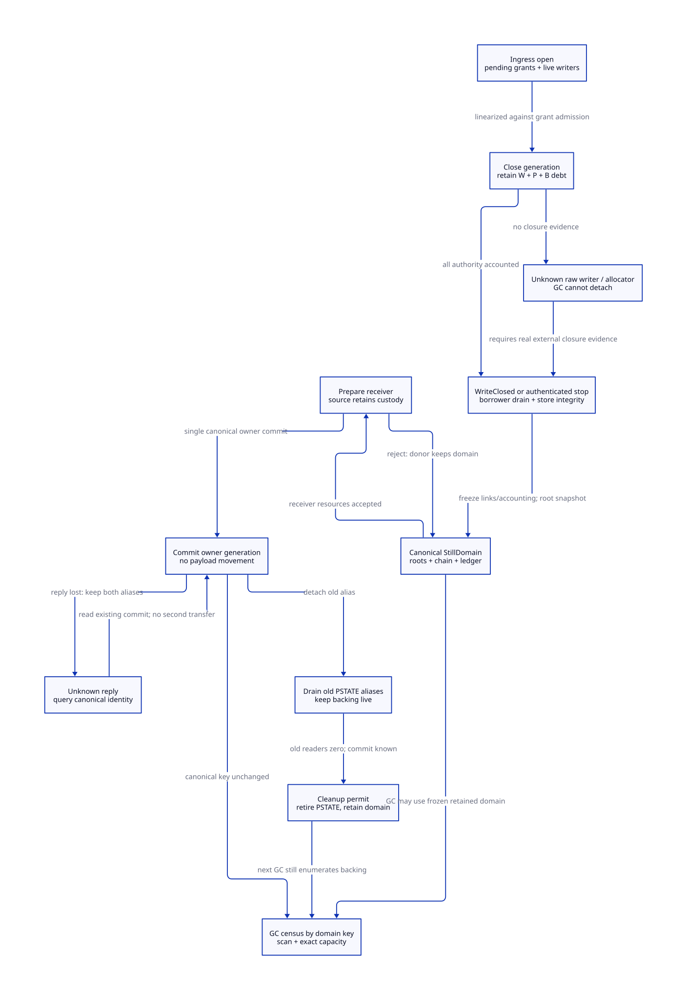

#+TITLE: Modern C Heap Authority Closure and Physical Still-Domain Handoff
#+SETUPFILE: ../../../modeling/org/setup.org
#+CATEGORY: gc-refactoring
#+PROPERTY: header-args :eval never :exports code
#+COLUMNS: %40ITEM %25STATUS %24OBLIGATION
#+OPTIONS: toc:3 num:t

* RESEARCH Decision and scope :modern_c:gc:smp:
:PROPERTIES:
:CUSTOM_ID: authority-handoff-decision
:AUTHORITY: GambitStillAuthorityHandoff
:COMPONENT: gc-work; host-roots; continuation; resource-exit
:OBLIGATION: AH-CLOSE; AH-STOP; AH-CHAIN; AH-ADMIT
:STATUS: conditional-models-native-source-refinement-open
:END:

Modern generated C remains the selected runtime direction. The previous
[[file:still-materialization-custody-design.org][materialization study]] separates scan validity, write closure, physical custody
and delivery. This study specifies how those conditions must be issued before
retiring a processor, and why current cleanup followed by native join cannot
serve as a recoverable handoff. It supplies no runtime implementation or native
test. Schema/model checks do not make these target services exist in C.

The selected architecture is a canonical StillDomain, independent of PSTATE,
containing one chain identity, root/scan bindings and an allocation ledger.
Owner change updates its authority; it does not copy payload or unlink a live
chain before a receiver exists. Existing PSTATE-based allocation, scanning,
sweep and accounting consumers must migrate together. This is a runtime
ownership refactoring, not a configuration wrapper around the old cleanup.

[[file:models/sysml/still-authority-handoff.sysml][SysML]] owns six needs, dependency edges, source routes, caller/cost matrices
and D2 topology. [[file:../../../modeling/ascent/assurance-planner.ss][ASCENT]] derives exact scoped admission and transitive blockers.
[[file:../../../../models/gambit/still_authority_handoff.qnt][Root QNT]] models pending grants, writers, borrower/reader pins, raw join status,
unknown commit and four abstract physical words. [[file:../../../../models/gambit/lean/StillAuthorityHandoff.lean][Lean]] checks a closed Gate
Step/Trace kernel and conditional stop/accounting/owner propositions. Store
integrity, complete root snapshots and the C atomic mapping remain premises.

* SOURCE Actual caller closure and its limits
:PROPERTIES:
:CUSTOM_ID: authority-handoff-source
:END:

** Resize frees before it joins

[[file:../../../../vendor/gambit/lib/setup.c::903][Resize]] may first collect for capacity, changes processor count collectively,
then retiring processors call cleanup_pstate and thread_exit. Processor0 later
[[file:../../../../vendor/gambit/lib/setup.c::978][calls thread_join and ignores its error]]. [[file:../../../../vendor/gambit/lib/setup.c::4665][cleanup_pstate]] removes interrupts and
calls [[file:../../../../vendor/gambit/lib/setup.c::4572][cleanup_os_and_mem_pstate]], which performs memory cleanup before OS cleanup.
[[file:../../../../vendor/gambit/lib/mem.c::4928][Memory cleanup]] frees the still chain and RC chain. A subsequent successful
join confirms target termination; it cannot restore that freed backing.
This source ordering is not a demonstrated native dangling-reference failure:
reachability under the existing synchronous contract still needs qualification.

Other real internal callers include [[file:../../../../vendor/gambit/lib/setup.c::950][setup rollback]] and [[file:../../../../vendor/gambit/lib/setup.c::4834][global cleanup]], which
shrinks to one processor before cleaning the current PSTATE. [[file:../../../../vendor/gambit/lib/mem.c::4950][VM cleanup]] destroys
scan synchronization and calls processor0 memory cleanup, with an explicit
other-processors TODO. Retained domains must drain before VM scan facilities
are destroyed; processor count alone is not that proof.

** Join and exit are also exported interfaces

[[file:../../../../vendor/gambit/lib/os_thread.c::546][POSIX thread_join]] tests pthread_join's returned value but maps failure using
err_code_from_errno; it does not retain the returned error code. POSIX returns
errors directly, so the wrapper's mapped status is not a lossless raw witness.
No installed Darwin failure was exercised. [[file:../../../../vendor/gambit/lib/os_thread.c::579][thread_exit]] calls pthread_exit.
[[file:../../../../vendor/gambit/lib/setup.c::6207][The runtime export table]] exposes join/exit, and [[file:../../../../vendor/gambit/lib/setup.c::5978][also cleanup_pstate]]. Internal
source searches therefore close only the selected repository callers, not all
external embedders that can invoke those pointers. Those clients must adopt the
managed protocol or retain the raw ABI's synchronous restrictions.

** The physical chain has several writers

[[file:../../../../vendor/gambit/lib/mem.c::300][PSTATE aliases]] include still_objs, still_objs_to_scan, words_still_objs,
words_still_objs_deferred and RC state. Actual necessary writers/consumers are:

1. [[file:../../../../vendor/gambit/lib/mem.c::1556][alloc_scmobj_still]] reserves/charges memory, allocates, links and initializes
   metadata; current body initialization is still the caller's responsibility.
2. [[file:../../../../vendor/gambit/lib/mem.c::1443][Still refcount operations]] are plain increments/decrements. [[file:../../../../vendor/gambit/lib/c_intf.c::6550][Marker exit]] writes a
   vector field and decrements count. A payload-only writer census misses both.
3. [[file:../../../../vendor/gambit/lib/mem.c::4222][Scan setup]] follows the chain and rewrites mark/scan linkage; ordinary tracing
   may update child references. A scanner holding mutation authority is not an
   inert reader whose pin can merely be ignored.
4. [[file:../../../../vendor/gambit/lib/mem.c::4387][Sweep]] relinks survivors, frees dead blocks and invokes foreign release code.
   [[file:../../../../vendor/gambit/lib/mem.c::4432][PSTATE cleanup]] frees the entire chain; [[file:../../../../vendor/gambit/lib/mem.c::4647][setup]] clears chain and counters.
5. [[file:../../../../vendor/gambit/lib/mem.c::6804][GC setup]] folds deferred accounting. [[file:../../../../vendor/gambit/lib/mem.c::6256][determine_occupied_words]] sums live still
   statistics over processor_count, so simply removing a processor also removes
   its contribution from this enumeration.

These are the selected internal closure anchors. Uninstrumented C aliases,
external hooks, foreign release callbacks and allocator internals remain explicit
source-admission gaps. No list of function names proves that those paths cannot
run concurrently with handoff.

* DESIGN Close heap authority without losing pending grants
:PROPERTIES:
:CUSTOM_ID: authority-close
:END:

#+NAME: authority-generation-record
#+BEGIN_EXAMPLE
Authority = { domainId, executorGeneration, phase, pendingGrants,
              activeWriters, borrowers, rootSnapshot, writeClosureReceipt }
phase: Open -> Closing -> Closed
Debt: P pending grants + W active writers + B native borrowers
Closed requires ingress closed and P=W=B=0.
#+END_EXAMPLE

Reserve/admit and close must share a linearizable generation gate. A pending
reservation registered before close is retained debt, even if no store ran.
After close it may withdraw; it cannot silently become a new grant. Existing
admitted writers may finish and publish their final write outcome; callbacks
cannot reopen the old generation. A new owner's future write grants require a
separate successor-generation admission after the GC/root cut; this study's
bounded model keeps the transferred generation closed.

A permit covers allocation/list publication, refcount changes, payload writes,
root mutations and native borrows according to their role. Collector scan/sweep
mutation has a separate epoch grant. At a physical chain mutation handoff, those
grants must close too. This is broader than counting constructor fill loops.
Release/acquire on an unrelated counter is not sufficient; an enter/check race
must not miss a grant that is about to become usable.

Closing ingress does not cancel an already admitted raw write. Reconciliation
can remove its outstanding debt only after authenticated stop, all delegated
borrower closure, visibility and integral-layout evidence. It does not guess
that a timeout or posted interrupt stopped the owner. [[file:../../../../vendor/gambit/lib/setup.c::66][raise_interrupt_pstate]]
requests later handling; it is not a stop receipt.

* DESIGN Stop receipt versus operation closure
:PROPERTIES:
:CUSTOM_ID: authority-stop
:END:

#+NAME: authority-stop-records
#+BEGIN_EXAMPLE
NativeStopReceipt = { vmId, executorId, executorGeneration, uniqueJoinOwner,
                      rawJoinReturn, joinConsumed, visibilityWitness }
WriteClosedReceipt = { domainId, authorityGeneration, closedIngress,
                       settledGrantSet, writerDrain, borrowerDrain,
                       finalStoreBoundary, inputRootSnapshot, integrityWitness }
#+END_EXAMPLE

NativeStopReceipt requires exact identity and raw successful join status. Target
termination does not close independent borrowers, account for unpublished
allocation or release a lock safely. A successful join result lost after its
consumption cannot be recovered by blindly joining the expired thread ID again.
Retain uncertainty unless another qualified operation-specific closure exists.

WriteClosed is a separate route: a cooperative owner can close all access to one
domain while its OS thread remains alive. With complete independent roots and
scan services, GC need not wait for its later native-resource join. Conversely,
join success does not substitute for WriteClosed's complete footprint.
The model's closed operation with lost join reply demonstrates that distinction;
its unknown active writer with lost reply demonstrates the remaining block.

The current selected fill loops have no cooperative mid-loop exit. Supported
arbitrary native death inside them has not been established. Async thread kill,
fatal faults, torn fields, interrupted malloc/list updates, unknown lock ownership
and raw callback/nonlocal exits bypassing the guard are refused as process-local
recovery. Cooperative retirement normally completes its bounded batch first.
A confirmed integral stop may instead abort a partial semantic result under the
previous materialization protocol, retaining actual valid slots for scanning.

* DESIGN Physical still-domain transaction
:PROPERTIES:
:CUSTOM_ID: still-domain-transfer
:END:

#+NAME: canonical-still-domain
#+BEGIN_EXAMPLE
StillDomain = {
  canonicalId, vmGeneration, ownerGeneration, descriptorLifetimePin,
  physicalChain, objectLayoutAdmission, blockAndReservationLedger,
  rootDomain, scanEpochState, deferredReleaseObligations
}
Transfer = { operationId, donorGeneration, receiverGeneration,
             preparedReceiver, frozenInventoryWitness, commitIdentity }
#+END_EXAMPLE

1. Close mutator and allocator publication ingress. Finish or reconcile grants,
   list edits and reservations; freeze a valid chain and its ledger. Retain roots
   and scan eligibility before old context retirement. Unpublished allocations
   or broken list mutations cannot be treated as a frozen inventory.
2. Prepare receiver resources while the donor retains custody. The independent
   root/scan service accepts the canonical domain. Rejection preserves the donor
   domain and charge; it does not leave an unlinked chain in limbo.
3. Commit one owner-generation change on the canonical descriptor. The same
   physical blocks and domain key remain visible. Do not implement this as
   detach-donor, then append-receiver, then reconstruct roots/counters.
4. If the commit reply is unknown, retain both metadata aliases and query the
   exact canonical identity/generation. Never free, recharge, re-execute the
   transfer or issue donor cleanup on the strength of a timeout. The receiver's
   root service must already be live before commit, not created by its reply.
5. Detach the legacy PSTATE alias only after observing the commit. Old snapshot
   readers retain pins until their last use. A canonical-domain collector may
   continue; physical list/scan mutators must already be closed. Reader pinning
   is not an exemption for an unclosed scanner that still edits the chain.
6. Issue a cleanup permit only after old aliases/readers, root delivery and
   side-effect responsibilities are discharged. PSTATE cleanup must stop calling
   free_still_objs on the transferred domain. New GC enumeration still visits
   that domain even after the old processor ID disappears.

The target can update ownership while canonical scan readers exist because the
commit does not mutate payload/linkage/scan ownership. This is conditional on
all readers already resolving the canonical descriptor. An old raw PSTATE scan
must finish its mutation phase before that cut. Freezing every reader behind a
join on a collector-dependent path would reintroduce the wait cycle; the
lifecycle service must wait outside GC participant authority and collector locks.

An inert old pin here protects PSTATE/descriptor metadata only. An old user
holding a raw block address, payload alias or refcount mutation capability must
still register a native borrow or scan authority; it is not admitted as an inert
reader. Every old cleanup/scan/exported entry must check the retired generation
before dereferencing old PSTATE ownership. Until that migration closes, unknown
legacy users retain the gate rather than being reclassified after failure.

The chain can contain FOREIGN objects. Retention avoids premature release but
cannot move release_fn's thread/VM affinity automatically. Existing sweep calls
release functions synchronously. Deferred release and stop-time resource policy
remain resource-exit obligations; an unknown native destructor is not proved
safe for an independent worker merely by moving its domain descriptor.

* DESIGN Capacity and peak memory are different ledgers
:PROPERTIES:
:CUSTOM_ID: still-domain-accounting
:END:

Current local words_still_objs is a phase statistic, not a running target booked
ledger. Deferred allocation, direct VM charging, failed-allocation rollback and
GC recount occur at different points. It would be incorrect to copy local
words_still_objs and deferred counters into a receiver and claim an exact
allocation-ledger conversion. The target adoption cut must reconcile all valid
block lengths, private reservations and their VM charge state.

#+NAME: still-capacity-equations
#+BEGIN_EXAMPLE
Inventory(domain) = sum(unique published block lengths) + private held blocks
CommittedPhysical = sum(Inventory(d) for each canonical domain d exactly once)
Account(domain) = booked + deferred                 // target model only
fold: (booked,deferred) -> (booked+deferred,0)       // total unchanged
Transfer: owner changes; physical inventory and charge do not change.
#+END_EXAMPLE

The native adapter must bind inventory revision, allocator reservation state and
GC accounting phase in one ledger snapshot. Booked and deferred fields cannot
be sampled independently while a fold updates them. The model's atomic fold
requires a real phase-exclusion or immutable-snapshot publication proof. Owner
commit alone does not supply it. Canonical collector scan/sweep changes remain
under that service's epoch grant; ownership transfer must not duplicate or steal
its active scan/sweep work. Old raw scan mutation closes before canonical entry;
a pinned inert metadata reader has no such mutation grant.

Pending capacity reservations and GC requested_words_still are not automatically
published physical blocks. Their commitment/refund state must be represented,
not added twice to physical occupancy. [[file:../../../../vendor/gambit/lib/mem.c::1648][Allocation failure rollback]] and the
resize accounting phases require separate source simulation. The QNT model's
four words prove target conservation only, not a mapping of today's counters.

Descriptor transfer requires zero payload copying after qualification; adopting
a legacy chain may require an O(N) inventory walk. A single canonical census can
remove duplicate donor/receiver enumeration, but tracing and sweeping live/dead
objects still remain. Pending old readers can retain PSTATE metadata; retaining
the whole L-word chain can also delay reclamation. There is no established peak
reduction. For disjoint storage S staging, L chain, E inputs and M metadata, the
peak includes their simultaneous residency. Only a pre-peak reusable Qg with
max_t(P_t-Qg_t+A_t) < max_t(P_t) proves a lower whole-round peak.

* PROOF Recovery and GC admission matrix
:PROPERTIES:
:CUSTOM_ID: still-domain-recovery-matrix
:END:

#+NAME: still-death-admission
| Observation | Recovery/custodian | GC admission |
|---+---+---|
| Cooperative WriteClosed, complete independent root snapshot, valid backing | Canonical domain may transfer; native join can remain pending separately | Conditional yes; OS cleanup may remain unresolved |
| Exact successful join, integral stopped writer, grants settled, borrowers drained | Guardian aborts partial result and freezes valid inventory before transfer | Conditional yes after root/scan service acceptance |
| Exact successful join but borrower/list/allocator integrity unknown | Donor generation and domain service retain backing/debt | Still blocked by unresolved heap authority |
| Failed join or lost success while writer debt remains | Preserve raw status, generation and roots; no blind rejoin/cleanup | Still blocked |
| Transfer committed but reply lost | Canonical receiver service retains backing; donor alias waits for query | Can scan canonical frozen domain; cleanup remains blocked |
| Transfer rejected before commit | Donor retains canonical domain and all charge | Can scan only if independent closure/root admission already holds |
| Old inert metadata reader remains | Pin old PSTATE, retain canonical domain | Can scan canonically; PSTATE reuse waits |
| Raw old scanner still edits chain | Preserve its epoch authority and backing | Cannot treat it as an inert pin; phase closure required |
| Backing freed before join / allocator corruption / fatal process fault | No safe reconstruction proved | Refuse recovery; no in-process GC progress guarantee |

These are design admission classes, not newly qualified current-runtime paths.

** Model obligations and retained counterexamples
:PROPERTIES:
:CUSTOM_ID: still-authority-proof
:END:

AH-H covers34 histories plus bounded positive simulation and a deliberately
rejected backing-drop step. AH-I covers22 named propositions, including actual
Gate Step/Trace no-reopen and nonincreasing closed debt. Neither proves whole
QNT induction, an unbounded C execution or global GC liveness. QNT keeps one
canonical domain and does not implement a real domain registry/allocator.

AH-CLOSE requires linearization and a complete producer/borrower census.
AH-STOP requires platform/identity/visibility and integrity receipts.
AH-CHAIN requires physical inventory, root and scan adapters independent of
processor_count. AH-ADMIT composes them with safe-point/resource-exit contracts.
MC-WRITE, MC-ROOT and MC-RECOVER depend on these new source needs; no source
receipt is issued by a link or a passing finite-model history.

Counterexamples preserve the first failing premise: preclose pending grant
forgotten; close with active writer/borrower; scan on join alone; source free
before commit; old reader ignored; rootless transfer; duplicate or omitted
deferred charge; stale-generation/raw-error stop receipt; callback reopening.
The next-GC-after-PSTATE-cleanup history checks that backing remains enumerable.

ASCENT input transport may pad a final five-edge record with repeated identical
edges. Its Datalog set meaning is unchanged; independent unpacking must recover
exactly the native unique edge set. No dependency is dropped, scope/hash field
interned, parser bound enlarged or qualification rule relaxed.

* RESEARCH Lessons applied to Gambit's own constraints
:PROPERTIES:
:CUSTOM_ID: still-authority-literature
:END:

[[https://pubs.opengroup.org/onlinepubs/9799919799.2024edition/functions/pthread_join.html][POSIX pthread_join]] defines successful target termination and thread-ID lifetime;
raw status must be retained. Direct fetch returned403 during this study; indexed
primary text and prior receipts retain the platform-evidence boundary.
[[https://www.open-std.org/jtc1/sc22/wg14/www/docs/n1570.pdf][C draft N1570]], sections5.1.2.4 and7.17, supplies publication/visibility vocabulary;
a Boolean completion flag is not the complete native synchronization proof.

[[https://cdn.kernel.org/doc/html/latest/RCU/Design/Requirements/Requirements.html][McKenney's RCU requirements]] separates publish/subscribe from reader reclamation.
The applicable lesson is to retain old metadata until real reader closure; no
Linux RCU primitive, kernel memory-order shortcut or grace-period performance
claim is imported into Gambit's portable C runtime. Native C refinement remains
necessary even after a descriptor handoff is modeled atomically.

[[https://anil.recoil.org/papers/2020-icfp-retropar.pdf][Retrofitting Parallelism onto OCaml]], sections4.4 and5, treats collector
coordination and C interaction as one design problem. [[https://ocaml.org/manual/5.3/intfc.html][The C-interface manual]]
requires explicit roots and disciplined field updates. Gambit's own still
representation, native callbacks and first-class continuation require separate
logical owner, native executor and root-domain lifetimes. None is replaced by
an OS thread join or by changing the implementation language.

* MATRIX Work, peak and retirement dependencies
:PROPERTIES:
:CUSTOM_ID: still-authority-benefits
:END:

#+INCLUDE: "still-authority-handoff-matrix.org" :minlevel 2

#+NAME: still-authority-retirement
| Current responsibility | Replacement and order | Retirement condition |
|---+---+---|
| PSTATE still chain/counters are the only census | Canonical domain and ledger first; adapt scan, sweep, recount | All participating contexts/domains enumerated exactly once |
| Cleanup always frees its chain | Explicit cleanup permit after domain commit and alias drain | Raw cleanup/exported callers migrated or refused |
| GC completion inferred from processor liveness/count | Root/authority/collector-role closure independent of OS join | Full root snapshot and collector obligations accepted |
| Join failure discarded or mapped without raw status | Unique lifecycle owner stores exact raw return and generation | All internal and admitted embedding consumers use receipt contract |
| Unknown transfer re-executed or source prematurely removed | Query canonical commit identity; retain backing | Commit query and receiver service survive owner/response loss |
| Plain refcount/payload mutation outside managed authority | Generated role permits and scoped native borrow protocol | Complete writer census, barrier/overflow and callback exits qualified |

Modern C must own these changes; Zig owes the same protocols and currently has
no demonstrated incremental GC work or peak benefit. No old path retires in this
study. Net benefit depends on removed wait coupling/duplicate inventory work
exceeding permit, root, ledger, retained-memory and compatibility costs.

* CHECK Exact evidence and native-derived views
:PROPERTIES:
:CUSTOM_ID: still-authority-checks
:END:

- [[file:../../../../evidence/research/still-authority-handoff/checks.json][Source-bound study receipt]]
- [[file:diagrams/still-authority-handoff.d2][D2]] / 
- [[file:../../../modeling/diagrams/component-proof-dependencies.d2][Shared proof graph]]
- [[file:../../../modeling/component-assurance.org][Component closure and assurance frontier]]

#+NAME: authority-handoff-sysml
#+INCLUDE: "models/sysml/still-authority-handoff.sysml" src sysml
#+NAME: authority-handoff-d2
#+INCLUDE: "diagrams/still-authority-handoff.d2" src d2
