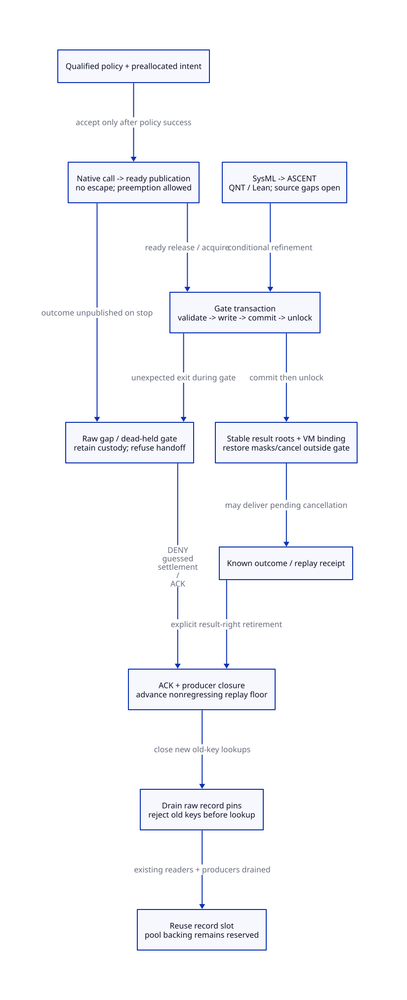

#+TITLE: Modern C Native Completion, Exceptional Exit and Receipt Lifetime
#+SETUPFILE: ../../../modeling/org/setup.org
#+CATEGORY: gc-refactoring
#+PROPERTY: header-args :eval never :exports code
#+COLUMNS: %36ITEM %24STATUS %24OBLIGATION
#+OPTIONS: toc:3 num:t

* RESEARCH Decision and authority :modern_c:gc:smp:
:PROPERTIES:
:CUSTOM_ID: completion-lifetime-decision
:AUTHORITY: GambitStillCompletionLifetime
:COMPONENT: gc-work; host-roots; resource-exit
:OBLIGATION: NC-ENVELOPE; NC-EXIT; NC-RESTORE; NC-RECLAIM
:STATUS: conditional-models-source-platform-open
:END:

Modern generated C remains mandatory. This study refines
[[file:still-receipt-admission-design.org][allocation receipts and snapshot admission]] with three separate contracts:
raw-enter to ready publication cannot escape; mutable gate transactions cannot
exit halfway; receipt records cannot be reused merely because delivery ended.
OS scheduling pauses are allowed. No bounded native-call duration, arbitrary
thread-death recovery, process-crash recovery or native admission is implied.

[[file:models/sysml/still-completion-lifetime.sysml][SysML]] owns six new needs, six imported source premises, nineteen dependency
edges, eleven caller families, nine cost rows and D2 topology. Native sysml
validation/evaluation drives [[file:../../../modeling/ascent/still-completion-lifetime.rules.scm][the actual ASCENT DSL]] and
[[file:still-completion-lifetime-matrix.org][the caller, closure and benefit matrices]]. QNT/Lean are root formal models;
this DEV model specifies refactoring obligations. Imported RA-ISSUE/SETTLE/GATE/
SWEEP, HR-BIND and RC-LIFETIME remain open. The local interface cut does not
replace or requalify historical global assurance reports or predecessor receipts.
No runtime implementation, native test or performance measurement is supplied.

* EVIDENCE What current callers actually guarantee :source:
:PROPERTIES:
:CUSTOM_ID: completion-source
:STATUS: selected-callers-known-external-host-policy-open
:END:

** Interrupt deferral differs from a native no-escape envelope

[[file:../../../../vendor/gambit/lib/setup.c::51][raise_interrupt_pstate]] records an interrupt for later Scheme delivery,
trips the stack and can abort device-select waiting. However,
[[file:../../../../vendor/gambit/lib/setup.c::317][disable_interrupts_pstate]] explicitly retains the synchronous-operation
interrupt. It changes PSTATE interrupt fields; it neither disables pthread
cancellation nor proves that a C helper cannot trigger GC or longjmp. Reuse the
pending-request mechanism, not an unsupported claim of native atomicity.

There is also genuine OS masking support:
[[file:../../../../vendor/gambit/lib/os_setup.c::526][mask_all_interrupts_begin/end]] compose user, heartbeat and child masks and
restore them in reverse order. [[file:../../../../vendor/gambit/lib/os_thread.c::874][thread_sigmask]] returns the underlying pthread_sigmask or
sigprocmask result. But the void family wrappers in os_time.c:1055–1078,
os_tty.c:8837–8867 and os_io.c:8596–8618 discard that status. Three saved-mask
slots and reverse restore are reusable; successful policy installation and
partial-failure cleanup are not currently receipted.

Real users include [[file:../../../../vendor/gambit/lib/os_io.c::9140][native process-device construction]] and
[[file:../../../../vendor/gambit/lib/os_shell.c::913][the system-call shell branch]]. Their masks cover blocking/resource work;
normal begin/end pairing alone does not provide exceptional cleanup, cancellation
protection or raw-result publication. The managed adapter must use status-bearing
primitives, retain saved state after partial failure and restore only successful
changes in reverse order. Unknown restore state refuses return to managed Scheme
execution; do not fabricate a policy-restored receipt.

** Signal handlers, logging and errno are part of the call graph

[[file:../../../../vendor/gambit/lib/os_base.c::156][Debug printf]] calls vfprintf and fflush. Allocation logging occurs after
malloc but before the wrapper returns. Code/aligned allocation also writes its
headers before an outer caller sees a pointer. A new outer wrapper cannot close
those earlier windows. Raw backing capture must precede logging and fallible view
initialization; initializing a Scheme object remains a separate owned operation.

[[file:../../../../vendor/gambit/lib/os_time.c::987][Heartbeat]] and [[file:../../../../vendor/gambit/lib/os_tty.c::8700][TTY signal handlers]] call installed function pointers;
SIGCONT invokes device-mode restoration. [[file:../../../../vendor/gambit/lib/os_io.c::8503][SIGCHLD explicitly saves/restores errno]] around waitpid and device work.
That one handler is useful evidence, not proof that every installed handler
preserves errno or avoids unsafe reentry. The optional
[[file:../../../../vendor/gambit/lib/os_setup.c::3084][crash handler]] calls fatal_error; fatal_error can call a host hook and then
[[file:../../../../vendor/gambit/lib/os_base.c::889][exit_process]]. External handlers, allocator interposition, fatal callbacks
and effective installed configuration remain admission gaps.

** C exceptions and real callback/retirement callers

In the selected C mechanism,
[[file:../../../../vendor/gambit/include/gambit.h.in::9979][BEGIN_TRY/THROW]] use a catcher and setjmp/longjmp.
The C cleanup macro is an ordinary code block; its cleanup expression runs only
on control paths that reach it. The alternate C++ configuration in that header
is not the modern C target and contributes no destructor guarantee here.
[[file:../../../../vendor/gambit/lib/setup.c::839][throw_error/propagate_error]], [[file:../../../../vendor/gambit/lib/setup.c::3354][call]] and
[[file:../../../../vendor/gambit/lib/setup.c::3410][run]] show real nonlocal return paths. Catching a longjmp does not roll back
list links, charge fields, a consumed flag, saved masks or a held gate.

[[file:../../../../vendor/gambit/lib/c_intf.c::6511][make_sfun_stack_marker]] allocates before filling its fields and contains an
explicit pre-allocation root-protection TODO. Marker invalidation on return is
not receipt ACK, alias elimination or proof that a captured continuation cannot
issue a later lookup. These obligations must be separated from receipt lifetime.
[[file:../../../../vendor/gambit/lib/c_intf.c::1683][release_foreign]] clears fields before arbitrary release_fn execution;
[[file:../../../../vendor/gambit/lib/mem.c::4387][sweep]] then frees backing. Neither field clearing nor an interrupted hook
proves destructor completion. A callback-capable destructor is a separate managed
service operation outside the raw allocator envelope and outside the gate.

[[file:../../../../vendor/gambit/lib/setup.c::903][Processor retirement]] cleans up before native thread_exit; the join loop
ignores join errors. [[file:../../../../vendor/gambit/lib/os_thread.c::546][Thread exit/join]] and their exported function pointers allow host use.
A source search found no pthread cancellation control in the selected lib C/header
surface; absence in this tree cannot constrain an external embedding. Stop/join
alone cannot reconstruct a raw allocation result or repair a dead-held gate.
The direct Darwin executable-path buffer chain remains a separate allocation
domain; it is not covered merely by adapting the generic heap macros.

* DESIGN Native no-escape contract :contract:
:PROPERTIES:
:CUSTOM_ID: completion-envelope
:OBLIGATION: NC-ENVELOPE
:END:

#+NAME: no-escape-steps
| Phase | Required action and ownership | Failure rule |
|-------+-------------------------------+--------------|
| Prepare | Stable service owns operation ID, grant, result slot and saved-policy storage before caller-local temporaries can disappear | Preparation failure accepts no native work |
| Policy entry | Establish admitted cancellation/handler policy before native-enter acceptance; save previous state with thread generation and nesting depth | Failed/unknown setup accepts no raw call; settle policy changes explicitly |
| Accept | Register native-enter and stable service custody under the domain gate, then unlock | Producer close races with acceptance under the same gate |
| Raw call | Invoke only the qualified allocator/backend; no callbacks, Scheme allocation/checkpoint, THROW, logging or voluntary thread exit | Blocking/preemption retains custody; no time bound assumed |
| Capture | Copy raw status and valid error information to preallocated immutable slot; live allocation backing identity remains pinned | Hardware fault, forbidden unwind or vanished raw result remains unknown |
| Ready | Publish complete required fields with release; readers acquire before reading | A local return register alone is not a recoverable record |
| Detach | Transfer result/root custody to stable service and release every gate; restore binding and policy in admitted order | No cancellation or signal restoration before these postconditions |

** GC participation is an entry obligation

Before raw acceptance, capture the execution context's roots at a qualified safe
point and publish its native-participation state. This root image is distinct
from the newly returned result root. Under the old synchronous participation
protocol, a collector can still wait for the C caller to return; masking or
postponing a checkpoint does not remove that wait. A refactored independent
worker may scan the frozen image only after proof that no moving/root writes or
unregistered FFI borrows can escape that state. Native allocator blocking or
unknown native writes can still obstruct progress. The QNT model assumes the
entry root/participation contract and models the result root separately; it does
not establish this source refinement. Additional root metadata/pins scale with
live root coverage R. No bounded GC-pause claim follows from no-escape.

The contract is no-escape, not no-preemption. A returning audited signal can be
allowed if it cannot enter the service/allocator unsafely and preserves the
required error state. Alternatively block the selected catchable signals using
checked per-thread masking. Do not block synchronous hardware-fault signals to
pretend they are recoverable. SIGKILL/process termination is outside the in-memory
service guarantee. Handler replacement and foreign code changing cancellation
policy invalidate the envelope until independently qualified.

For a POSIX profile, save and disable cancellation before accepting raw work;
restore the saved state only after the result has stable custody and no gate is
held. The original cancelability type is preserved, not silently rewritten.
Nested guards are thread-affine, bounded, LIFO, and restore OS state only at the
outermost boundary. Overflow, cross-thread restoration and unknown old state
reject entry. No raw-to-ready callback is allowed simply because a nested guard
exists. Unknown cancellation inside a non-async-cancel-safe backend cannot be
repaired by a later cleanup handler.

Restoring a signal mask can deliver a pending handler before the restore call
returns. Restoring cancellation can also surrender control. The protocol therefore
treats both as exit boundaries; do not put their success publication, output root
registration or unlock after the restoration and assume it will be reached.
Keep a stable, pre-recorded restoration-attempt descriptor; a pending cancellation
that kills the caller after a known native ready result does not erase that result.
Unknown policy restoration state is distinct from unknown native outcome and
refuses managed-thread reuse even if the native operation can be settled by the
service on another admitted context.

Sources: [[https://pubs.opengroup.org/onlinepubs/9799919799/functions/V2_chap02.html][POSIX signal/error and cancellation rules]],
[[https://pubs.opengroup.org/onlinepubs/9799919799/functions/pthread_sigmask.html][pthread_sigmask]], and
[[https://pubs.opengroup.org/onlinepubs/9799919799/functions/pthread_setcancelstate.html][pthread_setcancelstate]]. Primary indexed text was available; direct
function-page fetches returned403. This is not installed Darwin ABI qualification.

** Status known but error detail unknown

A published nonzero-size malloc NULL result proves no new block independently of
an unavailable diagnostic errno. The service may settle that exact grant once if
its declared outcome class permits NoBlock/ErrorUnavailable. It cannot fabricate
the original error or claim lossless API equivalence. If a profile requires exact
errno, missing diagnostic fidelity blocks that profile. A void code-free wrapper
that discarded munmap status does not provide even this independent success
witness. Conservative accounting and faithful caller observation are separate
proof obligations.

* DESIGN Exceptional gate transactions :gate:
:PROPERTIES:
:CUSTOM_ID: completion-gate-exit
:OBLIGATION: NC-EXIT; NC-RESTORE
:END:

#+NAME: gate-exit-matrix
| Cut | Allowed exit / recovery | Handoff decision |
|-----+-------------------------+------------------|
| Before gate acquisition | Return typed rejection; operation outcome remains service-owned | Retry only metadata work |
| Validation, before shared writes | Controlled return through the normal unlock path; unchanged ledger and consumed state | Reattempt exact outcome settlement |
| Partial mutable writes | Cooperative cancellation remains pending; finish the bounded commit, then unlock | No intermediate state may be observed as committed |
| Unexpected longjmp/foreign escape during writes | No automatic rollback or cleanup-unlock authority; poison/quarantine domain and preserve accepted upper-bound liability | Refuse admission and handoff |
| Commit complete but gate still held | Complete normal unlock; a dead owner still needs an independent safe unlock/recovery protocol | Owner death alone refuses handoff |
| Gate released, stable result published | Service can query/settle/deliver exact outcome, provided roots and binding are independently admitted | Conditional recovery allowed |

Poison/quarantine is a required supervisor response when an escape can be
identified, not an existing automatic detector. A catcher without the operation
and gate identity cannot certify repair. An unobserved escape leaves outstanding
leases/gate state and provides no fresh admission credential; this study does
not claim that every native corruption can be detected or safely contained.

Resolve fallible validation, allocation, waiting, hooks and diagnostics before the
first shared metadata write. Inside the mutation phase allow only audited bounded
field/atomic operations; no Scheme callback, GC, error propagation, cancellation
point, policy restoration or foreign finalizer. Expected status errors are values
carried outside the gate. Process the pending error/interrupt after unlock and
root/binding restoration. No C cleanup macro or Scheme dynamic-wind is treated as
a transaction rollback mechanism across arbitrary native escape.

The finite QNT model exposes a partial-write state deliberately: canonical
accounting conservation is demanded at observable stable cuts, not asserted for
every individual C store. Partial or poisoned state grants no allocation capacity,
refund receipt or handoff. The stable accepted intent retains its conservative
upper bound independently of whether a partially changed counter already reads
zero. Actual separation/protection of that upper-bound record is a C refinement
duty, not a property supplied by the old counters.

[[https://pubs.opengroup.org/onlinepubs/9799919799/functions/pthread_mutex_lock.html][Robust-mutex owner-death reporting]] leaves state consistency to the
application; it does not prove that the ledger or still chain is repaired. No
robust-mutex availability on Darwin, arbitrary lock stealing or crash-atomic
multiword commit is assumed. An immutable authoritative descriptor could change
the recoverable cut, but it would also require migrating every mutable chain/root
consumer and proving descriptor reclamation; this study does not quietly assume
that redesign already exists.

* DESIGN Receipt retirement and record reuse :lifetime:
:PROPERTIES:
:CUSTOM_ID: completion-reclaim
:OBLIGATION: NC-RECLAIM
:END:

#+NAME: receipt-lifetime-identities
| Identity | Meaning | Lifetime rule |
|----------+---------+---------------|
| OperationKey | VM/store epoch, issuer slot and generation, sequence, operation kind | No address-only key or wrapping reuse |
| ReceiptHandle | ID-only lookup capability; may be copied into Scheme continuation or native storage | Never a raw pointer into recyclable record storage |
| RecordPin | Registered raw record reader, producer or decoder access | Acquire under gate before dereference; drop after last access |
| Result root/backing pin | Scheme result root or private native backing custody | Independent of receipt-record pin and caller stack marker |
| Ack / replay-right retirement | Caller explicitly gives up future full-result retrieval for a prefix | Lost delivery, exception or marker deletion is not ACK |
| Retirement floor | Monotone per-issuer prefix plus issuer/store generation | Consult before lookup; retain validation directory after record reuse |

Lookup takes the domain/lifetime gate, validates store/issuer generation and
sequence against the floor, registers a record pin, then releases the gate before
reading immutable fields. Retiring a prefix takes that same gate, requires all
prefix operations settled, producers closed and replay rights explicitly retired,
then advances the floor. New old-key lookups now return Retired with zero native
calls. Existing pinned readers can finish. Reuse a record slot only after their
pins drain; do not wait for readers while holding the gate.

This permits old ID-only aliases to remain in captured continuations: they are
rejected before accessing a reused record. It does not preserve full-result replay
after acknowledged rights retirement; that is an explicit service contract.
If callers require indefinite result replay, keep the result/receipt or refuse
bounded-reclamation admission. Foreign raw pointers, unregistered decoders or
unknown callbacks holding record addresses reject reuse until they are migrated
or independently drained. Receipt ACK does not release the Scheme result root if
a consumer still owns that value, nor does it authorize freeing payload backing.

The floor/generation directory itself must survive old handles. Use a bounded
issuer-slot namespace with generation checks and refusal before machine wrap;
recycling a slot without an old-generation reject path merely moves the ABA bug.
Store/VM destruction must first revoke its entire handle namespace. Lookup must
validate namespace liveness before dereferencing a destroyed store. External
lookup implementations that bypass this directory remain unresolved.

A later operation ACK cannot close an earlier unknown prefix hole. With J issuers
and enforced window W, retain at most J*W operation slots; a blocked issuer stops
accepting new work before reserve exhaustion. This bounds admitted storage, not
completion latency. A timer is not a settlement witness. Sparse ACK compression
would require a separate algorithm and proof; the selected design conservatively
retains later records behind a hole.

Logical slot reuse is not a native free. Use a preallocated metadata pool/slab so
record reuse does not recursively require allocating a receipt for the receipt's
own free. Pool backing remains reserved. Physical slab release at shutdown is a
separate allocator/resource-exit operation and needs its own known outcome.
Unknown native metadata release keeps the corresponding slab liability.

[[https://web.stanford.edu/~ouster/cgi-bin/papers/rifl.pdf][RIFL sections3–4]] motivates stable request identity, completion records and
client acknowledgement, while requiring atomic effect/completion evidence and
safe metadata retirement. We import neither distributed leases nor its durable
storage/performance assumptions. [[https://www.kernel.org/doc/html/latest/RCU/Design/Requirements/Requirements.html][RCU requirements]] reinforce the separate
publication/reader-drain/reclamation obligations; no Linux primitive is assumed.

* PROOF Recoverable and rejected histories :proof:
:PROPERTIES:
:CUSTOM_ID: completion-closure
:STATUS: conditional-local-models-source-open
:END:

#+NAME: recovery-classification
| Unknown observation | Independent evidence needed | Result |
|---------------------+-----------------------------+--------|
| Caller delivery lost after ready | Exact key, acquire-ready and pinned record | Query same outcome; no raw retry |
| Owner stopped after ready, outside gate | Qualified stop, service result/backing root, admitted target binding | Service settles/replays exact outcome |
| Native status known, diagnostic errno unavailable | Published no-block class admitted by API | Safety settlement possible; fidelity remains unresolved |
| Native call accepted but no ready record | No actual keyed backend query facility currently exists | Retain intent/capacity; refuse handoff |
| Destructor cleared its fields then escaped | Hook completion/effects unknown | Do not invoke hook or free backing by inference |
| Transaction committed, gate owner died before unlock | No qualified native recovery protocol supplied | Keep domain unavailable despite known logical result |
| Caller ACK recorded, raw decoder still pinned | Published floor plus eventual pin drain | Reject new old-key lookups; postpone reuse |
| Later ACK with earlier unknown operation | No prefix closure | Keep records/window debt; reject overflow admission |

[[file:../../../../models/gambit/still_completion_lifetime.qnt][QNT]] checks29 named histories and100 seeded bounded sampled traces.
Five named histories intentionally construct unsafe restoration, partial unlock,
pinned reuse, stale-key execution and raw-gap handoff countermodels. One native
operation plus an already completed sequence2 peer is the explicit finite scope;
ownerStopped is a qualified full-stop premise, not an implementation of join.
The model never recycles operation generations or executes OS handlers. Its\nbinding flag starts qualified and is not a model of actual PSTATE restoration;\nHR-BIND remains an imported open source premise.
[[file:../../../../models/gambit/lean/StillCompletionLifetime.lean][Lean]] checks16 named declarations: settlement Step/Trace conservation,
restoration guards, an unpublished-outcome noninjectivity witness, pin/prefix and
producer guards, floor monotonicity and conditional window arithmetic. This is
not an induction of all QNT actions or a weak-memory/fault proof of current C.

The ASCENT extension qualifies only NC-H/NC-I from exact hash/method/check/scope
receipts. Four new and six imported source obligations remain open. Negative
missing-history, wrong-scope and stale-digest controls deny qualification;
all-scoped control uses synthetic source receipts solely to exercise the rules.
It cannot authorize runtime execution or establish full shared-graph closure.

* REPORT Migration and net benefit :matrix:
:PROPERTIES:
:CUSTOM_ID: completion-benefit
:END:

#+NAME: completion-migration
| Order | Refactoring contract | Retirement condition |
|-------+----------------------+----------------------|
| 1 | Typed policy entry/partial-failure/restore records; preallocated metadata bootstrap | Void mask wrappers retire only after process/shell and exported callers migrate |
| 2 | Raw backend capture before logging/header work; explicit no-escape call graph | Outer wrapper assumptions retire for each qualified effective backend |
| 3 | Expected-error values and no-escape gate mutation; poison cut | Ad hoc cleanup-unlock inference retires in managed path; no arbitrary death recovery promised |
| 4 | Service roots, stop evidence, restored binding before exit boundaries | Stack-local outcome ownership retires only with FFI/root closure |
| 5 | ID-only handles, generation directory, pinned lookup and ACK/floor | Per-record indefinite retention can retire for bounded admitted callers |
| 6 | Window/pool exhaustion refusal and separate slab release | No timeout-based deletion or hidden physical-memory refund |

See [[file:still-completion-lifetime-matrix.org][the SysML-derived full matrix]] and
[[file:diagrams/still-completion-lifetime.d2][D2]] / . For E outer envelopes,
a cancellation-state variant attempts two state calls on a successful normal
entry/restore path; adapting the three-mask family attempts six signal-mask calls.
An optional union-mask profile can block the qualified union once and restore
one saved mask once: two primitive calls rather than six for that candidate
three-mask adapter. Four fewer calls is an analytic comparison between new guard
profiles, not a saving in current raw allocation, which has no such guard.
Equivalent final masks are insufficient by themselves: pending-handler timing,
partial-error semantics and external handler dependencies must also be admitted.
The union profile stays unresolved without that evidence.
Those variants are conditional policies, not mandatory cumulative costs or a
measured Darwin overhead. Nested inherited guards add local depth bookkeeping.
Partial entry/restore failures add explicit work and may reject thread reuse.

Operation metadata can be bounded by J*W*Rop + J*Rfloor + L*Rpin plus the existing
block/domain/view ledgers, conditional on bounded issuers/window/readers and safe
generation handling. Physical pool reserves, delayed backing release and unknown
outcomes remain part of whole-round peak. Slot reuse reduces growth pressure;
it proves no RSS refund or decrease of max_t physical backing. The source still
proves zero extra whole-chain passes removable. No numeric speedup is asserted.

Modern C can express these contracts directly. Zig would need the same OS policy,
nonlocal-exit restrictions, stable roots, generation directory, pins and proofs.
No language-specific positive net runtime benefit is established by this study.
Architectural benefit is conditional recoverability and bounded accepted metadata,
with explicit refusal where safety or observation fidelity cannot be established.

* EVIDENCE Research receipt
:PROPERTIES:
:CUSTOM_ID: completion-receipt
:STATUS: local-formal-evidence-only
:END:
[[file:../../../../evidence/research/still-completion-lifetime/checks.json][The source-bound receipt]] retains native SysML output, exact ASCENT cases,
formal logs, hashes and expected negative controls. Historical receipts and
concurrent unrelated work remain unchanged.
