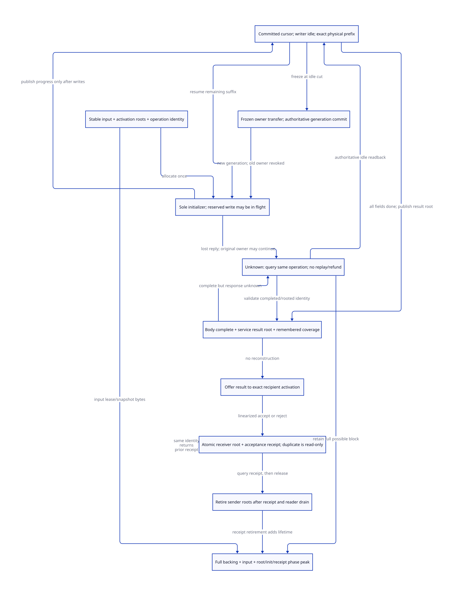

#+TITLE: Modern C Partial Initialization and Undelivered Result Recovery
#+SETUPFILE: ../../../modeling/org/setup.org
#+CATEGORY: gc-refactoring
#+PROPERTY: header-args :eval never :exports code
#+COLUMNS: %36ITEM %26STATUS %26OBLIGATION
#+OPTIONS: toc:3 num:t

* RESEARCH Decision and authority
:PROPERTIES:
:CUSTOM_ID: still-init-recovery
:AUTHORITY: GambitStillInitRecovery
:COMPONENT: gc-work; host-roots; continuation; resource-exit
:STATUS: conditional-kernels-checked-source-refinement-open
:OBLIGATION: IR-PROGRESS; IR-ROOT; IR-DELIVERY; IR-ABORT
:END:

Modern generated C is the required runtime architecture. This extends
[[file:still-init-safepoint-design.org][the initialization/safe-point contract]] to partial initialization and completed
results whose delivery is unknown. Scheme owns semantic InitSpec, field/layout
classification, PointId and activation identity. Modern C owns physical writes,
input leases, root registration, operation/owner generations, result admission
and retirement. This is a replacement contract for service/context separation;
there is no second Zig runtime or runtime implementation in this study.

[[file:models/sysml/still-init-recovery.sysml][SysML]] is the source of needs, dependencies, source routes, caller/cost rows and
diagram edges. The existing [[file:../../../modeling/ascent/assurance-planner.ss][ASCENT DSL]] derives qualification and transitive
blocking. [[file:../../../../models/gambit/still_init_recovery.qnt][Root QNT]] and [[file:../../../../models/gambit/lean/StillInitRecovery.lean][Lean]] are target behavioral kernels; their local checks
are neither native acceptance nor a complete source simulation.

* Source-grounded endpoints, not invented current failures
:PROPERTIES:
:CUSTOM_ID: still-recovery-source
:END:

** The pointer-bearing constructor

[[file:../../../../vendor/gambit/lib/_kernel.scm::43][ALLOC_SCMOBJ_INLINE]] may allocate a still object, decrement its native reference
count, restore the input and fill the body. [[file:../../../../vendor/gambit/lib/_kernel.c::23864][##make-structure's emitted consumer]]
then assigns RESULT/R3 and R1 before returning. The selected ordinary interval
contains no service yield, callback or lost-reply protocol. Its loop index and
memset do not expose resumable progress or an operation query API. This study
does not claim an existing asynchronous failure in that synchronous sequence.

[[file:../../../../vendor/gambit/lib/mem.c::1487][The allocator's contract]] requires body initialization before the next allocation;
[[file:../../../../vendor/gambit/lib/mem.c::1677][link/header/refcount publication]] precedes body fill. [[file:../../../../vendor/gambit/lib/mem.c::1743][make_pair and make_vector]]
write fields after allocation and require their native inputs not to be movable,
with additional still reachability/refcount conditions. Refcount1 is not proof
that an incompletely initialized pointer body can be scanned.

** An actual partial-error constructor and its consumers

[[file:../../../../vendor/gambit/lib/c_intf.c::5413][NONNULLSTRING_to_SCMOBJ]] first counts input characters, allocates STRING, then
fills it. In its UTF8 branch, p/start/i are real cursor state; an error after some
writes releases result, assigns *obj=false and returns a conversion error. At
[[file:../../../../vendor/gambit/lib/c_intf.c::5678][the common success endpoint]], *obj receives the object before the status returns.
The [[file:../../../../vendor/gambit/lib/c_intf.c::4335][C-to-Scheme conversion contract]] retains a still reference until its caller
releases it. [[file:../../../../vendor/gambit/lib/mem.c::1730][release_scmobj]] decrements that count; it is not an immediate free.

[[file:../../../../vendor/gambit/lib/mem.c::4016][The atomic subtype scan cases]] do not traverse STRING/BIGNUM payload words as
Scheme pointers. That distinction explains why a string converter's partial
error path cannot qualify a partially initialized STRUCTURE/PAIR for scanning.
There is no new allegation that current string cleanup is a pointer-body bug.

[[file:../../../../vendor/gambit/lib/os_io.c::11412][The directory-read consumer]] calls device_directory_read first, obtains name,
converts it, then releases/returns the result. Re-executing this entire wrapper
as a recovery strategy can advance the directory again. The operation identity
must therefore cover that earlier effect if wrapper-level recovery is promised.
A constructor-only ledger cannot prove directory-level exactly-once behavior.
The lifetime/immutability of borrowed name across service suspension remains an
explicit admission obligation, not a guarantee inferred from the pointer type.

[[file:../../../../vendor/gambit/lib/os_base.c::1735][Error-message conversion]] consumes a native/stack buffer and releases the converted
result before returning. A suspended service cannot keep using an expired stack
buffer. [[file:../../../../vendor/gambit/lib/c_intf.c::5732][NONNULLSTRINGLIST_to_SCMOBJ]] holds lst, str and pair across child conversion,
pair allocation and releases; this is a real parent/child ownership consumer,
not covered by a single-body proof. [[file:../../../../vendor/gambit/include/gambit.h.in::10269][Generated SFUN conversion scopes]] release their
converted values. [[file:../../../../vendor/gambit/lib/setup.c::3275][call/trampoline]] adds marker and nonlocal-return responsibilities.

#+NAME: still-recovery-endpoint-disposition
| Source endpoint | Existing source behavior | Target obligation / closure status |
|---+---+---|
| STRUCTURE RESULT/R3 -> R1 | One synchronous result, no reply journal | Preserve one initializer; publish result root before a new yield |
| UTF8 partial error | Release atomic payload; false/status output | Typed abort, stopped writer and known outcome; no generic pointer abort |
| STRING *obj -> status | Output store precedes return | Atomic recipient acceptance needs a managed slot; raw *obj is not a receipt |
| Directory input -> conversion | OS effect precedes constructor | Scope operation before effect, retain input lease; whole-wrapper closure open |
| String-list children | Distinct str/lst/pair references and releases | Parent/child IDs and root transfers; single-body abstraction insufficient |
| SFUN unwind/marker exit | Generated release and native nonlocal return | Own-token cleanup and activation identity; no root attached only to dead C locals |

* Operation identity and exact recovery state
:PROPERTIES:
:CUSTOM_ID: still-recovery-record
:END:

#+NAME: still-recovery-operation-shape
#+BEGIN_EXAMPLE
OperationKey = { VM, sessionGeneration, activationId, invocationSerial }
InitRecord = {
  key, allocationId, subtype, layoutId, initSpecId, ownerGeneration,
  initializerOwner, ownerState, inputLease, inputRootDomain,
  committedCursor, pendingWriteRange, writerState,
  completedBodyReceipt?, serviceResultRootReceipt?, deliveryState
}
Cursor = FieldIndex | { outputIndex, inputByteOffset, decoderState, inputImageId }
ResultReceipt = {
  key, allocationId, completeBodyId, resultRootId, rootEpoch,
  recipientActivation, recipientGeneration, admissionSerial
}
#+END_EXAMPLE

These are design data, not executable runtime declarations. Input contents,
allocation identity and descriptor generation must agree with the original
operation. A field count alone cannot restore a UTF8 decoder or a raw C stack.
A continuation captured before a Scheme call may deliberately invoke it again:
that new semantic invocation gets a distinct activation/invocation identity.
Deduplication never suppresses Scheme multi-shot continuation semantics.

A result root is an updateable registered reference, not a cached native address.
The still address does not move, but input/fill values or enclosing roots can.
Root and owner receipts must be validated against the active collector/domain
epoch. A stale readback is descriptive only; it cannot authorize writes or
retirement. Root updates/reloads, native borrower freeze and matching reader
drain remain shared HR/RC/WB obligations.

* Progress, physical writes and sole initialization authority
:PROPERTIES:
:CUSTOM_ID: still-recovery-progress
:END:

#+NAME: still-recovery-progress-steps
| Step | Guard | Effect / remaining custodian |
|---+---+---|
| ReserveWrite(p,q) | Current owner generation; stable input; no other in-flight batch | Record exclusive pending range [p,q); old committed p remains descriptive |
| PerformWrite | The same reservation and owner; no GC/callback/reentry | Write only reserved suffix; actual physical progress may exceed committed p |
| CommitProgress(q) | All reserved writes complete; writer at declared cut | Publish exact q/cursor and clear pending; no prefix replay |
| PrepareTransfer | Writer idle, no pending range, frozen old owner, retained roots/input | Package exact progress and responsibility; old owner may no longer write |
| CommitTransfer | Single operation/owner record arbitrates target acceptance | Advance generation once; same allocation/cursor, sole new initializer |
| Rejected transfer | Authoritative no-commit, old owner still owns record | Resume original owner at unchanged cut |
| Unknown transfer | Cannot classify commit | Retain frozen record and full backing; query same key; neither side assumes ownership |

Write publication is not a resumable cut until physical writes and cursor agree.
If a response disappears between a store and CommitProgress, restarting at the
last published p can rewrite an already written range. Even a repeated fill can
erase a later legitimate mutation after publication. The original writer must
finish that pending reservation, or recovery must prove it stopped and reconcile
the exact outcome. Merely timing it out does neither. An owner that has died with
unknown native store progress is quarantined; the present design proves no
crash recovery, forced arbitrary-instruction migration or eventual GC progress.

At a transfer cut, the old owner freezes before the record/roots are published;
the new generation is acquired before any target write. A release/acquire lock
handoff can establish this order. C store tearing, native memcpy interruption,
raw aliases and compiler reorderings are source/platform refinements, not facts
proved by recording an integer cursor. A synchronous fast path may have only
one end-of-constructor cut; no per-field atomic is imposed without a migration
requirement. With an admitted batch q, bookkeeping is ceil(a/q) publications,
not necessarily a publications. No bound on wall-clock pause follows from q.

Unfinished pointer bodies retain initialization custody and cannot acknowledge
the prior safe-point gate. A normal still root cannot make those fields safe.
The operation cannot wait for GC while GC waits for that same initializer.
Target alternatives (valid sentinel fill, partial scanners, GC-safe blocked
allocation) require separate proofs and costs; none is silently adopted here.

* Completed but not delivered: admission, not repeated execution
:PROPERTIES:
:CUSTOM_ID: still-recovery-delivery
:END:

#+NAME: still-recovery-delivery-steps
| State / answer | Allowed action | Disallowed inference |
|---+---+---|
| Busy(p,range,owner) | Observe or let original owner finish; retain roots/storage | Resume from p while pending writes may still occur |
| IdlePartial(cursor,ownerReceipt) | Acquire that exact owner/transfer receipt, then fill remaining suffix | Query itself grants ownership |
| BodyCompleteUnpublished(cursor=a) | Original owner publishes a registered result root; keep GC participation blocked meanwhile | Field completion alone is a rooted completion receipt |
| Complete(bodyReceipt,serviceRoot) | Offer the existing object to the exact recipient slot | Reconstruct object or rerun directory/FFI call |
| Accepted(recipientRoot,receipt) | Return/read the existing receipt; release sender only after matching handoff/drain | Lost reply means acceptance did not happen |
| Known failure before allocation | Settle only proven private liabilities | Reuse this rule for linked partial storage |
| Rejected / cancelled before acceptance | Withdraw offer under the same arbiter; retain or perform typed retirement | Cancellation request proves no target accepted |
| Unresolved | Retain original key, initializer/result responsibility and full possible backing | Replay with a fresh key, drop roots, refund on timeout |

The recipient transaction validates exact identity and generation, installs the
result root and records acceptance under one arbitration boundary. Only then
can it expose the slot to managed execution. Duplicate same-key admission reads
that receipt without changing the slot, repeating the initializer, advancing
native I/O or calling Scheme. Sender and recipient roots may overlap; they refer
to one backing object. Releasing the sender first creates a root gap.

This is an at-most-once result-admission contract within a live runtime. It is
not a claim that arbitrary Tcl/native callbacks or external effects become
exactly-once. A callback may escape after an external effect; without a separate
transactional effect protocol its outcome stays unknown and is not replayed.
No callback runs under the root/admission lock. A raw foreign consumer with only
*obj and a return status has no atomic receipt store; managed retry admission
must reject it until an explicit boundary is supplied. Its synchronous C API
can remain available without granting resumable-service authority.

If cancellation linearizes first, acceptance is refused and the offer must be
withdrawn before retirement. If acceptance linearizes first, cancellation cannot
undo the receiver's root or authorization. Nested callbacks own separate root
frames. An exception before handoff parks the operation in registered custody;
an exception after handoff does not erase the receiver's receipt. A C stack
unwind is never itself proof that backing or initialization responsibility ended.

Dedup metadata has its own last-user lifetime: fence further submissions for the
operation/session, drain outstanding retry/query readers and retain a generation
that cannot alias a later call before deleting the receipt. Receiver-root release
and receipt retirement are separate. The QNT model retains its receipt; no
bounded tombstone eviction, session closure or ABA proof is claimed.

* Conditional proofs, counterexamples and remaining refinement
:PROPERTIES:
:CUSTOM_ID: still-recovery-proof
:END:

QNT has31 named histories, one operation, three fields, two owner generations,
one recipient slot, two readback counters and abstract backing8. Positive
simulation samples100 traces of at most100 transitions. It separates reserved,
physically written and committed progress; transfer only at idle partial cuts;
unknown replies before/after body completion and acceptance; receipt dedup;
cancel order and typed atomic abort. Readback observes the current record and
is side-effect-free. Delayed stale reply transport, actual decoder state, many
participants, root scanning, remembered sets, native instruction interruption
and liveness are not modeled.

The retained omission controls cover prefix reset, repeated write, in-flight
transfer, revoked owner, early readiness, root gap, double acceptance, repeated
I/O, input lease loss, premature source cleanup, pointer partial abort and unknown
refund/retirement. The initial prefix-reset control exposed an invariant gap:
physical and committed progress were allowed to differ while idle. The model
now requires equality when no write is in flight. Its failed control and original
source are retained; this is a model correction, not a native bug report.

Lean checks16 named conditional statements. A small Progress Step/Trace kernel
preserves committed<=physical<=committed+1 and writes=physical. It additionally
checks monotonic progress, unique-owner premises, stale-generation rejection,
idempotent result admission, at-most-one admission and root overlap obligations.
That kernel is not the whole QNT transition system. No C instruction simulation,
complete initializer census, root/decoder representation theorem or native memory
order proof follows from these statements.

#+NAME: still-recovery-refinement-obligations
| Need | Source / mathematical obligation | Current boundary |
|---+---+---|
| IR-PROGRESS | Map actual loop/memset/decoder cuts and stopped writer to cursor; prove single-owner atomic handoff | Target kernel checked; actual source refinement open |
| IR-ROOT | Map completed body and updateable roots into collector domains, remembered coverage and reader drain | Reuses HR-RC/MARKER and WB-WRITERS/SNAPSHOT; source proof open |
| IR-DELIVERY | Map GVM slot/*obj/FFI effect to acceptance and activation identity; fence old receipt readers | Actual endpoints identified; raw ABI lacks managed receipt |
| IR-ABORT | Prove atomic versus pointer classification, writer stop, cancellation arbiter and exact backing retirement | Atomic source example identified; generalized cleanup open |

SysML dependencies make these blockers transitive through SP-STILL/SP-PEAK;
passing local histories cannot promote them. The expected graph is106 needs,
314 prerequisites,50 source routes and eight shared contracts. Source and memory
refinement remain distinct from local formal evidence. Selected native SysML
validation includes the predecessor52 files plus this model; whole-DEV and
unrelated concurrent studies are not requalified.

* Work, peak memory and retirement decisions
:PROPERTIES:
:CUSTOM_ID: still-recovery-benefit
:END:

For the existing synchronous constructor, required payload work remains a writes
and one allocation. Recovery after an authoritative prefix p requires a-p further
writes, not a complete refill. An unsafe replay implementation is not a valid
baseline for a claimed speedup. Modern C's benefit here is a reusable separation
of initialization and result custody that makes worker/context migration safe
under its premises; performance versus the present synchronous path remains
unmeasured and may regress if every small constructor receives needless metadata.

Let B be retained potential backing, E an owned input snapshot, R root metadata,
I initializer/cursor metadata and D delivery/dedup metadata. Charge their actual
coexisting backing per phase; overlapping sender/receiver roots do not double B.
For live operations L and retained receipts T, record storage is O(L+T), in
addition to the actual root slots scanned. Snapshot copying may cost E bytes and
O(E) work; a proven stable borrow can avoid that copy, but no lease is inferred
from a C pointer alone. Permanent uncertainty can retain B indefinitely.

The earlier selected still bound8a+63 requested bytes (<=65599) retains its WS8,
pointer8 and ordinary-malloc assumptions. This gate removes0 mandatory payload
allocations. It does not let movable worker tail space pay for a still block.
For phase t, let Q_t be actually omitted acquisitions and A_t added retained
backing/metadata. The candidate peak is max_t(P_t-Q_t+A_t); reduction requires
that maximum to be below max_t(P_t). A late refund cannot reduce an already
observed maximum, nor does one improved phase guarantee a lower whole-round peak.

#+NAME: still-recovery-migration
| Order | Shared modern C change | Old responsibility eligible for retirement |
|---+---+---|
| 1 | Scheme-generated typed InitSpec/effect/cursor and actual caller census | Duplicated implicit assumptions only for migrated constructors |
| 2 | Registered activation/input roots and generation-bound initializer record | Unowned C locals/scratch as sole custody; only after all relevant exits migrate |
| 3 | Batch cut, freeze and authoritative transfer arbitration | Blind retry/restart or caller-owned timeout takeover in new services |
| 4 | Recipient root+receipt admission, cancellation and callback boundary | Ad hoc release-before-handoff in admitted internal callers |
| 5 | Complete receipt/reader/session drain and typed physical retirement | Duplicate per-caller ledgers/cleanup branches after whole caller closure |

Public synchronous C ABI semantics and Scheme continuation semantics remain
requirements. No runtime path is retired by this research. A shared C generator
can centralize these protocols; Zig does not establish extra ownership, GC,
exactly-once or peak savings, and no second implementation is justified here.

* Literature learning and limits

[[https://www.cs.cmu.edu/~wing/publications/HerlihyWing90.pdf][Herlihy and Wing, Linearizability]], sections2 and4, separates invocation/response
histories from the abstract effect and uses representation relations for proofs.
We apply this to owner/admission arbitration; our local kernels do not prove
linearizability of Gambit's C implementation or provide a progress guarantee.

[[https://web.stanford.edu/~ouster/cgi-bin/papers/rifl.pdf][Lee et al., Implementing Linearizability at Large Scale and Low Latency]],
sections2-3, studies identity, completion records, retry rendezvous and metadata
retirement. Its motivating repeated-write example explains why replaying an
apparently idempotent initialization can overwrite later state. We borrow the
obligations, not RPC infrastructure, persistence assumptions or performance
numbers. This process-local design has no established server/client crash
recovery or lease-expiry reclamation.

[[https://ocaml.org/manual/5.3/intfc.html][OCaml's official C-interface manual]], sections5.1-5.2 and7, motivates valid fields,
scoped roots and explicit callback/exception boundaries. Gambit's own still
refcounts, root domains and multi-shot continuations determine the actual design;
OCaml macros or restrictions are not substituted for Gambit source proofs.

* Native-derived views and receipt
#+INCLUDE: "still-init-recovery-matrix.org" :minlevel 2

; [[file:../../../modeling/diagrams/component-proof-dependencies.svg][composed proof dependencies]].
[[file:../../../../evidence/research/still-init-recovery/checks.json][Source-bound receipt]] retains source/formal scopes, controls and unresolved boundaries.
