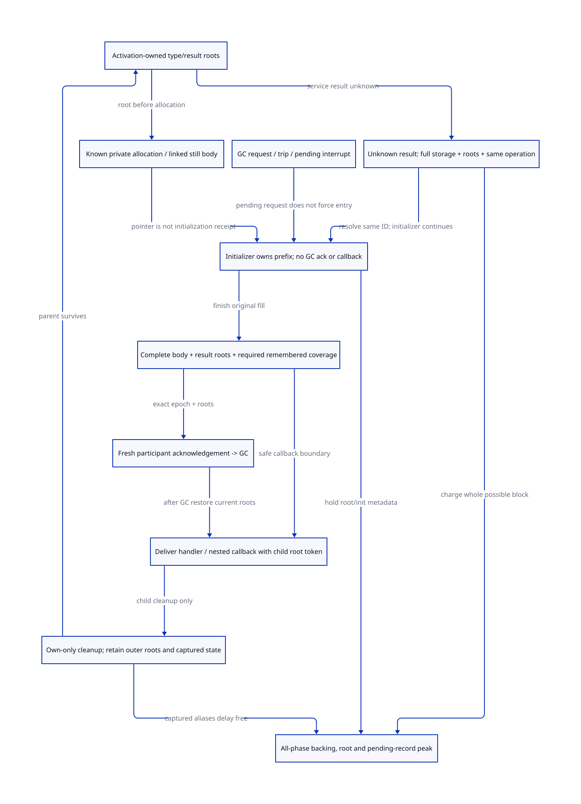

#+TITLE: Modern C Still Initialization, Safe-Point Participation and Root Custody
#+SETUPFILE: ../../../modeling/org/setup.org
#+CATEGORY: gc-refactoring
#+PROPERTY: header-args :eval never :exports code
#+COLUMNS: %38ITEM %25STATUS %24OBLIGATION
#+OPTIONS: toc:3 num:t

* RESEARCH Decision and architecture owner
:PROPERTIES:
:CUSTOM_ID: still-init-safepoint
:STATUS: selected-source-closure-target-laws-conditional
:AUTHORITY: GambitStillInitSafepoint
:COMPONENT: gc-work; host-roots; continuation; resource-exit
:OBLIGATION: SI-GATE; SI-CUSTODY
:END:

Modern generated C remains mandatory. This extends [[file:structure-poll-still-envelope-design.org][the structure/POLL/still study]]
to the actual boundary between a GC request, safe-point participation, pointer
initialization and Scheme/native callback delivery. It defines a replacement
contract, not an interrupt configuration workaround or another runtime language.
Scheme supplies semantic InitSpec/PointId/root/effect descriptors. C owns exact
allocation, owner-generation leases, root records, initialization, request and
participation publication. Scheme tail calls and multi-shot continuation remain
available; unqualified effects refuse a bounded/safe entry certificate, not
ordinary language semantics.

[[file:models/sysml/still-init-safepoint.sysml][SysML]] owns needs, source routes, caller/cost rows and view edges. [[file:../../../modeling/ascent/assurance-planner.ss][ASCENT]]
performs actual scoped qualification and transitive gap inference. [[file:../../../../models/gambit/still_init_safepoint.qnt][QNT]] models
request/participation/init/root histories; [[file:../../../../models/gambit/lean/StillInitSafepoint.lean][Lean]] checks13 conditional propositions.
None of these is a completed source simulation or native memory-model proof.

* Source evidence: allocation is not a scan-ready handoff
:PROPERTIES:
:CUSTOM_ID: still-init-source-chain
:END:

[[file:../../../../vendor/gambit/lib/_kernel.c::23864][The emitted ##make-structure body]] is a concrete consumer:

#+BEGIN_EXAMPLE
GC_SAVE1(type)
ALLOC_SCMOBJ_INLINE(STRUCTURE)       // may GC before obtaining the new pointer
  alloc_scmobj_still                // link/header/refcount1; body still uninitialized
  still_obj_refcount_dec(result)
GC_RESTORE1(type)                   // reload then clear saved[0]
INIT_SCMOBJ_INLINE(..., type)        // fill all a fields; no selected GC/callback call
PUSH_ARGS2(type,len); R3=result
R1=result; return to Scheme
#+END_EXAMPLE

[[file:../../../../vendor/gambit/lib/mem.c::1487][The allocator contract]] explicitly leaves body initialization to its caller and
requires it before another allocation. [[file:../../../../vendor/gambit/lib/mem.c::1677][The still allocator]] publishes list/header/
refcount metadata before returning. The selected [[file:../../../../vendor/gambit/lib/_kernel.scm::92][initializer]] does a memset or
field loop; its default source interval contains no POLL, GC call or callback.
A custom/interposed allocator or memory-fill hook is a separate effect input,
not automatically covered by the standard C path.

[[file:../../../../vendor/gambit/lib/mem.c::4222][setup_still_objs_to_scan]] selects externally referenced still objects; [[file:../../../../vendor/gambit/lib/mem.c::4170][scan's
ordinary still-object path]] visits all pointer fields. Refcount1 cannot make
uninitialized fields legal. After the native count is decremented to0, an
unregistered result can instead be omitted/reclaimed. Filling the body alone
also does not register that C local result as a collector root. Thus the target
safe cut requires BOTH completed initialization AND a current result-root
handoff before acknowledging participation or delivering a managed callback.
The existing uninterrupted C interval supplies that ordering implicitly; the
refactoring must express it when context/worker roles separate.

* True producers, consumers and direct-call census
:PROPERTIES:
:CUSTOM_ID: still-init-request-census
:END:

[[file:../../../../vendor/gambit/lib/setup.c::1182][___garbage_collect]] creates OP_GARBAGE_COLLECT and calls on_all_processors.
[[file:../../../../vendor/gambit/lib/setup.c::1140][The latter]] posts INTR_SYNC_OP then enters the synchronous-operation loop.
[[file:../../../../vendor/gambit/lib/setup.c::66][Posting]] writes a pending flag, trips the stack check and aborts device waiting;
it does not asynchronously execute Scheme or scan the interrupted C frame.

[[file:../../../../vendor/gambit/lib/_kernel.scm::229][POLL's handler]] saves registers/RA and may request GC after stack_limit.
[[file:../../../../vendor/gambit/lib/_kernel.scm::1426][The sync-op Scheme handler]] saves current state and calls service_sync_op.
[[file:../../../../vendor/gambit/lib/setup.c::1050][The loop]] enters barrier_sync_op and dispatches garbage_collect_pstate. It
synchronously clears the sync-op flag and processes operations until the
required no-op round; equal GC operations combine requested still amounts by
addition. Flag clearing alone is neither a per-request completion receipt nor
proof that a new constructor/root snapshot may already run.

[[file:../../../../vendor/gambit/lib/setup.c::313][Disabling interrupts]] keeps INTR_SYNC_OP enabled. Therefore it is not a
no-GC capability. The selected initializer is protected by an admitted interval
with no path into service/GC/callback, rather than by treating interrupt masks
as a stop-the-world lock. A modern collector must not substitute request arrival
for actual root-ready participation.

#+NAME: still-init-direct-callers
| Source surface | Actual producer / consumer | Admission boundary |
|---+---+---|
| _kernel.scm:43,280,1974,2040,2058 | Inline allocator, stack-limit handler, check-heap and explicit GC helpers | Keep preallocation GC separate from owned-uninitialized interval |
| mem.c:1647 | Still VM-accounting slow path calls GC before native block acquisition | Outer type roots must survive GC and any qualified cleanup effects |
| _num.scm:7941; _system.scm:1404 | Bignum / weak-table allocation helpers call GC | Sibling payload/root/initialization contracts must be classified independently |
| setup.c:1029 | Synchronous GC dispatcher calls garbage_collect_pstate | Exact frozen member/request generation, not a pending bit |
| setup.c:903 | VM resize execution can call garbage_collect_pstate directly | Resize/participant changes must honor the same initialization/root gate |
| setup.c:801; _kernel.scm:1438 | Terminated-run service loop and normal sync-op delivery | Context exit must settle or durably transfer initializer/root obligations |
| setup.c:206-241 | Interrupt selection and procedural OTHER servicing | Delivery is later than posting; queued native callbacks need effect contracts |
| os_time.c:987; os_setup.c:3037 | Timer handler -> registered heartbeat producer -> interrupt posting | No inference that a timer signal directly runs arbitrary Scheme code |

The [[file:../../../../evidence/research/still-init-safepoint/source-routes.json][structured source routes]]
record source classification, not runtime execution. Raw search output belongs
in the task cache and is not a published evidence dependency. Generated C mirrors are distinguished
from Scheme producers. External native callers, custom allocation hooks and
unclassified siblings remain explicit gaps; this is not a claim of whole-library
safe-point coverage from one ##structure audit.

* Modern C state machine and participation lease
:PROPERTIES:
:CUSTOM_ID: still-init-protocol
:END:

#+NAME: still-init-state-machine
| State | Responsible owner | Permitted transitions | Forbidden shortcut |
|---+---+---+---|
| Prepared | Activation root frame, exact owner generation | Allocate; qualified preallocation callback/GC with own roots | Replace another activation's scratch root |
| Pointer owned / body incomplete | Init token plus pointer/prefix and backing ledger | Finish original fill; retain queued requests | Acknowledge GC, callback, another managed allocation or Scheme exception delivery |
| Body complete / result-root debt | Same init/root token | Install scan-ready result root and complete publication | Treat initialized bytes or refcount0 as root publication |
| Scan-ready | Root frame and completed InitSpec | Freeze snapshot and acknowledge exact request; callback may get its own child frame | Spend an old epoch/root/owner receipt |
| Participating | GC/member lease owns immutable root snapshot | Collect; finish participation or obtain authoritative withdrawal | Resume mutation, release root frame or initializer ownership after merely posting/clearing a flag |
| Result delivered | Scheme root/continuation or explicit native result frame | Own-only activation cleanup after handoff | Erase parent/captured roots on inner exception |
| Result unknown | Same operation ledger retains roots, pointer possibility and full storage envelope | Resolve the same operation/generation; continue initializer under known owner | Replay with a new identity, refund/unpin or assume no pointer was allocated |
| Aborted before ownership | Known private reservation owner | Refund only the known private obligation | Apply this rule to linked/uninitialized or outcome-unknown storage |

GC requests and ordinary interrupt posts may remain pending during initialization.
This is not a promise to suppress all work forever. It is a requirement to finish
the admitted C initializer and root handoff before entering the collector's cut.
After acknowledgement the context stays frozen until participation ends; a new
request invalidates an old request-specific acknowledgement. The modern member
set and root domains remain those of the shared T0 contracts.

** Memory order and exact identity

The target sequence is: initialize root record/payload -> release-publish
completion/root snapshot -> release acknowledgement carrying request, context,
owner generation and snapshot identity -> collector acquire of matching receipt
and closed member set -> scan. A mutex handoff can implement the same relation.
Plain field stores, a pending flag or an arbitrary fence are not a substitute
for a C happens-before relation. Resume/root retirement require a matching
completion/withdrawal receipt and reader drain. Existing SYNC_GET/SEND and
architecture-specific shared-memory macros are source evidence, not a completed
C memory-model refinement. SI-GATE depends on the existing IH memory obligation.
No new C atomic implementation is supplied here.

For a generational target, initializing a nonmoving mature still object can
install references to young objects. Scan-ready therefore additionally requires
remembered-source coverage: either enroll the whole initialized object before
publication or record every relevant slot through the admitted initialization
barrier. A full collector's ordinary still scan does not establish this minor-GC
premise. SysML explicitly depends on WB-WRITERS and WB-SNAPSHOT; log overflow
must retain an owned fallback/reserve, never collect inside incomplete fill.
The local QNT has no remembered-set state; Lean's rootsReady is an assumed
predicate, not a derivation of coverage. Neither proves remembered-set
completeness. That source/refinement obligation remains open.

* Exceptions, callbacks and retained ownership
:PROPERTIES:
:CUSTOM_ID: still-init-reentry
:END:

The existing fixed [[file:../../../../vendor/gambit/include/gambit.h.in::8059][GC_SAVE/RESTORE macros]] overwrite and clear saved[0..2]; the
PSTATE has [[file:../../../../vendor/gambit/include/gambit.h.in::11623][three saved words]]. [[file:../../../../vendor/gambit/lib/mem.c::6526][mark_saved]] scans them for each participant.
That protects an admitted nonnested use. It is not a stack of native activation
roots. A nested use can logically overwrite a parent's cell or clear it on exit.

[[file:../../../../vendor/gambit/lib/c_intf.c::6511][The base marker allocator]] still contains the proc_or_false GC protection TODO.
The [[file:../../../../patches/fixtures/processor-interrupt-collective-wait-cumulative.patch::2010][cumulative patch recipe]] adds GC_SAVE1/RESTORE1, and its wrapper changes add
admission counts and unwind cleanup. These are different source artifacts from
an applied, built, qualified runtime. They do not prove arbitrary nested scratch
use safe. The parent input must remain in a distinct, updateable token-owned
root record through any collecting child allocation, and be reloaded afterwards.

The target RootActivation contains token/owner-generation, parent identity,
updateable Scheme slots, pending native-result/init reference and cleanup state.
Cleanup removes only its own token after result/initializer responsibility has
been accepted elsewhere. Unknown ownership and captured/nonlocal continuation
roots outlive lexical C scope as required. No generic defer statement guarantees
cleanup across the source's setjmp/longjmp-style control paths.

[[file:../../../../vendor/gambit/lib/setup.c::3275][___call/trampoline and generated SFUN wrappers]] are actual native reentry
surfaces. [[file:../../../../vendor/gambit/examples/tcltk/tcltk.scm::221][The Tcl command callback]] is a concrete Scheme callback consumer;
its marker and RC roots reuse HR-MARKER/HR-EXIT/HR-RC/VM-binding obligations.
A callback inside an unfinished initializer is not admitted by this design.
It must finish first, or use a separately proved scan-safe partial representation.
If the caller cannot do either, the native boundary returns a controlled rejection
or remains unqualified; it must not throw a Scheme exception through unfinished
storage to create the appearance of cleanup.

A real additional surface is [[file:../../../../vendor/gambit/lib/mem.c::4387][GC cleanup]] -> [[file:../../../../vendor/gambit/lib/c_intf.c::1683][release_foreign]] -> native release_fn.
The function call exists; permission/reachability of arbitrary Scheme reentry
from that GC phase is NOT proved. Nor is Tcl deletion thereby proved to occur
inside this constructor. Defer/qualify destructive callbacks using the existing
release-coordinator contract, or refuse unsupported effects. Negative shared-
scratch histories are target counterexamples, not established native crashes.

** Avoid the circular wait

Do not acknowledge GC while depending on callback completion that itself waits
for the same GC. Do not wait synchronously for delivery of a queued Scheme
exception/interrupt while the collector waits for this initializer. Complete the
noncollecting interval and roots first. A native allocator that blocks or invokes
unknown hooks provides no bounded pause guarantee. Supporting a GC-safe blocked
allocator would additionally require frozen roots, unlinked private-result
custody and a reentry ownership check before touching Scheme memory; it is not
silently inferred from C blocking or included as a finished design here.

** Failure cases

Before a pointer/link exists, known reservation failure may settle its own charge
and report through the normal rooted error path. The selected successful fill
has no ordinary error branch between pointer acquisition and completed handoff.
An unexpected unwind after link/prefix must retain initializer and backing: either
finish valid fields under the original owner, or obtain a separately proved
unlink/last-alias/drain receipt. Refcount decrement alone permits neither cleanup.
Fatal native faults and unresolved outcomes do not imply recoverable GC progress.

The proposed asynchronous service's unknown result is distinct from synchronous
malloc's known return. Charge the full possible block and retain input roots,
operation generation and initializer authority until same-ID resolution. A
bounded pending-slot policy can bound retained metadata; this model proves no
liveness, crash recovery, timeout-based reclamation or eventual completion.

#+NAME: still-init-unknown-resolution
| Authoritative same-operation answer | Required custody and allowed action |
|---+---|
| FailedBeforeAllocation | Settle only the identified private charge after proving no pointer/link/result was acquired |
| AllocatedOwned(progress, InitOwner) | Preserve exact prefix, allocation identity and sole initializer owner; resume at that progress, never restart initialization |
| Complete(resultRootReceipt, deliveryOwner) | Validate initialized body, published root and generation; deliver once or retain that result's custody |
| Unresolved | Retain possible backing, input/result roots, operation generation and initializer responsibility; no replay/refund/unpin |

Loss of a reply cannot reset progress to zero or authorize a second initializer.
Reinitializing a complete published object could overwrite user-visible writes;
finishing the original operation requires an authoritative progress/readback
protocol. The checked QNT unknown branch represents preallocation uncertainty
only. Partial-copy and completed-but-undelivered unknown outcomes remain explicit
unmodeled refinement obligations, including duplicate delivery and root-receipt
validation. A timeout is not one of the authoritative answers above.

* Quantified work and peak boundaries
:PROPERTIES:
:CUSTOM_ID: still-init-benefit
:END:

For the selected structure, the normal fill writes a words once. The gate need
not add a second O(a) initialization pass or a per-field callback. A candidate
that preinitializes a safe sentinel then writes final fields adds another a
field writes. Partial-scan metadata is a different collector design with its
own scanner/proof cost; neither is counted as an implemented saving.

For K retained activations with R_i root slots, target scanning is O(sum R_i)
and records are O(K), plus initializer/operation metadata. The exact C sizeof,
cache/atomic costs and peak lifetime need native layout qualification later.
During migration retaining both saved[3] and new root records adds both costs.
Only a complete SAVE1/2/3, RESTORE, marker, exception and native-call census allows
retiring the fixed scratch path. None is retired now.

Existing selected still backing remains8a+63 requested bytes under the previous
ordinary WS8/pointer8 malloc assumptions, <=65599. This study removes no mandatory
payload allocation. The peak must add all root records, withheld initialization,
unknown full blocks and delayed/captured aliases to overlapping phases. Qg can
lower the whole-round maximum only when actual omitted acquisition remains
larger than these added costs at every dominant phase; no automatic saving,
measured peak reduction, RSS bound or speedup follows from the new gate.

* Refinement and checked boundary
:PROPERTIES:
:CUSTOM_ID: still-init-refinement
:END:

QNT has21 histories over one initializer, two root activations, two request
numbers and an abstract held-block bound8. It checks early participation,
completed-but-unrooted entry, frozen participant mutation, pending interrupts,
child cleanup, unknown retention and same-operation resolution. Native pointer
provenance, field layouts, many participants, callback legality and source steps
remain open. An initial model invariant incorrectly treated a completed earlier
interrupt delivery as a delivery inside a later initializer; its trace/source
are retained and the event was scoped to the active initializer. This is a model
correction, not a native bug. The participant lease also prevents mutation after
acknowledgement and before collection completes.

Lean checks13 exact conditional statements: completion and result-root requirements,
fresh requests, field coverage, distinct-token cleanup, unknown charge and root/
peak accounting. Whole QNT induction and C memory-model/source refinement are
not established. Native SysML validates the predecessor51-file set plus this
model; Org validation covers8 owned documents and their referenced targets.

The composed graph retains100 needs/288 edges/46 routes/eight shared contracts.
Two ancestor inference cuts and two qualification-free route projections retain
the exact union. The inference-only transport elides exactly seven metadata
forms whose input facts are empty; the full DSL, qualification rules and every
prerequisite are retained. Metadata projections still carry every route/contract.
This stays within unchanged engine limits; it is not a new architecture owner.

* Learning from OCaml, then applying Gambit's own semantics

[[https://ocaml.org/manual/5.3/intfc.html][The official C-interface manual]], sections5.1-5.2, requires scoped roots and
valid fields before another allocation; it also describes safe filler values
when allocation must occur before final contents are available. Sections7 and9
separate callback/exception boundaries and restrict custom finalizer interactions.
We learn to state explicit obligations, not copy OCaml's macros or infer those
restrictions already hold for Gambit's arbitrary release functions.

[[https://anil.recoil.org/papers/2020-icfp-retropar.pdf][Retrofitting Parallelism onto OCaml]], sections4.4 and5, motivates coordinated
minor collection and complete language/FFI integration. Gambit's own saved-root
array, cooperative sync-op path, still constructor and multi-shot continuation
determine this design. No paper benchmark or fiber layout is imported.

* Native-derived matrices and diagram
#+INCLUDE: "still-init-safepoint-matrix.org" :minlevel 2

; [[file:../../../modeling/diagrams/component-proof-dependencies.svg][composed prerequisite graph]].
[[file:../../../../evidence/research/still-init-safepoint/checks.json][Source-bound receipt]] keeps formal checks distinct from native acceptance.
