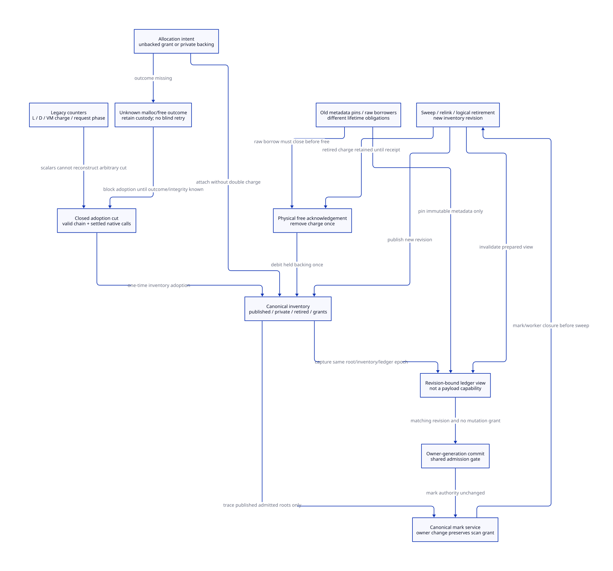

#+TITLE: Modern C Still Inventory Reconstruction and Snapshot-Consistent Handoff
#+SETUPFILE: ../../../modeling/org/setup.org
#+CATEGORY: gc-refactoring
#+PROPERTY: header-args :eval never :exports code
#+COLUMNS: %40ITEM %25STATUS %25OBLIGATION
#+OPTIONS: toc:3 num:t

* RESEARCH Architecture decision :modern_c:gc:smp:
:PROPERTIES:
:CUSTOM_ID: still-ledger-decision
:AUTHORITY: GambitStillLedgerSnapshot
:COMPONENT: gc-work; host-roots; continuation; resource-exit
:OBLIGATION: LS-INVENTORY; LS-INTENT; LS-SNAPSHOT; LS-RECLAIM
:STATUS: conditional-models-native-refinement-open
:END:

Modern generated C remains mandatory. [[file:still-authority-handoff-design.org][The previous authority/handoff study]] introduced
one canonical still domain independent of PSTATE. This study refines its ledger:
existing live/deferred/global counters cannot reconstruct physical backing at
arbitrary cuts. Adoption requires a closed inventory plus known native-call
outcomes; future managed allocation requires an intent recorded before the call.
No runtime implementation, native test or performance validation is supplied.

One snapshot binds domain/owner generation, root epoch, inventory revision,
allocation-intent settlement and collector mutation authority. Ownership-only
commit can overlap qualified canonical marking, but cannot race list edits,
sweep or ledger mutation without the same admission gate. Logical retirement,
capacity refund, physical free and observed residency are distinct events.

[[file:models/sysml/still-ledger-snapshot.sysml][SysML]] owns six needs, dependencies, actual caller/cost rows and view topology.
[[file:../../../modeling/ascent/assurance-planner.ss][ASCENT]] checks exact source/digest/scope and transitive blockers. [[file:../../../../models/gambit/still_ledger_snapshot.qnt][QNT]] models
one two-word existing block, one two-word intent and allocation/sweep/free cuts.
[[file:../../../../models/gambit/lean/StillLedgerSnapshot.lean][Lean]] checks16 conditional propositions including refund Step/Trace conservation
and noninjective legacy-counter examples. Native witness issuance, arithmetic
width, the joint C gate and whole-QNT/source refinement remain open.

* SOURCE Counter meanings and real consumers
:PROPERTIES:
:CUSTOM_ID: still-ledger-source
:END:

#+NAME: still-counter-phase-map
| Source state | Actual producer/consumer | Meaning and reconstruction limit |
|---+---+---|
| words_still_objs | [[file:../../../../vendor/gambit/lib/mem.c::4419][Sweep stores survivor-length sum]] | A GC phase result, not a continuously updated physical inventory |
| words_still_objs_deferred | [[file:../../../../vendor/gambit/lib/mem.c::1571][Small-allocation path]]; [[file:../../../../vendor/gambit/lib/mem.c::6804][GC setup fold]] | Deferred charge, not a second cohort of physical objects |
| occupied_words_still | [[file:../../../../vendor/gambit/lib/mem.c::1624][VM precharge]], [[file:../../../../vendor/gambit/lib/mem.c::1668][failure rollback]], [[file:../../../../vendor/gambit/lib/mem.c::6291][GC recount]] | Capacity/policy value whose meaning changes across phases |
| requested_words_still | [[file:../../../../vendor/gambit/lib/setup.c::1183][GC request]] -> [[file:../../../../vendor/gambit/lib/mem.c::6300][resize_heap]] | Proposed space can be treated as live before any block exists |
| STILL_LENGTH | [[file:../../../../vendor/gambit/lib/mem.c::1684][Allocation metadata]] | Logical block words including still prefix; not allocator padding or RSS |
| bytes_allocated_minus_occupied and bytes_occupied | [[file:../../../../vendor/gambit/lib/mem.c::367][Accounting macro]], [[file:../../../../vendor/gambit/lib/mem.c::7000][GC entry/exit]], [[file:../../../../vendor/gambit/lib/mem.c::6287][statistics aggregation]] | Allocation/statistical bookkeeping, not a raw backing census |

[[file:../../../../vendor/gambit/lib/mem.c::6256][determine_occupied_words]] loops processor_count and sums per-PSTATE live still
statistics. [[file:../../../../vendor/gambit/lib/mem.c::486][Heap-size/free-space helpers]] consume global still charge. Retiring a processor
without a new domain census would lose its retained contribution; duplicating
the old counters into two owners would overcount. The current recount is O(P)
processors. Sweep already accumulates live lengths during its necessary O(N)
chain pass: no extra existing full-chain recount pass has been proved removable.

** Allocation ordering gives an actual ambiguity witness

[[file:../../../../vendor/gambit/lib/mem.c::1593][Small allocation]] first obtains an aligned block, then updates deferred charge,
then links/initializes metadata. [[file:../../../../vendor/gambit/lib/mem.c::1610][Large allocation]] may charge new words plus the
previous deferred cohort before the physical call. On physical failure it
subtracts only new words; the previously deferred cohort remains accounted for.
The rollback cannot refund that prior cohort too.

For a conditional successful large allocation of w words, the interval after
VM precharge but before the native call and the interval after native success
but before list publication can have identical live/deferred/global counters.
Physical backing differs by w. This is a static sequential source witness, not
a native fault injection or a claim that current synchronous GC samples that gap.
A counter-only decoder therefore cannot recover arbitrary interrupted states.
The Lean witness formalizes the abstract information loss; it does not prove all
LegacyView records are reachable C executions.

** Post-GC is not automatically an empty-intent cut

[[file:../../../../vendor/gambit/lib/mem.c::1646][The large allocator can call GC before obtaining its block]]. [[file:../../../../vendor/gambit/lib/setup.c::488][The GC operation
uses COMBINING_ADD]]; [[file:../../../../vendor/gambit/lib/setup.c::1183][the request]] carries requested words and returns overflow status.
[[file:../../../../vendor/gambit/lib/mem.c::6368][resize_heap temporarily treats that request as live]], and its overflow paths
subtract the request and zero it before retry/return. The caller may still be a
live C allocation activation waiting to resume after GC.

Consequently a post-sweep barrier does not prove every per-domain allocation
intent is absent. An aggregate requested sum cannot identify each requester or
private outcome. Legacy adoption must either drain those activations at a later
acknowledged cut, or first capture per-request identity, extent, return slot and
settlement. The current scalar API does not already provide that receipt.

** Requested native bytes differ from logical words

[[file:../../../../vendor/gambit/lib/mem.c::554][alloc_mem_aligned_aux]] adjusts multiplier for pointer alignment, computes extra
padding, requests a container and stores its raw address before the aligned
pointer. [[file:../../../../vendor/gambit/lib/mem.c::657][free_mem_aligned_heap]] frees that original container. For the selected
profile's actual word/pointer widths and modulus:

#+NAME: still-extent-equations
#+BEGIN_EXAMPLE
w = STILL_BODY + WORDS(bodyBytes)
m = max(requestedMultiplier, pointerBytes / wordBytes)
extra = m*wordBytes - 1 + (modulus < pointerBytes/wordBytes ? pointerBytes : 0)
alignmentLayerRequestBytes = extra + (w+modulus)*wordBytes
#+END_EXAMPLE

This is the request at the alignment layer. [[file:../../../../vendor/gambit/lib/os_base.c::445][The heap wrapper]] may route to the
ordinary allocator or the code allocator. [[file:../../../../vendor/gambit/lib/os_base.c::321][The mmap code-allocator branch]] adds
two size fields and has platform/page effects. Debug and platform branches also
exist. Neither logical word totals nor the alignment-layer request determine
allocator usable size or RSS. Checked multiplication/addition and configured
backend identity are prerequisites; Lean's natural-number inequality does not
prove machine arithmetic cannot overflow.

* DESIGN Reconstruct at a qualified cut, then maintain a typed ledger
:PROPERTIES:
:CUSTOM_ID: still-ledger-inventory
:END:

#+NAME: canonical-still-ledger
#+BEGIN_EXAMPLE
DomainLedger = {
  domainId, vmGeneration, inventoryRevision, rootEpoch, gcPhase,
  publishedBlocks, privateHeldBlocks, retiredHeldBlocks,
  allocationIntents, nativeExtents, releaseObligations
}
Intent = { operationKey, ownerGeneration, checkedWords, requestBytes, backend,
           grantState, callState, outcomeReceipt, blockIdentity, refundState }
Capacity = publishedWords + privateHeldWords + retiredHeldWords + unbackedGrants
HeldBlockLogicalWords = publishedWords + privateHeldWords + retiredHeldWords
#+END_EXAMPLE

At a qualified settled cut each physical block belongs to one inventory category. Attach changes an
unbacked grant to held private backing; publication changes private to published;
retirement changes published to retired-held. These transfers do not add another
charge. A known no-block failure cancels only its own grant. A physical free
acknowledgement removes its own held extent. Pending/unknown outcomes keep a
conservative liability; the categories are not a claim of exact actual residency
while native execution is unresolved.

HeldBlockLogicalWords is the logical extent of known held blocks, excluding
alignment/backend overhead. An "unbacked grant" in the abstract ledger means no
backing has yet been attached to that record; while the outcome is unknown it
may conservatively cover a block already allocated natively. It is not evidence
that no physical block exists. Only a qualified one-block/extent-bound adapter
can turn that liability into a physical upper bound. Do not add the same grant
again as RAM after attaching its backing.

Legacy import requires valid list/header traversal, settled allocator/list
writers, scan/sweep phase closure and complete roots. Walk unique blocks once;
associate private reservations only from authoritative records. Existing malloc
has no operation-keyed result query. If a successful unrecorded raw allocation
or free cannot be identified safely after interruption, keep adoption unresolved.
A stop receipt alone supplies neither its pointer nor its outcome.

Future managed entry pre-registers the intent and checked extent before calling
the allocator. A native adapter still needs outcome/last-use evidence; an intent
record does not magically make malloc/free replayable. New metadata allocation
and its failure must be covered before exposing the intent. Normal synchronous
paths may combine these stages under one qualified guard; no mandatory helper
thread or additional payload copy is prescribed.

* DESIGN Snapshot publication and collector coordination
:PROPERTIES:
:CUSTOM_ID: still-ledger-snapshot
:END:

#+NAME: still-ledger-admission-view
#+BEGIN_EXAMPLE
LedgerView = { domainId, ownerGeneration, inventoryRevision, ledgerRevision,
               rootEpoch, markEpoch, sweepGrant, intentSettlement, capacitySummary }
OwnerCommit requires:
  expected owner + matching revisions/epochs + stable native mutation state
  + a gate shared with grant admission, sweep/list edits and ledger publication.
#+END_EXAMPLE

A version read followed by an unrelated owner CAS has a check/use race. The
comparison and authority reservation must linearize with the start of inventory
mutation. Use one qualified joint gate or equivalent atomic descriptor protocol;
the design does not claim an implemented C algorithm, wait freedom or bounded
retry. An odd/even revision counter alone is also insufficient if it permits
plain C data races while a reader copies fields.

Canonical mark ownership and work debt remain with the collector service across
owner-only handoff. For qualified marking that does not change inventory/ledger
identity, ownership change can preserve its scan grant. Actual mark metadata,
roots and forwarding writes still obey their own epoch/worker protocols.

[[file:../../../../vendor/gambit/lib/mem.c::4387][Sweep relinks and frees]] while accumulating survivors; [[file:../../../../vendor/gambit/lib/mem.c::7000][the current GC ordering]]
places barriers between setup, strong/weak marking, cleanup and resize. The new
adapter must preserve those phase dependencies. Sweep/list mutation excludes
owner commit, publishes a new inventory/ledger revision, and invalidates any
prepared old view. Refreshing a view must revalidate receiver resources and root
phase too; a refreshed number is not a reusable old authority token.

At native publication, all fields of the immutable snapshot precede its release
publication, and readers acquire the matching snapshot. Old snapshot versions
remain alive for their metadata readers. No reader may combine a new chain head
with old counters or a new owner with an unaccepted root census. Full-root and
scan adapters remain source obligations, not consequences of equality of totals.

* DESIGN Refund, release and old-reader custody
:PROPERTIES:
:CUSTOM_ID: still-ledger-reclaim
:END:

#+NAME: still-ledger-failure-matrix
| Cut | Required evidence | Custodian / forbidden shortcut |
|---+---+---|
| Grant issued, allocator not entered | Exact intent and grant extent | Capacity service keeps grant; do not trace a nonexistent object |
| Native allocation in flight / result unknown | Stable operation identity plus actual outcome and call closure | Intent service retains grant; no timeout refund, blind retry or guessed pointer |
| Known private block, not published | Block/container identity, checked extent, input roots and initializer ownership | Domain retains private backing; GC excludes uninitialized body from object traversal |
| Known null allocation return | Matching intent, no acquired block, closed call | Refund that grant once; prior deferred objects stay charged |
| Object unlinked as dead | Closed mark/borrow authority and retired-held record | Retain charge until physical free acknowledgement; unlink is not refund |
| Foreign destructor or free outcome unknown | Allowed executor, side-effect outcome and allocator-integrity evidence | Release coordinator retains responsibility; current native APIs supply no generic replay receipt |
| Old metadata view remains | Immutable version pin, no raw payload authority | Retain metadata; old summary cannot authorize current commit or capacity credit |
| Raw block user or scanner still active | Root/borrow or scan grant and actual last use | Retain physical backing and authority; cannot relabel it as an inert metadata reader |

A metadata pin is not a Scheme root. In the target model it may outlive physical
payload release because it grants access only to immutable records. Resolving
an object requires current canonical identity/generation and an appropriate
root/borrow grant. A live raw Scheme input usually contributes a root and cannot
simultaneously be declared unreachable by sweep. Collector raw readers/mutators
must also close before freeing their touched storage.

Separating retirement from free permits quarantine of unstarted release work,
with extra retained memory. It does not guarantee GC progress once an unknown
native free/destructor has entered shared allocator locks or arbitrary C code.
[[file:../../../../vendor/gambit/lib/c_intf.c::1683][release_foreign invokes native release_fn]]; its affinity, callbacks and completion
remain resource-exit obligations. The QNT unknown-free state retains debt and
blocks its scan/commit gate; it is not silently turned into successful freeing.
[[file:../../../../vendor/gambit/lib/os_base.c::388][The code-free wrapper]] discards munmap/VirtualFree return values. Under that
backend, normal return from the existing void heap-free wrapper is not a
backend-success receipt. A managed release adapter must retain the real result,
identity and extent before crediting release; the raw void ABI cannot supply
that evidence by itself. No actual munmap failure was tested or asserted here.
For a valid ordinary free call, language-level release still does not prove an
immediate RSS reduction. QNT ackFree denotes a qualified backend receipt, not
merely arrival at the current void function's return.

* PROOF Model correspondence and remaining obligations
:PROPERTIES:
:CUSTOM_ID: still-ledger-proof
:STATUS: conditional-local-checks-native-open
:END:

#+NAME: still-ledger-proof-matrix
| Need | Local mechanism / real route | Remaining proof |
|---+---+---|
| LS-H | 30 finite histories: grant/private/public/retired transitions, stale view, scan/commit, refund/free and two reader classes | Unbounded executions and native liveness |
| LS-I | 16 statements; refund Step/Trace preserves issued credit; category transfers conserve capacity; ambiguous legacy projection | Whole-QNT induction, C reachability and machine arithmetic |
| LS-INVENTORY | Small/large allocation, aligned extent and processor recount consumers | Closed adoption cut, deduplication, backend extent and pending-request mapping |
| LS-INTENT | Actual malloc/free return and rollback endpoints | Outcome receipt issuance, metadata failure and no hidden extra native allocations |
| LS-SNAPSHOT | Mark/weak/sweep/barrier/resize order and prepared-view invalidation | Joint gate, memory order, all actual readers and mutation grants |
| LS-RECLAIM | Sweep/free/foreign release and old PSTATE cleanup | Last-use/root closure, physical free evidence and destructor/thread affinity |

AH-CHAIN now depends on inventory and snapshot refinement; AH-ADMIT depends on
intent and reclamation. The old authority model's four abstract words are not
reinterpreted as a completed C-counter conversion. All existing native needs and
edges remain in the graph. Source routes alone issue no source-refinement proof.

The QNT representation holds one bounded intent and abstracts outcome witnesses.
Unknown held categories are conservative liability, not measured residency.
The deliberately unsafe refund step must violate safe. Negative histories retain
counter-only reconstruction, double refund, refund-after-acquisition, invalid
shell publication, raw-reader free, mutation during scan and pending allocator
handoff. The stale-view history separately checks commitReady is false.

ASCENT qualification policy and exact scopes/hashes remain unchanged. Inference
cuts elide only unused transport rules and empty metadata outputs; the current
case also omits fictional control-receipt injection. Full metadata queries retain
the omitted views. Duplicate padding has set semantics and independent unpacking
must recover the entire native need/edge/receipt/subject sets. Engine bounds are
not enlarged and no prerequisite is removed to make a query pass.

* RESEARCH Mechanism evidence and limits
:PROPERTIES:
:CUSTOM_ID: still-ledger-literature
:END:

[[https://www.open-std.org/jtc1/sc22/wg14/www/docs/n1570.pdf][C draft N1570]], sections5.1.2.4 and7.17, distinguishes synchronization from plain
shared-memory access; sections7.22.3.3-7.22.3.4 specify free/malloc behavior rather
than process RSS. Native profile and allocator selection still require evidence.
[[https://www.kernel.org/doc/html/latest/RCU/Design/Requirements/Requirements.html][McKenney's RCU requirements]] separates publish/subscribe and reclamation after
pre-existing reader closure. The lesson is to state who can dereference which
version, not to import Linux primitives or assume a reader pin proves GC roots.
[[https://anil.recoil.org/papers/2020-icfp-retropar.pdf][Retrofitting Parallelism onto OCaml]], sections4.4 and5, motivates coordinating
GC phases with the C interface. Gambit's still metadata, raw C constructors,
continuation roots and synchronous allocation requests determine this design;
no OCaml performance result or runtime representation is copied.

* MATRIX Work, memory and retirement
:PROPERTIES:
:CUSTOM_ID: still-ledger-benefits
:END:

#+INCLUDE: "still-ledger-snapshot-matrix.org" :minlevel 2

#+NAME: still-ledger-retirement
| Old responsibility | Replacement | Actual retirement condition |
|---+---+---|
| Processor-only capacity recount | Unique canonical-domain summaries, including retained domains | Every block/intent/reservation classified and all capacity consumers migrated |
| Interpreting phase counters as physical inventory | Typed ledger plus explicitly retained statistical counters | Closed legacy import and exact phase/request refinement |
| Unkeyed failure rollback assumed retryable | Unique intent/outcome/refund record | All allocation and error consumers cover missing/late outcomes |
| Cleanup free coupled to PSTATE lifetime | Domain-owned retirement and release acknowledgement | Root/borrow/scan closure and raw embedding consumers qualified |
| Unrelated version check and owner update | Shared snapshot/authority admission | C memory-order and linearization proofs plus native acceptance |

No old path retires in this study. Modern C and Zig owe the same inventory,
outcome and lifetime contracts; no additional Zig net benefit is established.
Capacity correctness enables retained domains and safer retirement. It does not
by itself eliminate required tracing, sweep or payload allocation, and retained
private/retired storage can increase the whole-round peak.

The machine receipt explicitly binds ledgerCosts to this study's native cost
rows, and verification compares them exactly with the matrix source. The prior
authority-handoff receipt accidentally selected older materializationCosts for
its benefit summary; its native-derived authority matrix and formal scopes were
correct. This study records that correction without rewriting the old receipt.
No formal/native qualification is upgraded by repairing presentation metadata.

* CHECK Source-bound artifacts
:PROPERTIES:
:CUSTOM_ID: still-ledger-checks
:END:

- [[file:../../../../evidence/research/still-ledger-snapshot/checks.json][Study receipt]]
- [[file:diagrams/still-ledger-snapshot.d2][D2]] / 
- [[file:../../../modeling/diagrams/component-proof-dependencies.d2][Shared proof graph]]
- [[file:../../../modeling/component-assurance.org][Component assurance]]

#+NAME: still-ledger-sysml-source
#+INCLUDE: "models/sysml/still-ledger-snapshot.sysml" src sysml
#+NAME: still-ledger-d2-source
#+INCLUDE: "diagrams/still-ledger-snapshot.d2" src d2
