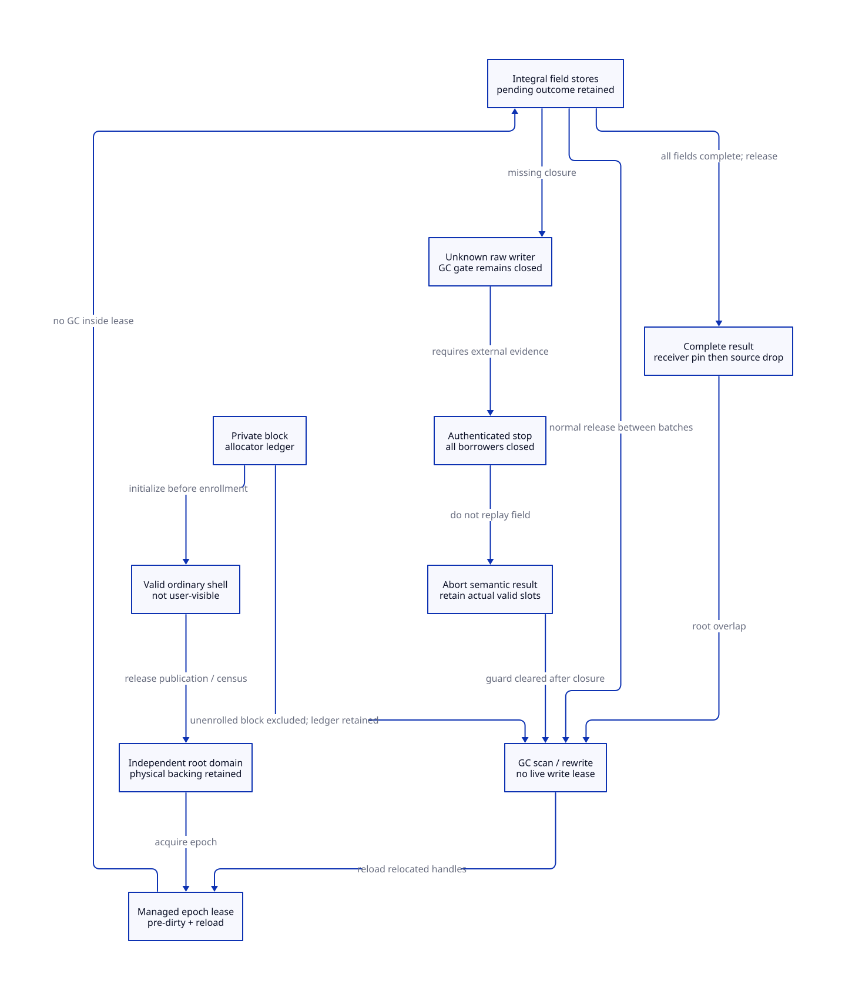

#+TITLE: Modern C Heap Materialization, Owner Loss and Scan Custody
#+SETUPFILE: ../../../modeling/org/setup.org
#+CATEGORY: gc-refactoring
#+PROPERTY: header-args :eval never :exports code
#+COLUMNS: %40ITEM %25STATUS %25OBLIGATION
#+OPTIONS: toc:3 num:t

* RESEARCH Decision and evidence boundary :modern_c:gc:smp:
:PROPERTIES:
:CUSTOM_ID: materialization-decision
:AUTHORITY: GambitStillMaterializationCustody
:COMPONENT: gc-work; host-roots; continuation; resource-exit
:OBLIGATION: MC-SHELL; MC-WRITE; MC-ROOT; MC-RECOVER
:STATUS: conditional-models-source-refinement-open
:END:

Modern generated C is the selected runtime direction. This study refines the
single admitted materialization transition in [[file:still-owner-retirement-design.org][the previous owner-isolation study]].
That abstraction did not cover death inside the final managed fill. Here a
scan-valid object, a rooted object, a writer-closed object and a semantically
complete result are four different facts. No runtime implementation, native
experiment, asynchronous thread termination or process-crash recovery is supplied.

The design admits recovery after integrity-preserving writer closure. It does
not admit detaching an unknown-live raw heap writer from a moving collector.
A scannable shell removes unknown contents from the problem; it cannot remove
unknown writes, old pointer aliases, allocator locks or collector dependencies.
Before heap authority is granted, an isolated native helper can remain unknown
without holding the GC gate. After that authority is granted, safe closure is
necessary. This distinction is an architecture limit, not a missing Zig feature.

[[file:models/sysml/still-materialization-custody.sysml][SysML]] is the authority for six needs, dependencies, caller routes, cost rows and
view topology. [[file:../../../modeling/ascent/assurance-planner.ss][The ASCENT DSL]] evaluates those native projections with exact source,
digest and scope bindings; source obligations remain pending. [[file:../../../../models/gambit/still_materialization_custody.qnt][QNT]] checks finite
interleavings; [[file:../../../../models/gambit/lean/StillMaterializationCustody.lean][Lean]] checks conditional propositions and a root-handoff Step/Trace
kernel. Neither is a proof of C store integrity or a qualified native runtime.

* SOURCE Real construction, mutation and collection chains
:PROPERTIES:
:CUSTOM_ID: materialization-source
:END:

** Physical publication is earlier than body validity

[[file:../../../../vendor/gambit/lib/mem.c::1487][alloc_scmobj's contract]] requires caller initialization before the next allocation.
[[file:../../../../vendor/gambit/lib/mem.c::1677][The still allocator]] links the block, sets count/length/header and returns its
uninitialized body. The list link is assigned before the following metadata
writes; it is not an interruptible, crash-safe publication protocol. Ordinary
operation relies on the existing collective/safepoint discipline. This is not
evidence that today's GC routinely scans an incomplete object.

[[file:../../../../vendor/gambit/lib/mem.c::4222][setup_still_objs_to_scan]] enqueues nonzero-refcount objects; zero-count objects may
still be discovered through tracing. [[file:../../../../vendor/gambit/lib/mem.c::4170][The ordinary scanner]] visits all body words.
A nonzero still refcount therefore protects reachability, not the validity of
uninitialized fields. The target must separate private physical allocation,
valid-shell preparation and collector-visible enrollment. No current API does
this separation for the selected constructors.

** Generated Scheme constructor

[[file:../../../../vendor/gambit/lib/_kernel.c::23864][The actual emitted make-structure body]] saves type, allocates, restores type,
fills, assigns RESULT/R3, then returns or enters the heap-overflow path.
[[file:../../../../vendor/gambit/lib/_kernel.scm::43][ALLOC_SCMOBJ_INLINE]] decrements the still refcount before INIT; [[file:../../../../vendor/gambit/lib/_kernel.scm::92][INIT]] uses memset or
plain stores. [[file:../../../../vendor/gambit/include/gambit.h.in::8059][RESTORE1 clears the saved slot]]. There is no selected GC/callback
inside that fill. Adding batch safepoints requires new input-handle and partial
result roots; the prior saved slot does not last across the fill automatically.

** Native constructors and release consumers

[[file:../../../../vendor/gambit/lib/mem.c::1743][make_pair]] and [[file:../../../../vendor/gambit/lib/mem.c::1778][make_vector]] allocate then assign fields. They explicitly exclude
movable input values and require still-input reachability or positive refcounts.
[[file:../../../../vendor/gambit/lib/c_intf.c::5732][NONNULLSTRINGLIST_to_SCMOBJ]] converts a string, calls make_pair(str,lst), releases
both temporary counts, and later publishes *obj. This is a real child-root
handoff, not evidence that arbitrary movable C locals are safe.
[[file:../../../../vendor/gambit/lib/c_intf.c::6525][Stack-marker creation]] also calls make_vector; callback/continuation users need
special admission, not automatic reuse of the ordinary vector shell protocol.

[[file:../../../../vendor/gambit/lib/c_intf.c::5413][String conversion]] fills atomic payload and can release on a conversion error;
[[file:../../../../vendor/gambit/lib/c_intf.c::5678][success writes *obj]]. [[file:../../../../vendor/gambit/lib/mem.c::4016][The scanner skips STRING/numeric payloads]]. Such payload does
not need pointer sentinels, but incomplete bytes must not be delivered to Scheme.
The error release only decrements count; it does not free the block immediately.

** Mutation is not an implemented generational barrier

[[file:../../../../vendor/gambit/include/gambit.h.in::5328][CAR/CDR]], [[file:../../../../vendor/gambit/include/gambit.h.in::5477][vector]], [[file:../../../../vendor/gambit/include/gambit.h.in::5835][structure]] and [[file:../../../../vendor/gambit/include/gambit.h.in::5926][continuation-frame setters]] ultimately use plain
field assignment/STORE_WORD_FX in the selected macros. Real Scheme consumers
include [[file:../../../../vendor/gambit/lib/_kernel.scm::4989][structure field construction]] and [[file:../../../../vendor/gambit/lib/_io.scm::8037][socket-info conversion/type repair]].
These are selected necessary writer families, not a claim that all raw C/FFI
aliases in the repository have been enumerated. The target remembered-set
protocol remains [[file:generational-barrier-design.org][an unimplemented generational design]]; do not report it as a
barrier already present in Gambit. Initialization, mutation, root updates and
collector relocation need distinct generated StoreSpec operations.

[[file:../../../../vendor/gambit/lib/mem.c::3490][mark_array]] reads a cell and rewrites it to a forwarded address. A still object's
address staying fixed does not keep its movable children fixed. Atomic valid
word stores alone cannot stop a writer from reinstalling a pre-GC child address.

** Physical custody survives a root-domain handoff only with a second contract

[[file:../../../../vendor/gambit/lib/mem.c::4432][free_still_objs]] frees the PSTATE chain; [[file:../../../../vendor/gambit/lib/mem.c::4928][cleanup_mem_pstate]] then cleans RC.
An independently registered root pointing into that chain does not prevent the
physical free. The target lifecycle service must retain or transfer the chain
and allocator accounting before old PSTATE cleanup is permitted. This refines
[[file:../ffi/retained-rc-scan.org][retained roots]] and [[file:../ffi/rc-freeze-publication.org][freeze/publication]], rather than inventing another root registry.

* DESIGN Allocation, enrollment and managed commit
:PROPERTIES:
:CUSTOM_ID: materialization-protocol
:END:

#+NAME: managed-materialization-record
#+BEGIN_EXAMPLE
Materialization = {
  operationKey, ownerGeneration, objectHandle, initSpec,
  privateBlockLease, allocatorAccounting, backingCustodian,
  rootDomain, inputHandles, initializedPrefix, pendingRange,
  wholeObjectDirtyToken, epochLease, terminalResultReceipt
}
InitSpec = { subtype, exactBytes, tracedSlotLayout, validShellRecipe,
             finalValueRecipe, effectFreeFill, allowedCheckpoints }
#+END_EXAMPLE

These are target records, not new runtime code. The guardian cannot be a field
only in the dying PSTATE. Reserve its metadata/capacity before enrollment; native
allocation failure retains or releases the unexposed block through the ledger.
A failure before the ledger records an allocated block is itself an allocator
recovery gap. No claim covers arbitrary termination inside malloc/list mutation.

1. Allocate a private block under the existing allocation/safepoint contract.
   Keep it outside collector traversal until header, length and all traced
   slots have legal values. Use the language's actual immediate sentinel, not
   an assumption that zero bytes encode #f. A private block contains no movable
   values before enrollment; its ledger can be retained without scanning it.
2. At a GC-admitted enrollment cut, install physical backing custody and a
   source root in the independent domain. Publish the fully valid shell and
   census membership as one admission protocol. GC cannot interleave between
   list visibility and root-domain/scan ownership acceptance. A release store
   alone cannot implement this multi-structure cut.
3. Acquire an epoch-scoped managed-write lease. Resolve every input handle in
   that epoch; do not carry interior or movable pointers over a later GC.
   Reserve whole-object dirty coverage before any young-pointer store. Failure
   to reserve performs no heap store. Dirty publication cannot collect.
4. Perform a bounded batch of integral, layout-valid stores with GC excluded.
   Publish committed progress only after the stores; a pending range retains
   uncertainty. Release the lease only after no deferred store/borrower remains.
   A checkpoint after release may collect; reacquisition reloads all handles.
5. A complete body plus released lease is still not delivery. Pin the receiver
   root and obtain exact-generation acknowledgement before releasing the source
   root. Lost acknowledgement retains source custody and queries the same result;
   it does not rerun initialization or deliver a second result.

The shell recipe initially admits ordinary pair/vector/structure pointer slots.
It does not admit arbitrary weak, procedure, frame, foreign or closure headers:
those scanner branches interpret special offsets/metadata. InitSpec must prove
that subtype's scan path before reuse. An incomplete typed structure is never
made observable to user callbacks merely because GC can scan its fields.

* DESIGN Owner loss and unknown writes
:PROPERTIES:
:CUSTOM_ID: materialization-recovery
:END:

#+NAME: materialization-failure-table
| Cut | Required evidence | Custodian and action | GC consequence |
|---+---+---+---|
| Private allocation, before enrollment | No managed pointer access; private allocator ledger retained | Ledger keeps block/charge; no body replay assumed | May exclude block from traversal; no physical reclaim before last user |
| Enrolled shell, between write leases | Valid slots, source root, physical custody, complete census | Guardian retains shell, inputs and dirty token | May scan even if operation response is unknown |
| Death inside field batch | Authenticated stop, delegated writer/borrower drain, store integrity and happens-before visibility | Guardian reconciles actual valid slots; aborts semantic result without replay | Clear lease only after closure; then scan and relocate actual slots |
| Failed/unknown join inside field batch | No proof old writer has stopped | Keep lease, roots, backing and dirty coverage | Cannot safely detach; bounded GC progress not established |
| Body complete, result not accepted | Completion record and source root retained; write lease closed | Query same operation; accept receiver pin once | GC scans through source domain |
| Receiver accepted, response lost | Exact result identity and receiver pin; source retained until acknowledgement | Deduplicated query/reply; no re-fill | No rootless interval; receipt retirement is a separate protocol |

A successful join is not enough if a delegated borrower can still write or if
termination interrupted an invalid representation/multiword store. Raw fatal
faults, asynchronous pthread cancellation, corrupt locks and arbitrary native
thread killing remain refused for process-local recovery. These are not safely
converted into a scannable object by changing an owner field.

The selected fill loops contain no cooperative thread-exit call. A supported
current path that stops a native owner halfway through one such loop has not
been established. The recovery rows therefore specify a target admission
contract; they are not a claim that pthread_join retrofits recovery into the
existing constructor. Cooperative retirement should normally finish its batch
and publish closure before exit.

Unknown field outcome is handled without guessing: under proven integral writes,
its actual value is either a legal sentinel or a legal retained input reference.
GC traces and updates whichever is present once writers are closed. Aborting an
unpublished semantic result does not require knowing the last committed prefix.
It is not physical free: guardian roots remain until borrowers and scan users
close and the normal collector may reclaim the object. Resuming the fill would
need a stronger per-operation idempotence/side-effect proof and is not admitted.

Exceptions and nonlocal exits may leave a batch only after the guard has
published either normal write closure or retained-unknown custody. An external
longjmp/cancellation that bypasses that guard is refused. Native conversion
errors must transfer the error/result roots and backing obligation before their
ordinary releases. Aborted-body root release and eventual physical free remain
source/lifecycle obligations; the finite model deliberately retains them.

A bounded batch of b stores supplies a work bound only for a cooperating executor
that holds no unbounded native operation, hidden allocation, foreign callback or
root-registry lock inside its lease. It supplies no wall-clock bound for a hung
executor. To keep arbitrary native helpers outside that failure domain, keep
native staging before managed commit, or use a separately qualified indirection/
nonmoving representation. No new representation is claimed here.

* DESIGN C ordering and the remembered-set epoch
:PROPERTIES:
:CUSTOM_ID: materialization-order
:END:

- All shell initialization precedes release publication of enrollment; collector
  enumeration acquires the same generation/census admission. Plain still fields
  are accessed only through the established mutator/collector exclusion.
- The lease gate must atomically exclude scan grants and new writer grants;
  checking a Boolean and then acquiring authority is insufficient. Acquire/release
  on the generation/participant state transports preceding stores. The actual
  C atomics algorithm and its progress proof remain MC-WRITE obligations.
- Whole-object dirty coverage is reserved before a store. It remains sticky for
  the entire partial initialization, including unknown progress and aborted-but-
  retained shells. A minor can rescan the whole partial object; this may cost a
  slots each minor. Do not clear a card because the previous minor saw only
  sentinels: later fields can install young references.
- Collector stores update all enrolled handles/slots; next lease reloads them.
  Releasing the last input root before a pending value is installed is forbidden.
- Dirty removal/rearming, allocator-chain transfer and root-domain removal must
  obey their existing closure/reader-drain protocols. No post-store barrier path
  may allocate/collect with coverage absent. Shared mutable raw FFI borrows that
  cannot participate in these gates are not eligible for the managed facade.

* PROOF Conditions, counterexamples and refinement ownership
:PROPERTIES:
:CUSTOM_ID: materialization-proof
:STATUS: local-conditional-checks-source-and-platform-open
:END:

#+NAME: materialization-proof-obligations
| Obligation | What is checked or specified | What remains unproved |
|---+---+---|
| MC-H | Three slots; pending before/after store; dead owner abort; root handoff; relocation epoch; explicit broken-enrollment witness | Unbounded state space, native liveness and instruction-level integrity |
| MC-I | Conditional scan/closure facts; RootStep and RootTrace preserve source-or-receiver coverage; algebraic store/peak facts | Whole-QNT induction, C memory model and source simulation |
| MC-SHELL | Real allocator/scanner path and valid-shell enrollment contract | Interruptible allocator ledger, special subtype recipes and native census linearization |
| MC-WRITE | Lease, pre-dirty, stale handle and no-reset contracts | Complete real writer census, C atomics mapping, overflow/rearm and GC exclusion |
| MC-ROOT | Root overlap and physical custody split | RC/root-chain transfer under cleanup, callbacks, resize and last-reader closure |
| MC-RECOVER | Stop plus borrower closure; abort without ambiguous store replay | Platform stop/store-integrity receipt, lock recovery and actual exception paths |

Counterexamples are retained as named QNT histories, not reported as runtime
bugs: enrollment with garbage slots; root removal before receiver pin; cleanup
freeing a rooted shell; scan while a pending raw writer exists; takeover without
borrower closure; post-store dirty gap; premature delivery; double acceptance;
old-epoch pointer reuse. The positive model assumes every performed store is
integral and every handle enumeration complete. A negative simulation deliberately
selects unsafeEnrollment to confirm the invariant checker rejects it.

The graph adds direct dependencies from SP-STILL to MC-ROOT and MC-RECOVER;
MC-SHELL relies on SP-POLL, not SP-STILL, avoiding a self-justifying cycle.
Source routes cannot satisfy source-refinement checks by existing as strings.
ASCENT all-scoped scenarios supply fictional receipts solely to test admission;
no control response grants runtime authority.

* RESEARCH Mechanism lessons and Gambit-specific choice
:PROPERTIES:
:CUSTOM_ID: materialization-literature
:END:

[[https://ocaml.org/manual/5.3/intfc.html][OCaml's official C-interface manual]], sections4.4 and5.1-5.2, separates allocation
interfaces, valid initialization, roots and field updates. [[https://anil.recoil.org/papers/2020-icfp-retropar.pdf][Retrofitting Parallelism
onto OCaml]], sections4.4 and5, studies GC coordination and the C interface together.
The lesson for Gambit is to state those obligations explicitly while retaining
its tail calls, first-class continuation and existing C-facing restrictions.
It is not evidence that adopting OCaml macros makes Gambit recoverable.

[[https://mailman.iro.umontreal.ca/pipermail/gambit-list/2019-November/009234.html][Feeley's 2019 generational-GC discussion]] identifies C/FFI assignment and safe-point
assumptions as migration costs. It is historical architectural evidence, not a
current runtime qualification or a theorem that every barrier must collect. Our
chosen no-implicit-GC barrier must reserve coverage and own failure explicitly.

[[https://research.google/pubs/threads-cannot-be-implemented-as-a-library/][Boehm, PLDI2005]] explains why compiler-visible synchronization matters.
[[https://www.open-std.org/jtc1/sc22/wg14/www/docs/n1570.pdf][C draft N1570]], sections5.1.2.4 and7.17, supplies the memory-model vocabulary;
volatile or machine-word size alone does not establish happens-before.
[[https://pubs.opengroup.org/onlinepubs/9799919799/functions/pthread_join.html][POSIX join]] supplies a conditional target-thread stop witness, not all delegated
writer closure. Direct fetch of the general POSIX chapter was403 during this
study; the indexed join page and the sealed predecessor retain that limitation.
The installed Darwin ABI and legal asynchronous-stop behavior are not qualified.

* MATRIX Benefits, extra work and migration
:PROPERTIES:
:CUSTOM_ID: materialization-benefits
:END:

#+INCLUDE: "still-materialization-custody-matrix.org" :minlevel 2

1. Define InitSpec/StoreSpec and independent backing custody in Scheme-generated
   contracts, keeping the current synchronous constructor behavior until the
   consumer replacement is qualified.
2. Split still private allocation from scan enrollment. Audit every special
   scanner subtype before admitting its shell; retain unsupported raw paths.
3. Add the managed lease and pre-dirty enrollment to the selected constructors;
   close root/physical-chain transfer and cleanup dependencies first.
4. Admit stopped-owner abort only after real stop/borrower/integrity receipts.
   Keep unknown heap writers in the gate; do not silently widen recovery.
5. Retire the replaced implicit fill-before-next-allocation and raw setter
   responsibilities only for fully migrated generated/FFI callers. Old paths
   remain necessary for callers not yet covered. No path retires in this study.

Net benefit requires avoided full-heap work/wait coupling to exceed shell stores,
partial-shell rescans, root scanning, lease/handle work and retention. Ordinary
shells use a extra stores for a traced fields; staging may add another a native
writes. Peak contains simultaneous S+B+E+M, and no required payload allocation
is eliminated. These are symbolic source-derived work bounds, not speedups.
S, B, E and M denote disjoint live storage; aliased backing must not be counted
twice. Qg is usable memory returned before the actual peak, not a later refund.
Modern C and Zig owe the same GC contracts; no additional Zig net benefit is
established by owner recovery or safe shell initialization.

* CHECK Evidence and views
:PROPERTIES:
:CUSTOM_ID: materialization-checks
:END:

- [[file:../../../../evidence/research/still-materialization-custody/checks.json][Current exact-source receipt]]
- [[file:diagrams/still-materialization-custody.d2][Native-derived D2]] / 
- [[file:../../../modeling/diagrams/component-proof-dependencies.d2][Shared component proof graph]]
- [[file:../../../modeling/component-assurance.org][Component assurance and shared-contract frontier]]

#+NAME: materialization-sysml-source
#+INCLUDE: "models/sysml/still-materialization-custody.sysml" src sysml
#+NAME: materialization-d2-source
#+INCLUDE: "diagrams/still-materialization-custody.d2" src d2
