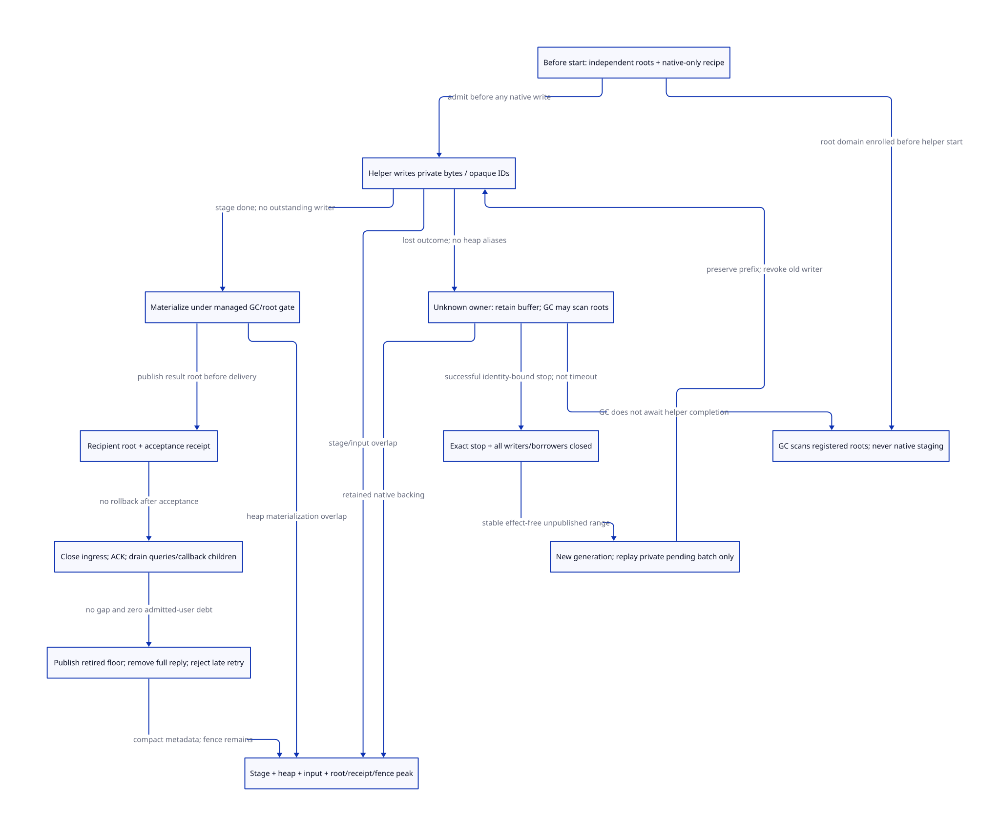

#+TITLE: Modern C Stopped Owners, Native Isolation and Receipt Retirement
#+SETUPFILE: ../../../modeling/org/setup.org
#+CATEGORY: gc-refactoring
#+PROPERTY: header-args :eval never :exports code
#+COLUMNS: %38ITEM %28STATUS %24OBLIGATION
#+OPTIONS: toc:3 num:t

* RESEARCH Architecture decision and evidence owner
:PROPERTIES:
:CUSTOM_ID: still-owner-retirement
:AUTHORITY: GambitStillOwnerRetirement
:COMPONENT: gc-work; host-roots; continuation; resource-exit
:OBLIGATION: OR-STOP; OR-ISOLATE; OR-TAKEOVER; OR-RETIRE
:STATUS: conditional-kernels-checked-native-refinement-open
:END:

Modern generated C remains mandatory. [[file:still-init-recovery-design.org][The previous recovery protocol]] forbids
replaying heap-visible initialization and retains ambiguous ownership. This
study adds a domain-specific alternative: an isolated helper may write private,
unpublished native staging, while the collector scans an independently registered
root domain. Only after a write-closure receipt may that private computation be
resumed or its pending batch recomputed. No runtime implementation, native test,
forced thread termination or general process-crash recovery is supplied.

[[file:models/sysml/still-owner-retirement.sysml][SysML]] owns behavior laws, dependencies, actual caller routes, cost rows and
view edges. [[file:../../../modeling/ascent/assurance-planner.ss][The existing ASCENT DSL]] checks exact scoped evidence and transitive
blockers. [[file:../../../../models/gambit/still_owner_retirement.qnt][Root QNT]] models32 base histories plus one shared-resource control;
[[file:../../../../models/gambit/lean/StillOwnerRetirement.lean][Lean]] checks22 conditional statements, including a finite drain Step/Trace kernel.
Passing these does not make the target isolation or stop protocol exist in C.

* Actual caller closure: four different meanings of termination
:PROPERTIES:
:CUSTOM_ID: owner-stop-source
:END:

[[file:../../../../vendor/gambit/lib/_thread.scm::1511][thread-terminate!]] goes through thread-end!, may post a Scheme thread interrupt,
and the current-thread path schedules another Scheme thread. This is not a
native writer-stop receipt. Scheme thread, processor/PSTATE, native executor
and initialization operation are separate identities; one operation may have
delegated borrowers that outlive any one of them.

[[file:../../../../vendor/gambit/lib/os_thread.c::546][___thread_join]] calls pthread_join on POSIX, maps failures through the runtime's
error helper and returns NO_ERR on success. The wrapper does not retain the raw
join return and generation as a durable operation receipt. [[file:../../../../vendor/gambit/lib/setup.c::978][The resize caller]]
ignores the wrapper's error. A failed join or transport timeout cannot issue a
stop receipt; neither can a repeated join after an earlier success was consumed.
Preserve raw return, exact native handle/generation and the single join owner.
This source fact is not a new native failure or a qualification of the patch.

[[file:../../../../vendor/gambit/lib/setup.c::903][Resize may directly invoke garbage_collect_pstate]], then performs collective
processor-count changes. Retiring processors call cleanup_pstate and thread_exit;
processor0 joins reclaimed native threads. [[file:../../../../vendor/gambit/lib/setup.c::1012][The synchronous dispatcher]] serves
both resize and GC. Therefore waiting for an uncertain helper/retirement on that
control path must not keep a collector participant active while waiting for
work that in turn requires GC. This is a wait-graph obligation, not a claim that
every existing join is deadlocked.

[[file:../../../../vendor/gambit/lib/setup.c::4665][cleanup_pstate]] removes interrupt handling and calls OS/memory cleanup.
[[file:../../../../vendor/gambit/lib/mem.c::4928][Memory cleanup]] frees still objects and calls [[file:../../../../vendor/gambit/lib/mem.c::684][cleanup_rc]], which detaches and
frees its chain. An initializer record or input root left only in that PSTATE
cannot survive by declaring its owner dead afterward. The target independent
domain must be enrolled, frozen/transferable and backed before those consumers
retire. Reuse [[file:../ffi/retained-rc-scan.org][the retained-domain]] and [[file:../ffi/rc-freeze-publication.org][writer-freeze]] obligations.

[[file:../../../../vendor/gambit/lib/mem.c::723][RC registration/data/refcount operations]] have native borrowers. The real
[[file:../../../../vendor/gambit/examples/tcltk/tcltk.scm::127][Tcl callback]] loads a procedure through client_data; [[file:../../../../vendor/gambit/examples/tcltk/tcltk.scm::183][deletion releases SCM/RC]];
[[file:../../../../vendor/gambit/lib/c_intf.c::6550][marker invalidation]] clears a field and decrements a still reference. None is a
general receipt that callback, query, derived child or captured-continuation
users have drained. This study does not assert Tcl violates its own deletion
rules or that a late callback is reachable solely because a release exists.

* Stop receipts and the lost-join-result boundary
:PROPERTIES:
:CUSTOM_ID: owner-stop-receipt
:END:

#+NAME: owner-stop-evidence
| Observation | What can be concluded | What remains owed |
|---+---+---|
| Scheme thread termination / marker false | Logical thread/frame state changed | Native stop, delegated writes, root/input lifetime |
| Cancellation request, timeout or failed join | Request/failure observed | Actual stop and store outcome remain unknown |
| Successful identity-matched native join, observed by unique join owner | Target thread terminated; successful POSIX synchronization is the required visibility relation | Delegated writers, TLS/native alias closure and interpretation of partial bytes |
| Operation-specific WriteClosed receipt | No further access to this operation if the last-use/alias protocol is proved | OS-thread resource retirement may still remain |
| All writers closed + independent domain + stable private recipe | Replacement owner may recompute the unpublished pending batch | New generation publication and final managed materialization |

#+BEGIN_EXAMPLE
StopReceipt = { nativeHandle, executorGeneration, joinOwner,
                rawJoinReturn, observationIdentity, writeClosureRef }
WriteClosure = { operationKey, ownerGeneration, finalCommittedCursor,
                 pendingRange, closedWriterSet, borrowerDrain, backingLease }
#+END_EXAMPLE

These are design data. A successful join does not recover a cursor that was never
published. It only makes a qualified post-stop reconciliation possible. A joiner
can also lose its own result after consuming a successful join but before
publishing the receipt. POSIX supplies no general retry-by-operation-ID API for
that gap: preserve uncertainty, do not issue another blind join on an expired
thread identity. A proved operation-specific WriteClosed handshake is an
alternative witness, not something inferred from thread exit or a flag.

The process must still be a valid C execution. Asynchronous cancellation,
arbitrary Mach thread termination, UB or a fatal native signal is not admitted
as a safe way to recover in-process allocator/lock state. TLS destructors and
other helpers must not retain operation writes after WriteClosed. Arbitrary
native/process crash recovery remains unresolved.

* Remove unknown native work from the GC wait graph before it starts
:PROPERTIES:
:CUSTOM_ID: owner-native-isolation
:END:

#+NAME: owner-isolation-sequence
| Stage | Required contract | GC relationship |
|---+---+---|
| Prepare under Scheme/context ownership | Classify effects; reserve native buffer; snapshot or lease input; create stable handle IDs and all potential root cells | Ordinary allocation/root safe-point rules still apply here |
| Publish isolation | Independent root domain and backing leases visible before helper start; no dependency on helper-held scan locks | Collector acquires complete roots without joining helper |
| Native helper execution | Touch only reserved native bytes and opaque IDs; no dereference of moving Scheme values, root mutation, Scheme callback or managed allocation | Unknown owner or pending native writes need not block scanning those roots |
| Unknown outcome | Keep full buffer, input/root leases and operation generation; do not read/overwrite/free concurrently written bytes | GC may continue under the already established isolation contract |
| Confirm closure / takeover | Exact stop plus all-writer drain, stable recipe and private range | Transfer generation; root domain remains enrolled |
| Materialize and publish Scheme result | Reenter a qualified managed context; allocation, full fill, remembered coverage and result-root handoff | Existing initialization/safe-point gate applies again |

A handle ID is not a copied SCMOBJ pointer. GC may relocate the value in its
registered updateable cell; the helper must not inspect that value while it
runs outside mutator participation. Materialization resolves handles only after
acquiring the managed/root epoch. Unknown potential roots cannot be added by
unmediated native callbacks; dynamic root discovery needs a mediated registrar
with its own complete publication contract.

Isolation also excludes hidden collector resources. Preallocate helper buffers
and avoid helper malloc/free, callbacks, TLS hooks or shared locks that GC or its
allocation slow path might need. Do not queue collector work behind an exhausted
pool of blocking/unknown helpers. Reserve collector scheduling capacity and park
the waiting context through its root-ready participation protocol. Merely moving
pthread_join to a different function does not remove a dependency.

The source [[file:../../../../vendor/gambit/lib/mem.c::4387][foreign cleanup chain]] can call [[file:../../../../vendor/gambit/lib/c_intf.c::1683][release_foreign and a native release_fn]].
A native borrow must keep its Scheme/native owner rooted and prevent physical
resource release; otherwise a finalizer waiting for that same helper can recreate
the GC wait edge. Existing deferred release/last-user contracts are prerequisites,
not effects supplied automatically by a staging buffer.

This condition cannot be issued retroactively to the current raw C still fill.
An unknown writer that can touch the managed heap or hold the root/allocator
resource stays unsafe for that cut. The local GC predicate abstracts other
participants as already qualified. It demonstrates noninterference of isolated
native uncertainty with that gate, not global termination, bounded pause, native
progress, bounded RSS or guaranteed allocation success. Retained root graphs and
native buffers can still exhaust capacity even if GC itself runs.

* Safe takeover: private replay is different from published-object replay
:PROPERTIES:
:CUSTOM_ID: owner-private-takeover
:END:

Keep committed cursor p and pending batch [p,q). A lost reply can leave some
physical stores in that range without advancing p. Once the sole old writer and
all delegates are proved stopped, and no consumer/GC ever interprets those native
bytes as a Scheme object, the replacement may overwrite the whole pending range
using the same stable, effect-free input. It need not infer which individual
native bytes were written. Committed prefix p is unchanged, and the old generation
is revoked before the replacement writes. With a batch bounded by qsize, repeated
work is at most qsize output items, plus the recipe's explicitly bounded decode
work; this is not a wall-clock bound.

This narrows the preceding study's prohibition rather than contradicting it:
heap-visible or externally effectful initialization cannot be replayed. A
published object's later mutation must not be overwritten. A directory read is
not a replayable batch: [[file:../../../../vendor/gambit/lib/os_io.c::6816][device_directory_read]] calls readdir and returns borrowed
name storage before [[file:../../../../vendor/gambit/lib/os_io.c::11412][string conversion]]. Record that effect outcome and copy/lease
its input before native staging. If the effect itself is unknown, retain it;
constructor recovery must not advance the directory again.

[[file:../../../../vendor/gambit/lib/c_intf.c::5413][UTF8 conversion]] needs output position, input byte offset and decoder/input-image
identity. A dead stack buffer, mutable source or raw pointer alias cannot issue
a stable replay witness. The selected synchronous [[file:../../../../vendor/gambit/lib/_kernel.scm::43][STRUCTURE initializer]] may keep
its existing one-pass, nonreentrant fast path; no staging or per-field atomic is
required for every constructor merely to adopt modern C.

Managed materialization is a separate failure domain. The QNT model treats
allocation/fill/result-root publication as one admitted transition; it does not
prove recovery if that managed owner dies midway through a raw pointer fill.
A valid sentinel shell would add another a writes, pre-dirty remembered coverage
and qualified atomic/pointer-store rules. It still does not permit collection
concurrent with an arbitrary unknown raw mutator. Partial scanners, universal
handles or process isolation are larger alternative designs with unproved costs;
none is silently credited as solving the remaining gap.

* Receipt retirement: close, drain, acknowledge, retain rejection
:PROPERTIES:
:CUSTOM_ID: owner-receipt-retirement
:END:

#+NAME: owner-receipt-retirement-protocol
| Step | Guard / action | Required remaining state |
|---+---+---|
| Receiver acknowledgement | Exact recipient activation confirms it owns/has received the result | Acceptance alone or sender timeout is insufficient |
| Close ingress | Fence new admitted reads/calls for the retiring key/session | Existing queries/callbacks retain pins |
| Parent/child handoff | An admitted callback may derive a child even after close | Add child pin before dropping parent; preserve unfinished debt |
| Drain users | Queries, callbacks, derived tasks and result users satisfy the exact protocol | No root/record free based solely on an empty queue |
| Publish retired floor | Every covered earlier serial is terminal, acknowledged and drained | Do not cross an outstanding earlier gap |
| Drop full reply record | Rejection fence visible before removal; root handoff already settled | Preserve generation/session fence and receiver-owned roots |
| Late retry | Old key at/below floor returns Retired/Closed without execution | Do not allocate a fresh operation or repeat a callback |

The counter prefix is inclusive and monotone. For session g, a floor r' may
replace r only if every serial in (r,r'] is terminal/acknowledged/drained and
old ingress is fenced. Later completed operations cannot jump an earlier gap.
A session close suffices as the conservative finite model; finer per-range
fences require their own multi-operation source refinement. A captured Scheme
continuation's new semantic call gets a new invocation identity; it must not be
mistaken for a transport retry of an old call.

The managed protocol must explicitly permit Retired after acknowledgement.
An ABI promising that any arbitrarily late retry returns the original value
cannot use this compaction without another retained result store. An
unacknowledged result remains retained even after acceptance or client death.
The current raw *obj/status C ABI is not silently changed into this protocol.

A receiver-owned Scheme value may outlive the dedup record. Only users of the
record/native staging must drain here; receiver roots have their own lifetime.

Full reply removal and removal of the rejection fence are different operations.
Keep a stable ingress router and nonreused session generation so a stale native
handle is checked before dereferencing freed metadata. A dangling raw C pointer
cannot be repaired by a floor lookup. Session/floor state may disappear only
with proof that its namespace cannot accept any old request again; timeout-only
expiry is insufficient. Process restart/persistence and unbounded-generation
storage are not qualified here. Root lifetime, native buffer lifetime and receipt
lifetime have different last-user conditions.

* Checked kernels, counterexamples and source obligations
:PROPERTIES:
:CUSTOM_ID: owner-retirement-proof
:END:

QNT checks33 named histories and100 sampled positive traces of at most100
transitions. One helper, three fields, two owner generations, one receipt and an
abstract earlier-gap flag cover exact stop versus failed join, private pending
replay, GC with unknown native writes, classic heap refusal, collector resource
coupling, reader/callback-derived drain, late retries and unsafe free controls.
The input/root/lock isolation facts are premises, not inferred native capabilities.

Lean checks22 conditional propositions. Its finite drain Step/Trace kernel
preserves nonincreasing user debt, including a callback-to-child handoff that
conserves debt; outstanding debt blocks retirement. GC-gate propositions erase
unknown-owner/pending-native-write fields only under complete isolation. No
whole QNT induction, C store atomicity, Darwin ABI/version qualification, general
watermark algorithm, arbitrary crash recovery or global liveness follows.
The initial QNT reserved-word and Lean simplification failures are retained as
tooling failures; no native failure is inferred from them.

#+NAME: owner-retirement-refinement
| Need | Actual source refinement owed | Shared prerequisites |
|---+---+---|
| OR-STOP | Raw native join result/identity, lost joiner outcome and all delegated writer/TLS closure | RC-JOIN; RC-LIFETIME; IH-MEMORY |
| OR-ISOLATE | Complete independent root/input/handle registry, no moving access or shared GC resource, park/wake and collector capacity | HR-RC; HR-BIND; GW-S |
| OR-TAKEOVER | Stable private batch/cursor, old-writer exclusion and new generation; separate materialization gate | OR-STOP/ISOLATE; IR-PROGRESS/ROOT |
| OR-RETIRE | Exact ACK/close/parent-child drain, contiguous floor, stable rejection router and root/receipt lifetimes | IR-DELIVERY; RC-LIFETIME; RX-S; HR-EXIT |

The graph is112 needs/339 prerequisites/54 source routes/eight shared contracts.
Only OR-H/I add local formal qualifications; all four source needs remain open.
The predecessor's40 formal slices retain identical subject bytes. The selected
native SysML set is predecessor53 files plus this model, not all concurrent DEV.

The unchanged ASCENT program treats need premises as report metadata: needFact
passes that field to modelRequired/openPremise; qualification reads the artifact,
digest, scope, method and check, not the premise string. A token transport keeps
all these authority fields literal, then independently restores native premise
text in the report. Exact inverse checks bind every need/edge/receipt, and small
matched build cuts compare full-text versus token output after decoding. This
is a bounded transport control plus a rule-dependency argument, not a new C or
Datalog semantic theorem. Full original text remains in SysML/native snapshots.
Initial uncompressed inference and metadata byte-bound failures remain retained;
parser limits are unchanged.

* Quantified benefit, peak cost and actual retirement order
:PROPERTIES:
:CUSTOM_ID: owner-retirement-benefit
:END:

The architectural gain is removal of the GC->unknown-helper-completion wait
edge for admitted native-only work. It is conditional on independent root and
collector resource closure; no measured pause/speedup percentage is established.
The ordinary synchronous path still fills a words and allocates its result once.
A staged service may add native buffer S, stable input E, H handle/root cells,
owner/query records and one later managed result B. S+B commonly overlap during
materialization. That can increase the full-round peak; no payload allocation
is eliminated by this protocol.

For a full one-to-one staged payload of a fields, native staging writes a fields
and managed materialization writes a more (2a total), with an extra read/copy of
the staging data. A compact constant-fill recipe can instead be O(1) plus handles,
but has little reason to run on a helper; retain the direct constructor fast
path. Any saved UTF8 decoding traversal must be weighed against the extra copy,
input lease and allocation; no such speedup is established here.

Receipt compaction replaces full retained reply records with session/floor/gap
metadata. Storage is O(sessions+gaps+live users), plus unacknowledged replies and
unknown native buffers. Root scanning is proportional to registered cells and
their admitted collector semantics; input reachability can retain much larger
managed graphs. qsize bounds replayed private output items only when the recipe
and input permit it. A sentinel alternative adds a writes (2a total).

Use max_t(P_t-Q_t+A_t) against max_t(P_t), charging stage/input/root/receipt
lifetimes in every overlap. Late reply compaction cannot erase an earlier
materialization peak. Unknown buffers consume physical capacity until real
writer/user closure even when collection is allowed to progress. Admission quotas
must account for permanently retained jobs; a full quota may refuse new service
work instead of reclaiming uncertain backing.

#+NAME: owner-retirement-migration
| Order | Modern C redesign | Old responsibility eligible for retirement |
|---+---+---|
| 1 | Separate Scheme invocation, processor, native executor, operation and root-domain identities | PSTATE index/dead Scheme flag used as universal owner witness |
| 2 | Generated isolated recipe and independent roots before helper start; reserve buffer and collector capacity | Root scanning or participant readiness waiting for helper completion, for admitted services only |
| 3 | Native stop/write-closure service with raw join result and unique join owner | Ignored errors, blind repeated joins and timeout ownership takeover |
| 4 | Private batch transfer and separate managed materialization | Full initializer restart or untracked native buffers in admitted callers |
| 5 | Recipient ACK/ingress/pin/derived-task drain and retained rejection floor | Per-caller reply caches/cleanup branches after complete migration |
| 6 | Retained root/backing transfer before PSTATE teardown | Unconditional cleanup of still/RC chains while admitted operations remain |

No current runtime path is retired by this design. Scheme semantics, tail calls,
continuations and portable C remain the purpose of the reconstruction. Zig
supplies no extra proof or established GC/ownership/peak benefit here.

* Platform and paper evidence

[[https://pubs.opengroup.org/onlinepubs/9799919799.2024edition/functions/pthread_join.html][POSIX pthread_join]] defines successful termination and forbids simultaneous joins;
[[https://pubs.opengroup.org/onlinepubs/9799919799/basedefs/V1_chap04.html#tag_04_15_02][POSIX4.15.2]] supplies successful synchronization obligations. The indexed primary
text was available while direct page fetches returned403. [[https://developer.apple.com/library/archive/documentation/System/Conceptual/ManPages_iPhoneOS/man3/pthread_join.3.html][Apple's archived manual]]
also distinguishes success and errors, but is historical documentation, not a
qualification of the installed Darwin binary or a delegated-writer guarantee.

[[https://web.stanford.edu/~ouster/cgi-bin/papers/rifl.pdf][Lee et al., Implementing Linearizability at Large Scale and Low Latency]],
sections3 and4.2-4.3, motivates unique operation identity, completion/result retention,
acknowledgement and metadata reclamation. We use those obligations, not its RPC
persistence assumptions, lease expiry or benchmark numbers. In-process unknown
native writes need Gambit's own root/collector/continuation contracts.

* Native-derived views and evidence
#+INCLUDE: "still-owner-retirement-matrix.org" :minlevel 2

; [[file:../../../modeling/diagrams/component-proof-dependencies.svg][composed proof dependencies]]. The separate GC branch
consults an already registered domain; it never reads native staging or establishes
isolation after a failure. [[file:../../../../evidence/research/still-owner-retirement/checks.json][The source-bound receipt]] separates formal kernels, source gaps and native acceptance.
