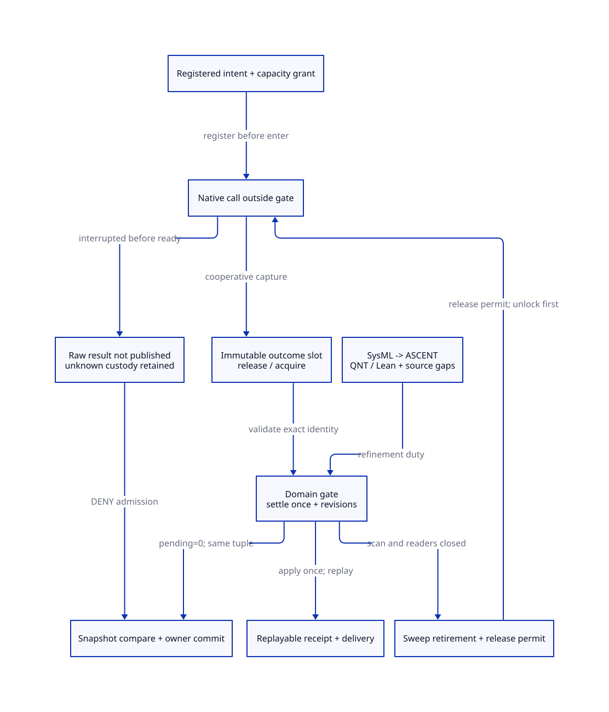

#+TITLE: Modern C Allocation Receipts and Atomic Still Snapshot Admission
#+SETUPFILE: ../../../modeling/org/setup.org
#+CATEGORY: gc-refactoring
#+PROPERTY: header-args :eval never :exports code
#+COLUMNS: %36ITEM %22STATUS %24OBLIGATION
#+OPTIONS: toc:3 num:t

* RESEARCH Decision and research boundary :modern_c:gc:smp:
:PROPERTIES:
:CUSTOM_ID: receipt-admission-decision
:AUTHORITY: GambitStillReceiptAdmission
:COMPONENT: gc-work; host-roots; resource-exit
:OBLIGATION: RA-ISSUE; RA-SETTLE; RA-GATE; RA-SWEEP
:STATUS: conditional-models-source-refinement-open
:END:

Modern generated C is the required runtime direction. This study refines
[[file:still-ledger-snapshot-design.org][still inventory and snapshot handoff]]: registration, backend execution,
completion publication, accounting settlement and caller delivery are distinct.
A stable registry owns responsibility through all five stages. One short domain
gate jointly protects settlement and snapshot admission. No native call, foreign
release hook, Scheme callback, GC, blocking wait or metadata allocation runs
while holding that gate.

The authority is [[file:models/sysml/still-receipt-admission.sysml][the SysML extension]], which references existing ledger,
owner-close and reader-lifetime needs directly. Native SysML evaluation supplies
needs, edges, source routes, caller matrix, cost rows and diagram topology.
[[file:../../../modeling/ascent/still-receipt-admission.rules.scm][ASCENT rules]] evaluate this explicit extension boundary, including imported
needs. Imported source obligations remain open; this is not a new qualification
of the entire shared assurance graph. Historical global receipts stay unchanged.
No runtime implementation, native test or performance measurement is supplied.

* EVIDENCE Actual allocation and release chains :source:
:PROPERTIES:
:CUSTOM_ID: receipt-callers
:STATUS: selected-caller-census-external-embeddings-open
:END:

The [[file:still-receipt-admission-matrix.org][native-derived matrix]] distinguishes nine caller families. The complete textual
wrapper reference search is retained in the research receipt directory; textual
matches are a search aid, not a proof of all dynamically installed C callers.

- [[file:../../../../vendor/gambit/lib/mem.c::1556][alloc_scmobj_still]] has two charge orders. Small allocations obtain native
  memory before deferred accounting. Large allocations charge new plus deferred
  words, possibly invoke GC first, then subtract only the new words on failure.
  A grant therefore identifies its own extent; it must not refund the entire
  deferred batch or aggregate GC request.
- [[file:../../../../vendor/gambit/lib/mem.c::554][alloc_mem_aligned_aux]] returns an aligned pointer and stores the original
  container behind it. [[file:../../../../vendor/gambit/lib/mem.c::657][free_mem_aligned_heap]] recovers that container.
  The managed registry must retain native arguments independently of payload.
- [[file:../../../../vendor/gambit/lib/os_base.c::445][Heap wrappers]] choose code or ordinary allocation by effective compile
  configuration. [[file:../../../../vendor/gambit/lib/os_base.c::326][Code allocation]] may add two header words and use mmap;
  [[file:../../../../vendor/gambit/lib/os_base.c::388][code release]] discards munmap or VirtualFree status. A void wrapper
  return cannot establish the required backend-specific success evidence.
- [[file:../../../../vendor/gambit/lib/os_base.c::190][Ordinary allocation]] calls malloc in its normal branches, then performs
  debug accounting/logging. [[file:../../../../vendor/gambit/lib/os_base.c::267][Ordinary release]] logs before free. Debug
  counters are neither operation identities nor completion records. Historical
  TempNewHandle branches require separate admission; they are not qualified here.
- [[file:../../../../vendor/gambit/lib/mem.c::4387][Still sweep]] reads the next link, invokes foreign release, frees the
  block, and rebuilds the chain/live sum. Its caller ignores the foreign release
  return. [[file:../../../../vendor/gambit/lib/c_intf.c::1683][release_foreign]] clears release-function/pointer fields before
  invoking user C; clearing them proves neither successful destructor completion
  nor safe retry after an unknown exit. These two release stages need separate
  records, not one generic success bit.
- The same aligned heap wrappers serve [[file:../../../../vendor/gambit/lib/mem.c::989][msection shrinking]],
  [[file:../../../../vendor/gambit/lib/mem.c::1013][msection growth]], [[file:../../../../vendor/gambit/lib/mem.c::1126][psection creation]] and
  [[file:../../../../vendor/gambit/lib/mem.c::1222][psection cleanup]]. Ordinary wrappers also serve RC and OS resources.
  Replacing a shared backend does not put these different objects into the still
  ledger. Each domain needs its own conservation/adoption adapter. Exported FFI
  entry points and arbitrary embedding code remain an open census boundary.

A separate direct-backend census found a Darwin-relevant bypass:
[[file:../../../../vendor/gambit/lib/os_files.c::1672][___os_executable_path]] grows its native buffer with direct malloc and frees
it after Scheme conversion (or on the native retry failure). It is reached by
[[file:../../../../vendor/gambit/lib/_kernel.scm::4221][the Scheme primitive]] and executable-path users in _nonstd.scm.
It is not a still-object charge and cannot be claimed covered by replacing
___ALLOC_MEM. The full lib C/header search found eleven raw-backend reference
lines in this source snapshot; macros, generated installations and external
embeddings prevent treating this textual count as a process-wide proof.

* DESIGN Records and authority :contract:
:PROPERTIES:
:CUSTOM_ID: receipt-records
:OBLIGATION: RA-ISSUE; RA-SETTLE
:END:

#+NAME: receipt-data-contract
| Record | Required identity and fields | Owner / lifetime |
|--------+------------------------------+------------------|
| OperationKey | VM, domain generation, operation sequence, kind | Stable service; never pointer-only |
| Grant | OperationKey, logical words, native requested extent, capacity bucket | Exists before entering allocation |
| BlockIdentity | Logical block generation, backend, original container/range, aligned view, requested bytes | Out-of-payload registry; no address-only reuse |
| NativeOutcome | OperationKey, immutable result kind, returned pointer for live allocations, raw status, error where defined, exact backend arguments | One adapter writes payload then publishes ready |
| Settlement | Exact outcome identity, applied/consumed state, ledger delta, resulting revision, return receipt | Gate protects both debit/credit and consumed bit |
| ReleasePermit | Block generation, root/borrow/scan closure, retired-list identity, unique native-call grant | Held across release outside gate |
| SnapshotView | Owner generation, inventory/ledger/root/collector revisions, producer-close generation | Copy under gate; no raw payload permission |

Use an integer/logical tombstone identity after deallocation; never dereference
freed headers or rely on evaluating a stale C pointer to identify a replay.
Before munmap, copy original base and full length from the code header into the
registry. Snapshot checked arithmetic for header/padding and backend-specific
rounding is mandatory. A zero-size or overflowed still request is rejected before
entering a backend; this study does not import general malloc(0) semantics.

The admitted adapter captures the raw return before debug logging or callbacks;
placing a new wrapper outside the old logging wrapper is insufficient. Move
logging after ready publication in the managed path. Capture errno immediately
only where the backend contract defines it; successful free has no status/errno
receipt to invent.

For mmap/alignment, raw backing capture must precede fallible header/alignment
initialization. Keep raw backing and initialized aligned-view receipts separate;
restore the latter through the existing initialization-custody contract. Wrapping
alloc_mem_aligned_heap only after its cptr/header writes leaves the earlier raw
allocation gap intact. A backing receipt grants no Scheme field scan authority.

The liability buckets are disjoint: known held blocks, known unattached grants,
and uncertain obligations partition a charge. Moving an unknown grant or release
into the uncertain bucket does not charge its physical backing again.

Prepare records and result storage outside the gate from a bounded/pinned
metadata service. If preparation fails, no native call has been accepted and the
caller retains the request. Metadata allocation itself needs a nonrecursive
bootstrap/reserve contract; calling managed malloc to allocate its own receipt
would not close this dependency.

** Native outcome classification

#+NAME: native-receipt-authority
| Observation | Receipt authority | Refund / retry consequence |
|-------------+-------------------+----------------------------|
| Registered but never entered, with producer-close proof | No-call cancellation | Grant can settle once |
| malloc returns NULL and adapter publishes it | Known no-block result for admitted nonzero request | Grant can settle once |
| malloc returns live pointer and adapter publishes it | Known private block, not initialized/scannable object | Transfer grant to held category, no new charge |
| Valid exact free returns normally and adapter publishes it | C deallocation completion | Charge can settle once; no RSS claim |
| munmap returns 0 and adapter publishes it | Backend range-release success | Settle exact mapping generation once |
| munmap returns -1 / VirtualFree fails | Known non-success, raw error retained | Keep conservative responsibility; platform-specific extent/retry proof required |
| Caller loses an already published receipt | Delivery unknown; operation known | Query same record, never redo native effect |
| Native effect may occur before ready publication, then owner disappears | Raw outcome unknown | No inferred success/failure, no blind replay, no credit |
| Stop/join succeeds or a timeout expires | Producer observation only | Does not determine malloc/free outcome |

[[https://www.open-std.org/jtc1/sc22/wg14/www/docs/n1570.pdf][C draft N1570, 7.22.3.3–4]] defines allocation/deallocation behavior,
including undefined behavior for invalid/double free. It offers no operation-key
query after a vanished caller. [[https://pubs.opengroup.org/onlinepubs/9799919799/functions/munmap.html][POSIX munmap]] specifies status/error reporting;
the primary search index was available, direct fetch returned 403. These are
contract sources, not qualification of installed Darwin allocator behavior.

[[https://web.stanford.edu/~ouster/cgi-bin/papers/rifl.pdf][RIFL, sections 3 and 4]] requires completion evidence to be atomic with
an operation's effects. That premise is precisely missing across a plain malloc
or free plus a later store. We use identity/replay reasoning; we do not import
RIFL durability, leases, performance, or claim that a receipt wrapper solves the
raw-effect gap. Cooperative no-unwind/no-owner-retirement from native enter
through ready publication is a proposed admission condition. Arbitrary death,
signal longjmp, foreign unwinding and allocator corruption remain unresolved.

* DESIGN One domain gate and memory order :atomicity:
:PROPERTIES:
:CUSTOM_ID: receipt-gate
:OBLIGATION: RA-GATE; RA-SWEEP
:END:

This is an abstract protocol, not C implementation. Baseline realization uses a
per-domain short mutual-exclusion gate; immutable completion slots have a
separate ready atomic. A successful acquire of the gate synchronizes with the
previous release. All plain protected metadata is accessed under that same gate.
A gate-acquisition CAS, if used, has acquire success and relaxed failure order;
unlock is release. No lock-free or wait-free claim follows. Fairness, primitive
choice and platform mapping remain refinement duties.

#+NAME: atomic-transitions
| Step | Atomic protected change / publication | Linearization and refusal |
|------+---------------------------------------+---------------------------|
| registerEnter | Under G, check producer generation/open state, exact unused key and capacity; install grant, increment native-in-flight, advance revision | Native caller owns accepted intent; close before acceptance rejects |
| publishOutcome | Outside G, sole adapter fills immutable slot, then ready.store(release); readers ready.load(acquire) before reading payload | Ready is result availability; no accounting change yet |
| settleOutcome | Under G after acquired ready, validate exact key/backend/generation; jointly change liability, consumed bit, in-flight and ledger/inventory revisions | One settlement point; duplicates return stored receipt, delta zero |
| captureView | Under G, copy the entire identity/revision tuple; pin its independent metadata lifetime | No speculative plain read followed by version retry |
| commitView | Under G, require exact current tuple, producer closure, native-in-flight=0, no mutation lease, root/scan closure; publish new owner and commit result together | Same gate excludes sweep, new permits, counter writes and competing commit |
| retireForRelease | Under G after root/raw-reader/scan/initializer closure, unlink into retired-held category and reserve one release permit; advance revision | Charge unchanged; permit prevents second free |
| executeRelease | Outside G, perform admitted destructor and backing-release stages separately; publish each result | Neither a hook nor raw free runs under G |
| settleRelease | Under G, only known backend success can mark released and apply one credit; clear permit/in-flight and advance revision | Stale view rejected; unknown/non-success keeps liability/exclusion |

The selected conservative profile also excludes commit while a scan or sweep
lease is active. A future mark-overlap profile needs separate unchanged-root and
collector-authority evidence; it is not silently granted by this gate design.
The C synchronization obligations follow [[https://www.open-std.org/jtc1/sc22/wg14/www/docs/n1570.pdf][N1570, 5.1.2.4 and 7.17]].
A version check cannot legalize racing plain loads. Revision or key wrap requires
refusal/drain and a fresh generation, rather than an ABA-prone comparison.

Root writers in other domains must revoke/drain their permits before supplying
RootEpochClosed. A bare integer root epoch is insufficient. Avoid lock inversion:
request root closure before acquiring G, then validate its pinned credential
under G; do not wait for another domain while holding G. Callbacks acquire fresh
entry permits after leaving G and never inherit its held state. Reentrant gate
entry is rejected/deferred, not recursively locked. No cooperative safepoint,
exception or cancellation may escape a partly updated gate transaction. An
abruptly dead thread holding or partially mutating G has no safe lock-steal rule
here; that domain cannot issue a snapshot receipt.

Readers of immutable metadata require separate metadata pins, not raw payload
borrows. [[https://www.kernel.org/doc/html/latest/RCU/Design/Requirements/Requirements.html][RCU requirements]] distinguish publication from reclamation; this
study borrows that distinction without assuming Linux RCU primitives in Gambit.
Payload can be freed while a tombstone remains pinned only after all payload
users have closed. Receipt retirement needs acknowledged consumers, exclusion
of old operation-key retries and drained readers; a timeout alone is not enough.
The bounded QNT model never recycles keys or records. A bounded production
reclamation algorithm remains an explicit obligation.

* PROOF Custody, conditional arguments and reachable countermodels :proof:
:PROPERTIES:
:CUSTOM_ID: receipt-proof
:STATUS: model-checked-conditional-source-open
:END:

1. Before raw enter, the stable service owns a grant and preallocated result
   slot. Entered producer cannot make them disappear by losing a return value.
2. Raw outcome publication does not change charge. After acquire, settlement
   changes both the accounting state and consumed bit under the same gate.
   Consequently an admitted exact key cannot credit twice. This is a logical
   gate-transition proof; native fault atomicity is a separate obligation.
3. Successful allocation moves grant to private backing without a second charge.
   Initialization/root publication is still governed by the earlier shell and
   root-transfer contracts. A live native pointer is not a scannable Scheme body.
4. Sweep transfers a closed block to retired-held, retaining liability. Physical
   release and subsequent credit are different events. Between them capacity
   charge can exceed actual backing; it must never be presented as RSS.
5. Capture and commit share G with all revision mutations. If sweep wins first,
   its revision invalidates the prepared view. If commit wins first, an old-owner
   release permit cannot subsequently be issued. Release already accepted keeps
   in-flight nonzero, so commit refuses until exact outcome settlement.
6. A failure/unknown outcome retains the canonical service's grant or release
   permit. A safely detached, scannable quarantined block need not force all
   unrelated root scanning to wait. Unknown payload writes, unknown destructor
   reentry or a damaged native allocator still prevent a general GC/progress
   guarantee. Quarantine is not a proof that these cases are harmless.

#+NAME: counterexamples-and-guards
| Interleaving | Failure | Required guard / evidence boundary |
|--------------+---------+------------------------------------|
| malloc succeeds; thread disappears before ready; new worker refunds | Uncharged physical allocation or lost address | Unknown retains grant; cannot discover pointer from counters |
| free succeeds; delivery lost; retry same pointer after address reuse | Invalid free or destruction of a new generation | Query completion only; raw gap refuses retry |
| consumed CAS succeeds; thread dies before independent charge subtraction | State says applied but ledger unchanged | One protected transaction, plus qualified no-escape assumption; CAS alone insufficient |
| charge subtracted; consumed flag not yet changed; second consumer refunds | Duplicate credit | Same gate and no partial-state recovery claim |
| snapshot checks revisions; sweep unlinks/frees; owner CAS succeeds | Admitted stale inventory | Joint gate check-and-commit |
| sweep holds G while foreign release calls Scheme allocation | Reentrant deadlock | Reserve release then unlock; callback has independent admission |
| new allocation reuses address while old receipt still exists | ABA / wrong refund | Domain, block and operation generations; retain tombstone |
| marker/root writer runs after root epoch check | Freed live object | Revoked writer permits and closure credential, not an epoch integer |

[[file:../../../../models/gambit/still_receipt_admission.qnt][QNT]] splits raw allocation/free effects from ready publication, settlement,
delivery and sweep. Nineteen named histories include three deliberately unsafe
countermodels; sampled positive histories check safe. It models one two-word
allocation/release, no key recycling, no C weak memory or arbitrary native death.
[[file:../../../../models/gambit/lean/StillReceiptAdmission.lean][Lean]] proves accounting conservation by Step/Trace induction, consumed/unknown
no-credit rules, stale/busy gate rejection and metadata bound arithmetic. It does
not prove all QNT states, allocator integrity, weak memory or C fault recovery.
The source obligations in ASCENT therefore remain unresolved even when both
formal receipts match their exact artifact hash and scope.

* RESEARCH Migration and retirement :migration:
:PROPERTIES:
:CUSTOM_ID: receipt-retirement
:STATUS: design-only
:END:

#+NAME: receipt-migration-dependencies
| Order | Required contract | Old responsibility eligible for retirement |
|-------+-------------------+------------------------------------------|
| 1 | Classify effective backend and all domain consumers; preallocated metadata bootstrap | No global wrapper removal yet |
| 2 | Status-preserving backend adapters; qualified enter-to-ready envelope | Swallowed release status in managed path only |
| 3 | Exact grants, blocks, outcomes and joint settlement; old allocation activations drained | Small/large local compensations after equivalent capacity accounting |
| 4 | Canonical roots/scan closure; atomic domain gate; generation-safe admission | PSTATE owner assumptions in selected managed still path |
| 5 | Retire/release permit and separate destructor results; cleanup uses same service | Direct unmanaged still free branches only after caller closure |
| 6 | Replay exclusion, reader drain and bounded metadata reclamation | Ad hoc receipt retention; not native allocator itself |

Msection, permanent, RC, native I/O and external FFI paths remain until their own
adapters are proved. [[file:../../../../vendor/gambit/lib/mem.c::6256][Current occupied-space recount]] is already O(P) processor
summaries; sweep already walks the chain it must reclaim. This study proves no
extra whole-chain pass removable. Modern C and Zig owe the same root, gate,
receipt, backend and reclamation contracts. Zig has no demonstrated incremental
net runtime benefit here.

* REPORT Work and peak model :matrix:
:PROPERTIES:
:CUSTOM_ID: receipt-benefits
:END:

See [[file:still-receipt-admission-matrix.org][the SysML-derived source, dependency and benefit matrix]] and
[[file:diagrams/still-receipt-admission.d2][D2 source]] / .
For M retained operations, N block records, D domains and V pinned views,
metadata is bounded by M*Rop + N*Rblock + D*Rgate + V*Rview only if those
populations and record extents are bounded. Sizes are symbolic, not fabricated
byte counts. No admitted reclamation bound means no finite long-run metadata
bound. Unknown allocations consume grants; unknown releases consume conservative
capacity even when the native range was physically released.

At each time t, extra physical backing from delayed release is the sum of blocks
still actually held beyond the baseline release time. Whole-round peak is max_t
of actual live backing plus retained backing plus metadata and allocator overhead;
maxima of independent terms must not be added as an asserted measured peak.
Logical charge can also include already released unknown outcomes; do not count
that debt twice as physical memory. No new payload copy is required by this
protocol, but no reduction of whole-round peak or latency is established.

Positive net benefit requires correct bounded replay/reclamation, acceptable
per-domain contention and materially useful independent ownership/recovery.
Counterevidence includes unbounded pending outcomes, allocator-global stalls,
contentious gating, metadata exceeding avoided work, or caller bypasses. The
architectural return is a safe basis for GC worker/context separation; it does
not follow merely from changing implementation language.

* EVIDENCE Reproducible research receipt
:PROPERTIES:
:CUSTOM_ID: receipt-checks
:STATUS: local-formal-evidence-only
:END:

[[file:../../../../evidence/research/still-receipt-admission/checks.json][Source-bound formal receipt]] retains native SysML output, exact ASCENT cases,
QNT/Lean logs, artifact hashes, the initial authoring failures and the deliberately
failing negative invariant run. This does not authorize native execution.

** Analytic event budget for the unbatched profile
:PROPERTIES:
:CUSTOM_ID: receipt-event-budget
:STATUS: design-count-not-timing
:END:

For A admitted raw allocation calls, F admitted raw release calls, S view
captures, H commit attempts, and K duplicate settlement queries, the selected
unbatched metadata protocol requires 2A+2F+S+H+K gate visits: enter/register and
settle for each native call, plus capture/commit/query visits. The retirement
permit combines unlink and release-enter registration in this count. Additional
initializer publication, producer closure, scan leases, pool management, failure
classification and record reclamation add visits. If these steps cannot fuse as
specified, this expression is a lower budget, not an upper bound. Failure with an
unsettled result lacks its settlement visit and retains the obligation instead.

Each completed call uses one release-ready publication and at least one
acquire-ready observation before settlement. A=F=1 with no snapshot or query
therefore has a four-gate metadata budget plus two outcome publications, before
those additional duties. Receipt replay invokes zero native calls; the existing
code has no managed replay baseline, so this is not a measured work saving.
Batching may amortize gate acquisitions but must preserve each individual key,
receipt and revision effect. No sharding speedup or memory-order cost is assumed.
