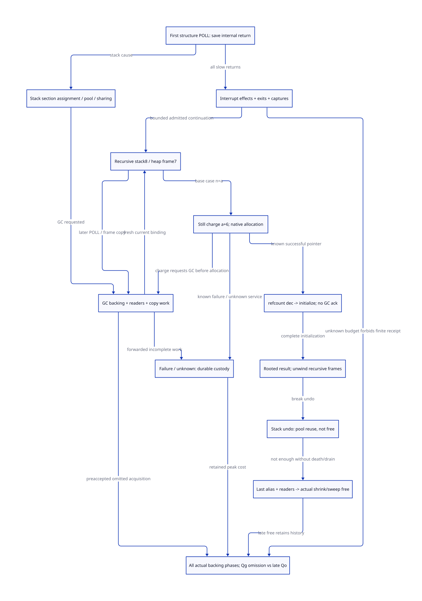

#+TITLE: Modern C Structure POLL, Recursive Frames and Still Allocation
#+SETUPFILE: ../../../modeling/org/setup.org
#+CATEGORY: gc-refactoring
#+PROPERTY: header-args :eval never :exports code
#+COLUMNS: %38ITEM %26STATUS %24OBLIGATION
#+OPTIONS: toc:3 num:t

* RESEARCH Decision and scope
:PROPERTIES:
:CUSTOM_ID: structure-poll-still-envelope
:STATUS: conditional-source-envelope-open
:AUTHORITY: GambitStructurePollStillEnvelope
:COMPONENT: gc-work; continuation; host-roots
:OBLIGATION: SP-POLL; SP-FRAMES; SP-STILL; SP-PEAK
:END:

Modern generated C is the mandatory redesign. This continues [[file:rest-gc-resume-envelope-design.org][the real rest
construction chain]] past ##structure's first POLL(1), through recursive frame
growth, possible GC and ##make-structure's still allocation. Existing Scheme
semantics, proper tail calls, multi-shot continuation and C portability are
amplified through explicit descriptors and ownership; there is no second Zig
runtime or established additional Zig benefit in this slice.

The central finding is structural: a bounds neither the pre-existing live graph
nor arbitrary interrupt/exception callbacks, retained continuation versions,
other VM participants, or repeated recoverable failures. Therefore a alone gives
no finite whole-call peak certificate. A conditional bound needs each of these
inputs, actual backing identities and their lifetime cuts. Refusing that finite
certificate does not forbid execution or silently suppress Scheme interrupts.

[[file:models/sysml/structure-poll-still-envelope.sysml][Native SysML]] owns needs, dependencies, routes, callers, costs and diagram.
[[file:../../../modeling/ascent/assurance-planner.ss][ASCENT]] checks exact receipt identities and transitive gaps. [[file:../../../../models/gambit/structure_poll_still_envelope.qnt][QNT]] explores target
histories; [[file:../../../../models/gambit/lean/StructurePollStillEnvelope.lean][Lean]] checks 17 named conditional arithmetic/ledger statements.
Source simulation and complete native eligibility remain open, not inferred
from files or local checks. Existing root-level models remain historical assets.

* Actual first POLL slow path and return
:PROPERTIES:
:CUSTOM_ID: structure-poll-path
:END:

[[file:../../../../vendor/gambit/lib/_kernel.c::23950][The existing generated entry]] sets R3=1 then POLL(1); its return descriptor is
RETI cfs0. [[file:../../../../vendor/gambit/include/gambit.h.in::8510][POLL]] tests stack trip and optionally the heartbeat countdown.
It does not mean GC necessarily occurs. [[file:../../../../vendor/gambit/lib/_kernel.scm::229][The actual handler]]:

1. Aligns caller slots, pushes all GVM registers and the internal RA, and binds
   internal_return. These are real roots/control state, not the zero-heap span.
2. If the stack-limit reason applies, calls stack_limit && garbage_collect.
   stack_limit may rebind space without GC; only a true return requests GC.
3. On overflow it calls the Scheme stack-overflow exception path. Otherwise it
   still dispatches ##interrupt-handler, including after a successful GC.
4. [[file:../../../../vendor/gambit/lib/_kernel.scm::1285][The internal-return handler]] restores registers/RA and caller alignment.
   The target reissues the current PointId/grant only after the actual return;
   intermediate states and nonlocal exits cannot spend the old assurance.

[[file:../../../../vendor/gambit/lib/_kernel.scm::1448][Interrupt dispatch]] consults an installable Scheme procedure vector. It may
loop over pending interrupts; its last procedure call may be a tail call.
[[file:../../../../vendor/gambit/lib/_thread.scm::3232][Thread initialization]] installs heartbeat/user/GC/other handlers. The GC handler
itself can deliver a thunk to the current or primordial thread. This is a real
producer path, not hypothetical native I/O. Arbitrary installed handlers can
allocate, reenter, capture continuation state or fail before returning.

With the header default GVM register count5, FRAME_SPACE(6)=12. Thus cfs0 has a
12-word internal stack frame and, if copied by mark_captured_continuation, an
11-word heap frame (decoded fs9 plus RA/header2). At recursive POLL(2), cfs8
produces stack20 and heap19. These are conditional source-layout calculations;
no rebuilt binary/profile or native sizeof experiment is claimed. All actual
configured register counts and label descriptors must match the receipt.

#+NAME: structure-poll-outcomes
| Actual outcome | Space effect | Required custody / assurance |
|---+---+---|
| Interrupt only | Existing internal frame plus callback allocation/captures | Exact effect/exit budget or no finite-envelope qualification |
| stack_limit returns0 | Stack may be unchanged, reassigned, shared or moved | Current stack/heap bounds and roots; no inference of malloc/free |
| stack_limit returns1, GC succeeds | Frame/root movement, copy backing, resize/fudge and GC interrupt | Epoch binding, initialized-copy ownership, root/readers and callbacks |
| GC overflows | Scheme exception may return or escape | Rooted original invocation, explicit exception/retry budget |
| Nonlocal/captured exit | Caller frames may outlive original traversal | Complete continuation alias/domain ownership, no forced frame free |

* Recursive frame descriptors, transfer and physical sections
:PROPERTIES:
:CUSTOM_ID: structure-frame-space
:END:

[[file:../../../../vendor/gambit/lib/_kernel.c::23958][The loop]] stores four values and advances the stack by8 per field. The matching
[[file:../../../../vendor/gambit/lib/_kernel.c::30605][return label descriptor]] is RETN fs5, link0, gcmap0xf. Thus FRAME_SPACE(5)=8;
[[file:../../../../vendor/gambit/lib/mem.c::3671][captured-frame copying]] stores header1+extra RA1+fs5=7 words. For one traversal,
r=a-1<=8191 yields stack8r<=65528 words and one distinct copied cohort7r<=57337
words. The latter is 458696 bytes at WS8. Existing C already uses this compact
heap form: the one-word difference is an accounting correction, not a new saving.
It excludes internal/break/caller frames, chunk links/padding, transitive roots,
previous versions and concurrent participants. GC can keep contiguous top frames
on the stack; these formulas do not assert that every frame is always copied.

[[file:../../../../vendor/gambit/lib/mem.c::7098][stack_limit]] first checks physical stack-fudge exhaustion. Its acquisition cases
are separate:

- It can take a section from the processor free list if stack and heap differ.
- It can request the next already-acquired section from the VM list under the
  allocation lock. [[file:../../../../vendor/gambit/lib/mem.c::3065][next_msection_without_locking]] does not itself malloc: it
  selects an existing section, invokes a custom allocator if installed, or falls
  back to heap/stack sharing. Sharing requires enough remaining guards; fatal
  overflow remains possible. Role-compatible tail is not arbitrary free bytes.
- If approximate global free capacity is insufficient, it may add a break frame
  and return1 to request GC. The two-thirds test limits preserved contiguous
  frame growth; it does not by itself bound the entire VM or callback graph.
- Native backing acquisition happens through adjust_msections during setup/GC
  resize. Current logical assignment and a new OS allocator acquisition must not
  be counted as the same event.

When switching stack sections, the handler first makes a FIRST_BREAK_FRAME_SPACE
of4 words. It traverses frames, testing count>=5 or words>=100 *after* the frame
has been decoded. Therefore100 is not an exact transfer-byte/word bound. Given
an actual maximum decoded frame F, words<=99+F, also <=5F under the count premise.
For the restricted pattern of one default recursive RETI frame20 and at most
four RETN frames8, the copied block is <=52 words, plus first break4. Other
caller/internal frames need their own F. Reaching the break can select no
memmove and an additional4-word break instead; do not combine exclusive cases.

[[file:../../../../vendor/gambit/lib/mem.c::7371][stack_overflow_undo_if_possible]] can return to the previous section and push the
current one onto the processor free list. words_prev_msections changes and
prepare_mem_pstate runs, but no aligned free occurs there. Capturing a
continuation invalidates certain undo opportunities; neither return nor pool
membership proves that all captured/root aliases or GC readers have ended.

* Still charge, actual allocation and initialization interval
:PROPERTIES:
:CUSTOM_ID: structure-still-space
:END:

The recursion base calls ##make-structure with n=r+1=a. [[file:../../../../vendor/gambit/lib/_kernel.scm::43][The inline allocator]] uses
a+1 words for small no-handles objects, <=255 when a<=254. At a>=255 it invokes
alloc_scmobj with type protected by GC_SAVE1. [[file:../../../../vendor/gambit/lib/mem.c::1556][The still allocator]] charges
STILL_BODY6+a words, not a+1. Its native allocation and accounting branches are:

#+NAME: structure-still-branch-matrix
| Condition / endpoint | Actual behavior | Failure and root responsibility |
|---+---+---|
| a+6+d<=1024 | Allocate native block, then defer accounting | Failed pointer returns error before adding deferred charge |
| a+6+d>1024, VM free check succeeds | Under lock charge current and deferred objects, clear deferred | Failed current allocation refunds a+6 only; previous objects remain charged |
| VM free check insufficient | GC requested with a+6, then native allocation after successful GC | GC rejection and partial resize settle requested charge through existing overflow path |
| Native allocation succeeds | Link still list, refcount1, header/length set; body uninitialized | Constructor owns pointer and initialization; list/refcount alone is not scan readiness |
| Macro returns | Decrement native refcount, restore type root, initialize body | No safepoint acknowledgement or next allocation before complete initialization |
| Result / error | Return rooted result, or Scheme error frame and possible retry | Captured/error continuation may retain arguments/earlier results; every retry has an effect budget |

Here d=all deferred still words for that context, not just this invocation.
a+6+d<=1024 iff a+d<=1018. With d0, a255 through1018 use the deferred branch;
a1019 and above require VM accounting/possible GC. Debug forced-GC configuration
and custom service paths require their own admission.

[[file:../../../../vendor/gambit/lib/mem.c::553][alloc_mem_aligned_aux]] requests alignment slack plus the block from
[[file:../../../../vendor/gambit/lib/os_base.c::445][alloc_mem_heap]]. With WS8, pointer size8, multiplier1/modulus0 and the ordinary
malloc route, the request is 8*(a+6)+15 = 8a+63 bytes, at most65599 for a8192.
This is a requested block size, not allocator usable size, resident memory, or
a bound including debug/custom/low-level-exec allocation infrastructure.
This study admits no generated-header/installed Darwin profile receipt; header
defaults are not silently promoted to that status.

[[file:../../../../vendor/gambit/lib/_kernel.c::23856][The emitted consumer]] decrements the native reference before initialization.
The comment on alloc_scmobj requires body initialization before the next
allocation. The modern C contract must make this a no-acknowledgement InitSpec
interval: an independent collector cannot start scanning that uninitialized
body merely because a list link/header or native refcount exists. The context
must finish initialization and publish roots before joining the safe-point cut.
GC_RESTORE1 clears the temporary saved root; local type/result values remain
protected by that noncollecting interval and subsequent published roots.
No new raw blocking/reentrant hook can be inserted there without a new proof.

The failure branch preserves type/length/RA in an additional error frame and
retries if its Scheme exception returns. An unbounded number of such returns,
or retained escaped continuations/results, defeats a total envelope derived
solely from a. A finite analysis needs explicit per-lineage retry/capture bounds.

* Acquired-container envelope and actual release endpoints
:PROPERTIES:
:CUSTOM_ID: structure-joint-peak
:END:

#+BEGIN_EXAMPLE
Acquired(t) = Nsection(t)*SectionRequest(profile)
            + DirectoryRequestsStillLive(t)
            + sum(actual still/native requests still live at t)
            + Auxiliary/held-partial/effect backing not already in those containers
Pwhole = max over ALL phases t of Acquired(t)
#+END_EXAMPLE

Payloads inside these containers, stack7/8-word differences, cards and guards
must not be added again as separately acquired bytes. Instead they are placement
and role-capacity requirements determining which containers are needed. Include
old and new directories during their actual replacement overlap, before the
old one is freed; include partial section acquisitions and temporary allocator
infrastructure if the metric includes it. A requested-allocator-byte metric
is distinct from allocator usable memory and RSS throughout.

[[file:../../../../vendor/gambit/include/gambit.h.in::11279][Section backing size]] is sizeof_msection(131072), rounded to words plus alignment
slack. Under the ordinary LP64 layout with sizeof(___msection)=32 and the above
allocator route, one section request is1048615 bytes. This is a conditional
source/ABI example; no native sizeof or current toolchain check was performed.
A whole section, its usable to-space half, a copy tail, and logical stack demand
are different quantities. Directory growth can temporarily own two blocks.

#+NAME: structure-release-matrix
| Endpoint | What actually changes | Can reduce acquired-container occupancy? |
|---+---+---|
| next_stack_msection / VM free section assignment | Assignment/role counters and bounds | No additional native allocation at that call under default selection |
| stack_overflow_undo_if_possible | Current section becomes locally reusable | No: still acquired by VM |
| Pending charge settled / failed VM reservation refunded | Accounting liability | No by itself; failed allocation may never have acquired a block |
| adjust_msections contraction | Actual free_mem_aligned_heap on selected sections | Yes, after valid root/readers/layout retirement cut; earlier peak persists |
| free_msections cleanup | Free all backing sections and directory | Yes; not ordinary function-return behavior |
| free_unmarked_still_objs | Unreachable still block freed during cleanup phase | Yes; refcount decrement/initialization/return alone does not do this |
| Actual aligned free -> free_mem_heap | Release original allocator pointer, or low-level-exec free route | Metric/profile must match; C allocator free need not lower RSS immediately |

[[file:../../../../vendor/gambit/lib/mem.c::891][adjust_msections]] may return after partial acquisition; only actual nb_sections
and observed container identities count. [[file:../../../../vendor/gambit/lib/mem.c::6357][resize_heap]] temporarily charges requested
still space before policy decisions; recoverable overflow reduces its reserve,
can undo the requested charge and retry policy calculation. This rollback is
not permission to free an initialized live structure or already-published copy.
[[file:../../../../vendor/gambit/lib/mem.c::4387][Still sweeping]] requires the GC mark/refcount/root process, and may invoke other
foreign cleanup code; its effects are not automatically bounded by this structure.

* Qg strict-gain conditions and falsifiers

Let b_t be the matched baseline's actual acquired-container bytes and q_t the
actual acquisition omitted before overlap, not a logical suffix size. Let o_t
be all newly required backing/metadata/effect/unknown-retention cost. A valid
comparison needs c_t<=b_t-q_t+o_t for every corresponding phase, including:
first internal frame/interrupt, recursive growth, transfer, all GC passes,
resize/fudge, still initialization, error/retry, unwind, reader drain and cleanup.
The strict whole-round claim is max(c_t)<max(b_t); net credit in one phase is
insufficient. If acquisition cardinality changes discontinuously at section
boundaries, derive q_t from the omitted actual container, not from Qg bytes alone.

Positive case: a preaccepted role-compatible tail makes an otherwise necessary
additional backing acquisition unnecessary through every dominant phase;
added metadata/retention does not consume the saving; other participants,
callbacks and failures stay below the old maximum. Existing PSTATE tail reuse,
local free-list reuse and VM acquired-free sections are already in the baseline.

Falsifiers: the same section still has to be acquired later; an unchanged still,
interrupt/error or reader-hold phase is the maximum; destination growth equals
the apparent credit; or root/alias closure is incomplete. A movable heap/stack
tail does not directly pay alloc_scmobj_still's independently allocated block.
Doing that would require a distinct nonmoving arena/major-collector design,
with ownership/scanning/release proofs, not reinterpretation of Qg.

Late Qo or still/section free can reduce future occupancy after retirement. It
cannot reduce the recorded earlier maximum. No numerical measured reduction,
RSS/OOM bound or positive unconditional net benefit is established here.

* Modern C replacement order and responsibility
:PROPERTIES:
:CUSTOM_ID: structure-migration
:END:

#+NAME: structure-modern-c-migration
| Order | Scheme semantic output | Modern C responsibility | Old responsibility can retire only when |
|---+---+---+---|
| 1 | PointId, RETI/RETN FrameSpec and root map | Decode/encode and coherent current binding | Every save/restore, GC frame scanner, transfer and return consumer agrees |
| 2 | PollEffectSpec with bounded or explicitly unknown effects | Callback/retry/capture lineage accounting | All installed/native entry effects are covered; unknown never receives a finite certificate |
| 3 | FrameGrowSpec and copy/capture identity | Backing/assignment/pin ledger; exact transfer cut | stack_limit, undo, break, captured frame and GC work paths migrate together |
| 4 | StillInitSpec and error continuation | Charge versus actual pointer, no-ack init, publish roots | Deferred/VM/GC/refund/partial failure and result delivery all refine the contract |
| 5 | Whole invocation phase requirements | Preflight compatible grants and matched-baseline peak ledger | All above plus native memory-order/reader obligations hold; no wrapper-only extra allocator |

The C portability/backend bridge remains. Current macros, PSTATE paths and
allocator consumers remain source authority until those conditions hold. No
runtime path is retired in this study. Generated descriptors can consolidate
repeated hidden layout/guard reasoning; their validation, ledgers and effect
tracking are real new work that must earn a net benefit. Zig does not remove
those necessary semantic, root, safe-point or memory-ownership responsibilities.

* Refinement, model boundary and checks
:PROPERTIES:
:CUSTOM_ID: structure-refinement
:END:

The QNT slice has18 named histories: pool versus fresh backing, bounded versus
unknown callback effects, batch254-frame progression, GC rebind, still failure,
unknown service custody, initialized versus uninitialized GC, captured roots and
past-peak retention. Unknown allocation charges its potential held block; this
is an upper custody envelope, not observed allocation. Abstract section100/still21/aux2/effect4 are model units,
not the source byte formulas above. The254-frame batch requires a source
stuttering/refinement proof; finite positive sampling is not exhaustive or live.

Lean's17 exact statements cover source-layout arithmetic, after-frame transfer
bounds, deferred splitting, typed acquired-backing ledger independence from
pending/pool counters, and a list-of-phases maximum. The initial allPhasePeak
proof used a library theorem name unavailable in this Lean environment; that
failure is retained and the proof was rewritten with induction and omega.
These are conditional mathematical results, not source simulation or native ABI
qualification. Raw source/count/layout and actual last-alias closure are still
SP source obligations linked to RG, IH, HR and control prerequisites in SysML.

Native validation uses the predecessor's50-file qualified input set plus the
new component model. A whole-DEV attempt encountered a concurrently edited
unrelated foundation-binding model syntax error; its diagnostics and input
hashes are retained. This study does not claim that whole DEV passed. The
selected51-file composition must resolve/validate without dropping any selected
need or prerequisite. Org/D2 are views; JSON transports input/result identities,
not an alternative architecture owner. Org checks cover8 owned artifacts and
their referenced targets. An unrelated whole-DEV link failure is retained.

ASCENT keeps its form/column/source limits unchanged. Paired receipt transport
shares only scenario and an equal status; each identity/scope/digest/check is
recovered independently. Different statuses fall back to individual records.
Two ancestor inference cuts and two metadata-only source-route cuts preserve
all96 needs,272 edges,44 routes and8 contracts. Negative paired stale-digest and
nonpass-status cases cannot qualify the affected proofs. Metadata cuts grant no
readiness; source-byte/form/column failures are retained.

* Paper mechanisms and Gambit-specific reflection

[[https://simonmar.github.io/bib/papers/parallel-gc.pdf][Marlow et al., Parallel Generational-Copying GC with a Block-Structured Heap]],
sections3.4-3.5, separates scan and allocation frontiers and pending block work.
We use that distinction for initializer/scan custody. It does not prove an
allocation tail is already context-owned or physically freed.

[[https://anil.recoil.org/papers/2020-icfp-retropar.pdf][Sivaramakrishnan et al., Retrofitting Parallelism onto OCaml]], sections4.4 and5,
uses deliberately placed synchronization and language-feature integration.
Gambit's actual installable interrupt callbacks, multi-shot frames and C
constructor intervals determine our boundary. Neither OCaml fiber layout nor
paper benchmark improvements are transferred into this study's benefit matrix.

* Native-derived views
#+INCLUDE: "structure-poll-still-envelope-matrix.org" :minlevel 2

 and [[file:../../../modeling/diagrams/component-proof-dependencies.svg][the composed proof graph]].
[[file:../../../../evidence/research/structure-poll-still-envelope/checks.json][Source-bound evidence receipt]] distinguishes local checks, source gaps and native acceptance.
