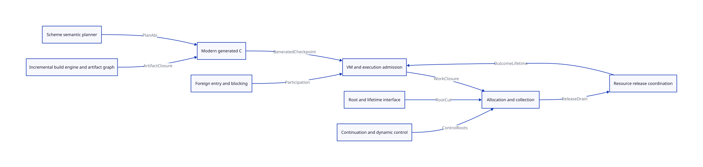
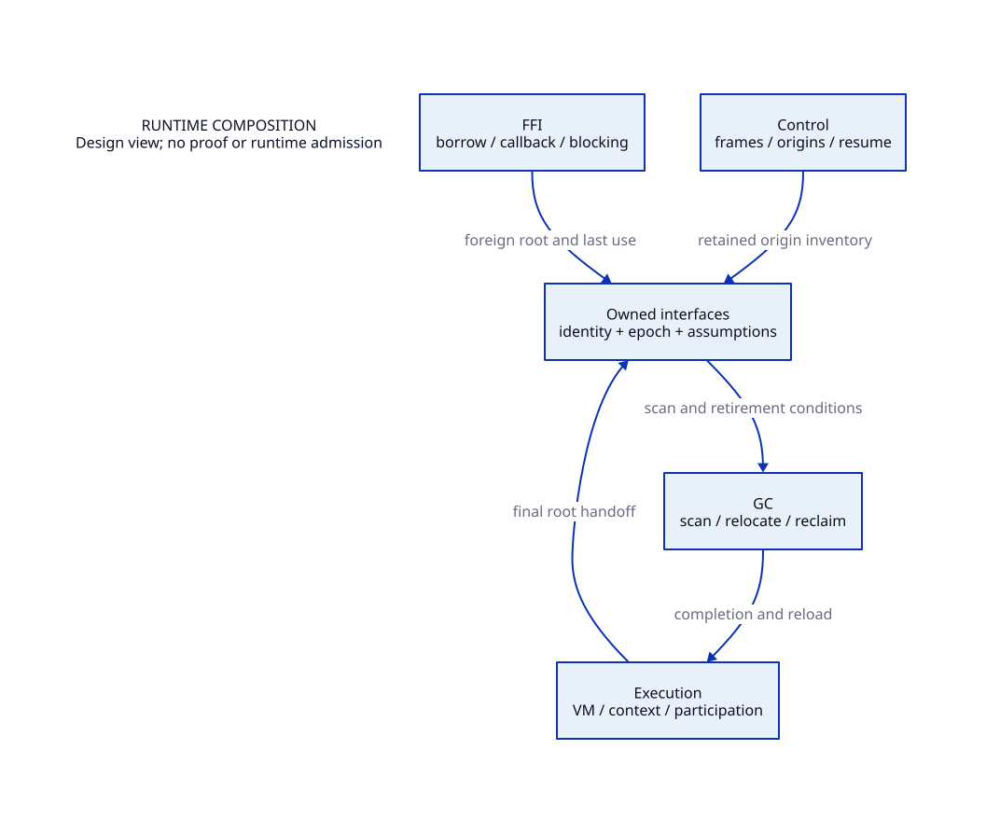

#+TITLE: Runtime Composition
#+SETUPFILE: ../../modeling/org/setup.org
#+CATEGORY: architecture

* RESEARCH Execution, memory and control compose through owned interfaces
:PROPERTIES:
:ID: 3a85c607-c3b2-50b2-9276-82cd921992ba
:CUSTOM_ID: runtime-composition
:OWNER: runtime architecture
:STATUS: design-only
:EVIDENCE_CLASS: design-and-source-correspondence
:END:

VM identity, execution ownership, root custody, suspended control, collector work and foreign invocation are distinct lifetimes. Independent GC workers need root/producer closure; a suspended continuation does not itself prove that native readers have drained.

[[file:../../refactoring/modern-c/runtime-blueprint.org][The modern-C blueprint]] composes runtime responsibilities with semantic generation and build contracts. [[file:blueprint-map.org][The source-bound module/interface map]] and  derive from this category's existing composition model. Per-module predicates and the shared ledger retain their original owners.

#+NAME: runtime-module-responsibilities
| Module | Owns | Receives | Must not infer |
|---+---+---+---|
| execution | VM/context membership, park/reentry and participation | GC completion and root reload obligation | Published metadata means host stopped mutating |
| gc | Relocation, scanning, worker drain, allocation and reclaim decision | Stable complete root inventories and lifetime witnesses | Current break root covers saved continuations |
| control | Captured frames, denv, saved origins and resume semantics | Relocated locations and valid execution grant | General continuation is a one-shot effect continuation |
| ffi | Native borrow, callback origin, blocking/reentry, foreign last use | Root custody and control boundary policies | Leaving a C frame drains all Scheme producers |
| interfaces | Agreed cross-module meaning and assume/guarantee premises | Owner module guarantees | Boolean snapshots discharge producer or memory-order proofs |

- [[file:execution/index.org][Execution and ownership]]
- [[file:gc/index.org][GC and memory]]
- [[file:control/index.org][Continuation and effects]]
- [[file:ffi/index.org][Foreign boundaries and resources]]
- [[file:interfaces/index.org][Cross-module interfaces]]
- [[file:models/sysml/composition.sysml][Runtime composition model]]
- [[file:diagrams/composition.d2][Runtime dependency view source]]
- 
