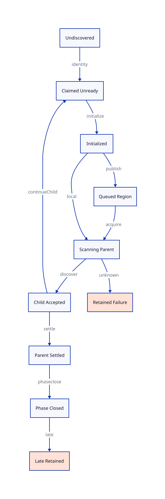

#+TITLE: Native Custody to Atomic QNT Refinement
#+SETUPFILE: ../../../modeling/org/setup.org
#+CATEGORY: architecture
#+OPTIONS: toc:3 num:t
#+PROPERTY: header-args :eval never

* RESEARCH Separate discovery, visibility, acceptance and parent settlement
:PROPERTIES:
:ID: f5a03085-d3a0-5b34-a563-0a9eefb59cb9
:CUSTOM_ID: atomic-refinement
:AUTHORITY: GambitAtomicRefinement
:EVIDENCE_CLASS: source-grounded-refinement-design
:STATUS: refinement-open
:END:

The design conclusion is narrower and more useful than treating each C function
as one atomic model action. Canonical forwarding, initialization, publication,
dequeue and descendant acceptance have different cuts. A parent can remain in
scan while a child progresses. Current gc_work_closure.qnt does not directly
represent that history under a projection preserving canonical item identity,
actual scanner ownership and parent scan completion.

[[file:models/sysml/atomic-refinement.sysml][Owned SysML]] defines the source-step projections, necessary predicates,
proof targets and diagram edges. [[file:atomic-refinement-map.org][Derived source/QNT and Lean tables]] inherit
proof dispositions from [[file:../../../modeling/proof-obligations.org][the shared closure matrix]]. Current QNT and Lean sources
are unchanged. Planned action names below are design notation, not runnable model
code, admitted theorems or runtime implementation.

** A concrete source/model shape mismatch
:PROPERTIES:
:CUSTOM_ID: discovery-gap
:END:

In [[file:../../../../models/gambit/gc_work_closure.qnt::54][finishScan]], a fresh child's state changes from undiscovered to local root
in the same update that changes its parent from scanning to scanned. Other
ordinary actions do not first discover that child while the parent remains
scanning. The model is an explicitly bounded, atomic work-accounting slice.

In [[file:../../../../vendor/gambit/lib/mem.c::3999][native scan]], nested mark_array can win forwarding, copy a child and call
end_heap_chunk before the enclosing scan returns. The publishing worker remains
active; another active worker can remove that complete chunk under the queue
lock. This source ordering admits child progress before the parent's scan-return
boundary, subject to the actual graph, layout, profile and schedule. It is not a
native execution receipt or a claim that the collector violates its semantics.

For the direct projection, consider parent=scanning and child=undiscovered. The
next source child publication would require parent=scanning and child=queued.
The current model has no ordinary path that first discovers the child while
retaining that parent state. Applying finishScan early falsely certifies parent
completion; hiding the child until parent return loses its earlier dequeue/scan
observations. This is a source-level obstruction to this particular mapping,
not a proof that all alternative refinement mappings are impossible or that the
finite model is internally unsafe.

The model comment allows an item to stand for a pending region rather than a
physical object. Changing that interpretation is legitimate only with an explicit
region/edge coverage relation. It cannot silently make a chunk, an object copy,
a first-field obligation and a parent scanner the same exclusive ticket.

** Proposed refinement relation and observation boundary
:PROPERTIES:
:CUSTOM_ID: relation
:END:

The proposed relation has two reasoning layers, with no duplicated QNT source:

1. Source operations plus ghost history map to a custody relation: canonical
   identities, speculative attempts, initialized ranges, queue entries, counted
   scanners, delegated edges, unresolved transfers and phase-scoped issuer rights.
2. That relation maps to an explicitly extended work-closure model. The existing
   maintained gc_work_closure.qnt would be the future edit location, after design
   acceptance. The single-object CollectionContract remains supporting evidence
   for claim/redirect/initialize ordering, not the whole task graph.

Each native step must match an abstract step or preserve the relation by
stuttering. If batching or fixed progress classes require a finite abstract
segment, its intermediate states and observation preservation must be justified
through an explicit ghost-step expansion. One cannot just call a whole native
function atomic while concurrent scanners can observe its middle.

#+NAME: refinement-observations
| Preserved observation | Required relation |
|---+---|
| Identity and phase | VM/generation, collection/root cut, phase/round, producer generation and canonical target agree |
| Readable payload | A scanner sees initialized descriptor-selected bytes at its admitted acquisition cut |
| Ownership and debt | Every required edge/region has one canonical obligation and live custodian or known settlement |
| Completion | A parent return settles its own covered scan; a phase receipt also requires every producer/unfinished domain drained |
| Failure disposition | Rejected, accepted, unknown and terminally settled effects remain distinguishable |

#+NAME: simulation-obligation-schema
#+BEGIN_EXAMPLE
InitNative(C) -> exists A, InitAbstract(A) and R(C, A)
I(C) and R(C, A) and NativeStep(profile, C, C_next)
  -> exists A_next,
       (AbstractStep(A, A_next) or A_next = A)
       and R(C_next, A_next) and I(C_next)
R(C, A) -> ObservationsNative(C) = ObservationsAbstract(A)
#+END_EXAMPLE

This is a proposed theorem schema. Any finite-segment adapter must explicitly
replace the middle clause with a justified ghost expansion; it cannot silently
change one-step simulation into an arbitrary future-dependent path. Internal
bookkeeping needs a termination argument. Real lock/wait polling instead needs
its admitted scheduling and visibility rely conditions; a rank is not asserted
to decrease on every native polling instruction.

Auxiliary history records already occurring reservations, winners and transfers;
it must be a conservative extension of admitted source histories, without adding
runtime synchronization or assuming a future successful effect. Infinite ghost
stuttering cannot establish progress. Safety simulation and liveness refinement
therefore have separate obligations.

This follows the method of [[https://www.microsoft.com/en-us/research/publication/the-existence-of-refinement-mappings/][Abadi and Lamport, The Existence of Refinement Mappings]]:
map lower-level states/steps while preserving allowed behaviors, with auxiliary
variables where justified. That theorem has hypotheses; it does not prove that
our proposed relation exists. [[https://www.cs.cmu.edu/~wing/publications/HerlihyWing90.pdf][Herlihy and Wing, Linearizability]], sections 2 and 4,
motivates representation invariants and operation cuts within invocation/response.
A cut for the queue is not automatically a cut for the whole collector.

** Forwarding CAS: identity is not readiness
:PROPERTIES:
:CUSTOM_ID: forwarding
:END:

[[file:../../../../vendor/gambit/lib/mem.c::3572][The winning CAS]] establishes the canonical destination before payload copying.
The winner retains initialization and future scan responsibility. Claim and
redirect are therefore compatible with an uninitialized destination; publish and
acquire are not. A loser restores its speculative header allocation and redirects
the root slot to the winner. The losing attempt and the canonical task are two
different accounting entities.

The ghost transition is: reserve attempt; select canonical winner; retain winner
initialization debt; settle only the losing attempt when its rejection is known.
An already forwarded target reuses a live or known-settled canonical obligation.
It never issues another canonical copy or decrements the winner's debt. The old-header writer census must also justify interpreting a failed CAS result as this epoch's forwarding pointer; arbitrary header mutation or ABA is not admitted. The
current QNT claim action does not model competing speculative attempts; matching
requires extra history/transition structure, not a second application of claim.

After winning CAS, rollback to the old address cannot be assumed safe: other
roots may already have been redirected. A permanently lost winner therefore
prevents a successful completion receipt unless an admitted helping/repair
protocol restores the obligation. Such helping is not supplied by this source
study. Current copying functions do not return a recoverable transfer-error
status; hypothetical service failure must not be attributed to them.

** Chunk publication and delegated first fields
:PROPERTIES:
:CUSTOM_ID: publication
:END:

[[file:../../../../vendor/gambit/lib/mem.c::3599][mark_array]] remembers the copied object's first field for tail marking when
applicable, copies the body, may publish a complete chunk, then follows that first
field. The [[file:../../../../vendor/gambit/lib/mem.c::4196][PAIR fast path]] scans the remaining pair field; the matching movable
subtype path in scan skips the first field as well. Tail marking and chunk
scanning consequently own different edge obligations that can coexist.

Readable copied bytes do not imply all outgoing edges have been processed.
A canonical copy ticket can be queue-owned while a counted producer still owns
the delegated first edge. Edge debt must be represented separately, or bundled
under a live aggregate that cannot disappear. Captured-frame copying has its own
layout and locking path; this first-field argument is not assigned to every
subtype or raw continuation frame.

[[file:../../../../vendor/gambit/lib/mem.c::3254][end_heap_chunk]] writes an end marker and, for a non-current-scan chunk, links
under the queue lock. A barrier precedes the tail update, another precedes unlock;
notification follows unlock. A candidate publish cut lies inside this protected
sequence once the readable initialized range is established for the actual
consumer/profile. Neither a raw link write nor a condition-variable signal alone
is the publication proof. The current-scan branch keeps local cursor custody and
does not acquire a fictitious FIFO entry.

A chunk can contain multiple objects, while the incomplete chunk can grow during
local scanning. Proposed publishBatch/acquireBatch operate on a descriptor-bound
set of pending regions. The relation partitions already-scanned prefix, admitted
scan region, private suffix, end/link words and delegated edges without losing or
double-counting obligations. These are logical boundaries, not a proposal to add
one atomic counter per object.

The QNT copied count of two is a bounded progress abstraction, not a concrete
word/byte count. Arbitrary-sized and zero/one-word bodies need an explicit
abstraction or a revised readiness representation. A finite two-item graph does
not prove an unbounded heap/chunk partition.

[[file:../../../../vendor/gambit/include/gambit.h.in::11014][Synchronization macros]] select sync builtins, Win32, emulated or sequential
operations; spinlocks can select mutexes or ticket locks. The actual enabled
configuration, compiler contract, word access and lock/barrier semantics must be
bound before claiming a C memory-order refinement. Source spelling alone is not
a portable C11 data-race/visibility proof, and no profile is newly qualified here.

** Dequeue: queue removal is scanner acceptance, not settlement
:PROPERTIES:
:CUSTOM_ID: dequeue
:END:

[[file:../../../../vendor/gambit/lib/mem.c::4340][Own-FIFO]] and [[file:../../../../vendor/gambit/lib/mem.c::6704][remote-FIFO]] consumers move the head under the matching queue lock,
then scan outside the lock. At the head-removal cut, ghost custody changes from
queued to a counted scanner that retains the descriptor/range and phase identity.
The source queue can forget the entry only because the scanner now owns its debt.
Unlock and function-call setup can stutter while that scanner obligation remains.

A local incomplete chunk uses the cursor relation and proposed scanLocal path.
The transfer model must account for cursor updates that become public only after
nested mark calls. Describing all scan input as a FIFO queue loses this path.

A bounded native-to-model mapping cannot erase the interval after dequeue and
before scan return. If a proposed executor can interrupt or migrate that interval,
it needs a recoverable scanner/transfer custodian. The present synchronous source
does not supply an exception-safe recovery API for arbitrary worker loss.

** Necessary QNT design changes, without model implementation
:PROPERTIES:
:CUSTOM_ID: proposed-actions
:END:

#+NAME: progressive-qnt-design
| Proposed action | Guard / effect | Why it is needed |
|---+---+---|
| discoverChild(parent, edge) | Parent remains scanning and counted; classify a fresh canonical child or alias; establish that edge's custody before clearing its discovery debt | Native child progress can precede parent scan return |
| finishParent(parent) | All required edges have known accepted/settled custody and no unknown handoff; settle only parent scan | Accepted children may remain queued or scanning |
| reserveAttempt / aliasCanonical | Preserve canonical identity; rejection settles speculative attempt only | Competing forwarding CAS does not create two canonical copies |
| publishBatch / acquireBatch | Bind complete initialized range set and descriptor, preserving total debt across queue/scanner | Native queue unit and model item unit differ |
| wakeSeeker(worker) | Phase count positive; activate counted seeker even with no queued item | Native wake can be spurious; QNT wake currently requires queued work |
| lateReject / reconcileTransfer | Closed-phase work cannot enqueue; known accepted completion may settle its existing ticket; unknown effect retains custody | Failure handling must not manufacture success or same-phase reopening |

The finite graph's future finishParent guard could require its known outgoing
edge covered, but general runtime admission needs the actual frame/object scan
inventory. Merely checking child != undiscovered does not prove every required
edge was visited or every pending transfer resolved.

For the POSIX profile, [[file:../../../../vendor/gambit/include/gambit.h.in::10912][CONDVAR_WAIT maps to pthread_cond_wait]].
[[https://pubs.opengroup.org/onlinepubs/9799919799/functions/pthread_cond_clockwait.html][The Open Group condition-wait specification]] permits spurious wakeups and requires
rechecking the predicate; this does not establish that a particular native run
experienced one.

The [[file:../../../../vendor/gambit/lib/mem.c::6756][native wait return]] increments count whenever the phase count is still positive,
even if no chunk is queued. Existing QNT wake requires a queued item. With a
projection equating native count and model active count, this is another direct
guard mismatch. Either explicitly represent awake seekers or justify a different
count abstraction; silently ignoring the native increment breaks counted.
Progress of this seeker loop requires separate scheduling/finite-work premises.

** Failed transfer, late work and closure cuts
:PROPERTIES:
:CUSTOM_ID: failure-late
:END:

#+NAME: failure-late-ledger
| Case | Ledger treatment | Forbidden shortcut |
|---+---+---|
| Known pre-effect reservation rejection | Source retains required edge; settle unused attempt/reservation only | Dropping required child debt |
| CAS loser | Alias winner; remove losing speculative attempt | Treating loser as winner completion |
| Winner or publisher outcome unknown | Retain source/transfer custodian and unfinished obligation; prevent affected successful completion/reuse | Undoing visible forwarding or speculative duplicate publish |
| Dequeued scan interrupted in a proposed executor | Scanner debt persists or is explicitly accepted by a replacement custodian | Empty FIFO counted as fully scanned |
| Root ingress sealed but parent still admitted | Inherited same-phase derivation remains accounted; phase cannot yet be drained | Rejecting required descendants solely because new roots are closed |
| Phase fully closed | Reject same-phase creation; retain a valid old lease or admit a separate phase with stable handles | Relabeling an unresolved raw pointer after backing reuse |
| Native release accepted, completion late | Settle exact existing resource ticket under live delivery ingress | Reopening tracing phase or issuing a duplicate free |
| Unknown native release effect | Independent payload/root custodian retains responsibility; target permit stays blocked | Success inferred from wrapper loss or nonzero callback return |

The last two cases belong to the resource-release ledger, not a mark-task action
in the selected QNT. [[file:../../../../vendor/gambit/lib/c_intf.c::1683][release_foreign]] clears fields before invoking the callback;
GC wrapper cleanup ignores status. Therefore transferring to a proposed task
service needs custody before wrapper loss. It cannot reconstruct ownership from
that wrapper afterward.

Completion has three cuts: external root admission closes; all admitted producers
and tracing debt drain in a specific phase; target-specific native users and
resource tasks permit reclamation. Parent settlement alone is none of those global
cuts. Unknown outcomes can preserve safety while indefinitely preventing progress.

** Lean proof decomposition and conditional result
:PROPERTIES:
:CUSTOM_ID: lean-obligations
:END:

[[file:atomic-refinement-map.org][Ten SysML-owned proof targets]] cover partition, canonical ownership, discovery,
publication, acquisition, failure, late work, wake, safety simulation and progress
simulation. They are proposed propositions, not new Lean declarations.

The required preservation induction is explicit: establish initial root/issuer
coverage; prove canonical claim and losing-attempt conservation; preserve a
complete range/edge partition through copy and publication; transfer queue debt to
scanner without an owner gap; accept children before settling parent; exclude
late same-phase creation at the closure cut; compose the resulting relation with
matching completion/reclaim observations.

[[file:../../../../models/gambit/lean/WorkAccounting.lean::39][zeroCountAndEmptyQueuesExcludeHiddenWork]] requires ProducerLifetimeSafe and
QueuesEmpty over counted/private/queued fields. It neither supplies those native
premises nor represents scanning, transit, speculative attempts, delegated edges
or unknown native effects. New lemmas must show that the richer domain projects
to its premises, or generalize the existing theorem at its maintained source.
Integer word bounds, no ABA, actual memory visibility and finite domains remain
separate obligations rather than being inferred from Nat arithmetic.

Conditionally, complete exclusive custody plus step preservation and sealed
issuers prevent unfinished required work from vanishing at zero count. This is
the safety goal. Eventual drain additionally requires finite production, fair
scheduling/delivery and a well-founded bound on internal stuttering; permanently
unknown effects cannot be silently excluded from that progress argument.

No QNT/Lean source was changed, no model checker/prover/solver was run, and no
runtime/native test was added. Modern generated C and a conditional Zig provider
owe the same relation; ghost proof structure is not a Zig-exclusive runtime gain.

#+CAPTION: Projection fragments; parent scanning and accepted child work coexist. These are not a single global automaton.

Diagram edge IDs resolve to the complete effects and evidence boundaries in
[[file:atomic-refinement-map.org][the derived projection-fragment table]].

[[file:diagrams/atomic-refinement.d2][D2 source]] · [[file:../../../modeling/proof-obligations.org][Closure matrix]] ·
[[file:../../../../evidence/research/gc-atomic-refinement/checks.json][Document/source check receipt]]

** Concrete discovery and settlement contract
[[file:child-discovery-design.org][The next design slice]] separates canonical selection from source-edge acceptance, Body/Tail fragments and physical batches, with explicit discoverChild/finishParent guards and preserved negative/positive scenarios. [[file:child-discovery-map.org][The complete action and Lean case tables]] derive from owned SysML.
