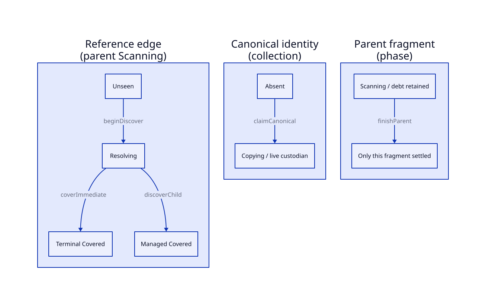
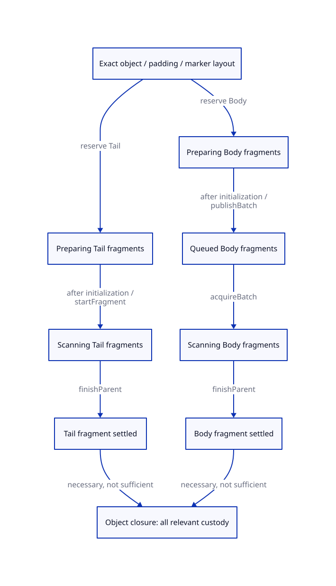

#+TITLE: Child Discovery, Fragment Settlement and Canonical Coverage
#+SETUPFILE: ../../../modeling/org/setup.org
#+CATEGORY: architecture
#+OPTIONS: toc:3 num:t
#+PROPERTY: header-args :eval never

* RESEARCH Cover each reference edge; settle only the assigned fragment
:PROPERTIES:
:ID: 9c3e495a-f58a-5d83-bb09-d17d757f0bda
:CUSTOM_ID: child-discovery
:AUTHORITY: GambitChildDiscovery
:EVIDENCE_CLASS: source-grounded-action-design
:STATUS: refinement-open
:END:

The design separates collection-scoped canonical object identity, phase-scoped
scan fragments and individually identified reference edges. discoverChild covers
one assigned edge after reference handling and target custody are known;
finishParent settles one fragment after its assigned inventory and physical visit
are complete. Neither action waits for the target object to finish, and neither
body-fragment settlement nor canonical forwarding implies whole-object closure.

[[file:models/sysml/child-discovery.sysml][Owned SysML]] is the authority for seven state domains, sixteen proposed action
contracts, thirteen scenarios, eight Lean preservation cases and eight source
facts. [[file:child-discovery-map.org][Their tables]] and both D2 diagrams derive from exported SysML. Proof
status remains exclusively in [[file:../../../modeling/proof-obligations.org][the shared obligation ledger]]. This is a concrete
design for future correction of the existing QNT, not a second QNT implementation.

** Source evidence and why one work state is insufficient
:PROPERTIES:
:CUSTOM_ID: source-meaning
:END:

[[file:../../../../vendor/gambit/lib/mem.c::3572][Forwarding CAS]] chooses a destination before body copy. A loser decrements its
speculative header cursor and redirects the source reference to the winner.
Alignment padding can remain as valid layout: do not infer a full byte/space
refund from settling the losing attempt. The already-forwarded branch later
redirects references without recopying the object.

[[file:../../../../vendor/gambit/lib/mem.c::3599][Movable copying]] selects the first field for tail marking only when words > 0
and subtype <= BOXVALUES. It copies the body, may publish a complete chunk, then
follows that first field. [[file:../../../../vendor/gambit/lib/mem.c::4168][Matching movable/default scanning]] skips that field;
[[file:../../../../vendor/gambit/lib/mem.c::4196][PAIR fast scanning]] marks the remaining field. Therefore a queued/scanned body
and a still-live first-field producer can legitimately coexist.

These are inspected branch facts. A still object's mark CAS instead enrolls a
local still scan list; its ordinary scan does not acquire the movable tail split.
Frames, captured continuations, weak objects and procedure fields have special
rules. A subtype/phase descriptor must establish its actual role assignment;
unsupported or incomplete adapters remain outside admission.

[[file:../../../../vendor/gambit/lib/mem.c::3249][Chunk publication]] handles object bytes, headers, padding and marker/link words.
[[file:../../../../vendor/gambit/lib/mem.c::4344][Dequeue]] handles a region whose scanner is counted, not one uniform logical
object. The incomplete current chunk can remain local. The new design cannot
assume one physical chunk equals one canonical object or one edge obligation.

[[file:../../../../models/gambit/gc_work_closure.qnt::54][Current finishScan]] simultaneously first reveals a fresh child and marks its
parent scanned. This prevents the direct parent/child progress mapping described
in [[file:atomic-refinement-design.org][the preceding study]]. Current nextPhase reconstructs initialState, including
copy/visibility state. That is a bounded abstract work reset; interpreting it as
resetting real canonical forwarding across strong and weak phases is invalid.
The native weak phase reuses the same collection and calls process_wills.

** Identity domains and exact meaning of coverage
:PROPERTIES:
:CUSTOM_ID: identity-domains
:END:

CanonicalKey binds VM/generation, collection/root cut and the old-object origin
with reuse generation. It does not contain phase. A canonical address/copy-task
entry therefore survives strong-to-weak admission within the same collection.
Speculative AttemptId, CopyTaskId, FragmentId and transfer task identities are
separate typed domains. A stable old-origin writer census and no ABA remain
premises, not consequences of naming these keys.

A FragmentId binds phase/round, descriptor revision and role. Its assigned edge
inventory is sealed before settlement. Roles include Body, Tail, Root, Frame and
Still; this study does not establish all their native adapters. An EdgeId binds
that fragment, slot identity and descriptor revision. Two source slots pointing
to the same CanonicalKey require two edge receipts but at most one canonical copy.

Edge state is Unseen -> Resolving -> Covered. Covered means that this assigned
reference has a known terminal-policy disposition, or its reference handling is
complete and its canonical target has live required custody or a valid imported
closure receipt. It does not mean that the target's payload is initialized, its
outgoing edges are finished, or its backing may be freed. Those facts have their
own witnesses and admission guards.

Fragment state is Preparing -> Scanning -> Settled. A Body fragment owns ordinary
assigned fields and physical visit/cursor obligations; a Tail fragment owns its
assigned first field. A Body view can read headers of an object whose Tail view
uses a field in the same storage. Disjoint semantic edge ownership does not
require all nondestructive byte/descriptor views to be disjoint.

** Canonical selection must precede edge acknowledgement
:PROPERTIES:
:CUSTOM_ID: canonical-selection
:END:

A combined discoverChild that creates the canonical record only after the
winner's root-slot store is too coarse. Another worker may observe the winning
forwarding header and handle its own reference before that root-slot store.
The design therefore separates the native CAS cut from source-edge acceptance:

1. beginDiscover changes the owned edge from Unseen to Resolving and binds its
   sampled origin. The source fragment remains live. A speculative native copy
   attempt can have its own AttemptId.
2. claimCanonical at a winning CAS creates one canonical destination and a live
   copy custodian, with readiness false. If an attempt was used, settling that
   attempt and issuing the copy task have separate ledger deltas. No source edge
   must already be Covered for another worker to alias this record.
3. A losing CAS settles only its own attempt. Its reference handling uses the
   winner's entry; it cannot decrement the winner's copy debt. An already-known
   target issues no second canonical task.
4. redirectReference records the actual owned source-slot update without covering
   the edge or changing target readiness. discoverChild commits only after this
   edge's reference update is known and its
   target receipt/custody is valid. It changes Resolving to Covered, retains the
   parent in Scanning, and neither issues canonical work nor settles parent/child.

A child can still be Copying at step 4. Its initializer remains counted and future
scanner admission still requires initialized bytes. Requiring the child already
complete would serialize valid work and can make self/cyclic graphs wait on
themselves. This argument does not supply helping for a permanently lost winner;
unknown or lost custody blocks the affected completion/reuse receipt.

coverImmediate uses an admitted terminal-value/runtime policy. It is not a blanket
rule that every nonmovable/permanent object has no managed dependencies. Any
separately rooted or deferred structure still needs its declared producer census.
An already Covered EdgeId is not discovered again: replayReceipt is a read-only,
identity-matching operation over a live receipt registry, with zero ledger delta.

** finishParent guard and its frame rule
:PROPERTIES:
:CUSTOM_ID: finish-guard
:END:

The exact proposed guard is the conjunction of: parent is Scanning; descriptor,
phase and custodian match; assigned inventory is sealed; every assigned edge is
Covered; physical visit/cursor handling is complete; and no transfer affecting
that fragment has an unknown acceptance/disposition. A known target != absent
is not a substitute for this conjunction.

The effect is only this fragment Scanning -> Settled, settling exactly one task.
Every canonical copy, other fragment, accepted child and independent transfer
keeps its state and owner. In particular:

- A Body fragment may settle while its Tail fragment remains Preparing/Scanning.
- A Tail fragment may settle after handing its child to a live canonical copy
  custodian, even when the child is unfinished.
- A leaf can have an empty edge set, but its physical visit is still a required
  guard; universal edge coverage alone is vacuously true.
- Whole-object phase closure additionally requires its copy/initialization
  custody, all relevant Body/Tail fragments and imported coverage valid, with
  no unknown object users. It is distinct from this fragment's settlement.

Object-phase closure here closes local object obligations, not its descendant
graph or a target reclaim permission. Accepted descendant tasks remain live in
the collection ledger.

The source guarantees none of these complete inventories merely by publishing a
queue tail. They are required refinement premises for every admitted role.

** Batch cover has two independent axes
:PROPERTIES:
:CUSTOM_ID: batch-partition
:END:

The physical layout manifest partitions the closed chunk interval into exact
object intervals (including headers), valid padding/filler intervals and marker/
link intervals. Initialization, object boundaries and cursor monotonicity must
match the real word/alignment profile. Native CAS loser padding is still layout,
not another canonical Scheme object or a refunded credit by assumption.

The semantic inventory uses the subtype and phase policy:

#+NAME: body-tail-partition-obligation
#+BEGIN_EXAMPLE
RequiredEdges(object, phase, descriptor)
    = BodyAssignedEdges disjoint-union TailAssignedEdges
Each assigned edge has one fragment custodian until its receipt is Covered.
Every required physical visit has a live fragment, even for empty edge sets.
#+END_EXAMPLE

Skipped weak relations are classified separately by actual policy: some are
selected later by process_wills, others are intentionally weak and repaired or
removed in cleanup. Do not turn all skipped slots into tracing obligations or
silently drop them from collection-wide phase scheduling. Imported strong-phase
coverage is accepted only with the matching descriptor/phase certificate;
a forwarding pointer alone is not that certificate.

reserveFragments registers exact Body/Tail obligations while the copy custodian
is still live. Preparing tail debt exists before chunk publication; its field
cannot be traversed until initialized. initializeCopy establishes byte readiness;
publishBatch then routes exact Body fragments to a queued region, while a
currently-scanned region retains local ownership. startFragment activates an
eligible local/Tail fragment; acquireBatch activates queued Body fragments under
counted scanner custody. Neither publication nor dequeue settles a fragment. finishCopy settles only
the initialized copy task after its required fragments have accepted custody;
it retains canonical identity/readiness and does not wait for those fragments
to finish. This avoids leaving copy debt permanently live in the proposed
transition system.

A batch may contain many objects and fragments. A membership proof prevents
omitted or duplicated fragments, while byte-layout and semantic-edge proofs
remain distinct. The current two-item/two-copy-word QNT abstraction does not
establish arbitrary region sizes, empty bodies, frame descriptors or native
memory visibility. Those require explicit projections and bounded/unbounded
proof obligations before runtime admission.

** Accounting without double charging edges and parents
:PROPERTIES:
:CUSTOM_ID: accounting
:END:

The task ledger has disjoint typed identities for attempts, copies, fragments and
independent transfer/reconciliation tasks. Edges are obligations contained by a
live fragment; they are not automatically counted again as independent tasks.
Transferred Body fragments retain their identity when moving private -> queued
-> scanning. A delegated first edge receives a distinct Tail fragment rather
than disappearing from its old owner without acceptance.

#+NAME: child-ledger-conservation
#+BEGIN_EXAMPLE
issued_after     = issued_before + new_tasks
settled_after    = settled_before + newly_settled
unfinished_after = unfinished_before + new_tasks - newly_settled
issued           = settled + unfinished
#+END_EXAMPLE

All quantities are nonnegative ghost counts backed by finite typed task sets.
Fresh canonical selection issues a copy task once. Aliasing issues none.
Fragment reservation issues required fragments once. discoverChild changes edge
coverage without settling a task. finishParent settles its own fragment once.
Parent completion therefore does not subtract an accepted child's obligation.
Counts are proof quantities, not a requirement for per-object native atomics.

Unknown transfer effects stay enrolled and keep the source/transfer custodian
live. Known pre-effect failure may settle only an unused attempt. A fully closed
phase cannot accept fresh work; closing new root ingress while admitted parents
remain live still allows their accounted descendants. Late resource completion
settles an exact already accepted resource ticket under live delivery ingress;
it is not a new tracing task or same-phase reopening.

** Exact future edits to the existing QNT
:PROPERTIES:
:CUSTOM_ID: qnt-edit-plan
:END:

[[file:../../../../models/gambit/gc_work_closure.qnt][The maintained model]] is the future edit target. No executable model is added
here. The state/guard/update/frame contracts in [[file:child-discovery-map.org][the derived table]] specify:

1. Split current work/owner into collection canonical identity/readiness and
   phase fragment/edge state. Add typed attempts and unresolved transfers where
   the admitted failure profile needs them. Preserve active/arrived/count and
   historical failure witnesses through corresponding projections.
2. Replace finishScan's combined child creation and parent settlement with
   beginDiscover, canonical selection/alias, discoverChild and finishParent.
   Explicit canonical selection can occur before either source edge is Covered.
   redirectReference is an explicit state-changing action, so the discovery
   guard does not rely on an update receipt that no modeled action can create.
3. Bind each fragment to its actual assigned finite edge inventory and physical
   visit. Root fragments receive their own inventory; multi-edge objects do not
   collapse to the fixed graph's one outgoing edge without a proof adapter.
4. Replace uniform single-item publication/acquisition with exact batch membership
   and local/Tail paths, or prove a conservative finite-domain adapter. Ownership
   safety is per FragmentId/role/phase, not a ban on legitimate Body plus Tail
   work for one physical object.
5. Keep canonical identity through nextPhase. Reseed only phase-required work
   under real skip/deferred/import policy. Never reset unresolved old debt to
   make the next phase look clean. finishPhase checks full root/issuer coverage,
   unfinished tasks, unknown transfers and inherited derivation rights.
6. Retain existing initializer names/fault meanings and legitimate positive
   sharing/cycle cases. Existing source remains unchanged until model editing
   and qualification are separately undertaken; no old receipt is reinterpreted
   as checking these new actions.

** Preserve counterexamples without manufacturing native failures
:PROPERTIES:
:CUSTOM_ID: counterexamples
:END:

The thirteen [[file:child-discovery-map.org][SysML scenario rows]] separate four legacy negative controls, six
new design-negative histories and three required positive controls. Existing
initOld, initEarlyIdle, initDuplicateClaim and initEarlyPhase remain byte-identical.
Their future mutations respectively remove readiness, producer-lifetime,
exclusive acquisition and phase-completion requirements. The witness property is
retained across a richer projection; an identical shortest trace is not promised.
The existing healthy initFixed baseline remains unchanged. The three proposed
positive histories have no current initializer binding: its present two-object
cycle does not already encode arbitrary self-edges, shared slots or these new
fragment/phase observations.

New negative histories cover duplicate canonical creation, omitted Tail debt,
partial edge/unknown-transfer parent completion, vacuous leaf completion,
incorrect phase recopy and late enqueue. These are proposed omission controls,
not freshly checked traces or observed Gambit defects. The earlier withdrawn
finish/rescan claim stays withdrawn; not(done) remains in CollectionContract.

Positive controls are equally necessary: shared targets and self/cyclic graphs
must not create duplicate copies or require recursive target completion; children
must progress before their parent finishes; and strong/weak phases must reuse
canonical identity with only their actual newly required obligations. A model
that avoids every negative trace by blocking these histories is not an acceptable
refinement of the source.

** Lean step preservation and remaining premises
:PROPERTIES:
:CUSTOM_ID: lean-preservation
:END:

Eight [[file:child-discovery-map.org][preservation cases]] identify the preconditions and postconditions for identity,
discovery, replay, layout, acceptance, settlement, balance and phase transitions.
Each prospective lemma needs an initial relation and a frame rule, not just an
arithmetic equality. The critical induction steps are:

- Canonical selection preserves one destination and one copy custodian under
  stable old-header interpretation/no ABA; losing attempts cannot settle it.
- Resolving -> Covered preserves a valid receipt for the exact assigned slot,
  while parent and accepted-child tasks remain represented.
- Body/Tail assignment preserves complete, disjoint semantic edges and valid
  physical layout, with role/phase-specific skip policy and all leaf visits.
- Queue/scanner and Tail activation preserve unique task custody under the
  selected profile's actual visibility and valid range/descriptor lifetime.
- finishParent removes precisely one live fragment after every assigned
  obligation is represented elsewhere or terminally handled. It preserves all
  other tasks and never establishes object closure by itself.
- Phase admission preserves canonical identity and old-debt witnesses, importing
  coverage only under an explicit scope/policy certificate.

[[file:../../../../models/gambit/lean/WorkAccounting.lean::39][Existing WorkAccounting]] supplies conditional counted/private/queued reasoning.
Its ProducerLifetimeSafe and complete worker domain must be derived from this
richer fragment/attempt/transfer representation. Neither Nat arithmetic nor
SysML predicates prove the native visibility, descriptor census, nonlocal exit
ownership, integer word bounds or finite-domain abstraction. Safety induction
also does not prove eventual delivery: fairness, finite production, live
custodians and absence of infinite internal stuttering remain progress premises.

This learns from [[https://www.microsoft.com/en-us/research/publication/the-existence-of-refinement-mappings/][Abadi and Lamport's state/step refinement]] and
[[https://www.cs.utexas.edu/~EWD/transcriptions/EWD06xx/EWD687.html][Dijkstra and Scholten's outstanding-descendant argument]]. Neither paper
establishes these Gambit premises or requires a child-completion wait at every
local parent return. No new theorem, exploration, solver or native run is claimed.
Modern generated C and conditional Zig owe the same semantic obligations.

#+CAPTION: SysML-derived role projections. A covered edge retains parent debt; canonical selection is a separate cut.

#+CAPTION: SysML-derived Body/Tail custody. Neither branch alone establishes object closure; guards remain in the table.

[[file:../../../modeling/proof-obligations.org][Closure matrix]] · [[file:../../../../evidence/research/gc-child-discovery/checks.json][Exact document/source receipt]]

** Copy/fragment handoff refinement
[[file:copy-handoff-design.org][The copy handoff study]] refines the four existing action definitions: initialization is local readiness, included Tail custody precedes batch commit, private Body acceptance can precede later publication, and finishCopy only settles copy debt. [[file:copy-handoff-map.org][The derived route/failure matrix]] distinguishes earlier-prefix publication from the upcoming target copy.
