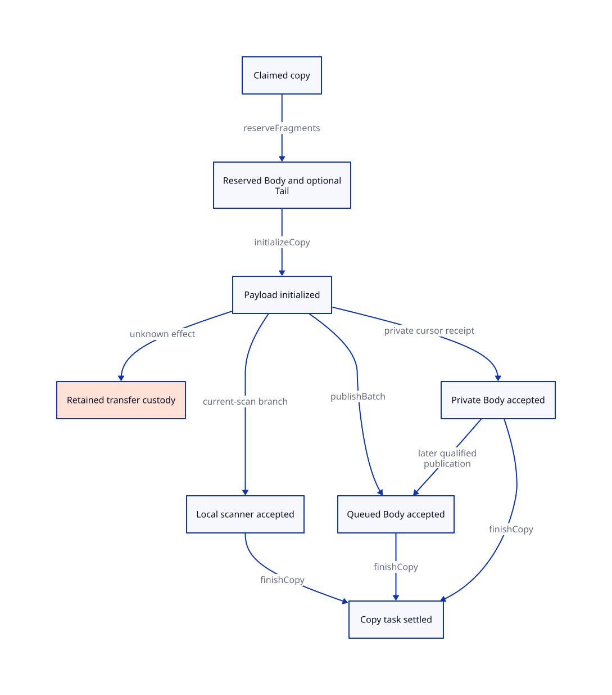

#+TITLE: Copy Initialization, Tail Escrow and Batch Handoff
#+SETUPFILE: ../../../modeling/org/setup.org
#+CATEGORY: architecture
#+OPTIONS: toc:3 num:t
#+PROPERTY: header-args :eval never

* RESEARCH Copy settlement follows accepted custody, not a universal queue sequence
:PROPERTIES:
:ID: 40b6344f-10fa-5c99-9a1f-45cf901990a2
:CUSTOM_ID: copy-handoff
:AUTHORITY: GambitCopyHandoff
:EVIDENCE_CLASS: source-grounded-partial-order-design
:STATUS: refinement-open
:END:

The four actions form an identity-scoped partial order. Required fragment custody
must exist before the copy can relinquish it; payload initialization precedes
readable batch publication. But finishCopy can precede later queue publication
when a counted private-cursor custodian already accepts the exact Body region
and Tail obligation. An earlier-prefix publication can precede the upcoming
object's claim entirely. A single global reserve -> initialize -> publish ->
finish sequence would misdescribe both source paths.

[[file:models/sysml/copy-handoff.sysml][Owned SysML]] owns the handoff routes, failure cuts, preservation cases,
source facts and D2 edges, including the later lifetime extensions. It binds the four amended action definitions
in [[file:models/sysml/child-discovery.sysml][the existing child model]]; it does not copy their definitions into another
action registry. [[file:copy-handoff-map.org][The derived route/failure/Lean map]] and [[file:child-discovery-map.org][the action table]] are views.
[[file:../../../modeling/proof-obligations.org][The shared ledger]] remains the only obligation-status authority.

** Source order and the actual Tail custodian
:PROPERTIES:
:CUSTOM_ID: source-tail
:END:

[[file:../../../../vendor/gambit/lib/mem.c::3572][mark_array's winning CAS]] publishes canonical identity before payload copy.
After redirecting the source cell, the code checks words > 0 and subtype <=
BOXVALUES, then assigns cell = alloc. That assignment preserves the address of
the copied first field while the byte-copy loop advances alloc and body. The
threshold branch may then call end_heap_chunk; only afterward does goto again
traverse the selected first field.

The proposed Tail reservation maps to that live source activation/cell and the
matching role descriptor. The worker remains counted while inside this nested
marking path. Preparing is a real logical obligation even though field bytes
are not yet ready or tail traversal has not started. No separate native Tail
registration API is being claimed. The existing worker lifetime is the candidate
aggregate custodian; its completeness and interruption policy still need proof.

[[file:../../../../vendor/gambit/lib/mem.c::4196][PAIR scanning]] excludes that field, and the matching movable/default scanner
also skips it. A remotely scanning Body can therefore coexist with source-owned
Tail work after publication. This is semantic edge partitioning, not a ban on
header/layout reads sharing storage views. Still, frame, weak and other special
adapters must establish their own descriptors; the ordinary first-field cut does
not automatically apply to captured-frame MISC_MEM_LOCK/link handling.

If the eligibility condition excludes Tail, reserveFragments creates no dummy
Tail task. Body/cursor visit obligations remain even for empty pointer-edge sets.
No worker is allowed to infer object/phase completion solely from an empty FIFO
or a Body scan finishing while required Tail work remains.

** A publication cut must identify which copies it contains
:PROPERTIES:
:CUSTOM_ID: prefix-membership
:END:

[[file:../../../../vendor/gambit/lib/mem.c::3537][The space-shortage loop]] saves the current alloc cursor and closes the current
chunk before allocating the upcoming object's header or winning its CAS. That
batch contains earlier completed object intervals, padding and marker/link words.
It must not list the upcoming target as initialized, reserved or accepted merely
because its resolver caused the closure.

[[file:../../../../vendor/gambit/lib/mem.c::3604][The threshold-after-copy branch]] instead closes a chunk after the current
object's payload and required padding have been copied. Its manifest may include
that object. The object's required Tail was already assigned to the live source
activation, even though that Tail can remain unstarted.

Each route binds collection/canonical key, CopyTaskId, region generation, exact
prefix interval, manifest revision and included Body FragmentIds. Prefix
membership is immutable once committed. Existing child identity survives a later
private -> queue transition; no new canonical copy or fragment is minted just
because a later batch now contains it.

An empty object-member set does not authorize forgetting marker/link traversal
or live queue/cursor users. Retain an explicit batch-control obligation or its
proven counted-context owner; padding and markers are not extra Scheme objects.

This ordinary-copy analysis proves neither a universal frame publication cut nor
all interval arithmetic. Captured continuation copying has a distinct local
condition and locking/layout protocol. Its adapter remains separately qualified.

** Four action guards and responsibility transfer
:PROPERTIES:
:CUSTOM_ID: four-actions
:END:

*** reserveFragments: establish obligations while source custody is live
The source copy custodian must be live, the admitted role descriptor must identify
the exact copy/field interval, and each required FragmentId must be unique.
Reserve Body and applicable Tail while source/copy responsibility still exists.
For the ordinary Tail path, reservation precedes inclusion of that object in a
published batch. It is not a claim that every publication anywhere in the worker
must follow this future object's reservation.

Payload-dependent special descriptors may need a different admitted cut. They
cannot use an unspecified reservation or be included in a readable batch before
all required field roles are known. A future metadata allocator must provision
that state before it can fail without custody; logical ghost reservation does
not itself require a new allocation per object.

*** initializeCopy: establish local byte readiness
All selected payload/padding bytes must be initialized and role inputs known.
The copy state becomes Initialized and the earlier model's copyReady means local
payload readiness. Fragment identity and existing ownership persist. This action
does not enqueue work, settle a task, start Tail traversal or establish a
cross-worker happens-before edge. Descriptor/phase validity and visibility are
independent premises.

*** publishBatch: commit only the exact initialized prefix
[[file:../../../../vendor/gambit/lib/mem.c::3254][end_heap_chunk]] writes the end marker, conditionally links a FIFO chunk under
its lock, orders content/link before tail and tail before unlock, then signals.
The manifest must match that actual prefix and the enabled barrier/lock profile.
Every included eligible Tail has counted or already accepted/settled custody.
A condition signal is notification, not the ownership receipt.

The current-scan branch does not enqueue a FIFO entry. It retains qualified
scanner/local-cursor responsibility for the relevant unscanned suffix. Queue
acceptance and this local acceptance are distinct cases; both preserve Body and
Tail debt. Dequeue later moves Body custody to a counted scanner without settling
it, as specified by the preceding studies.

*** finishCopy: settle only after explicit accepted custody
The copy must be Initialized, exact copy/manifest identities must agree, every
required Body/Tail must have known live or settled custody, and no copy effect
may remain unknown. Body acceptance has three successful variants:

- PrivateCursor: the counted owner retains the exact private alloc interval,
  role descriptor and future scan/flush responsibility. Public alloc_heap_ptr
  need not yet include it; losing the private cursor would still lose work.
- QueuedOrScanning: the exact committed batch/range has qualified visibility and
  a live queue/scanner custodian. The signal or a speculative link alone is
  insufficient.
- Settled: a valid matching receipt establishes that the Body fragment already
  finished. A delayed copy receipt need not require the child to become live again.

finishCopy changes only this CopyTaskId to Settled. Canonical identity/readiness,
source-parent edge/fragment debt and every accepted child task remain unchanged.
A required Tail can be Preparing, Scanning or known Settled. Child completion is
not a prerequisite for parent copy settlement.

There is no actual finishCopy call in mem.c. This is a proposed ghost/contract
cut over source operations. One mark_array invocation can copy many objects and
follow tail chains, so its C function return is not one object's copy receipt.

** Private suffix, public cursor and future scanning
:PROPERTIES:
:CUSTOM_ID: private-cursor
:END:

mark_array begins with a local alloc cursor; nested/tail copying can advance it
past public alloc_heap_ptr. [[file:../../../../vendor/gambit/lib/mem.c::3663][The final cursor update]] or a chunk closure later
exposes that range to the normal local scanning path. [[file:../../../../vendor/gambit/lib/mem.c::4323][scan_movable_objs_to_scan]]
uses alloc_heap_ptr and then reaches incomplete-chunk storage; it cannot infer
an unflushed private suffix from queue emptiness.

The private-acceptance receipt therefore includes the owner generation/activation,
exact range and role inventory, live local cursor and eventual scan path. It can
permit finishCopy before publication because fragment debt remains represented
under that counted owner. It does not authorize owner exit or arbitrary migration.
If a future independent-worker executor can interrupt here, it must first transfer
cursor/descriptor and all unfinished fragment rights to a replacement. Otherwise
that interruption profile is not admitted.

A full collection receipt remains later than every required local scan and phase
cut. A copy can finish locally while its Body still waits for cursor flush and
its Tail awaits traversal. None of these local receipts is a target reclaim permit.

** Failure cuts and retained responsibility
:PROPERTIES:
:CUSTOM_ID: failure-cuts
:END:

The [[file:copy-handoff-map.org][six failure rows]] distinguish before-claim rejection, post-CAS initialization,
Tail reservation, uncertain publication, private-owner loss, and retry/late receipt.
Current mark_array/end_heap_chunk are void routines; they expose no recoverable
transport failure result. The failure design describes obligations for proposed
services/executors, not source-observed failures or an existing helping API.

Before a winning claim, a known unused attempt may settle while its required
source edge remains owned. After visible forwarding, one cannot simply restore
the old header: other references may already point to the destination. The copy
initializer retains the canonical obligation until repair/help is accepted, or
successful GC completion remains blocked. Metadata failure after CAS is not an
excuse to discard Tail debt or resume mutators with incomplete copying.

A required effect still unresolved retains source/transfer custody and forbids
successful settlement of that copy. This condition concerns current unresolved
work, not a permanent failure flag that would forbid later success after known
repair. Unknown link/tail/acceptance effects are reconciled by exact identities,
not by speculative duplicate publish or free.

After a copy has settled to private custody, the Body/Tail obligations themselves
protect the range; copying's old debt is not revived on owner migration. The
replacement must accept those same task identities before the old custodian
vanishes. If that protocol is absent, keep the old owner or reject the profile.
No fairness assumption can reconstruct a cursor or raw pointer already lost.

Late acknowledgement may settle the exact outstanding transfer while its delivery
registry is live. It does not create another copy/fragment or reopen a closed
phase. Root ingress can close while admitted parents still derive required work;
final phase closure cannot precede those obligations' settlement.

** Parent-child accounting and frame obligations
:PROPERTIES:
:CUSTOM_ID: ledger
:END:

Let one successful copy have C=1 live copy task, B required Body fragments and
T required Tail fragments. These are task identities, not byte/space charges.
The source parent/edge's own task stays separately represented.

#+NAME: copy-handoff-ledger-deltas
| Action | Issued delta | Settled delta | Unfinished delta | Required frame |
|---+---+---+---+---|
| reserveFragments | B+T | 0 | B+T | Copy/source custodian stays live; no duplicate reservation |
| initializeCopy | 0 | 0 | 0 | All fragment/canonical identities retained |
| private acceptance / publishBatch / acquireBatch | 0 | 0 | 0 | Move Body custody; retain exact tasks and Tail owner |
| finishCopy | 0 | 1 | -1 | Body/Tail and source-parent tasks unchanged |
| later finishParent(fragment) | 0 | 1 | -1 | Only the named fragment settles |
| unknown required effect | Policy-specific transfer task enrollment only | No speculative settlement | Required debt persists | No success from unknown outcome |

For each admitted ledger, issued = settled + unfinished, with nonnegative typed
finite sets. Edge obligations are contained by their live fragments, not charged
again as independent tasks by default. A transfer/reconciliation task, when
needed, has its own identity and creation/settlement rule.

Scalar equality is only a necessary check. Lean step preservation must show the
actual map/set frame: no other parent/child task was deleted, reminted or silently
changed. Equal before/after child counts do not prove this identity-preserving
frame. Machine-word overflow, source lifetime and actual atomic visibility remain
additional native obligations.

** QNT correction plan and required histories
:PROPERTIES:
:CUSTOM_ID: quint-plan
:END:

The maintained future edit target remains [[file:../../../../models/gambit/gc_work_closure.qnt][gc_work_closure.qnt]], with unique
support in repository models/. No QNT code is added in this study.

1. Separate local payloadInitialized from published visibility, and retain a
   CopyTask state independent of Body/Tail fragment states. Current work=2
   conflates private copying and ready private scan work.
2. Add reserveFragments and explicit Body acceptance classification. finishCopy
   may leave the abstract Body private (work=2 under a justified projection),
   while only its copy task settles. Later publish can still move that same Body
   to queued work; copy settlement must not disable it.
3. Bind publishBatch to an exact initialized-prefix membership set. An earlier
   prefix excludes the upcoming unclaimed target; a later prefix can include
   children whose copy tasks already settled under private ownership.
4. Keep Tail's Preparing/Scanning/Settled custody independent of Body queue state.
   Profile-qualified visibility gates acquisition; initialization alone cannot
   satisfy the publication guard. Idle and phase completion must cover private
   cursor work, unfinished copies, Tail and unknown transfers.
5. Preserve existing fault controls and the preceding child-discovery scenarios.
   Add design histories for earlier-prefix-before-claim, copy-finished-before-
   publication with private debt, Body-scanned-before-Tail, stale/missing private
   cursor, no-Tail exclusion, unknown partial publication and duplicate finishCopy.
   These are required future controls, not newly checked traces.

Do not repair the model by forcing every object into a queue or waiting for all
children at every finishCopy. Those restrictions would remove legitimate source
histories. Current nextPhase/canonical identity and discoverChild/finishParent
obligations from earlier studies remain necessary.

** Lean preservation premises and conditional argument
:PROPERTIES:
:CUSTOM_ID: lean-premises
:END:

The [[file:copy-handoff-map.org][seven preservation rows]] cover reservation, initialization, prefix membership,
publication, private acceptance, settlement and failures. Each must connect a
source step or justified stutter to the proposed abstract transition while
preserving exact task/region/phase identities and observations.

Initially the winning copy and source parent are owned. Reservation creates
unique child tasks before source responsibility can disappear. Initialization
changes readiness only. Accepted private/queue/scanner custody preserves each
child's task and range. Copy settlement removes precisely the copy task after
those receipts are known. By induction, no required Body/Tail obligation is lost
merely because the copy or source parent finished. This conditional argument
requires complete inventories, exclusive valid custody and the actual cut/order
premises. It is not a new mechanized theorem.

The proof follows [[https://www.microsoft.com/en-us/research/publication/the-existence-of-refinement-mappings/][state/step refinement]] and learns from
[[https://lamport.org/pubs/auxiliary.pdf][Lamport and Merz, Auxiliary Variables in TLA+]], sections 3 and 5:
auxiliary state must preserve original behavior; adding history or stuttering
steps is not adding runtime bookkeeping or a future-success assumption. Their
TLA+ rules are methodological evidence, not an automatic QNT/Lean soundness theorem.
[[https://www.cs.utexas.edu/~EWD/transcriptions/EWD06xx/EWD687.html][Dijkstra and Scholten]] motivates retaining outstanding descendant responsibility;
it does not prove our private-cursor lifetime or the C memory model.

Progress separately needs finite production, fair scans/delivery, live custodians
and a bound on internal bookkeeping stutter. Permanently unknown copy effects or
lost cursors can block completion; they cannot be removed from the ledger to
claim liveness. Modern generated C and conditional Zig share these obligations.
No runtime path retires or receives a performance gain by this design alone.

#+CAPTION: SysML-derived partial-order projection. Private acceptance can precede later queue publication; all finishCopy edges require Body/Tail receipts.

[[file:../../../modeling/proof-obligations.org][Closure matrix]] · [[file:../../../../evidence/research/gc-copy-handoff/checks.json][Exact document/source receipt]]

** Lifetime continuation
[[file:custody-lifetime-design.org][The custody lifetime study]] expands private acceptance through publication, idle, migration and storage retirement, distinguishing historical copy settlement from current authority.
