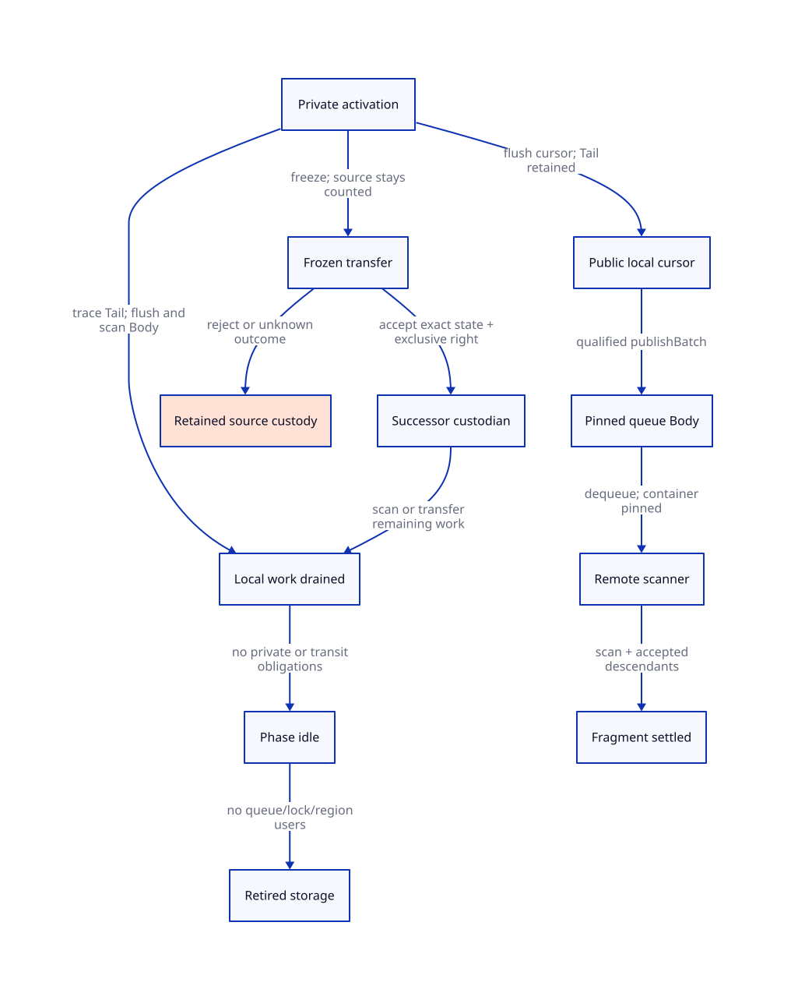

#+TITLE: Private Cursor and Tail Custody Lifetime
#+SETUPFILE: ../../../modeling/org/setup.org
#+CATEGORY: architecture
#+OPTIONS: toc:3 num:t
#+PROPERTY: header-args :eval never

* RESEARCH Copy settlement requires current custody; owner retirement is a later cut
:PROPERTIES:
:ID: c6038363-fbbd-4af6-a5cd-e251d080a527
:CUSTOM_ID: custody-lifetime
:AUTHORITY: GambitCopyHandoff
:EVIDENCE_CLASS: source-grounded-lifecycle-design
:STATUS: refinement-open
:END:

[[file:models/sysml/copy-handoff.sysml][The existing owned SysML model]] now owns eight lifecycle transitions, six
receipt rules, eight unexecuted counterexample histories, seven additional
preservation cases and five necessary lifetime predicates. It also binds six
additional source slices. [[file:custody-lifetime-map.org][The lifecycle/receipt/counterexample tables]] and
[[file:diagrams/custody-lifetime.d2][D2 edges]] derive from that same model. The shared
[[file:../../../modeling/proof-obligations.org][obligation ledger]] owns statuses; no second status registry is introduced.
The original four action definitions remain in child-discovery.sysml.

** Source lifecycle: synchronous activation, public cursor, phase idle, processor exit
:PROPERTIES:
:CUSTOM_ID: source-lifetime
:END:

[[file:../../../../vendor/gambit/lib/mem.c::3502][mark_array]] takes alloc and limit from PSTATE into local variables. Each outer
iteration has start/n and cell, while goto again reuses cell for the delegated
first field. The activation owns more than a heap end pointer: pending source
slots, Tail progress, descriptor inputs and the exact storage interval matter.
The shown ordinary path performs Tail traversal synchronously and writes the
final alloc_heap_ptr before returning. It contains no service migration or
finishCopy API. Debug/fatal behavior is not a successful recoverable handoff.

At a threshold, [[file:../../../../vendor/gambit/lib/mem.c::3616][the publication branch]] updates alloc_heap_ptr, closes/starts a
chunk and only then follows cell via goto again. Body may therefore become
remotely scannable while Tail remains local. A normal mark_array return has
consumed the current invocation's Tail loop and flushed its local cursor. It
does not imply that all copied objects' Body work or descendants have completed.
A copy's logical settlement may occur earlier under qualified private custody;
there is no one-object receipt tied to the C function return.

[[file:../../../../vendor/gambit/lib/mem.c::3417][setup_stack_heap_vmstate]] initializes participant heaps/FIFOs and both phase
counts to np. After setup's barrier, [[file:../../../../vendor/gambit/lib/mem.c::6845][strong-phase root marking]] runs before
mark_reachable_from_marked. Thus a root producer is already a counted participant
before entering the scanner loop. Enrolling only scan-loop workers would omit
root producers and would misstate the present accounting.

[[file:../../../../vendor/gambit/lib/mem.c::6686][The scanner loop]] calls local still/movable scanning, steals complete chunks,
then decrements workers_count under the termination mutex. On the shown normal
control path, synchronous mark_array calls have returned before this decrement.
A condition wait can wake while the phase remains active, increment the count
and rescan; wake is not evidence that a particular chunk was accepted.
The full producer inventory and platform memory-order refinement remain open.

Three different events must remain distinct:

- Phase idle: this participant has no retained private activation/Tail/initializer
  work on the admitted synchronous path. Its PSTATE/FIFO can still be used by
  other scanners; idle does not authorize destruction.
- Processor removal: [[file:../../../../vendor/gambit/lib/setup.c::900][vm_resize_pstate]] can call GC for capacity, returns from
  that call, synchronizes, then cleans up and exits an unneeded processor. The
  synchronous dispatcher selects resize and GC separately; these inspected paths
  do not supply a legal mid-mark_array transfer of alloc/cell.
- Storage retirement: queues, locks, msections, descriptors and raw-pointer users
  must all be quiescent or accepted elsewhere. [[file:../../../../vendor/gambit/lib/mem.c::4928][cleanup_mem_pstate]] frees still
  objects and cleans RC; it is not a private-cursor/Tail transfer interface.

[[file:../../../../vendor/gambit/lib/mem.c::7002][GC phase barriers]] separate setup/strong/weak/cleanup before heap resize.
This establishes inspected ordering, not complete proof of every external caller,
forced OS-thread termination, asynchronous exception policy or worker migration.
A proposed interruptible independent worker must provide its own admitted cuts.
OS preemption retaining the same thread stack is suspension, not custody transfer;
Scheme-thread migration is not evidence that GC's C activation can migrate.

** Custody state and the exact receipt boundary
:PROPERTIES:
:CUSTOM_ID: receipt-currency
:END:

#+NAME: custody-lifetime-fields
| Record | Required content | Why pointer/count alone is insufficient |
|---+---+---|
| Identity | Collection, phase, canonical copy, CopyTaskId and FragmentIds | Same object can carry different phase obligations |
| Owner | Worker slot generation and activation/transfer identity | A reused processor index does not authenticate old authority |
| Private frame | alloc/limit, pending cell, remaining source range/start/n or equivalent resumable state, role descriptors | Flushing alloc alone does not preserve pending Tail execution |
| Region | msection generation, initialized prefix and private suffix bounds, container users | Reused addresses can satisfy stale range comparisons |
| Acceptance | Current live counted custodian, qualified queue/scanner or valid settled receipt, with exact successor chain | Historical acceptance is not present execution authority |
| Rights | One execution right and one Copy settlement right, with unresolved effects represented | Two counted owners must not both execute the same Tail |

These are semantic fields for a generated contract, not a mandate to allocate a
runtime record for every object. The source activation can represent several
fields collectively if a complete simulation proves that representation.

A PrivateCursor acceptance is valid while the exact initialized suffix and its
future scan path remain represented by a live counted activation or an accepted
successor. Tail has independent current live/settled evidence where required.
At actual finishCopy consumption, identities and generations must still match,
there must be no unknown required effect, and its unique settlement right must
remain unconsumed. A cached accepted=true or worker ID cannot establish this.

After finishCopy, the historical event stays true even if the original owner
later publishes, transfers or retires. Current authority must advance along
same-task successor custody or a valid settled receipt. We do not resurrect Copy
debt on migration. We do not allow a historical private receipt to dereference
retired storage, settle Copy twice, or authenticate a new epoch's work.
A phase/region generation change invalidates old operational authority; retained
historical completion facts are not new access or reclaim permissions.

Body publication never consumes Tail custody. A Body scanner skips delegated
first-field work in the admitted ordinary PAIR/default adapters. When source
Tail traversal resolves an edge, its derived canonical copy/fragment obligations
must already have custody before that edge obligation can settle. Descendant
completion is not required at each step; descendant responsibility must persist.
Special captured-frame, weak and still adapters remain separate proof domains.

** Transfer and retirement guards
:PROPERTIES:
:CUSTOM_ID: transfer-retire
:END:

The current source relies on synchronous calls; the following is a proposed
migration protocol, not a native behavior already supported by Gambit.

1. Freeze the old activation's execution right at an admitted cut. The old
   counted custodian retains the complete frame and pinned storage.
2. Prepare the exact unfinished task set and resumable cursor/Tail state. A
   destination announcement or transport send is not accepted custody.
3. Accept into a live counted destination or a qualified transfer/queue service.
   Acceptance binds generations and exact task membership. The source cannot
   release responsibility before this cut. A qualified queue needs a proven
   drainer/activation and termination protocol, not just a nonempty FIFO.
4. Commit the successor relation and transfer the single execution right. Old
   and new participants may both temporarily be counted, but only one may run
   the pending Tail. Preserve issued/settled task sets and other owners' state.
5. Release the old private custody only after known acceptance. Rejection keeps
   the old owner; an unknown outcome keeps frozen source/transfer custody until
   reconciled. A known settled fragment can satisfy the corresponding obligation
   without being recreated. No speculative duplicate publish or header rollback.
6. Retire old containers/storage only after all queue, thief, scanner and raw-
   pointer users drain or transfer under a separate accepted lifetime protocol.

The transfer release predicate applies only to an unfinished handoff. Normal
retirement after all obligations have settled needs no artificial destination.

Publication and migration cannot race over a mutable manifest or cursor frame.
Freeze/commit revisions must serialize their ownership update or retry against
a known current revision. A queued Body and a private Tail can intentionally
have different owners. Losing cell is not repaired by publishing more Body bytes.
The accepted destination must preserve the local scan frontier, not merely alloc:
blindly copying PSTATE fields can skip or repeat a chunk already under scan.

No physical failure recovery follows from this ghost design. If a profile allows
forced loss of a live C stack without accepted state retention, it cannot receive
finishCopy/private-custody admission. It remains unresolved rather than assuming
fairness will reconstruct lost pointers. The native resize path is not evidence
that such forced loss is reachable or supported.

** Counterexamples and source reachability
:PROPERTIES:
:CUSTOM_ID: lifetime-counterexamples
:END:

[[file:custody-lifetime-map.org][Eight owned histories]] retain: unflushed owner exit; published Body losing
Tail; announced-but-unaccepted transfer; two executors resuming one Tail; stale
receipt after generation reuse; freeing an idle queue still read by a thief;
hypothetical resize inside copy; and a Body receipt deleting whole-object debt.

Seven are design-negative controls for omitted guards. Resize-inside-copy is
explicitly reachability-unresolved: the inspected normal synchronized path does
not demonstrate this native interleaving. None was newly executed by QNT or a
native runner. Keep the previous four QNT fault initializers, their source
identity and prior failure receipts; do not relabel design histories as traces
from the existing model.

The prior finish-to-rescan claim remains withdrawn under its existing
[[file:../../../../evidence/research/gc-terminal-closure/counterexample-correction.json][correction record]]. This lifecycle study does not revive it.

** QNT action corrections and Lean step preservation
:PROPERTIES:
:CUSTOM_ID: lifetime-refinement
:END:

The edit target stays [[file:../../../../models/gambit/gc_work_closure.qnt][the existing QNT source]], with no parallel model root.
No QNT edit or execution is performed here. Extend its planned state with:

- Per-activation private/public cursor frontiers, pending Tail roles, task status
  and region/owner generations; copy readiness differs from visibility.
- Receipt/successor identity and a single Copy settlement right. finishCopy can
  remove Copy debt while Body/Tail stay live or already settled.
- Separate flushCursor, publishBatch, advanceTail, prepareTransfer,
  acceptTransfer, releaseSource, idle and retire cuts. Native synchronous profile
  excludes transfer while inside the activation; proposed executor profiles must
  establish extra transition correspondence.
- Explicit frozen/unknown transit custody. Destination rejection and lost reply
  preserve the old obligation; receipt replay is idempotent by exact identity.
- Phase idle versus container retirement; stable participant membership through
  phase barriers. Wake can be spurious while count remains positive. Existing
  wake currently requires queued work and is a narrower abstraction.

A transfer freeze may be abstract stuttering; task-owner movement must preserve
an exact set frame. Publication moves only included Body IDs. Tail resolution
can issue new children, and finishCopy settles only CopyTaskId. A queue empty
check alone cannot justify idle if private/Tail/transit work exists. All terminal
and phase-transition guards must inspect the complete obligation inventory.

[[file:../../../modeling/proof-obligations.org][The ledger]] adds five open lifecycle obligations and one limited source-order
fact. Seven added preservation rows in [[file:copy-handoff-map.org][the shared preservation table]] identify
activation-frame completeness, Tail advance, flush/publication, transfer commit,
receipt consumption, idle/retirement and observational projection/progress.

For Lean, start from a finite typed task map and generation-qualified custody
relation, not just Worker.privateWork. Prove each transition preserves:

1. Every unfinished required task has one execution custodian or explicit frozen
   transfer/qualified queue custody; counted coverage has no release-before-
   acceptance gap. Parent/source inventories are not erased by child transfer.
2. issued = settled + unfinished with disjoint exact identities; movement leaves
   these sets unchanged, while finishCopy removes only its single CopyTaskId.
3. Descriptor/range validity and storage pinning persist for every remaining
   private/Tail/queue user. Counted retirement and physical reclamation are
   separate predicates.
4. A current receipt matches the successor or settlement chain and cannot be
   consumed twice. Historical facts remain valid without granting new authority.
5. Projection preserves observable source behavior; liveness separately needs
   finite production, fair service and bounded internal stutter, not a prophecy
   that unknown handoffs will eventually have succeeded.

[[file:../../../../models/gambit/lean/WorkAccounting.lean][WorkAccounting]] supplies conditional aggregate lifetime/generation lemmas,
not this concrete invariant. Its ProducerLifetimeSafe premise must be preserved
by the proposed transitions; it cannot be assumed as the conclusion of transfer.
Learn from [[https://lamport.org/pubs/auxiliary.pdf][Lamport and Merz's auxiliary-state discipline]] without claiming their TLA+
rules automatically prove QNT/Lean soundness. [[https://www.cs.utexas.edu/~EWD/transcriptions/EWD06xx/EWD687.html][Dijkstra and Scholten]] motivates
retaining descendant deficits; it does not supply a Gambit stack-migration or
weak-memory theorem.

** Modernization consequence and closure boundary
:PROPERTIES:
:CUSTOM_ID: lifetime-modernization
:END:

#+NAME: custody-lifetime-value-matrix
| Requirement | Modern generated C | Conditional Zig backend | Present conclusion |
|---+---+---+---|
| Explicit cursor/Tail ownership | Scheme emits common semantic metadata and typed C contracts | Can consume same metadata with explicit state/cleanup | Shared modernization; no exclusive Zig benefit established |
| Migratable collector work | Generate resumable state instead of relying on a lost C activation | Explicit structs/allocators can represent the same state | Full frontier, exclusive execution and accepted transfer required in either language |
| Reliable finishCopy evidence | Identity/generation checks and one-shot settlement | Same invariants; defer does not prove asynchronous transfer | Both need current custody and failure reconciliation |
| Worker and storage retirement | Separate task drain from queue/region reclamation | Same lifetime and memory-order proof | No language erases queue/thief users |
| Work reduction | Preserve private scanning and avoid forced per-object enqueue/descendant joins | Same possible contract lowering | Mechanism retained; no measured speed or net Zig gain claimed |

The architecture retains Gambit's ordinary private-copy fast path while making
its hidden lifetime obligations explicit. The cost is state/adapter/receipt
maintenance where execution becomes interruptible or migratable. This study
establishes source cuts and necessary design guards; it closes neither the full
collector nor worker migration. No runtime path is retired by this document.

#+CAPTION: SysML-derived ownership lifecycle. Body publication and Tail custody are separate; retirement requires the additional container/user cut.

[[file:../../../../evidence/research/gc-custody-lifetime/checks.json][Exact document/source receipt]] · [[file:../../../modeling/proof-obligations.org][Closure matrix]]

** Migration refinement continuation
[[file:migration-cut-design.org][The migration-cut study]] expands the scan/caller frontier beyond alloc/cell and refines accepted source release to allow a destination that already completed its transferred work. Publication/freeze and commit/reject serialization remain proposed contracts.
