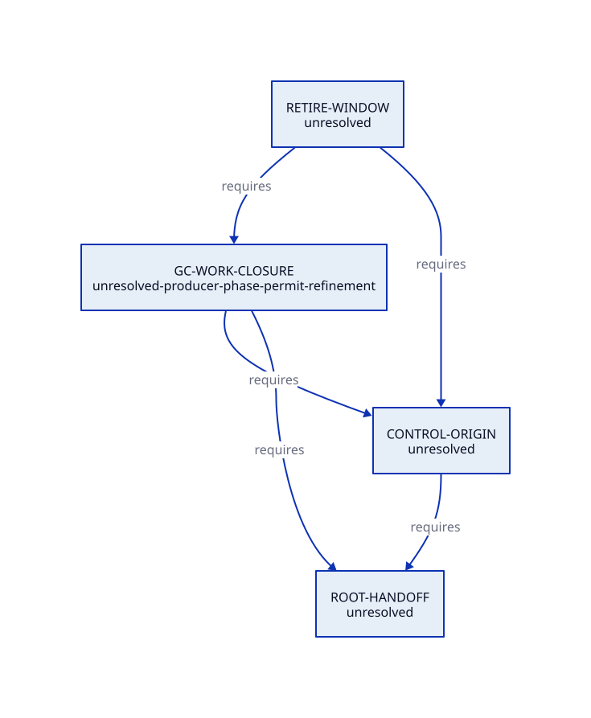
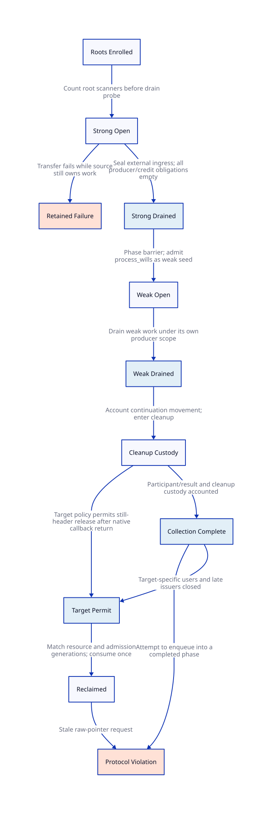
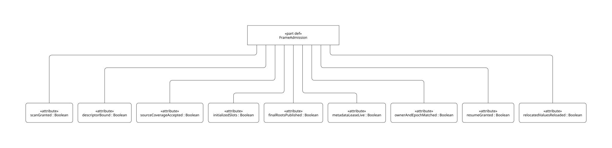
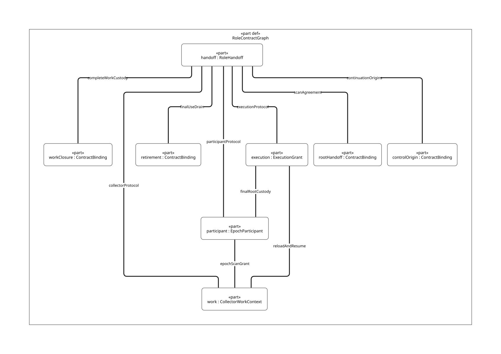
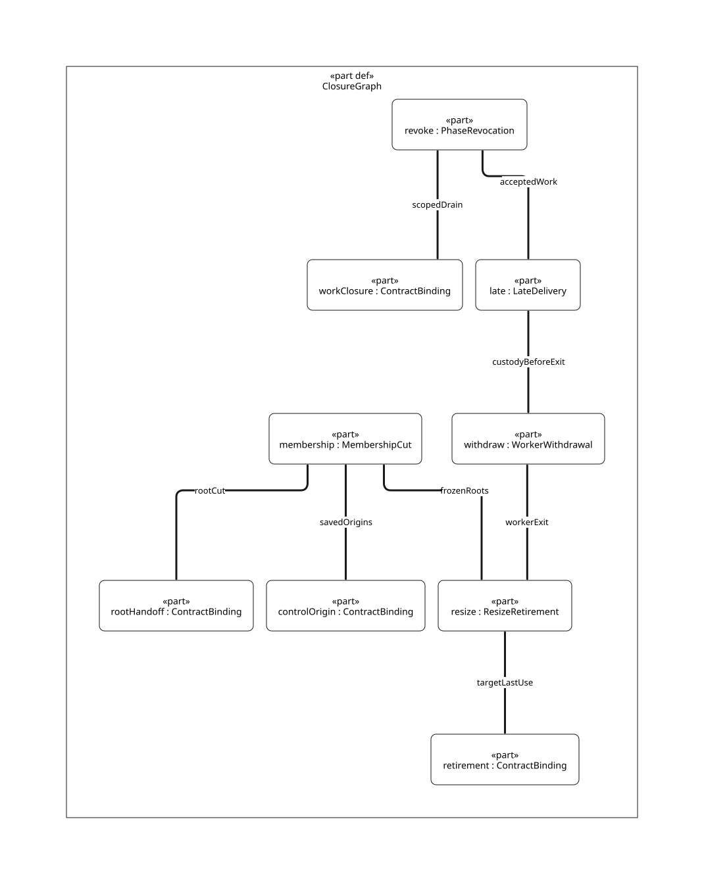

#+TITLE: Runtime Cross-Module Contracts
#+SETUPFILE: ../../../modeling/org/setup.org
#+CATEGORY: architecture

* RESEARCH Interfaces with explicit producers and consumers
:PROPERTIES:
:ID: 74d34423-f60e-5745-8da0-e875bee1ec2c
:CUSTOM_ID: runtime-interfaces
:OWNER: runtime architecture
:STATUS: design-only
:EVIDENCE_CLASS: design-and-source-correspondence
:END:

These are architectural obligations, not newly deployed APIs. Each interface has one meaning across modern C and a conditional Zig implementation. Existing formal artifacts support slices of that meaning; their composition is not yet proved.

#+BEGIN: sysml-view :kind interface-contracts :source architecture/runtime/interfaces/models/sysml/model-relations.sysml
#+NAME: runtime-interface-ledger
| Contract | Owner | Producer | Consumer | Composition |
|---+---+---+---+---|
| ROOT-HANDOFF | dev/architecture/runtime/execution | execution + FFI root custodian | GC scanner | unresolved |
| CONTROL-ORIGIN | dev/architecture/runtime/control | control save/restore/capture | GC continuation traversal | unresolved |
| RETIRE-WINDOW | dev/architecture/runtime/gc | GC phase coordinator + control/FFI producers | resource reclamation / next collection reuse | unresolved |
| GC-WORK-CLOSURE | dev/architecture/runtime/gc | collector workers | GC completion / execution reentry | unresolved-producer-phase-permit-refinement |
#+END:
- [[file:../../../modeling/correspondence.org][Field/event projections, assumptions, counterexamples and unresolved refinements]]
- [[file:models/sysml/shared-runtime-contract.sysml][Shared runtime transition predicates]]
- [[file:models/sysml/interfaces.sysml][Named interface records and necessary conditions]]
- [[file:diagrams/relations.d2][Cross-module relation view source]]
- 

** Failure custody and cycles
A failed or incomplete handoff keeps the source custodian live, or transfers custody through an independently acknowledged successor; it never authorizes reclamation merely because a request was accepted. A completion result identifies the same VM, generation, epoch and target as the consumer's outstanding request.

Control cannot await GC completion while retaining a required unpublished root behind that wait. GC cannot await a producer's permanent shutdown while that producer is blocked waiting for the same GC. Separate publication/acknowledgement from final resource drain, preserve the retained-failure state and prove the wait graph from actual callers.

** OPEN Source refinement
Identity fields, producer sets and failure paths are obligations. The shared SysML booleans name them; no concrete instance or satisfaction assertion turns them into certificates. Full source coverage, native memory order and combination of safety with progress remain unresolved.

** Shared GC/control proof frontier
- [[file:gc-control-contract.org][Shared identity, phase protocol and source-derived terminal-reopen counterexample]]
- [[file:../../../modeling/proof-obligations.org][SysML-derived obligations and dependency dispositions]]
- [[file:models/sysml/model-relations.sysml][Canonical model-binding and obligation source]]

** Producer closure, late work and reclamation
- [[file:gc-completion-design.org][Current completion design and prior counterexample correction]]
- [[file:completion-model-map.org][SysML-derived source and lifecycle map]]
- [[file:models/sysml/collection-completion.sysml][Producer / phase / collection / target predicates]]
- [[file:diagrams/completion-custody.d2][Derived lifecycle D2]]
- 

** Producer census and parent-child custody
[[file:producer-custody-design.org][Caller-grounded custody argument]], [[file:producer-custody-map.org][SysML-derived census]], and [[file:diagrams/producer-custody.d2][D2 edges]] distinguish bounded lexical coverage from open-world producer closure.

** Native-to-QNT custody refinement
[[file:atomic-refinement-design.org][The atomic refinement study]] separates forwarding, readiness, chunk publication, scanner custody and parent settlement. [[file:atomic-refinement-map.org][SysML-derived source/action and Lean targets]] retain the distinction between current QNT actions and proposed changes.

** Child discovery and fragment completion
[[file:child-discovery-design.org][Canonical/edge/fragment state and guard design]] and [[file:child-discovery-map.org][derived action, scenario and Lean tables]] refine discoverChild/finishParent without merging collection identity, phase work and physical regions.

** Copy initialization and fragment custody
[[file:copy-handoff-design.org][The copy handoff study]] scopes ordering by copy and batch identity, including Tail escrow, earlier prefix closure, private-cursor acceptance and copy-only settlement. [[file:copy-handoff-map.org][Routes, failure cuts and preservation premises]] derive from owned SysML and bind the existing four action definitions.

** Private cursor and Tail lifetime
[[file:custody-lifetime-design.org][Lifecycle, current receipt and owner retirement argument]]; [[file:custody-lifetime-map.org][SysML-derived transitions, rules and unexecuted counterexamples]].

** Migratable cuts and scan continuation
[[file:migration-cut-design.org][Scan frontier, complete restore state and publication/decision argument]]; [[file:migration-cut-map.org][SysML-derived cuts, atomic-step plan and race controls]].

** PAIR continuation case
[[file:pair-resume-design.org][Real thief/PAIR/mark_array source chain and pending advance]]; [[file:pair-resume-map.org][SysML-derived source tags, steps and controls]].

** RESEARCH FrameSpec for T0 GC/SMP refactoring
[[file:frame-contract-design.org][Encoding, stack/heap coordinates and root-union contract]] / [[file:models/sysml/frame-contract.sysml][source, proof, migration, counterexample and baseline/delta records]] / . The target reuses existing root formal bindings; no new current-GC model is copied into DEV.

** RESEARCH Execution, participant and collector work separation
[[file:role-contract-design.org][Source chain, ownership, handoff and benefit matrices]] / [[file:models/sysml/role-contracts.sysml][native shared contracts and formal reference bindings]] / . Eight new necessary laws remain open to QNT/Lean and C refinement. Native binding lookup and ASCENT association do not imply native runtime acceptance.

** RESEARCH Membership closure, revocation and late delivery
[[file:membership-revocation-design.org][Source-grounded cuts, C memory order, refinement and net-benefit matrices]] /
[[file:models/sysml/membership-revocation.sysml][eight open native laws and model-owned duty associations]] /
. Member freeze precedes root seal; close-new-acquisition
preserves accepted drain rights; one-worker withdrawal differs from phase drain.

** RESEARCH Actual publisher/writer census and chunk-close race
[[file:publication-close-design.org][Modern-C publication/close protocol, memory order and benefit matrix]] /
[[file:publication-close-callers.org][32 native-resolved selected caller records]] /
[[file:models/sysml/publication-close.sysml][nine open laws and duty bindings]] /
[[file:diagrams/publication-close.svg][native D2 view]]. Batch scan debt and publisher/result debt are separate;
the proposed gate/queue protocol has explicit contention and retirement gates.

** RESEARCH Executable synchronous-publication assurance
[[file:synchronous-publication-design.org][Four source lifetimes, fusion/last-use/exit admission, own QNT and Lean]] /
[[file:models/sysml/synchronous-publication.sysml][component-owned native model needs and dependencies]] /
[[file:../../../modeling/assurance-planner.org][generic ASCENT method/check planner]]. Existing root contracts support this
component; its own behavior model is now explicit rather than only referenced.

** RESEARCH Composed component proof frontier
[[file:../../../modeling/component-assurance.org][Eight-component needs, shared contracts and closure matrix]] /
[[file:models/sysml/component-assurance.sysml][module-owned GC/root/control/resource obligations]]. Root contracts remain
under models/; DEV owns their target-refactoring projections and open proof work.
