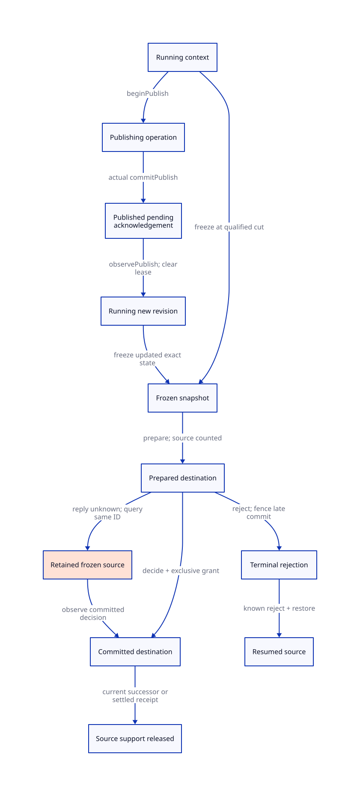

#+TITLE: Migratable Scan Cuts, Restore State and Publication Commit
#+SETUPFILE: ../../../modeling/org/setup.org
#+CATEGORY: architecture
#+OPTIONS: toc:3 num:t
#+PROPERTY: header-args :eval never

* RESEARCH Restore the scan continuation, not just the allocation pointer
:PROPERTIES:
:ID: b1342286-ec76-4be0-8736-038112d09145
:CUSTOM_ID: migration-cut
:AUTHORITY: GambitCopyHandoff
:EVIDENCE_CLASS: source-grounded-migration-design
:STATUS: refinement-open
:END:

[[file:models/sysml/copy-handoff.sysml][The existing copy model]] owns seven cut candidates, ten restore-state families,
ten proposed QNT atomic steps and ten unexecuted race histories. Five necessary
migration predicates, seven additional preservation cases and six source slices
extend that same owner. [[file:migration-cut-map.org][The generated admission/state/step/race tables]] and
[[file:diagrams/migration-commit.d2][D2]] are views. Status belongs to the common
[[file:../../../modeling/proof-obligations.org][obligation ledger]]. No second QNT/Lean root, runtime API or native acceptance
is introduced. The preceding [[file:custody-lifetime-design.org][lifetime argument]] remains the starting contract.

** Why PSTATE.scan_ptr is an incomplete restoration point
:PROPERTIES:
:CUSTOM_ID: source-frontier
:END:

The following are source facts, not executed failure traces:

- [[file:../../../../vendor/gambit/lib/mem.c::4184][scan_no_fast_path]] increments local ptr only after scan returns. The PAIR
  fast path calls mark_array and then increments ptr. A suspended nested Tail
  can leave the outer scan's increment still pending. Restoring only the object
  address can repeat that scan or advance twice.
- [[file:../../../../vendor/gambit/lib/mem.c::4261][scan_complete_heap_chunk]] has a separate local ptr/start/head loop. PSTATE
  scan_ptr is not its per-object checkpoint.
- [[file:../../../../vendor/gambit/lib/mem.c::4321][scan_movable_objs_to_scan]] loads local ptr from scan_ptr, updates the PSTATE
  checkpoint only at selected boundaries, dequeues complete chunks and later
  transitions to alloc_heap_chunk_start. Local ptr may be ahead of scan_ptr.
- [[file:../../../../vendor/gambit/lib/mem.c::4348][Local dequeue]] and [[file:../../../../vendor/gambit/lib/mem.c::6717][remote steal]] advance a FIFO head before releasing its lock
  and scanning the removed chunk. A queue snapshot no longer contains that claim;
  the active caller holds it. Empty FIFO does not mean no claimed work.
- [[file:../../../../vendor/gambit/lib/mem.c::4243][Still scanning]] pops still_objs_to_scan before scan. The detached base/body
  and its role continuation are part of the in-flight inventory.
- [[file:../../../../vendor/gambit/lib/mem.c::282][Allocation/chunk/FIFO/scan macros]] are relative to PSTATE. In
  [[file:../../../../vendor/gambit/lib/mem.c::3265][end_heap_chunk]], scan_ptr's containment in the allocation chunk decides
  whether to enqueue or keep local scanning responsibility. Retargeting to an
  unrelated destination PSTATE can change that decision even with identical alloc.

Therefore the restoration domain includes the caller's progress and control tag,
claimed-but-dequeued work and context identity, in addition to alloc/limit/cell.
The earlier allocation-frame inventory was necessary but not sufficient to claim
complete migration of an enclosing scan activation.

** Cut admission and full restore inventory
:PROPERTIES:
:CUSTOM_ID: cut-admission
:END:

The [[file:migration-cut-map.org][owned cut table]] distinguishes four candidate boundaries (mark_array return,
after object advance, claimed chunk before scan, and phase-drain boundary), two
adapter-required cuts (prepared Tail and popped still object), and publication-
in-flight exclusion. None is a qualified native migration hook today.

A mark_array return flushes allocation state and ends its own Tail loop, but
retains its caller's pending return/scan work. After an object scan returns and
ptr advances, a generated resumable loop can expose the exact next header. A
claimed chunk cut needs its own claim and return-to-drain/steal mode. Inside the
Tail loop, a complete caller-role continuation is mandatory: serializing only
cell/start/n does not serialize enclosing scan indices, pending increments,
captured-frame locks or special adapter state.

This is not a choice to abandon fine-grained migration. It specifies the state
that fine-grained migration must make explicit. Generated resumable frames can
replace implicit C call-stack obligations. Until an adapter has a complete state
and effect inventory, its interior cut is excluded from that profile; other
qualified boundaries can remain available.

The ten state families in SysML separate identity, allocation context, private/
public allocation frontiers, scan frontier, caller continuation, claimed work,
Tail frame, publication state, task rights/accounting, and lifetime/phase pins.
They are semantic obligations, not a requirement for ten heap allocations.

#+NAME: migration-frontier-coverage
| Position | What a restore must preserve | What cannot be inferred |
|---+---+---|
| Inside nested mark_array | Its remaining cells and complete caller continuation | PSTATE scan_ptr being current |
| Between object scans | Exact next header and whether advance already occurred | Object address alone encoding resume phase |
| Dequeued complete chunk | Claimed range, its local cursor and return mode | Work still appearing in the FIFO |
| Popped still object | Detached base/body and admitted role state | List head retaining the in-flight object |
| Private allocation suffix | Local/public cursor distinction and all Body/Tail obligations | Public heap cursor covering private initialized bytes |
| Published Body plus local Tail | Queue/container references and independent Tail frame | Queue ownership transferring all outgoing edges |

** Execution worker and collector context are separate identities
:PROPERTIES:
:CUSTOM_ID: context-binding
:END:

A migration changes ExecutionWorkerId and the execution grant. It does not
implicitly move the origin PSTATE's roots, RC list, queue lock, msection lists or
VM/phase membership into the target's unrelated live PSTATE. The proposed default
transfer retains a pinned CollectorContextId and its resource references, with
an exclusive execution lease; concrete execution binding still needs an adapter.

The destination must provide a compatible context lease/capacity. It cannot
accept by overwriting its own live alloc/scan state. Copying scalar fields does
not preserve pointer aliases into FIFO sentinels or references used by thieves.
If a design also relocates the collector context, it needs a distinct container/
reference transfer proof; this study does not infer that from execution migration.

Preserve end_heap_chunk's original containment meaning for the source context.
A remote complete-chunk scanner can allocate into its own context while scanning
a claimed chunk from another queue; the restore state must retain both origins.
Do not equate input chunk ownership with destination allocation ownership.
Profile admission must also specify counted-participant and barrier roles. Moving
a task does not silently add/remove native GC phase participants.

** Publication and migration serialize before externally visible effects
:PROPERTIES:
:CUSTOM_ID: publication-serialization
:END:

The proposed serialization domain is the affected collector context, not a
collection-wide lock. Its owner execution grant, monotone revision and publication
operation state govern freeze acceptance. The concrete representation remains open.

1. beginPublish reserves an immutable exact manifest/opId while the context is
   Running and unfrozen, before a FIFO link or local publication effect occurs.
   It retains source custody and pins the affected context/container.
2. commitPublish represents actual Body acceptance at the qualified native
   visibility cut, before or at enabled remote acquisition. The publisher can
   still observe Unknown and retains its publication lease.
3. observePublish validates the exact committed receipt, advances the context
   revision and clears that lease. It transfers no Body rights again. Tail and
   parent/copy rights stay independent.
4. freezeContext can accept only a matching current revision at a complete cut,
   with no publication in flight and no external GC lock held. It freezes the
   source execution grant and pins the immutable restore snapshot.

A consumer may scan an already published Body before the publisher observes its
receipt. The actual commit cannot be delayed in the abstract model until that
reply; actual publication and publisher knowledge are separate state.

If publication wins first, freeze must snapshot the resulting revision and Body
custody. If freeze wins first, old-source publication is disabled. If publication
is partial or unknown, retain its operation/custody and reject or defer freeze;
a later failed revision check cannot undo visible FIFO links.

The existing FIFO lock protects link/head/tail operations, not this whole
migration transaction or caller state. The old code has no publication operation
registry. Lowering to generated C must connect the new context gate to the full
native publication protocol; an abstract atomic QNT action does not supply that
connection automatically.

Thieves may still consume already committed batches concurrently. The snapshot
retains live queue identity and only the source-owned unfinished domain; it must
not restore an old FIFO head/tail over later dequeues. Queue custody observations
are validated as current successor or settled evidence, not frozen copies of
mutable queue state. Container pins survive these independent consumers.

** A decision protocol separates rejection from lost acknowledgement
:PROPERTIES:
:CUSTOM_ID: migration-decision
:END:

Each TransferId has an actual decision Pending, Committed or Rejected. The
source's observed outcome may be Unknown independently of that actual decision.
Preparation accepts state/resources provisionally; it gives no execution grant.

commitMigration specifies one atomic decision/grant change: Pending becomes
Committed, a prepared counted destination receives sole execution authority for
the exact task domain, and the source remains frozen. rejectTransfer competes
with commit on that same decision: a terminal Rejected record fences late commit.
This is a proposed linearization point, not a claim that several native C fields
already change atomically.

#+NAME: migration-outcome-custody
| Source knowledge | Actual possibilities | Permitted action | Retained responsibility |
|---+---+---+---|
| Known Committed | Matching destination grant exists or work already settled | Reconcile same IDs; release source support only under current receipts | Destination/successors/settled records; independent container users |
| Known terminal Rejected | Commit is fenced for this TransferId | Restore source at exact next work and fresh revision | Source execution and task rights; prepared target cleanup separate |
| Unknown | Pending, Committed with lost reply, or Rejected not yet observed | Query/retry same identity; keep source execution frozen | Counted source/transfer support plus any committed destination; pinned snapshot/storage |

Timeout, cancellation of a request, allocation refusal before global decision,
or a lost reply is not proof of terminal rejection. A target rejection must
reach a durable terminal decision, or source remains frozen while reconciling.
There can temporarily be two counted participants, but never two execution grants
for the same pending Tail. Support custody is not another right to execute.
No speculative task reissue, FIFO republish or forwarding rollback is permitted.

The destination may complete before the source observes Committed. Valid matching
settled receipts then suffice for the transferred obligations; forcing an already
drained target to stay active would be unnecessary. The existing
AcceptedTransferBeforeReleaseLaw is refined to admit this settled case. Acceptance
must originally have counted coverage; later release uses current successor or
settled evidence. This does not retroactively validate a zero-count handoff gap.

After finishCopy, its historical settlement remains true throughout migration.
Only current Body/Tail execution/support authority evolves. A migration decision
cannot consume Copy's settlement right again or grant access to reused storage.

** Proposed QNT steps and conditional Lean preservation
:PROPERTIES:
:CUSTOM_ID: migration-refinement
:END:

[[file:migration-cut-map.org][Ten atomic-step rows]] specify beginPublish, commitPublish, observePublish, freezeContext,
prepareDestination, rejectTransfer, commitMigration, reconcileOutcome,
resumeSource and releaseSource. They define guard/update/frame/source-mapping
requirements for a future edit to [[file:../../../../models/gambit/gc_work_closure.qnt][the existing QNT]], without adding executable
model code here. Pending return/scan progress and claimed work must be explicit
within that model's planned richer state.

Keep physical substeps distinct from abstract steps. The link/barrier/tail writes
can stutter under publication-in-flight custody until the valid abstract commit.
A stopped activation's snapshot can stutter while transfer Pending; Unknown must
not project to completed work. A new migratable executor needs its own concrete
step mapping; do not pretend current C already executes the added migration steps.

[[file:copy-handoff-map.org][Seven added preservation cases]] require exact frontier coverage, publication/
freeze serialization, context binding, one decision/grant commit, fenced rejection,
unknown-outcome retention and release framing. In Lean the proposed invariants
must establish, step by step:

- Each required next edge, detached chunk/object, pending caller return and Tail
  is represented exactly under the admitted role partition. Cursors alone do not
  imply edge completeness.
- A publication snapshot cannot become stale while accepted for execution; no
  external effect is rolled back by a failed ownership revision check.
- Pending to Committed/Rejected is exclusive, and current execution authority is
  unique. Replayed decisions are idempotent by generation-qualified identity.
- issued/settled/unfinished task sets retain their exact frame on transfers;
  Copy settlement remains distinct from descendant and region/container lifetime.
- Counted lifetime coverage survives preparation, unknown observation and source
  release; target completion before reply is handled by valid settled receipts.
- Restoring one collector context preserves every other live context's roots,
  frontiers and container users; phase barriers retain their declared membership.

[[file:../../../../models/gambit/lean/WorkAccounting.lean][Existing aggregate lifetime/generation lemmas]] do not establish these new maps
or transitions. Complete source/role inventories, concrete ordering and a progress
argument remain open. Fairness cannot recover a lost scan frontier. Retained
unknown work can safely block completion indefinitely; liveness needs additional
failure/service assumptions and cannot be obtained by deleting that obligation.

[[https://cs.brown.edu/~mph/HerlihyW90/p463-herlihy.pdf][Herlihy and Wing's linearizability method]] motivates specifying one decision
between invocation and response, with representation invariants connecting
concrete steps. It is methodological support, not a proof of this GC protocol.
[[https://lamport.org/pubs/auxiliary.pdf][Lamport and Merz]] motivates history/stuttering state that preserves observations;
its TLA+ rules are not an automatic QNT/Lean soundness result.

** Counterexamples, modernization and remaining closure
:PROPERTIES:
:CUSTOM_ID: migration-closure
:END:

The [[file:migration-cut-map.org][ten unexecuted design-negative histories]] cover stale scan_ptr, lost dequeued
chunk, lost popped still work, wrong context containment, publication after
snapshot, freeze after partial link, late commit after rejection, lost commit
reply followed by source resume, overwriting a busy destination, and source
withdrawal before target refusal. These are omitted-guard controls, not findings
that the unchanged native source exhibits these migration executions. Keep all
previous negative controls and the existing finish/rescan correction unchanged.

#+NAME: migration-modernization-matrix
| Architectural change | Work preserved or avoided | Necessary new support | Modern generated C / Zig |
|---+---+---+---|
| Explicit resumable scan frames | Preserve private/Tail fast paths without mandatory per-object queueing | Complete role/caller inventory and generated resume tags | Shared contract; no exclusive Zig benefit established |
| Context separate from executor | Move work without overwriting another VM participant | Context leases, generation checks and resource pins | Both require runtime redesign |
| Publication/decision protocol | Avoid duplicate publish, Tail execution and task reissue | Operation state, revision/decision serialization and reconciliation | Neither language provides this proof automatically |
| Boundary-specific admission | Support finer cuts when their adapters are complete | Per-role frontier/effect evidence | Measured performance and net language benefit remain unclaimed |

The common ledger adds five open migration obligations and one limited source
fact. No native migratable cut, complete collector contract or memory-order
refinement is closed. No runtime path is retired. Existing QNT/Lean sources and
historical receipts remain unchanged.

#+CAPTION: SysML-derived proposed publication/freeze/decision protocol. Unknown is source knowledge; a committed destination may already execute while source support stays frozen.

[[file:../../../../evidence/research/gc-migration-cut/checks.json][Exact document/source receipt]] · [[file:../../../modeling/proof-obligations.org][Closure matrix]]

** Concrete PAIR case
[[file:pair-resume-design.org][The PAIR continuation study]] instantiates the scan frontier with source-grounded tags, a single pending three-word advance and claimed-chunk return modes. The tag table distinguishes outer array selection from again-only Tail re-entry.
