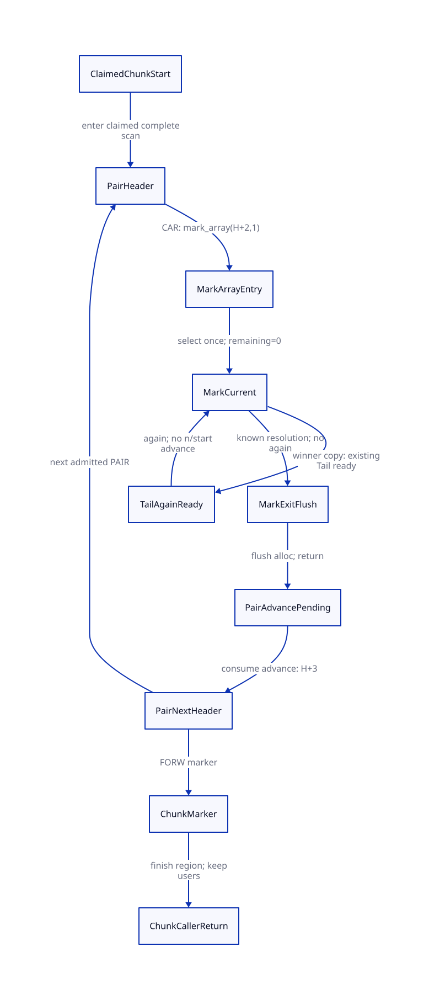

#+TITLE: PAIR Scan Continuation, Pending Advance and Claimed Chunk Custody
#+SETUPFILE: ../../../modeling/org/setup.org
#+CATEGORY: architecture
#+OPTIONS: toc:3 num:t
#+PROPERTY: header-args :eval never

* RESEARCH A PAIR visit owes one CAR resolution and one later scanner advance
:PROPERTIES:
:ID: 65762b48-1275-494b-8b58-722d372498f1
:CUSTOM_ID: pair-resume
:AUTHORITY: GambitCopyHandoff
:EVIDENCE_CLASS: source-grounded-pair-resume-design
:STATUS: refinement-open
:END:

[[file:models/sysml/copy-handoff.sysml][The existing SysML owner]] defines ten proposed resume tags with individual
source ranges, ten QNT atomic-step designs, eleven unexecuted counterexamples, five
necessary predicates, seven preservation cases and eight additional source facts.
[[file:pair-resume-map.org][The source-tag/step/race tables]] and [[file:diagrams/pair-resume.d2][D2]] derive from that owner.
[[file:../../../modeling/proof-obligations.org][The shared ledger]] owns disposition. No runtime migration hook, QNT source edit
or new Lean theorem is asserted. These names are proposed continuation tags;
only again is the existing inner C label selected by this study.

** The real chain: thief, complete chunk, PAIR macro, mark_array, caller
:PROPERTIES:
:CUSTOM_ID: pair-source-chain
:END:

The primary case follows the remote thief path, with a local-dequeue variant
kept as a separate return mode:

#+BEGIN_EXAMPLE
mark_reachable_from_marked, thief W
  lock origin O FIFO -> advance O.head to node -> unlock
  scan_complete_heap_chunk(W, node+1)
    ptr = start; head = *ptr
    scan_and_advance(ptr, head), exact PAIR fast path
      mark_array(W, ptr+2, 1)
        select outer array cell once
        resolve CAR; winning copy can delegate first-field Tail via goto again
        finish the loop; alloc_heap_ptr = alloc; return
      ptr += 3
    read next header or terminating FORW marker; return
  goto continue_local_scan
#+END_EXAMPLE

[[file:../../../../vendor/gambit/lib/mem.c::6717][Remote dequeue]] changes origin head before unlocking and calling the complete
scanner. [[file:../../../../vendor/gambit/lib/mem.c::4261][The complete scanner]] owns a separate local ptr. [[file:../../../../vendor/gambit/lib/mem.c::4196][The exact PAIR macro]]
then calls mark_array before its cursor increment. The thief's final return is
[[file:../../../../vendor/gambit/lib/mem.c::6727][continue_local_scan]]. In contrast, [[file:../../../../vendor/gambit/lib/mem.c::4365][the local FIFO caller]] reacquires its FIFO
lock after scan_complete returns. These are not interchangeable continuation tags.

This is a source-derived execution shape, not a newly executed trace. Admission
requires the exact header/profile match and the parent copy/Tail role inventory.
If ___USE_SCAN_NO_FAST_PATH selects scan(), its separate caller-return adapter
must be qualified; the fast-path resume frame is not silently reused there.

** Physical field order and the two different Tail owners
:PROPERTIES:
:CUSTOM_ID: pair-field-partition
:END:

[[file:../../../../vendor/gambit/include/gambit.h.in::5309][The actual constants]] are PAIR_SIZE=2, PAIR_CDR=0 and PAIR_CAR=1. For a PAIR P
whose header is H, the field positions are:

#+NAME: pair-physical-roles
| Word position | Meaning | Responsibility in this admitted copy/scan path |
|---+---+---|
| H | Header | Scanner validates exact fast-path header |
| H+1 | P.CDR, physical first field | Delegated Tail owned by P's winning copier, possibly still in flight |
| H+2 | P.CAR | Body scanner calls mark_array here with one array input |
| H+3 | Next header or marker | Reached by one pending caller increment after mark_array returns |

Suppose P.CAR reaches another movable PAIR Q. A winning Q copy redirects P.CAR,
selects the destination Q.CDR address as cell, copies the payload, may publish a
chunk, and only then executes goto again. Q.CDR is a new copy's delegated Tail;
it is not the original P.CDR obligation. Body scanning P can finish its CAR
while P's own CDR remains with the original copier.

If another worker already wins Q, [[file:../../../../vendor/gambit/lib/mem.c::3580][the losing CAS branch]] redirects the current
cell and continues the outer array loop. It does not create another Q copy or
resume Q's delegated Tail. The already-forwarded branch likewise redirects.
Redirection itself need not wait for winner payload readiness: it consumes no
payload; the winning initializer must retain its existing canonical obligation.
That source-lifetime correspondence remains a premise, not a receipt API already
present in C. Do not infer a full padding refund from alloc-- in the loser path.

This edge partition is scoped to phase/region/claim/visit/role identity. It is
not a claim that a Scheme object or every aliased root is examined once globally.
Weak phases and other role adapters can have distinct legitimate obligations.

** Exact tags and the pending continuation debt
:PROPERTIES:
:CUSTOM_ID: pair-tags
:END:

Every tag in [[file:pair-resume-map.org][the derived tag table]] has a source range, established state,
next action and retained responsibility. The critical distinction is the pending
PAIR increment, not just the numerical cursor value.

#+NAME: pair-mark-state-example
| Cut | Logical input state | Current cell | Outer scanner and next action |
|---+---+---+---|
| MarkArrayEntry | start=H+2, one pending input | Not selected yet | ptr=H; call/selection still owed |
| MarkCurrent after selection | remaining inputs=0, startNext=H+3 | Initially P.CAR; later exact current derived Tail | ptr=H; resolve this cell, not another array input |
| TailAgainReady | Same exhausted array-input state | Existing reserved Q.CDR (or next admitted Tail) | ptr=H; goto again only |
| MarkExitFlush | Outer loop has exited; no pending again | No active input to resume | Flush private alloc and return |
| PairAdvancePending | mark_array invocation returned and flushed | Inner locals no longer needed | ptr=H; consume exactly one H to H+3 advance |
| PairNextHeader | Previous visit advance consumed | New visit starts only after header dispatch | ptr=H+3; read header/marker without replaying prior CAR |

[[file:../../../../vendor/gambit/lib/mem.c::3511][while(n-- > 0) and start++]] run once for this one-element CAR array input.
[[file:../../../../vendor/gambit/lib/mem.c::3515][again]] is inside that loop, below its selection. A Tail resume bypasses both
operations. On the eventual failed loop test, the native postdecrement has still
occurred; the restore relation must distinguish loop-exited from pending-test
state instead of treating raw n as a reusable nonnegative work counter.

MarkCurrent is specifically the entry before reading *cell at again, not a
checkpoint anywhere inside resolution. Once forwarding is visible but copying
is incomplete, a transfer needs the existing copy-progress subframe. Rewinding
that state to MarkCurrent can take a forwarded branch or read an uninitialized
Tail slot while abandoning the winning initializer. An active child copy frame
must be restored before its pending parent continuation; otherwise exclude that
interior cut. The additional partial-copy replay control retains this failure.

At TailAgainReady, the ordinary selected path needs alloc/limit, current cell,
remaining source range/loop state and the pending caller frame. obj/body/head/
words from the completed copy are not blindly used as a resumed copy loop: again
reloads the next object's state. Inside partial copying or publication, the
previous study's richer state and exclusion rules still apply. Known publication
includes a known no-publication branch; no per-object enqueue is mandated.

The full live frame also carries ClaimId, PairVisitId, original header H, scan
mode and next-slot semantics, pending advance right, origin queue/node, allocation
context identity, region/phase generations, publication/transfer state, and
current execution grant. PSTATE.scan_ptr does not replace the complete scanner's
local ptr. Fine-grained migration must materialize this role-specific frame;
the source currently keeps it on synchronous C activations.

** Claimed chunk custody outlives queue removal; container users outlive scan return
:PROPERTIES:
:CUSTOM_ID: pair-chunk-custody
:END:

Let node be the untagged FIFO link value claimed by the thief. The actual call
starts scanning at node+1, after origin head becomes node. The queued scan task
has moved to a counted active caller; it cannot be reconstructed by searching
the now-advanced FIFO. A freeze must retain ClaimId, node/start, exact current
frontier, bound return mode and all active pair/mark continuation debt.

The old complete-scanner function accepts only start and scans until a FORW
marker. A proposed explicit end/range receipt therefore needs the exact published
manifest and proof of marker/bounds; it is not an existing end argument. The
restore profile must bind that manifest, initialized storage and marker validity.
Marker traversal/control is retained without inventing extra Scheme objects.

Reaching a marker discharges the claimed region's visit/continuation work only
after all discovered obligations retain live/settled custody. It does not wait
for every descendant's execution to finish, and it does not settle P.CDR merely
because the Body scanner has passed P.

The origin head can still equal node when scan_complete returns. That node is a
live queue/sentinel reference even after its scan-region task completes; freeing
its msection at this cut would invalidate later queue users. Keep region/container
pins until the independent user/retirement contract permits release. The thief's
allocation context W also remains distinct from input queue origin O.

** Atomic-step plan and conditional preservation
:PROPERTIES:
:CUSTOM_ID: pair-refinement
:END:

[[file:pair-resume-map.org][Ten step rows]] define claimChunk, enterPair, selectCarCell, resolveKnownCell,
armReservedTail, resumeAgain, flushMarkReturn, advancePair, finishClaimedChunk
and returnCaller. They refine the planned richer state of the existing
[[file:../../../../models/gambit/gc_work_closure.qnt][gc_work_closure.qnt]], without an executable model edit in this study.

armReservedTail references an already reserved winner Tail. It must compose with
canonical claim, reserveFragments, initializeCopy and qualified publication; it
must not collapse visible forwarding plus partial copying into one unjustified
atomic native operation or reserve Tail after publication. resumeAgain changes
the next control action while leaving exhausted outer-array input state and the
caller's pending advance unchanged. The non-winning known-resolution branch can
close the local mark invocation while winner/descendant debt remains elsewhere.

advancePair is one atomic proposed consume/update of PairVisitId's advance right,
ptr=H+3 and tag=PairNextHeader. It is enabled only when the mark invocation has
closed and ptr still equals H. A delayed/replayed resume request cannot consume
the same right again. When the next header is another PAIR, allocate a distinct
visit identity within the same claim; do not reuse the previous advance counter.

For a bounded QNT control, retain both CAR/CDR roles, distinct parent/new-copy
identities and enough aliasing to exercise winner/loser sharing and cycles.
A single work flag or one scan count per object cannot express this frame.
Keep all four existing fault initializers and their historical evidence. Generic
subtypes reached through CAR/CDR still need their own role adapters: an unqualified
interior cut can defer migration and continue normal source execution until an
admitted boundary. It is not a rejection of a legal Scheme value.

[[file:copy-handoff-map.org][Seven added Lean preservation rows]] require:

1. Exact CAR/CDR role partition and parent winner evidence.
2. Claim/marker/range and origin sentinel custody after dequeue.
3. One outer selection versus again-only re-entry, including explicit loop exit.
4. Winner-only pre-reserved Tail and the current exclusive execution grant.
5. A tag-indexed exact H to H+3 advance frame, not scalar count equality alone.
6. Actual caller mode with no duplicate claim or stale FIFO restoration.
7. Full frame preservation under the existing publication/freeze/decision protocol.

The diagram projects a PAIR stretch. A non-PAIR header dispatches to its own
qualified role adapter or continues the native scanner without interior migration.
Proving this PAIR subset alone cannot authorize completion of a mixed chunk.

A conditional induction partitions a claimed chunk's scan work into completed
visits, the current continuation and the unvisited suffix. Entering a PAIR keeps
its one advance pending; resolving its CAR/Tail cells preserves accepted child
debt; return flushes allocation state but leaves that advance; consuming the
advance once moves the frontier to the next header. Marker completion therefore
cannot silently discard local continuation work. This argument needs exact role
coverage, valid manifest bounds and step correspondence; it is not a new Lean
proof. Existing [[file:../../../../models/gambit/lean/WorkAccounting.lean][aggregate lifetime lemmas]] do not establish these concrete frames.

The methodological use of [[https://lamport.org/pubs/auxiliary.pdf][auxiliary history/stuttering state]] preserves source
observations; it does not introduce a runtime receipt for every word or provide
automatic QNT/Lean soundness. Native memory order, full adapter inventory and
progress through unknown migration/publication outcomes remain separate duties.

** Controls, architectural value and remaining gaps
:PROPERTIES:
:CUSTOM_ID: pair-closure
:END:

The [[file:pair-resume-map.org][eleven unexecuted design-negative histories]] retain CAR replay, early advance,
double advance, again re-entering the array prologue, loser Tail creation,
confusing parent and new-copy CDR, missing detached claim, freeing a live sentinel,
wrong caller mode, duplicate Tail after migration and partial-copy rewind to
field dispatch. They are omitted-guard
counterexamples for the proposed design, not native failures observed this turn.
The earlier finish/rescan correction and all historical receipts remain unchanged.

#+NAME: pair-resume-value-matrix
| Design | Work protected or avoided | Required support | Modern generated C / Zig |
|---+---+---+---|
| Tag plus pending advance | Avoid missed or replayed CAR/Tail work and skipped next headers | Generated role frames and per-visit transition guards | Same semantic generator contract |
| Winner-only delegated Tail | Retain existing tail-marking fast path without second CDR scan | Canonical winner/role receipts and exclusive execution right | No exclusive Zig benefit established |
| Claimed chunk plus return mode | Preserve dequeue batching without re-enqueueing a stolen chunk | Context/queue pins and exact caller continuation | Both need explicit lifetime support |
| Separate task and storage completion | Avoid premature release while preserving descendant parallelism | Distinct region scan and container/user receipts | Shared runtime obligation; no measured gain claimed |

The shared ledger adds five open PAIR obligations and one limited source fact.
The real source chain is identified; migratable lowering, exact state projection,
all role adapters and native qualification remain open. No runtime path retires.

#+CAPTION: SysML-derived PAIR continuation. The loop through TailAgainReady does not consume another array input or the caller's single pending advance.

[[file:../../../../evidence/research/gc-pair-resume/checks.json][Exact document/source receipt]] · [[file:../../../modeling/proof-obligations.org][Closure matrix]]
