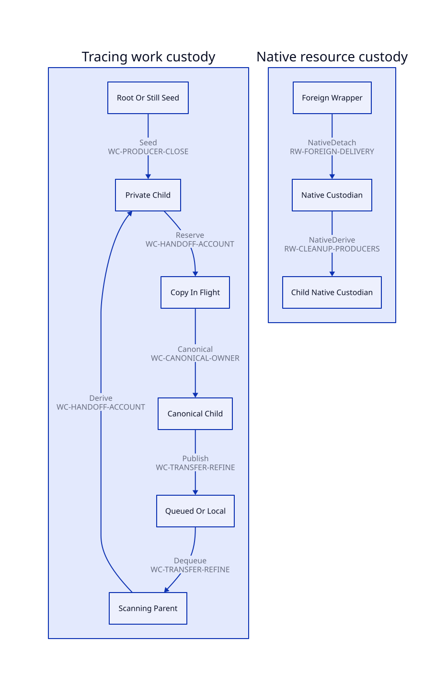

#+TITLE: Producer Closure and Parent-Child Custody
#+SETUPFILE: ../../../modeling/org/setup.org
#+CATEGORY: architecture
#+OPTIONS: toc:3 num:t
#+PROPERTY: header-args :eval never

* RESEARCH A closed producer domain, not merely empty queues
:PROPERTIES:
:ID: 814a17c5-6eae-57b4-a27d-232f55bdc65e
:CUSTOM_ID: producer-custody
:AUTHORITY: GambitProducerCustody
:EVIDENCE_CLASS: source-census-and-conditional-design
:STATUS: refinement-open
:END:

The architectural decision is to preserve an obligation until its required child
work has a live custodian or a known settlement. A parent need not wait for every
child to finish. It must retain responsibility until acceptance commits, and the
accepted child's unfinished debt must survive the parent's departure. Closing new
root issuers does not revoke already admitted derivation rights.

[[file:models/sysml/producer-custody.sysml][Owned SysML]] is the single source for producer families, transfer edges,
necessary predicates and census scopes. [[file:producer-custody-map.org][The derived inventory]] includes exact lexical source
occurrences and coverage limits. [[file:../../../modeling/proof-obligations.org][The closure matrix]] owns obligation dispositions through
the relation model. This Org document owns interpretation, conditional arguments
and proposed refinement; it does not create another status registry.

** What is complete, and what is still open
:PROPERTIES:
:CUSTOM_ID: census-boundary
:END:

The finite inventory contains 18 producer families and eight custody edges.
Three explicit source scopes enumerate selected symbol occurrences in mem.c,
c_intf.c and os_io.c. Comments and literals are blanked while retaining offsets;
macro definitions, call-like tokens and identifier references are distinguished.
Every selected call-like occurrence must fall within at least one SysML-owned
family range or the derivation fails. A reference is not automatically a call.
Conditional compilation branches remain visible together.

This is a reproducible lexical census, not a preprocessed program call graph.
Families also bind root/frame routines, the weak table cleanup span, the Scheme
FFI generator and shutdown. The whole producer domain remains open until generated
frame/layout inputs, host root writers, enabled configurations, dynamic modules,
user C callbacks and native vtables are admitted. Thus WC-CALLSITE-MAP establishes
only this bounded source slice; WC-PRODUCER-CLOSE remains open.

The dispatcher evidence read in the current receipt returned an unknown binding
and incomplete registered coverage. It provides no negative claim about existing
research or runtime correctness. Source analysis is independently bound below.

** Real caller chains and their distinct closing cuts
:PROPERTIES:
:CUSTOM_ID: source-cuts
:END:

*** Root entry and the last right to derive tracing work
[[file:../../../../vendor/gambit/lib/mem.c::6775][Setup]] builds the externally referenced still-object list. In strong marking,
processor zero scans VM fields, symbol/keyword tables and mark_rc; participants
scan their assigned globals, continuation frames, registers, saved fields, type
cache and processor object. The root routines precede the local scan fixed point.
Their descendant work can therefore exist before a worker enters the idle loop.

The proposed root cut needs a frozen participant/root inventory and a live
custodian for every admitted seed. It is not the first observation of an empty
FIFO. mark_rc's processor-zero call does not prove that nonzero processor RC
registration is covered. ROOT-HANDOFF and CONTROL-ORIGIN retain those obligations.

*** Copy, publication, dequeue and nested discovery
[[file:../../../../vendor/gambit/lib/mem.c::3470][mark_array]] uses a local allocation cursor. The winning forwarding CAS precedes
the body copy, and a losing copier rolls back its speculative header allocation.
The loser may reuse the winner's canonical obligation; it cannot settle that
obligation or treat forwarding visibility as initialized scanner input. The
source does not establish a failure-recovery mechanism for a permanently lost
winner. Native failure behavior and publication order remain explicit premises.

[[file:../../../../vendor/gambit/lib/mem.c::3249][end_heap_chunk]] has four call sites: two in movable copying and two in
captured-frame copying. It writes an end marker, conditionally links a complete
chunk under the FIFO lock, orders visibility with barriers and signals a waiter.
The currently scanned chunk can bypass FIFO insertion. Both the private cursor
and this local scan path need a ledger image; publishing a tail is not the whole
producer census.

[[file:../../../../vendor/gambit/lib/mem.c::4235][Still scanning]] removes a list head before calling scan. Local and remote chunk
consumers remove a FIFO entry before scanning outside the lock. These are
queue-to-scanner transfers. A removed entry becomes scanning work, and scan can
invoke mark_array or mark_captured_continuation again. The PAIR macro fast path
is included in the census rather than assumed to be ordinary scan dispatch.

The final idle decrement uses scan_termination_mutex. Publication uses another
lock. Correctness therefore requires an actual lifetime/visibility refinement:
all publishers remain counted, dequeued work has scanner custody, wakeups obey
the predicate loop and no idle publisher can create an unaccounted child. The
separate locks alone do not establish a native race or a native correctness proof.

*** Weak admission is not reopening the strong terminal state
[[file:../../../../vendor/gambit/lib/mem.c::6873][process_wills]] seeds wills and selected testators after strong drain, under the
weak phase's distinct count. Its traversal can derive the same kinds of movable,
still and captured-frame work. Strong and weak receipts share a collection but
have different phase identities. Moving an executable will onto a list is not
execution of its Scheme action.

After weak scanning, move_continuation still uses stack/backing layout. Weak-table
cleanup repairs entries in the later cleanup phase. No direct mark_array call is
present in that inspected function span; this limited negative source fact does
not exclude arbitrary indirect/generated effects. Target permits must cover
these users before resize/reuse, separately from the strong/weak drain bits.

*** Native release has more than the GC sweep as a producer
[[file:../../../../vendor/gambit/lib/mem.c::4383][GC sweep]] and [[file:../../../../vendor/gambit/lib/mem.c::4430][forced still cleanup]] both call release_foreign and then free the
wrapper without inspecting the release result. [[file:../../../../vendor/gambit/lib/_kernel.scm::3884][foreign-release!]] is an explicit Scheme
entry; it raises an OS exception on nonzero status. The generated _kernel.c entry
mirrors this Scheme source and is not an independent semantic producer design.

[[file:../../../../vendor/gambit/lib/c_intf.c::1683][release_foreign]] reads the callback/pointer and clears both fields before
calling native code. A deferred design must place the payload and any Scheme
roots in independent stable custody before the wrapper disappears. Error return
does not restore these fields. Adding a queue after this call without a prior
custody protocol cannot create safe retry authority.

[[file:../../../../vendor/gambit/lib/c_intf.c::5287][STRUCT/UNION/TYPE conversion failure]] calls the release function when wrapper
construction fails. Generic POINTER conversion instead reports failure without
disposing the incoming payload. Actual os_io constructors perform their own
cleanup. Admission must preserve this caller-specific ownership distinction.

[[file:../../../../vendor/gambit/lib/os_io.c::1603][Device release]] reaches a virtual release and frees the device at last refcount.
Device cleanup removes group membership before closing, can wait in select on
EAGAIN, and can return early on another error. [[file:../../../../vendor/gambit/lib/os_io.c::3948][TLS context release]] frees strings,
SSL_CTX and RC storage; its constructor also invokes it on failure. These are
real native users, not evidence that a generic GC worker can execute every
callback. Thread affinity, reentry, blocking, vtables and external library hooks
need individual effect admission. A failed device close can already have changed
group state; retry cannot assume the original context is intact.

[[file:../../../../vendor/gambit/gsc/_ptree2.scm::2610][FFI generation]] selects default pointer release, generated struct/type release,
or a supplied identifier. This open extension point prevents a repository-only
function list from proving all native cleanup producers closed.

*** Teardown cannot reuse the tracing completion cut blindly
[[file:../../../../vendor/gambit/lib/mem.c::4928][cleanup_mem_pstate]] frees still objects and then calls cleanup_rc. VM cleanup
destroys the scan mutex/condition variable before processor-zero memory cleanup
and carries an explicit other-processor TODO. [[file:../../../../vendor/gambit/lib/setup.c::4577][Processor cleanup]] is another caller.
These facts do not by themselves prove an existing failure. They do prevent a
new asynchronous cleanup service from assuming those facilities remain alive.

The proposed shutdown order is: seal new root issuers; retain admitted parent
and child issuer rights; settle or custody all accepted tasks and unknown effects;
seal late delivery; discharge payload/root borrowers; only then withdraw the
services required by that exact target. Transfer to an independent failure
custodian can finish collector participation without claiming native disposal.
A task waiting for a service that shutdown waits to destroy is a cycle to break,
not work to cancel silently.

** Proposed ledger and ownership protocol
:PROPERTIES:
:CUSTOM_ID: handoff-protocol
:END:

#+NAME: parent-child-handoff-protocol
| Step | Required invariant | Failure responsibility |
|---+---+---|
| Admit parent | Bind VM/generation, collection/root cut, phase/round, producer generation and issuer | Admission rejection must not acquire old raw aliases |
| Reserve child | Establish a unique obligation or a canonical alias while parent remains live | Known pre-effect rejection leaves parent owner; unused reservation may be rolled back |
| Initialize / publish | Maintain transfer custody until destination data and scan inputs are visible | Unknown publication stays enrolled; no speculative duplicate enqueue or free |
| Commit acceptance | Destination owns the work and unresolved descendants; source receives matching acceptance | Lost acknowledgement keeps a transfer record; reconciliation uses identity, not a second effect |
| Release parent | Every required child is settled or accepted with unfinished debt retained | Parent exit does not decrement the accepted child's outstanding debt |
| Derive recursively | Children reserve their own children under inherited admitted rights | Root ingress closure does not deny necessary already-admitted derivation |
| Settle | Exactly one canonical obligation leaves unfinished domain | Alias/dedup paths do not settle another producer's obligation |

The logical partition is private, reserved, in transit, queued, scanning and
settled. Unfinished is the union of the first five domains, each obligation in
exactly one domain. Roots and derived tickets use the same issuer accounting.
For one closed identity, issued = unfinished + settled. Producer rights capable
of issuing future children are additional obligations, not silently equated with
current queue length. Integers in SysML/Lean are ghost quantities; actual word
bounds/overflow and atomic visibility remain implementation obligations.

This does not require one atomic increment per object. Gambit's counted-worker
and chunk batching can refine many logical obligations under a single live
producer. The aggregate may drop only after every private/scan/transfer child
is mapped to another live aggregate or settled. Prove this mapping before adding
runtime counters; otherwise instrumentation can add cost without establishing
closure.

** Conditional safety argument and counterexamples
:PROPERTIES:
:CUSTOM_ID: custody-argument
:END:

Assume a complete admitted issuer domain, exclusive canonical custody, the stated
ledger partition, identity-preserving publication/acceptance, and a closure cut
serialized with admission and the last producer departure. Initially all root
tickets are owned. A reservation adds a child while its source remains live;
commit changes custody without removing unfinished debt; settlement removes only
known completed work. By induction, unfinished required work always has custody.
If ingress is sealed, issuer rights and all unfinished/transfer domains are empty,
no same-phase work can subsequently appear without violating a premise. This is
a conditional argument, not a checked native theorem or a liveness result.

#+NAME: custody-negative-histories
| History | Why the proposed proof fails | Evidence class |
|---+---+---|
| Parent decrements last active count; child is enqueued afterward | Required child passes through no live ledger owner | Hypothetical ordering counterexample; not a reported Gambit execution |
| Scanner pops final still item and declares idle before scan returns | Empty list hides an active producer | Source operation order motivates missing-lifetime premise |
| CAS loser treats forwarding as completed body copy | Winning initialization/scan obligation is still outstanding | Source CAS-before-copy order; no claim existing scanner reads it prematurely |
| Completion ignores weak seeds after strong drain | Erases legitimate process_wills work in the same collection | Actual source phase ordering |
| Wrapper clears fields; deferred enqueue is rejected; wrapper freed | No independent payload/root custodian exists | Proposed deferred design fails; current source is synchronous |
| Child cleanup denied after shutdown seals new roots | Admitted parent cannot complete or loses mandatory descendant | Hypothetical shutdown negative control |
| Retry relabels an old raw pointer into a new epoch after backing reuse | New identity cannot repair a dangling reference | Required lifetime rejection, not safe retry |
| Callback error is counted as resource disposed | Error can follow partial effects and cannot authorize a second free | Actual device close/foreign reset order motivates disposition split |

Late tracing work for a closed phase is rejected as same-phase work. A request
may retain a valid old lease while storage remains live, or be admitted in a new
phase with a valid stable handle and no unresolved old alias. Otherwise it stays
quarantined under a failure custodian and blocks the affected reuse permission.
Late native completion may settle an already accepted ticket while that settlement
ingress is open; it cannot create unregistered tasks after final service withdrawal.

The separation between local idleness, outstanding descendants and global
termination learns from [[https://www.cs.utexas.edu/~EWD/transcriptions/EWD06xx/EWD687.html][Dijkstra and Scholten, EWD687]], especially the outgoing
deficit and delayed acknowledgement argument. This design does not implement
their cornet algorithm, inherit its theorem, or establish fairness/finite native
callbacks merely by naming a counter. Unknown/nonterminating callbacks retain
custody and can prevent shutdown progress.

** QNT and Lean refinement obligations
:PROPERTIES:
:CUSTOM_ID: formal-projection
:END:

#+NAME: producer-refinement-map
| Concrete family / cut | Existing formal slice | Required refinement, not executed here |
|---+---+---|
| Copy -> initialize -> publish -> dequeue -> derive | gc_work_closure claim/copyWord/publish/scanLocal/acquire/finishScan | Expand atomic finishScan child creation into reserve/transfer/accept; track scanner and unknown effects; preserve safety under internal substeps |
| CAS duplicate discovery | finishScan retains already discovered target | Relate canonical identity and live winner custody without double issue/settle; distinct copy-in-flight and initialized states |
| Counted parent retains child producers | WorkAccounting ProducerLifetimeSafe | Generalize projection to private/reserved/transit/scanning and rights; prove complete finite domain and nonnegative balance |
| Strong -> weak admission | gc_work_closure nextPhase and finished | Retain old receipt, admit weak seeds with matching phase; do not reset collection identity to conceal outstanding work |
| Terminal same-phase actions | CollectionContract guarded rescan | Keep existing not(done) guard; define terminal stutter separately from legitimate next-phase progress |
| Wrapper -> native task -> children | No selected QNT/Lean slice covers this chain | Add separate resource-task refinement and failure disposition; native task settlement is not a strong/weak scan action |
| Shutdown / permit | SavedStackRetirementWindow conditional premises | Show stable issuer exclusion, last borrower closure and target-specific service lifetime before consuming matching permit |

QNT negative controls should permit last-parent-before-child, dropped transfer,
duplicate settlement, stale generation, weak-phase suppression and withdrawal
with accepted descendants. Positive scenarios must retain all legitimate work;
disabling derivation is not a repair. Progress needs finite production, fair
scheduling and delivery, plus an explicit policy for unknown native effects.

Lean needs ticket-domain partition and preservation lemmas, canonical alias
conservation, child-before-last-parent-release, identity-safe phase closure and
service-withdrawal composition. Existing WorkAccounting has counted/private/queued
fields and conditional premises, not the full scanning/transit/native domain.
The selected saved-stack-origin QNT remains outside its companion historical
report's input coverage. No new theorem or model-check result is asserted.

** Modern C / conditional Zig value and closure matrix
:PROPERTIES:
:CUSTOM_ID: producer-net-benefit
:END:

#+NAME: producer-support-value
| Support work | Modern generated C baseline | Conditional Zig path | Present measurable boundary |
|---+---+---+---|
| Shared issuer/ticket identity and custody protocol | Scheme-generated opaque handles, helper operations and target-specific APIs | Same protocol with tagged types and error unions | 18 families / 8 transfer edges need semantic coverage in either language |
| Private temporary cleanup | Explicit cleanup labels or generated scoped helpers | defer/errdefer on local ownership before acceptance | Only local branches may be removed; cross-thread accepted tasks remain explicit |
| Publication and canonicalization | C atomic/lock helper contracts and profile qualification | Zig atomic/lock helpers and matching profile qualification | Same happens-before and winner lifetime proof; no automatic GC/root benefit |
| Native release / shutdown | One shared coordinator, effect declarations and root/resource custodian | Same service contract plus Zig/C ABI and toolchain support | Existing release status discard cannot retire until all callers and failure delivery are covered |
| Existing C path retirement | Replace scattered emission/support after source and native equivalence admission | May replace the same paths if incremental benefit exceeds added ABI/toolchain obligations | Zero runtime paths retired and no numerical speedup claimed in this study |

The modernization gain is eliminating duplicate root/cleanup responsibility and
making worker separation safe under one runtime contract. It is available to
modern C. A Zig increment requires independently bounded support actually removed
after reuse of C generators/libraries, while preserving all the same semantic and
native qualification obligations. The current evidence does not establish that
increment. No language receives a credit for removing mandatory accounting.

#+CAPTION: SysML-derived custody edges; edge IDs resolve to complete rules in the inventory.

[[file:diagrams/producer-custody.d2][Derived D2 source]] · [[file:../../../modeling/proof-obligations.org][Canonical closure matrix]] ·
[[file:../../../../evidence/research/gc-producer-custody/checks.json][Exact documentation/source receipt]]

** Atomic refinement continuation
[[file:atomic-refinement-design.org][The follow-on source/action design]] identifies discovery/parent-settlement and wake/count guard gaps in the direct projection, and expands CAS, chunk publication, dequeue, failure and late-work obligations. [[file:atomic-refinement-map.org][All projection and proof-target rows]] derive from the owned SysML refinement model.
