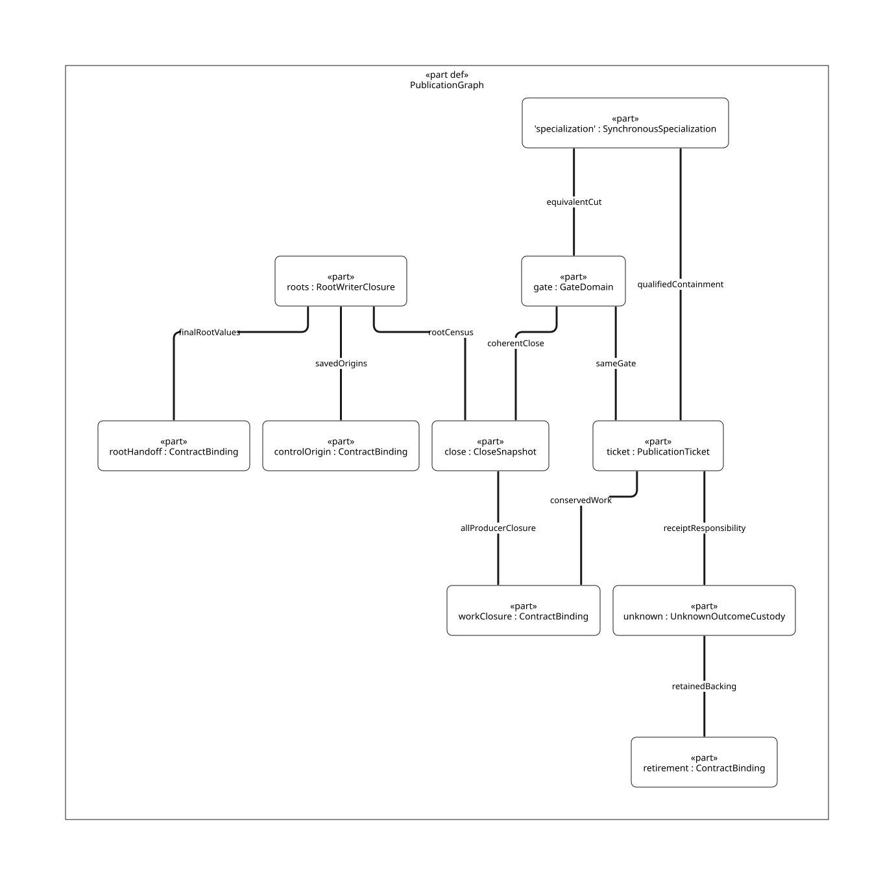

#+TITLE: Chunk Publication, Phase Close and Real Root Writers
#+SETUPFILE: ../../../modeling/org/setup.org
#+CATEGORY: architecture
#+PROPERTY: header-args :eval never :exports code
#+COLUMNS: %34ITEM %20STATUS %24OWNER %34OBLIGATION

* RESEARCH Scope and native authority
:PROPERTIES:
:ID: 9bda46eb-d4bd-4361-ae0d-ef6957f7b733
:CUSTOM_ID: publication-close
:AUTHORITY: GambitPublicationClose; GambitProducerCustody; GambitRuntimeModelRelations
:OWNER: runtime interfaces; modern-C GC and execution
:STATUS: design-only; source-refinement-open
:EVIDENCE_CLASS: source-caller-census-and-conditional-protocol
:END:

Modern C remains mandatory. This is a concrete synchronization and ownership
study for T0 GC/SMP refactoring. [[file:models/sysml/publication-close.sysml][Native SysML]] owns the new laws, selected caller
records and formal associations; it references the existing producer families,
[[file:models/sysml/membership-revocation.sysml][membership/revocation]] and root model bindings. [[file:publication-close-callers.org][The caller matrix]] is transported
from native evaluated fields, not a new hand-maintained architecture database.
[[file:diagrams/publication-close.d2][Native D2]] /  are structural views.

The new inventory contains 32 selected caller records: four direct publishers,
seven tracing producer paths, sixteen root-writer groups, one control/denv graph
writer, one generated FFI entry family, two phase-control paths and one native
extension boundary. Groups are not 32 individual runtime calls. Existing
[[file:producer-custody-design.org::#census-boundary][eighteen producer families]] are reused, not replaced or renamed as new evidence.
The four end_heap_chunk calls and eleven kernel GC_SAVE1 sites are separately
enumerated; the whole dynamically extensible writer universe remains OPEN.

* Source findings and boundaries
:PROPERTIES:
:CUSTOM_ID: publication-callers
:STATUS: selected-source-census
:END:

** Four direct publishers and seven ways to produce tracing work
[[file:../../../../vendor/gambit/lib/mem.c::3550][mark_array:3550]] ends a prefix before obtaining another section;
[[file:../../../../vendor/gambit/lib/mem.c::3619][3619]] publishes after completing a copy past the chunk threshold.
[[file:../../../../vendor/gambit/lib/mem.c::3747][mark_captured_continuation:3747]] and [[file:../../../../vendor/gambit/lib/mem.c::3797][3797]] perform the corresponding frame-copy
operations with MISC_MEM_LOCK already held. Both copy families keep initialization
and private continuation/Tail obligations beyond the mere existence of a forwarding
pointer. A forwarding CAS can become visible before later body writes; it is not
a scanner-readiness receipt.

The seven producer paths are strong roots, external still seeds, weak wills,
still-object scanning, local/private chunk scanning, remote stolen chunks and
the PAIR scan-and-advance fast path. Their actual callers, closing cuts and open
premises are in [[file:publication-close-callers.org][the native-derived matrix]]. In particular:

- [[file:../../../../vendor/gambit/lib/mem.c::4235][Still scanning]] removes the list head before scan returns.
- [[file:../../../../vendor/gambit/lib/mem.c::4329][Local scanning]] can scan a private incomplete chunk without a FIFO insertion.
- [[file:../../../../vendor/gambit/lib/mem.c::6710][Stealing]] removes the head and unlocks before scan_complete_heap_chunk.
- [[file:../../../../vendor/gambit/lib/mem.c::4196][PAIR scanning]] can recurse into mark_array before the caller advances ptr.
- [[file:../../../../vendor/gambit/lib/mem.c::6898][Weak wills]] start work in a distinct phase; move_continuation remains a later
  backing user. Scheme will-action execution is not established by that enqueue.

** Real root writers, their consumers and why their closure is different
#+NAME: publication-root-writer-consumers
| Writer / entry | Actual scan consumer | Required closure / remaining gap |
|---+---+---|
| [[file:../../../../vendor/gambit/lib/mem.c::723][register_rc]], [[file:../../../../vendor/gambit/lib/mem.c::760][release_rc]], [[file:../../../../vendor/gambit/lib/mem.c::816][set_data_rc]]; [[file:../../../../vendor/gambit/lib/os_dyn.c::748][make_c_closure]]; [[file:../../../../vendor/gambit/examples/tcltk/tcltk.scm::292][Tcl client-data construction]] | mark_rc -> mark_array(&h->data) | Every RC owner chain, link mutation and data writer must participate. Processor-zero scanning does not prove nonzero registrations are covered |
| [[file:../../../../vendor/gambit/lib/c_intf.c::6509][make/kill_sfun_stack_marker]] through generated [[file:../../../../vendor/gambit/include/gambit.h.in::10043][BEGIN_SFUN variants]] | Externally referenced still object -> vector scan; callback entry uses marker | proc_or_false protection must precede make_vector; current source has an explicit TODO. Marker allocation and nested callback owner binding remain separate |
| [[file:../../../../vendor/gambit/lib/_kernel.scm::2433][Eleven GC_SAVE1 sites]] and [[file:../../../../vendor/gambit/lib/_num.scm::7889][bignum.make direct saved writes]] | mark_saved -> mark_array(ps->saved) | Saved slots must remain stable through allocation, restore from updated slots and clear after use. The C mirror is not an independent semantic writer |
| [[file:../../../../vendor/gambit/lib/_io.scm::5068][Cache-fill macros]], called at 5148/5237/5351/5809 | mark_type_cache | Three input and one output calls in this source; generated-module/configuration closure remains open |
| [[file:../../../../vendor/gambit/lib/_kernel.scm::1428][sync-op-interrupt]], [[file:../../../../vendor/gambit/include/gambit.h.in::10325][BEGIN_CFUN_CTX]], register/frame macros | mark_registers + mark_continuation | Spill RA/registers/fp before scan; preserve exact descriptors and reload updated slots before reentry |
| [[file:../../../../vendor/gambit/include/gambit.h.in::5957][GLOBALVARSET / SET_GLO]], [[file:../../../../vendor/gambit/gsc/_t-c-2.scm::4119][GSC emission]], setup global initialization | mark_global_variables, partitioned by SINGLE_VM mode and processor count | Snapshot actual module/global-list membership; dynamic modules and raw inline C remain extension points |
| [[file:../../../../vendor/gambit/lib/mem.c::1930][intern_symkey -> symkey_table_set]] | mark_symkey_tables | Bucket/next/table replacement writes are GSTATE-shared; per-VM freezing alone is insufficient if another VM can mutate them |
| [[file:../../../../vendor/gambit/lib/_kernel.scm::3154][Continuation/frame setters]], [[file:../../../../vendor/gambit/lib/_system.scm::4138][deserialize]], [[file:../../../../vendor/gambit/lib/_io.scm::11706][implode-frame]], [[file:../../../../vendor/gambit/lib/_thread.scm::345][denv cache promotion]] | Current/captured frame and reachable thread/denv traversal | These include root-graph payload writers, not only root-slot stores. Captured frames are not presumed immutable |
| [[file:../../../../vendor/gambit/lib/setup.c::421][VM/processor setup]], [[file:../../../../vendor/gambit/lib/setup.c::4714][PSTATE root initialization]] | VM/processor fields, registers/saved/cache scan | Initialize before member publication; resize failure/exit retains lifetime obligations |
| [[file:../../../../vendor/gambit/lib/mem.c::3583][GC relocation writes through actual cell pointers]] | Root owner later reloads the moved values | Collector writes are admitted writes too; excluding mutators does not exclude relocation updates |

The eleven kernel save sites are make-vector, make-u32vector, make-s32vector,
make-u64vector, make-s64vector, make-f32vector, make-f64vector, make-values,
make-closure, make-frame and make-structure. Generic GC_SAVE2/3 definitions are
writer interfaces, not evidence of additional actual calls in the selected set.

This is a source-grounded inventory, not an enabled/preprocessed call graph.
Macro emission, generated products, direct field aliases, function-pointer exports,
FFI callbacks, dynamic modules and configuration branches still require admission.
Unknown writers are refused managed scan/retirement authority, or assigned a
separately specified supported participation protocol; they are not silently
omitted. Keeping bytes allocated does not make stale unregistered Scheme pointers
safe. The inventory does not prove a generational barrier or permission to skip
mature continuation scanning.

* RESEARCH A derivable modern-C synchronization protocol
:PROPERTIES:
:CUSTOM_ID: publication-protocol
:STATUS: reference-design-not-implemented
:OWNER: modern-C collector
:END:

** Identity, custody and lock domains
Use the existing immutable scope key: VM/incarnation, collection, root cut,
phase/round, producer generation and worker-team identity/incarnation. A batch
record additionally identifies its ticket and generation, chunk/range generation,
coverage and stable custody handle. Record storage must be protected before it
can be published; resolving an old raw pointer is not a way to acquire a lease.

For a phase let U be the number of unfinished canonical *batch* tickets and P
its outstanding publisher/receipt users. U is a projection of private-batch,
queued, scanning and transfer custody. It is not a substitute for all existing
ProducerClosure credits: root/still seeds, private not-yet-batched copies and
Tail/edge debt remain covered by their live producer/worker responsibilities.
P is independent of U: a consumer can finish scanning while a publisher still
owes a known return/result and last use. Neither count means one atomic per object.

For a finite, complete ticket domain T, partition tickets into Pending, Queued,
Scanning, Transfer, Settled and RejectedKnown. Let I count issued tickets, C
settled tickets and J known pre-effect returns. The intended conservation laws are:

\[
U = |Pending| + |Queued| + |Scanning| + |Transfer|,\qquad I = U + C + J,
\qquad P = |OpenPublisherReceipts|.
\]

Unknown outcomes are unresolved observations of a ticket, not a seventh work
state that duplicates it. They may coexist with any work state, including Settled.
Required coverage must remain in live private custody, an unfinished ticket or
already completed coverage. J is not completed work: rejected coverage returns
to a live private producer before J increases. Pending Tail/frontier obligations
remain separate even if the published prefix is complete.

#+NAME: publication-conservation-deltas
| Transition | Change in I/U/C/J/P | Additional preservation premise |
|---+---+---|
| reserveBatch | +1 / +1 / 0 / 0 / +1 | Fresh identity; private prefix responsibility transfers without a gap |
| commitPublish / acquireBatch | 0 / 0 / 0 / 0 / 0 | Exclusive state/custodian transition, not duplicate work |
| finishParent | 0 / -1 / +1 / 0 / 0 | Coverage and child acceptance complete; publisher may still be live |
| known pre-effect return | 0 / -1 / 0 / +1 / 0 | No committed effect; required prefix custody restored before refund |
| acknowledgePublish | 0 / 0 / 0 / 0 / -1 | Known result, last use and retained record/user lifetimes satisfied |
| unknown / worker handoff | 0 / 0 / 0 / 0 / 0 | Same stable identity; source retains until destination acceptance |

These equations define the required refinement, not independently maintained
physical counters or proved Lean theorems. Nonnegative counts, a complete finite
partition, unique issuance/settlement and actual range coverage are premises.
In particular, I = U + C + J and U=0 cannot establish P=0 or all-producer drain.

The reference protocol uses a phase gate G and FIFO lock Q. All gate/ledger and
queue transitions use the same G identity; queue insertion/removal takes G then Q.
No path takes G while holding Q. The real captured-frame caller already holds MISC
M, so the proposed total order is M -> G -> Q: never acquire M under G/Q, and
never wait for a remote receipt while retaining M. Existing M locking is not
removed by this design. Native callbacks, payload copying and scanning execute
outside G/Q. An asynchronous cancel/longjmp across an unfinished locked mutation
is unsupported unless a separately proved cleanup/recovery protocol is supplied.
Preallocate stable ticket storage outside G/Q; neither allocation nor receipt
waiting is allowed under those locks. The remaining allocator, OS and service
lock graph still needs qualification; M -> G -> Q is not a proof of every lock
in Gambit. Publication readiness must not allocate or invoke Scheme while locked.

All new closure checks take G. Thus queue commit and debt transfer cannot be
interleaved with a close snapshot. The protocol deliberately exposes a shared
coordination cost; a finer-grained replacement must refine the same cuts before
claiming equivalence. This is not a recommendation to add G to today's code while
leaving old unlocked hints and count transitions authoritative.

** Proposed atomic steps and custody accounting
#+NAME: publication-qnt-step-matrix
| Proposed step | Guard / source cut | State change under reference protocol | Custody / model obligation |
|---+---+---+---|
| holdProducer | Before root seed, object/frame copy or local scan | Admit a matching live producer/drain right | Root/private/Tail debt stays covered even before any batch ticket exists |
| preparePrefix | Live issuer; copy/end marker complete for the exact publishable range | Initialize privately outside G/Q; retain any pending Tail/frontier work | Body initialization is not forwarding CAS; caller-specific coverage proof |
| reserveBatch | Under G, matching scope, live issuer, no effective revoke, known fresh ticket | Transfer prefix coverage into pending batch; U += 1; P += 1; publish stable record | External admission may be closed while admitted derived work still has drain rights |
| commitPublish | Under G then Q; ready prefix; first effect for this ticket | Pending -> Queued; link/tail and coverage commit; U unchanged; P unchanged; notify predicate under G | Queue visibility never precedes accepted debt; initialized bytes become observable through qualified synchronization |
| acquireBatch | Under G then Q; exact queued ticket and scanner lease | Queued -> Scanning, then unlock; U unchanged | Head removal does not settle work; scanner now owns it |
| discoverChild | Scan has a required edge; complete canonical/fragment classification | Accept/delegate descendant responsibility before parent release | Existing canonical work is not credited twice; private child work stays covered until batch acceptance |
| finishParent | Under G; all edges/advance/Tail obligations completed or accepted elsewhere | Settle this canonical batch once; U -= 1 | P may remain positive; a finished scan is not publisher last use |
| acknowledgePublish | Under G; known committed result and publisher last use, or known pre-effect rejection with private custody restored | Drop only the publisher/receipt responsibility; P -= 1 | Rejection refunds U only after returning required range custody to a live producer; mandatory work is not canceled |
| retainUnknown / reconcile | Result unavailable, stable pre-enrolled custodian exists | Keep P and stable identity/lease; later reconcile authoritative ticket outcome under G | U may be pending, queued, scanning or already settled; absence from queue proves none of these outcomes |
| closePhase | Under G; complete coherent projection and root census; all producer/credit/publisher/reader/unknown obligations zero | Commit phase drain/effective revoke/terminal close for the same scope | No future same-scope acceptance; publish successor separately |

If end_heap_chunk bypasses FIFO because the chunk is empty/currently scanned,
keep local/private custody. No empty ticket is invented simply to count that
path. The four publisher call sites need independent range/layout proofs; this
protocol cannot infer them from one shared function name.

closePhase here closes a scan/copy scope, not the whole collection or a backing
reclaim permit. Source [[file:../../../../vendor/gambit/lib/mem.c::6902][move_continuation]] runs after weak scanning, followed by
weak-table cleanup and foreign release in later code. These users need their
own admitted control/cleanup and target-lifetime rights; an already revoked
scan grant cannot authorize them. That cross-owner composition remains open.

Private child discovery may leave the shared batch ledger unchanged while a
counted issuer retains all new private obligations. It must not release that
issuer right until those obligations are scanned or accepted elsewhere. A new
independent shared batch requires reserveBatch under G. This is why the protocol
does not prescribe one gate acquisition or one atomic counter per object edge;
the concrete aggregated producer summary still needs a completeness proof.

These are target QNT action contracts, not additions to repository QNT files.
SysML's reservation/publish/acquire/settlement/close cut flags denote event
witnesses, not persistent flags requiring a mutex to stay locked forever. They
must be related to actual pre/post states by a transition refinement. Setting
all flags false is not a behavioral proof; required positive histories and
progress must also be represented.

* RESEARCH Chunk publication racing phase close
:PROPERTIES:
:CUSTOM_ID: publication-races
:STATUS: conditional-safety-only
:END:

The adversarial history is: a publisher sees permission, another worker sees an
empty queue and zero count, close/reuse commits, then the publisher links a chunk.
It is a negative history for an inadequately generalized target, not a reproduced
bug in current Gambit. Today's four direct publishers run inside counted tracing
callers; [[file:../../../../vendor/gambit/lib/mem.c::6737][idle decrement]] follows local/stealing work. A native counterexample needs
an actually reachable uncounted producer, not just two different locks.

In the reference protocol G totally orders reserve/commit/acquire/settle/close.
There are three conditional cases:

1. Close precedes reservation: no valid old-scope ticket is granted. Pending
   disposition retains the caller's valid private/root custody; no old backing
   is dereferenced using a new invented lease.
2. Reservation precedes close: U or P is positive until the accepted work and
   publisher obligations settle. Close cannot commit a zero predicate. An admitted
   producer may finish deriving children after external enrollment closes.
3. Commit precedes a delayed receipt: scanning can make U=0, but P remains positive
   until publisher last use and known outcome, or reconciliation with an accepted
   live custodian. Queue emptiness and scan completion cannot discard P.

Under complete census, single-ticket conservation, qualified lock ordering and
all-reader lifetime premises, no valid publication can appear after effective
same-scope closure. This is a conditional argument, not C/QNT/Lean refinement.
[[https://www.cs.utexas.edu/~EWD/transcriptions/EWD06xx/EWD684.html][Dijkstra–Scholten]] separates computation traffic from return signaling and relies
on bounded diffusion. Here the lesson is to retain accepted responsibility through
derivation and acknowledgment; the paper does not prove Gambit's shared-memory
queue, root inventory or native callback semantics.

** Who owns an unknown result
#+NAME: publication-unknown-custody
| Known state / uncertainty | Required live custodian | Allowed next action / forbidden inference |
|---+---+---|
| Known no queue effect | Original producer, with prefix and roots still valid | Restore private ownership before refund; retry only after known exclusion of any prior commit |
| Queue committed, scanner not done | Queue/scanner owns required scan work; publisher or accepted reconciler owns receipt/last-use debt | Keep the same ticket; never refund U as if enqueue failed |
| Scanner done, publisher result unknown | Publisher or pre-enrolled reconciler still owns P, record and prior root/backing lease | U=0 is possible; P blocks close/reclaim until authoritative outcome and last use are resolved |
| Source worker requests withdrawal | Source until full transfer is accepted; then designated reconciler with the exact identity/leases | Worker exit alone does not transfer responsibility; preserve unknown transfer state |
| Worker disappears without admitted transfer/recovery | No safe recovery demonstrated | Deny this failure mode's admission; do not invent a custodian after losing pointers or locks |
| C callback may mutate roots or reenter | Root owner / independently admitted native service, outside G/Q | A tracing grant is not callback authorization; wait/affinity/cleanup require their own protocol |

Current end_heap_chunk returns void and has no modeled uncertain publication
result. Unknown-result support concerns proposed migration/cancel/service handoffs.
It is not evidence that a failed current C return has been observed. Live recovery
requires a reconciler enrolled *before* the possible loss, stable record retention
and a known lock-release policy. Process/thread loss inside a mutation without
recovery remains unsupported, even if a reference-count variable still exists.

** Conditional support erasure for the real synchronous callers
The four direct sites call end_heap_chunk synchronously and return into their
copying caller before its later idle decrement. No Scheme callback is visible
inside that publication function. This supports a source-bounded candidate:
if every admitted publisher remains inside a counted producer lifetime until
publication last use, then P>0 implies at least one live producer right. Separate
physical P increments and receipt records can be erased on that qualified path;
their logical obligation is discharged by the enclosing producer invariant.
Only publisher-specific receipt support is erased by this argument; required
batch work, coverage and scanner custody are still represented.
The complete caller/configuration and C memory-order refinement is still OPEN.

Reserve and commit can also fuse into one G/Q transaction if the private issuer
protects the already initialized prefix until that transaction and stable ticket
storage is prepared outside the locks. With both refinements, the designed
successful-batch count changes from five to three G sections: commit, acquire
and settle. This is conditional transaction-count algebra, not native performance
evidence. If migration, cancellation, delayed delivery or a native callback can
outlive the counted producer, the containment premise fails: retain explicit P
custody or a separately proved equivalent producer lease. The design must not
add a second physical counter to today's synchronous paths without this analysis.

* OPEN C memory-order refinement
:PROPERTIES:
:CUSTOM_ID: publication-memory-order
:STATUS: all-concrete-access-paths-open
:OWNER: modern-C platform and collector adapters
:END:

A release/acquire edge must be carried by the synchronization operation actually
observed, or by a proven lock protocol. Fences do not independently repair
conflicting ordinary accesses. [[https://www.open-std.org/jtc1/sc22/wg14/www/docs/n1570.pdf][N1570 §§5.1.2.4 and 7.17.4]] supplies these language
constraints; choosing G/Q below remains a target design with platform obligations.

#+NAME: publication-memory-order-matrix
| Access / event | Proposed C discipline | Exact unresolved source-to-target obligation |
|---+---+---|
| Private body writes, end marker and coverage -> queue commit | Single custodian writes before unlock of qualified G/Q; scanner acquires corresponding lock order before reading | Four copy call sites, exact frame/object boundaries and pending Tail contents |
| Accepted ticket / credit -> linked queue entry | Under G+Q, ticket and queue transition form one linearization cut | Real queue link/tail byte stores refine one model commit; no preexisting unlocked access bypasses it |
| Queue head -> scanner ownership | Under G+Q, move custody before unlock; scan outside both locks | Local and stolen consumers, including local bypass and still list, need distinct projections |
| Optional queue hints | Reference path reads authoritative state under G/Q; any later atomic relaxed hint is scheduling-only | A hint cannot authorize payload dereference, settle a producer, close, or sleep without rechecking the protected predicate |
| Predicate / zero snapshot / publication receipt | Protect all participating ledger reads/writes with the same G identity | Match VM/phase/generation and coherent revision; cached count or snapshot from another lock is insufficient |
| Condition wait and wake | Predicate checked under G; wait releases/reacquires that G; commit/close updates predicate and notifies | Preserve empty-wakeup/spurious-wakeup histories and worker-count abstraction; signal is not a credit |
| Stable handle -> record / payload dereference | Prior lease and admitted resolver protect generation/lifetime before following addresses | No ABA, counter wrap, stale transfer receipt or post-reclamation lease acquisition |
| Root writer -> final root publication -> scan -> reload | Existing ROOT-HANDOFF plus complete writer inventory and relocation writer admission | RC owner chains, marker-before-allocation, GSTATE aliases, generated/FFI/control writers remain open |
| MISC / G / Q and exits | M before G before Q; no callback/copy/scan in G/Q; no unmanaged escape | Actual platform mutex semantics, errors and control cleanup; current MISC-held frame caller cannot be ignored |

[[file:../../../../vendor/gambit/lib/mem.c::3284][Current publication]] explicitly orders old-link/content before new-tail
visibility with two barriers. Existing stolen-queue hints include unlocked reads.
Neither is removed by a paper argument about a different protocol. [[https://gcc.gnu.org/onlinedocs/gcc/_005f_005fsync-Builtins.html][GCC's __sync
documentation]] describes full-barrier operations with stated exceptions; it does
not make later body-copy writes visible merely because forwarding CAS happened
earlier. Actual compiler predefines, mutex/ticket-lock selection and all access
paths remain qualification inputs. No current native race or measured fence
reduction is claimed. POSIX reference pages returned HTTP 403 during this study;
their full text is not counted as inspected platform evidence.
Lock/condition-variable success and failure semantics must be qualified for the
selected adapter. An unsupported interrupted/owner-death path is not assumed to
have either acquired the lock or performed no effect. The reference protocol
does not infer ownership from a discarded OS return code.

* OPEN QNT / Lean preservation and reflection
:PROPERTIES:
:CUSTOM_ID: publication-refinement
:STATUS: nine-new-laws-open
:AUTHORITY: GambitPublicationClose; GambitRuntimeModelRelations
:END:

#+NAME: publication-preservation-matrix
| Duty | Needed QNT distinction | Lean step-preservation premise and obligation |
|---+---+---|
| PC-RESERVE | Live private issuer versus pending accepted batch; separate U and P | Fresh canonical identity, exact range coverage and transfer of private custody without a gap |
| PC-COMMIT | Atomic gate/queue commit, initialization readiness and full phase key | Commit keeps total unfinished responsibility and publishes initialized bounded bytes; forwarding identity is insufficient |
| PC-ACQUIRE | Queued -> Scanning with U unchanged, then scanner execution | Unique removal and continued lease; queue empty does not erase a scanner |
| PC-SETTLE | discoverChild separated from finishParent; incomplete advance/Tail remains debt | All required edges accounted before unique settlement; canonical alias is not another completed task |
| PC-UNKNOWN | Scan state and publisher receipt outcome are orthogonal | A scan may finish while P remains; unknown cannot refund or republish; reconcile preserves exact identity and lifetime |
| PC-CLOSE | Coherent zero of full existing closure plus U/P projection and writer census | No hidden producer; every future effect excluded or already counted; terminal stability under same scope |
| PC-LOCK | Source internal lock/byte steps refine an atomic cut or stutter | Fixed lock order, coherent authority and C happens-before; stuttering cannot conceal divergence |
| PC-WRITERS | Root slots and control graph writers, root seal and collector updates | Concrete caller/alias/configuration census, protected callback inputs, final values and reload; unknown writer denies admission |
| PC-ERASE | Relate explicit-P reference transitions to synchronous producer containment and fused reserve/commit | P>0 implies an enclosing live producer; no escape before last use; private range remains covered; fused cut preserves observation and progress |

[[file:../../../../models/gambit/gc_work_closure.qnt][The supporting QNT]] currently abstracts publish/acquire visibility atomically,
combines discovery with finishScan, and allows wake only when work is queued.
It has no independent P, explicit publication outcome or dynamic writer census.
Do not relabel its historical status as a check of this protocol. Its primary
registered contract remains [[file:../../../../models/library/gc/CollectionContract.qnt][CollectionContract.qnt]], whose existing not(done) guard
already excludes the withdrawn direct finish→rescan history.

[[file:../../../../models/gambit/lean/WorkAccounting.lean][WorkAccounting]] needs ProducerLifetimeSafe as a premise of zero-count exclusion.
It does not instantiate that premise for these thirty-two source records, nor
model separate publisher last-use debt. Required generalization: a finite complete
custody domain, a partition of pending/queued/scanning/transfer work and independently
counted publication users; each admitted transition preserves total coverage and
single settlement. Root and backing refinement also reuse
[[file:../../../../models/gambit/lean/HostRootParticipation.lean][HostRootParticipation]] and [[file:../../../../models/gambit/lean/SavedStackRetirementWindow.lean][SavedStackRetirementWindow]]. Existing input/report classes
remain unchanged, including CONTROL-ORIGIN's QNT/report mismatch.

A full refinement must show initial related states, each native step matching a
QNT action or justified stutter, and safety reflection to actual outcomes. It
must also show finite accepted production, eventual drain delivery and a
well-founded internal rank. Safety obtained by disabling every publication or
leaking every unknown result is not acceptance. No QNT or Lean source or proof
execution is added in this task.

** Retained negative and required positive histories
#+NAME: publication-scenario-matrix
| ID | History class | Required result / open premise |
|---+---+---|
| PC-N-HIDDEN | Negative: producer drops counted lifetime before linking chunk | Reject the abstraction; no zero-cut proof without complete issuer coverage |
| PC-N-GAP | Negative: check gate, unlock, link without reservation | Close can miss the effect; accepted debt must precede visibility |
| PC-N-EARLY | Negative: consumer treats forwarding identity as payload readiness | Require ready bounded prefix and qualified publication |
| PC-N-POP | Negative: queue empty after dequeue but scanner still owns chunk | U/scanner custody remains live |
| PC-N-ACK | Negative: U reaches zero before publisher's delayed receipt | P prevents effective close and record/backing reuse |
| PC-N-RETRY | Negative: unknown return refunded then retried under a fresh identity | Retain P and stable ticket; authoritative reconciliation |
| PC-N-ROOT | Negative: omit direct saved/type-cache/RC/denv or native root writer | Deny complete census / scan permit |
| PC-N-LOCK | Negative: old Q-held path takes G or G-held code takes M | Lock-order proof fails; do not admit mixed protocol |
| PC-P-PUBLISH | Required positive: reserve -> publish -> acquire -> settle -> ack -> close | All work and publisher obligations settle |
| PC-P-EARLYSCAN | Required positive: scan finishes before ack; then reconciler delivers result | U=0/P>0 blocks close only until legitimate last use settles |
| PC-P-REJECT | Required positive: known pre-effect rejection returns coverage to private issuer | Required scan work survives refund and can be accepted later |
| PC-P-LOCAL | Required positive: locally scanned/empty chunk skips FIFO | Producer custody covers scan without inventing an empty queued ticket |
| PC-N-ERASE | Negative: erase P but allow publisher escape after producer idle | Containment fails; explicit retained publication custody is required |
| PC-P-FUSE | Required positive: prepared private prefix -> fused reserve/commit under enclosing live issuer | Same accepted work, publication observations and terminal guard as the unfused reference |

These fourteen histories are specifications of controls, not executed native or
QNT traces. Current-source reachability of an uncounted native publisher remains
unproved. The lost-winner/private-copy recovery problem is not solved by a
publication ticket alone.

* RESEARCH Net benefit and replacement gates
:PROPERTIES:
:CUSTOM_ID: publication-benefits
:STATUS: conditional-net-benefit-not-measured
:OWNER: modern-C refactoring
:END:

#+NAME: publication-net-benefit-matrix
| Responsibility | Candidate eliminated work | Added work / quantitative structural boundary | Positive condition / refutation |
|---+---+---+---|
| Actual caller/writer census | Repeated inconsistent guesses about roots/producers and unsafe fallback rescans if demonstrated | 32 maintained selected records referencing existing families; still not a complete ABI/configuration census | Useful only if admission and generated consumers use it; documentation count alone is no runtime gain |
| Gate/queue reference protocol | Independent guessed-empty decisions; future whole-worker coupling during migration | Unbatched successful FIFO path has 5 G critical sections and 2 Q acquisitions per batch, plus producer/close operations | Avoided coordination/retention must exceed shared-gate contention; the reference can regress a well-tuned current collector |
| Qualified synchronous specialization | Separate P counter/receipt work when enclosing producer lifetime already covers every publisher; separate reserve cut when preparation is private | Conditional fusion/containment gives 3 rather than 5 G sections per batch; still 2 Q acquisitions | All four caller paths, no escape/reentry and lifetime/access refinement must close; asynchronous or unknown handoff invalidates the erasure |
| Independent publisher debt P | Blocking unrelated retirement until an unnecessarily global shutdown, if target permits permit earlier release | Separate receipt/last-use bookkeeping; unknown can retain an entire needed backing interval | Bound unknown admission and guarantee reconciliation; unbounded retention defeats the benefit |
| Batch custody and shared support | Duplicate per-service ticket/receipt/error protocols where semantically identical | Logical metadata O(M + W + B + X), for member/worker/retained batch/transfer populations | Aggregate by batch/worker while preserving all private/Tail obligations; no per-object atomic is assumed |
| Existing copying/stealing | No benefit claimed for parallel GC already present | Exact copy/root/frame coverage remains mandatory | Role/publication redesign alone removes 0 required root visits and 0 necessary copied payload words |
| Zig alternative | No root-census, memory-order, cancellation or GC obligation disappears from adding the language | Extra toolchain/ABI maintenance unless it retires a named C support path | Zig-specific positive net benefit remains unestablished; modern C does not depend on it |

Five G sections are reserve, publish commit, acquire, scan settlement and publisher
acknowledgment, with one Q acquisition at commit and one at acquire. This is a
count in the proposed unbatched protocol, not measured machine operations, a
native comparison or a lower bound for all implementations. Extra failed attempts,
producer admission/departure, unknown reconciliation and close checks add costs.
All locks are outside payload copy/scan loops. Batched acknowledgments are a
possible future refinement, not an achieved reduction. Existing FIFO publication
and dequeue already acquire queue locks; those two Q acquisitions are not both
new relative to the selected baseline.

For B successful queued batches, reference gate entries = 5B + producer actions
+ close attempts + failure/reconciliation actions, before any proved batching.
A throughput benefit requires avoided work/coordination > these added costs.
Pause, tail latency and peak retained bytes must pass separately; they cannot
be hidden in one positive average. No percentage, speedup or arbitrary timing
is invented. A central contended G with no actual redundant work to eliminate
is a direct countercondition to adoption of this particular protocol.

#+NAME: publication-retirement-matrix
| Old responsibility | New owner / replacement gate | Status |
|---+---+---|
| Implicit lifetime protection of all four publishers by the current tracing caller | Explicit admitted producer + batch/publisher custody with real caller closure | Source projection and all four layout cuts open; retain old behavior |
| Queue visibility and count inferred from different protection domains | Coherent gate/queue/ledger protocol, including every old hint/read path | C access and native profile refinement open; no macros removed |
| Queue removal interpreted without explicit scan handoff | Single canonical queue-to-scanner transfer | Local, remote, still/private and Tail cases must compose |
| Root-writer admission inferred from PSTATE or one scan owner | Root/carrier/writer inventory with generated entry and alias coverage | RC nonzero owner, marker allocation, dynamic/FFI/GSTATE/control writers remain open |
| Worker exit assumed to dispose unknown publication | Pre-enrolled accepted reconciler and prior stable leases | Unsupported loss/locked-exit modes must be refused; source worker retains until accepted transfer |

No runtime path is retired. Next evidence gate is concrete C access/lock-profile
coverage and a source-to-action mapping for one actual batch range, with positive
and negative histories preserved. Pure structure and conditional algebra do not
establish this gate.

* Native tools and association receipts
:PROPERTIES:
:CUSTOM_ID: publication-checks
:EVIDENCE_CLASS: native-structure-and-hypothesis-association-only
:END:

[[file:../../../../evidence/research/t0-chunk-close/checks.json][The scoped receipt]] binds source bytes, all native model inputs, evaluated
caller/duty fields, exact ASCENT matches, Org links and D2. Root QNT/Lean sources
and historical failures remain unchanged. ASCENT may connect native-resolved
caller/source/root identities and open premises; it cannot turn them into support
observations or execution authority.

#+NAME: publication-native-commands
#+BEGIN_SRC sh
sysml -strict -validate -json dev
sysml -strict -render '#interconnection:GambitPublicationClose::PublicationGraph' -render-form d2 -o dev/architecture/runtime/interfaces/diagrams/publication-close.d2 dev
#+END_SRC

[[file:../../../modeling/ascent/publication-close.ss][The maintained ASCENT selector]] and [[file:../../../modeling/ascent/publication-close.request.scm][source-bound request]] carry native
caller/duty/root associations and code hashes. The primary root binding of a
caller or duty is not its complete dependency closure; SysML's typed dependencies
and the preservation matrix retain additional root/control/retirement premises.
