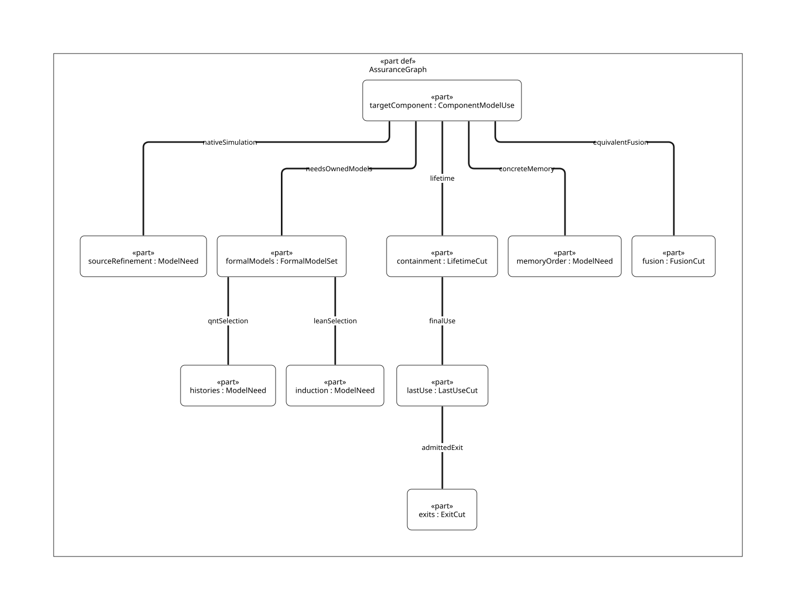

#+TITLE: Synchronous Publisher Lifetime and Reserve/Commit Fusion
#+SETUPFILE: ../../../modeling/org/setup.org
#+CATEGORY: architecture
#+PROPERTY: header-args :eval never :exports code
#+COLUMNS: %35ITEM %22STATUS %30OBLIGATION

* RESEARCH Component, executable models and authority
:PROPERTIES:
:ID: f1b47ad6-e574-43b0-972f-14bcde35ef64
:CUSTOM_ID: synchronous-publication
:AUTHORITY: GambitSynchronousPublication; GambitAssuranceRouting
:OWNER: modern-C GC; shared execution/control/FFI contracts
:STATUS: model-slices-checked; source-refinement-open
:EVIDENCE_CLASS: source-study-and-scoped-formal-results
:END:

Modern C is mandatory. [[file:models/sysml/synchronous-publication.sysml][The component's native SysML]] binds its own
[[file:../../../../models/gambit/synchronous_publication.qnt][executable QNT]] and [[file:../../../../models/gambit/lean/SynchronousPublication.lean][parametric Lean source]], as well as four real source routes,
four target requirements and four distinct assurance needs. Existing root models
remain supporting contracts; they are not substitutes for this target behavior.
[[file:../../../modeling/assurance-planner.org][The shared ASCENT planner]] selects modeling/checking methods from typed SysML
need and policy records and retains unmet prerequisites.  is the
component/model/obligation structure, not an executed native trace.

* Four source routes and the actual last-use boundary
:PROPERTIES:
:CUSTOM_ID: sync-source-routes
:STATUS: selected-source-slice
:END:

#+NAME: sync-source-route-matrix
| Route | Entry and continuing source use | Lifetime/idle consequence |
|---+---+---|
| Movable rollover | [[file:../../../../vendor/gambit/lib/mem.c::3543][3543–3555]]: save alloc, end_heap_chunk, next_heap_msection, prepare, reload pointers | Publication return precedes allocator/cursor/copy work; keep the enclosing producer right |
| Movable threshold | [[file:../../../../vendor/gambit/lib/mem.c::3615][3615–3625]]: end_heap_chunk, start_heap_chunk, reload alloc, possible Tail goto again | Complete prefix publication is not complete parent/Tail scanning |
| Captured rollover | [[file:../../../../vendor/gambit/lib/mem.c::3696][MISC lock]], [[file:../../../../vendor/gambit/lib/mem.c::3742][3742–3752]]: msection helpers and remaining frame construction | Existing MISC remains held through additional work; include MISC -> ALLOC and qualify hooks |
| Captured threshold | [[file:../../../../vendor/gambit/lib/mem.c::3794][3794–3813]]: start chunk, advance ptr/cf, possibly next_frame, normalize orig_ptr, unlock MISC | Guard uses stored alloc_heap_ptr, not local alloc; source reachability/layout is a separate obligation |

[[file:../../../../vendor/gambit/lib/mem.c::3251][end_heap_chunk:3251–3307]] writes the end marker, tests the actual cursor/scan
predicate, links under Q, orders link/content and tail, unlocks Q, then signals
the phase condition variable. The signal is a *post-unlock use of a VM facility*.
The last-use interval therefore includes more than the queue link store. Preserve
the actual post-increment predicate; informal labels such as empty/currently
scanned do not prove every layout branch. Fusion concerns accounting steps,
not arbitrary movement of end-marker or notification stores.

[[file:../../../../vendor/gambit/lib/mem.c::3408][setup_stack_heap_vmstate]] initializes both phase counts from processor_count
before the phased strong/weak scans. [[file:../../../../vendor/gambit/lib/mem.c::6667][mark_reachable_from_marked]] drains local still/movable
work, steals and scans outside the queue lock, and only then decrements the phase
count under scan_termination_mutex at [[file:../../../../vendor/gambit/lib/mem.c::6740][6740]]. Wait return increments a positive count
before another work pass; zero exits that phase. Root-seeding paths run before
the same reachable-work loop, with their workers initially counted. A resumed
scanner must be counted before calling either copy routine. Phase/generation,
participant completeness and actual C visibility still need native refinement.

The candidate source relation is per phase and worker incarnation:

\[
PublicationUse(p) \lor NotifyUse(p) \lor CallerResidual(p)
\Longrightarrow CountedOwner(owner(p)).
\]

Checking only an aggregate P>0 -> R>0 does not identify who is counted, whether
that owner is still live, or whether it covers the same phase. Source R counts
workers; the target may generalize it to admitted producer/custody rights, but
that change requires its own projection. No one-record-per-edge representation
is required by the logical relation.

* Exits, hooks and unknown outcomes
:PROPERTIES:
:CUSTOM_ID: sync-exits
:STATUS: conditional-admission
:END:

#+NAME: sync-exit-matrix
| Path | Source evidence / classification | Custody and independent P decision |
|---+---+---|
| Normal synchronous return | No Scheme callback is visible inside end_heap_chunk; signal occurs before return | P can be represented by the still-counted enclosing owner if the whole last-use/caller relation is proved |
| Allocator hook after rollover | [[file:../../../../vendor/gambit/lib/mem.c::3096][custom_msection_alloc]] may be called by next_msection_without_locking; initialized to zero at [[file:../../../../vendor/gambit/lib/mem.c::4819][4819]] | Default initialization is not a lifetime invariant against later extensions; admit null or a reviewed no-escape/transfer contract |
| Fatal heap/debug path | [[file:../../../../vendor/gambit/lib/mem.c::3040][fatal_heap_overflow]] calls [[file:../../../../vendor/gambit/lib/os_base.c::903][fatal_error]]; optional fatal hook precedes process exit | Ordinary process termination is not reusable completion; a hook that nonlocally escapes requires prior custody/recovery admission |
| Scheme synchronization error | [[file:../../../../vendor/gambit/lib/setup.c::1060][execute_sync_op_loop]] saves an error operation and throws after its collective loop | Distinguish completed relocation/capacity-error delivery from a throw inside a publisher mutation |
| Notification error | POSIX macro at [[file:../../../../vendor/gambit/include/gambit.h.in::10912][10912–10913]] computes success, but the caller does not inspect the signal result | Notification failure does not itself mean queue commit is unknown; progress and facility-error policy remain separate |
| External asynchronous cancellation / unmanaged jump | Selected thread source does not establish a cancellation exclusion policy for all embedders | Do not infer safety from lack of a Scheme throw in this function; locked exit without recovery is unsupported |
| Delayed outcome still inside owner | Unknown does not release the caller right | Erased physical P remains possible only while a valid enclosing right continues to cover every debt |
| Outcome escapes worker lifetime | Native publication currently returns void; new migration/service loss is a target extension | Keep explicit P or an equivalent accepted producer lease, stable identity, root/backing lease and pre-enrolled reconciler |

[[https://developer.apple.com/library/archive/documentation/System/Conceptual/ManPages_iPhoneOS/man3/pthread_setcancelstate.3.html][Apple's archived cancellation manual]] distinguishes deferred/asynchronous
cancellation and lists condition waits as cancellation points. The archived text
is mechanism evidence, not acceptance of the current machine/libpthread profile.
[[https://developer.apple.com/library/archive/documentation/System/Conceptual/ManPages_iPhoneOS/man3/pthread_cond_wait.3.html][The archived wait manual]] describes releasing the mutex while waiting and error
returns. Source wait behavior, cancellation cleanup and all platform return codes
remain qualified separately. No native cancellation experiment is performed.

* Fusion and support-erasure admission
:PROPERTIES:
:CUSTOM_ID: sync-fusion
:STATUS: target-requirements-open
:END:

#+NAME: sync-admission-matrix
| Requirement | Necessary conditions | Failure disposition |
|---+---+---|
| LifetimeContainmentLaw | All four sites; same phase/owner; counted before first effect through notification and caller residual; admitted hooks/exits and accesses | Retain explicit publication/custody support or reject the unsupported mode |
| FusionAdmissionLaw | Ready bounded prefix; private roots protected before gate; stable record allocated beforehand; one canonical acceptance and same G/scope; no required observable intermediate; bypass and rejection preserve custody | Keep split protocol if any intermediate can escape or an input can collect/change before acceptance |
| LastUseReleaseLaw | Notification, cursor/Tail, locks and descriptor readers accounted; required work scanned/accepted; unknown transferred with prior valid leases | Source retains until accepted complete handoff; timeout/worker disappearance is not transfer |
| ExitAdmissionLaw | Reusable continuation has known custody, accepted restore state and qualified lock cleanup; no unmanaged locked exit or process termination | No reuse receipt; explicit P alone cannot repair a lost lock or unregistered root |

Reserve/commit fusion may hide a Pending accounting state only while an enclosing
private producer protects it and external observers do not depend on that
intermediate record. Preserve end-marker/layout effects and both source publication
ordering obligations until actual consumer paths are mapped. A reference proof
about atomic locks does not authorize deletion of current barriers or volatile
reads. Body initialization, forwarding identity, queue publication, notification,
caller completion and idle are different events.

* Executable QNT model and checked controls
:PROPERTIES:
:CUSTOM_ID: sync-qnt
:STATUS: typechecked-controls-and-simulation; native-refinement-open
:END:

The component model is maintained under models/, not copied into DEV. It has
four symbolic sites, two workers and a fixed collection/phase; three modes are
split+explicit P, fused+explicit P and fused+enclosing producer. It models work
stages separately from receipt, notification, unknown, caller residual, owner
busy state and idle count. Scanner ownership prevents the owning worker from
idling while a scan is outstanding. Wake can occur before queued work appears.

All four source entry predicates are abstract enabled sites. This does not prove
actual pointer arithmetic, word-size padding, frame layout, MISC lock scheduling,
weak/strong phase transitions, generation reuse or the stored-pointer threshold.
Each has a source-refinement obligation; no native code is generated from QNT.

#+NAME: sync-qnt-actions
| Actions | Required property |
|---+---|
| begin / prepare | Counted owner and private residual cover prefix preparation |
| reserve / commit / fused | Accepted work before queue visibility; ready prefix; distinct mode costs |
| notify / returnPublisher | Post-unlock notification last use precedes normal return |
| acquire / finishScan | U moves queue -> scanner -> settled, independently of publisher return |
| drainCaller / idle / wake | Residual clears before decrement; reacquire count before work |
| loseOutcome / transferUnknown / reconcileCommitted | Same retained identity; erased mode forbids outliving owner; explicit mode can retain P after U=0/count=0 |
| rejectBeforeEffect / bypass / scanLocal | Private custody survives pre-effect return and non-FIFO paths |
| seal / close | Future starts excluded and coherent debt conditions hold; closure cannot erase retained last use |

Fifteen deterministic runs cover all four sites, 5/4/3 gate-cost modes, last
notification use, caller residual, unknown retention/reconciliation, known
pre-effect return, local bypass, early wake and four deliberate fault controls.
Negative controls intentionally demonstrate violated target invariants for escaped
erasure, dropped residual, premature return and unready fusion. They are not
native Gambit failure reports. Typechecking and a seeded simulation with a
500-sample/100-step budget passed. Simulation is not exhaustive model checking
or a liveness proof; the retained JSON records the last 101-state trace.

The code preserves issued = unfinished + settled + refunded and count = awake
workers. In erased mode open publishers require their enclosing owner. Closed
safety additionally requires no unknown/notification/residual debt. The modes'
checked endpoint/cost histories do not constitute a full bisimulation or prove
all source stuttering preserves progress. [[https://quint.sh/docs/quint][Quint's CLI documentation]] distinguishes
simulation, tests and model-checker verification; only the first two plus
source typechecking are claimed here.

* Lean results and remaining source refinement
:PROPERTIES:
:CUSTOM_ID: sync-lean
:STATUS: nine-parametric-theorems-checked; source-simulation-open
:END:

Nine new theorems check under the repository's pinned Lean toolchain. They show:
complete owner coverage discharges receipt/notification/residual debt when the
owner list is empty; receipt-only coverage is insufficient; a qualified ownership
transfer preserves coverage; reserve, positive settlement and known return
preserve arithmetic balance; U=0 does not imply P=0; and 5B=3B+2B is transaction
count algebra. The refund theorem does not prove real private-root restoration.

#+NAME: sync-refinement-obligations
| Need | Executable / proved slice | Still required |
|---+---+---|
| SP-HISTORY -> QNT | Target interleavings and deliberate controls | More populations/configurations; actual C histories and enabled guards |
| SP-INDUCTION -> Lean | Finite owner/debt cover and arithmetic lemmas | General full transition invariant, memory/layout and actual custody partition |
| SP-SOURCE -> Lean | No source-simulation proof admitted | Initial relation, each C step/action or stutter, source exits, concrete idle/wake mapping and progress |
| SP-MEMORY -> C-memory | No native memory-order refinement admitted | Compiler/macro profile, access census, all MISC/ALLOC/G/Q edges, native error/cancel behavior and root/handle lifetimes |

SysML declares SP-SOURCE's prerequisites as SP-HISTORY, SP-INDUCTION and SP-MEMORY.
ASCENT derives dependency closure and preserves the unresolved memory-order
prerequisite. A checked new Lean file is not evidence that every C step is
simulated, and historical root reports are not promoted to cover these files.

* Net benefit and support retirement matrix
:PROPERTIES:
:CUSTOM_ID: sync-net-benefit
:STATUS: structural-cost-counts-only
:END:

#+NAME: sync-net-benefit-matrix
| Case | Required support | Designed G sections / FIFO batch | What can disappear / adoption condition |
|---+---+---+---|
| Split explicit protocol | Reserve, commit, acquire, settle, independent publisher return | 5; 2 Q locks | Reference safety protocol may add contention relative to today's collector |
| Fused explicit protocol | Combined acceptance/commit and explicit P | 4; 2 Q locks | Separate reserve transaction disappears only with protected private preparation |
| Fused synchronous containment | Combined acceptance/commit; publisher debt projected into existing owner lifetime | 3; 2 Q locks | Publisher-specific P update/receipt support can disappear; work/coverage/scan custody remains |
| Unknown outlives owner | Explicit P or equivalent independent custody right | No fixed completed-batch bound for unresolved work | Retain accepted reconciler/leases; added delay/retention can outweigh benefit |
| Existing current synchronous path | Existing counted caller and FIFO locking | No new native cost measured | Do not impose a second physical P counter merely to match the reference model |

The checked difference is two G transactions per successful modeled batch between
reference and the contained/fused target. It is not a measured speedup or a proof
that a new shared G is better than the current two-lock/lifetime protocol. Roots,
required live copying, Tail work, callback qualification and memory ordering do
not disappear. Positive net benefit requires eliminated support/coordination to
exceed new gate/registry/qualification cost without unbounded retention or worse
pause behavior. No runtime path is retired by these formal checks.

#+NAME: sync-language-increment-matrix
| Necessary work / retirement | Modern generated C | Zig | Language-specific gain established here |
|---+---+---+---|
| Producer containment and fused acceptance | Same owner, last-use, private-root and gate invariants | Same invariants; no GC/root exemption | None; the two-transaction structural saving belongs to the protocol |
| Explicit P on escaping unknown outcomes | Keep a qualified independent custodian and leases | Keep the same support | None |
| C memory, hook and platform admission | Compiler/atomic/OS profiles and complete caller census | C ABI/imports plus Zig compiler/allocator/error conventions and the same hook census | None; additional boundary still requires justification |
| Generated descriptors and scoped receipts | Scheme-generated typed descriptors and C consumers | A second native emitter/consumer can use the shared contract | Reuse is possible; incremental elimination of necessary support remains unproved |

The shared contract and formal artifacts reduce duplicate *specification work*.
They do not prove that maintaining another backend removes a necessary C consumer,
FFI entry or GC root path. The C baseline remains mandatory; Zig admission needs
an additional demonstrated benefit after its extra emitter, ABI and qualification
surface, independently of these language-neutral protocol gains.

* Scoped provenance
:PROPERTIES:
:CUSTOM_ID: sync-receipt
:EVIDENCE_CLASS: model-check-and-association-only
:END:

[[file:../../../../evidence/research/sync-publication-assurance/checks.json][The receipt]] retains formal byte identities, initial parse/proof diagnostics,
positive/negative traces, native SysML output and ASCENT controls. Four necessary
architecture requirements remain open to actual C refinement. Runtime
implementation, native tests and performance measurements remain outside scope.
